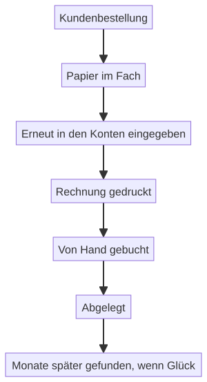

# 1. Der Raum, in dem das Papier lebt

Der Raum hatte keinen Namen an der Tür. Alle im Riverton Office Supply nannten ihn den Rechnungswagen, obwohl Rechnungen nur ein Bruchteil dessen waren, was er beherbergte: Bestellscheine, Lieferscheine, Gutschriften, Gutschriftbelege, die dünnen rosa Blätter, die Lieferanten verschickten, wenn sie schneller bezahlt werden wollten, und die dickeren cremefarbenen, die Kunden verschickten, wenn sie später zahlen wollten.

Maggie Ellery hatte den Raum zusammen mit dem Unternehmen von ihrem Vater geerbt. Sie leitete Riverton schon seit elf Jahren und begann dennoch jeden Montag in diesem Raum, stand in der Türe mit einer Tasse Kaffee, die in ihrer Hand kalt wurde, und blickte die drei grauen Aktenkästen an, als müssten sie Tiere füttern, für die sie verantwortlich war.

Die Aktenkästen hießen in der Sprache des Büros die Alten Jahre, die Mittleren Jahre und das Laufende Jahr. Die Alten Jahre hatten ein Schloss, für das niemand einen Schlüssel hatte. Die Mittleren Jahre hatten eine Schublade, die sich nur öffnen ließ, wenn man sie leicht anhob, so wie man einen Koffer anhebt, dessen Verschluss aufgegeben hat. Das Laufende Jahr war dasjenige, das zählte, und zugleich jenes, das sich nicht schließen ließ, weil die Ordner darin durch das Papier, das schneller eintraf, als es jemand einsortieren konnte, fett geworden waren.

Doreen Pratt hütete diese Aktenkästen seit thirty-one Jahren. Sie war dreiundsechzig, trug einen Strickjacke in jeder Jahreszeit und besaß jene Art von Gedächtnis, die ein Unternehmen sicherer wirken lässt, als es ist. Wenn man Doreen den Lieferschein der März-Lieferung an den Schulbezirk in Ashfield bat, blickte sie nicht in die Aktenkästen. Sie blickte zur Decke, bewegte leicht die Lippen und sagte: "Das war die Woche, in der Trevors Transporter den Lichtmaschine hatte. Dritter Ordner von hinten, zweite Schublade, hinter den rosa Belegen." Sie hatte oft genug recht, dass niemand je darauf gekommen war, aufzuschreiben, wie sie es tat.

Das ist das Erste, was man über ein Unternehmen wie Riverton verstehen muss, und es ist jene Sache, über die fast niemand in den Büchern über Betriebsführung schreibt. Das Unternehmen lief nicht auf seiner Software. Es lief auf Doreen.

---

Um acht Uhr zwanzig an diesem Montag klingelte das Telefon an Maggie's Schreibtisch mit jener besonderen Helligkeit eines Kunden, der gerade enttäuscht werden soll.

Es war die Ashfield Academy, der Schulbezirk, der seit neunzehn Jahren bei Riverton kaufte: Stifte zu Tausenden, Hefte auf Paletten, die guten weißen Whiteboard-Marker, die tatsächlich löschen. Ihre Geschäftsführerin war eine geduldige Frau namens Carol, die an jenem Morgen eine Lieferung von vierhundert Ringbuchmappen erhalten und keine Rechnung bekommen hatte.

"Margaret," sagte Carol, und Maggie erkannte an der Verwendung ihres vollen Namens, dass dies ernst war, "wir können eine Rechnung, die wir nicht erhalten haben, nicht begleichen, und wir können unser Quartal nicht abschließen ohne sie. Und Ihr Fahrer hat die Mappen im Parkplatz abgestellt, nicht am Ladefeld."

Maggie sagte die Dinge, die man sagt. Sie würde sich persönlich darum kümmern. Es tat ihr leid. Sie würde innerhalb einer Stunde zurückrufen.

Sie legte das Telefon nieder und tat, was sie zehntausendmal getan hatte: Sie ging zum Rechnungswagen und fragte Doreen, wo die Papierarbeiten waren.

Doreen blickte zur Decke. Sie bewegte die Lippen. Dann sagte sie: "Die Mappen sind Donnerstag ausgegangen. Die Rechnung hätte mit dem Beleg gehen sollen. Es sei denn"—hier machte sie Pause, denn sie hatte das Ende ihres Gedächtnisses erreicht und konnte den Abgrund dahinter fühlen—"es sei denn, es ist in den Fach gelegt worden und Trevor hat es mit den Retouren mitgenommen."

Es gab vier Fächer im Rechnungswagen. Sie waren beschriftet *Ein*, *Aus*, *Später* und, in einer Handschrift, die niemandem gehörte, der noch für Riverton arbeitete, *Trevor*. Es gab keinen Trevor mehr. Es seit sechs Jahren keinen Trevor. Das Fach blieb, und Papier ging weiterhin hinein, denn ein Fach mit einem Namen darauf ist eine Art Anweisung.

Maggie fand die Rechnung im Trevorfach, unter einem Samenkatalog und einer Erinnerung an Feuerlöscher. Sie war Donnerstag gedruckt, Donnerstag unterzeichnet und nie versandt worden. Sie war, streng genommen, ein vollständiges und korrektes Dokument. Sie war einfach nicht in Bewegung gekommen.

Sie fuhr sie selbst nach Ashfield, weil der Fahrer schon nach Hause gegangen war und weil sie die zwanzig Minuten im Auto damit verbringen wollte, in aller Wut zu sein. Auf dem Rückweg hielt sie am Kreisverkehr beim Einkaufspark und saß dort länger, als der Verkehr erforderte, beobachtete die Scheibenwischer bei ihrer Arbeit und dachte: *Wir sind darin nicht schlecht. Wir sind nicht faul. Wir sind nicht dumm. Warum fühlt sich das Unternehmen also zusammengehalten von Schnur an?*

---

Hier ist ein Fakt, der Maggie überraschte, wenn sie ihn an jenem Abend las, und der Sie wahrscheinlich ebenfalls überraschen wird.

Im Juni 1975 veröffentlichte ein Magazin namens *Business Week* einen langen Artikel mit dem Titel "Das Büro der Zukunft." Es beschrieb mit großem Vertrauen eine Welt, in der das routinemäßige Papierarbeit des Geschäfts—die Aktenführung, die Buchführung, das Sortieren—von Maschinen übernommen würde, und Papier würde zu einer Kuriosität werden, so wie das Pferd zu einer Kuriosität wurde nach dem Automobil. Die Vorhersage wurde über die folgenden Jahrzehnte so oft wiederholt, dass sie einen eigenen Namen erwarb: das papierloses Büro.

Zwischen 1980 und 2000 verdoppelte sich der weltweite Verbrauch von Büropapier mehr als.

Das ist keine kleine Ironie; es ist eine große, und sie hat eine Ursache, die für alles in diesem Buch wichtig ist. Papier überlebte nicht, weil Büros rückständig waren. Papier überlebte, weil es extrem gut in einer Sache war: Es war das Einzige im Gebäude, das jeder lesen konnte. Der Buchhalter konnte eine Bestellung lesen. Das Lager konnte einen Lieferschein lesen. Der Verkäufer konnte eine Preisliste lesen. Der Steuerprüfer konnte alle lesen. Ein Computer von 1985 konnte nicht mit einem Computer im nächsten Raum sprechen, schon gar nicht mit dem Rechnungswesen des Schulbezirks, also druckte der Computer das Papier, und das Papier sprach.

Wir sind nicht daran gescheitert, papierlos zu werden. Wir haben die *Herstellung* von Papier automatisiert. Wir haben es billiger gemacht, ein Dokument zu drucken als zu einem Aktenkasten zu gehen, und dann haben wir alles gedruckt, und dann haben wir mehr Aktenkäufe gekauft.

---

Rivertons Montag war nicht ungewöhnlich, und genau deshalb ist es wert, erzählt zu werden. Die gleiche Szene spielt sich in tausend Variationen in jeder Stadt ab: ein Sanitärgroßhändler, ein Aufkleberdrucker, ein Familienunternehmen, das Gewerbeküchen installiert. Die Details ändern sich; die Form nicht.

Ein Kunde stellt eine Frage, die drei Fakten aus drei Orten erfordert. Jemand verspricht eine Antwort. Die Antwort erfordert einen vierten Fakt, der im Kopf einer Person lebt, die im Urlaub ist. Bis der vierte Fakt gefunden ist, hat der Kunde wieder angerufen, und der Versprich ist zu einem kleinen Schaden geworden. Der Schaden wird mit einer Entschuldigung und einem Rabatt behoben, und der Rabatt wird nirgends verzeichnet, denn Rabatte, die gegeben werden, um Schaden zu beheben, sind nicht die Art von Sache, die jemand aufschreiben möchte.

Multiplizieren Sie das mit fünfzig zwei Wochen und mit jedem Fach, und Sie gelangen zum wahren Kostenweg, wie die meisten kleinen Unternehmen arbeiten. Kein Diebstahl. Kein Verschwendung, in dem Sinne, wie ein Prüfer ihn meint. Eine Steuer des Erinnerns: die unendliche, unsichtbare Maut des Behaltens von Fakten in menschlichen Köpfen und Papierfächern und des Transports dieser Fakten von einem Kopf zum anderen per Telefon.

Es gibt ein Diagramm, das dies sichtbar macht, und es ist wert, einen Moment lang angesehen zu werden, denn es ist die Karte des Problems, um das dieses Buch kreist.

Sechs Schritte, und an jedem Pfeil wird ein Fakt von einer Person von einem Medium in ein anderes kopiert. Jede Kopie ist eine Gelegenheit, einen Fehler einzuführen, und jeder Fehler kostet mehr, ihn zu finden, als er kostete, ihn zu machen. Die Rechnung, die nie reiste, war keine Anomalie. Sie war das normale Verhalten eines Systems, dessen Gedächtnis über Fächer, Köpfe und Schubladen verteilt ist, mit keinem einzelnen Ort, an dem die Wahrheit verwahrt wird.

Es ist wert, eine Zahl darauf zu setzen, denn die Zahl ist es, die Menschen' Gedanken verändert.

Die Ashfield-Rechnung kostete Maggie vierzig Minuten: zwanzig am Telefon, zwanzig im Auto. Addieren Sie Doreens zehn Minuten des Blickens und die des Fahrers fünf, und die der Buchhalterin fünfzehn am folgenden Woche, wenn die Zahlung nicht eintraf und verfolgt werden musste. Eine Stunde und eine Viertelstunde von vier Personen Zeit, um ein einziges Stück Papier zu liefern, das bereits korrekt produziert worden war. Die Rechnung war achthundertvierzig Pfund wert. Das Unternehmen hatte vielleicht sechzig Pfund an Lohnkosten verwendet, um sie zu liefern, und niemand würde jemals diese sechzig Pfund in irgendeinem Bericht sehen, denn sie ist keine Ausgabe. Sie ist schlicht ein Tag, der etwas kürzer war, als er hätte sein sollen.

Multiplizieren Sie sechzig Pfund mit der Anzahl der Dokumente, die ein Großhändler in einem Jahr produziert—Bestellungen, Belege, Rechnungen, Gutschriften, Abschlüsse, Gutschriftbelege—und die unsichtbare Steuer wird zur größten einzelnen Kostenstelle im Unternehmen, größer als die Miete, größer als die Transporter, größer als die Gehälter, aus denen sie gezahlt wird. Sie ist unsichtbar, weil sie keine Zeile in den Konten ist. Sie ist das Fehlen einer Zeile.

---

Maggies Vater hatte einen Ausdruck für das Geschäft. Er sagte es oft, stand im Lager mit den Händen im Nacken: "Wir verkaufen Schreibwaren, Margaret. Wir verkaufen keine Verwirrung." Er meinte damit einen Stolz auf die Qualität des Services, und es war wahr: Rivertons Service war gut. Er war gut in der Weise, wie ein Restaurant mit einem brillanten Koch und ohne Reservierungsbuch gut ist. Es funktionierte, solange der Koch in der Küche war.

Was Maggie jener Montagabend zu ahnen begann, mit dem kalten Kaffee und der sicher gelieferten Rechnung, war, dass das Unternehmen das Limit dessen erreicht hatte, was gute Menschen in ihren Köpfen halten können. Riverton war von vierhundert Produktlinien auf elf tausend gewachsen. Es war von einem Transporter zu sechs geworden. Es hatte Kunden, die über einen Shopsortiment bestellten, den niemand ganz vertraute, und Lieferanten in drei Ländern, die Rechnungen in zwei Währungen verschickten. Doreens Gedächtnis, so außergewöhnlich es war, war zu einem Single Point of Failure mit einem Strickjacke geworden.

Sie wollte keine Software kaufen. Sie hatte Software gekauft. Es gab ein Buchhaltungsprogramm, das schöne Berichte produzierte, die niemand las, und ein Lagersystem, das von einem Mann installiert worden war, der seitdem ausgewandert war, und ein gemeinsam genutzter Ordner im Netzwerk des Büros, der siebzehn Versionen der Preisliste enthielt, von denen vierzehn falsch waren.

Was sie jedoch wollte, obwohl ihr die Worte dafür noch fehlten, war ein Unternehmen, das sich erinnerte. Ein Ort, an dem ein Kunde, ein Produkt, eine Bestellung, eine Rechnung und eine Zahlung derselbe Fakt sind, von verschiedenen Seiten gesehen. Ein Ort, der die Frage "was ist jetzt wahr?" beantworten konnte, ohne einen Telefonanruf.

Der Rest dieses Buches geht darum, wie ein Unternehmen diesen Ort gewinnt, und was geschieht, wenn einer künstlichen Intelligenz erlaubt wird, darin zu arbeiten.

---

Eine Anmerkung zu dem, was Sie gleich lesen werden.

Dies ist kein Buch für Programmierer. Es enthält kein Code, keine Befehle, die man in ein schwarzes Fenster tippen würde, keine Datenbankabfragen. Wenn Sie einen Webbrowser verwenden und eine E-Mail beantworten können, haben Sie alle Fähigkeiten, die dieses Buch erfordert. Die technischen Teile werden so beschrieben, wie man sie einem Kollegen über das Mittagessen beschreiben würde: was die Sache tut, warum sie das so tut, und was man erwarten soll, auf dem Bildschirm zu sehen.

Auch ist es kein Theoriebuch. Jede Szene, die folgt—jede Installationsscreen, jedes Gespräch mit dem Assistenten, jede Rechnung, die es erstellt, jedes Mal, dass es eine Ablehnung vom System erhält—wurde an einem realen Computer, an einer realen Installation durchgeführt und während sie geschah, fotografiert. Wenn etwas schiefging, und Dinge gingen schief, ist der Fehler ebenfalls im Buch, denn ein Leitfaden, der nur den erfolgreichen Weg zeigt, ist kein Leitfaden; er ist eine Werbung.

Das Unternehmen in diesen Seiten heißt Riverton Office Supply. Es ist eine reale Installation mit einem fiktiven Namen, eingerichtet für das Schreiben dieses Buches: ein Schreibwaren-Großhändler mit Kunden, Produkten, einem Lager, einem Bankkonto und einem Steueramt, das zu befriedigen ist. Sie können dieselben Schritte mit dem Namen Ihres eigenen Unternehmens verfolgen, und bis zum Ende werden Sie dieselbe Sache haben, die Maggie an diesem Montagabend wollte—ein Unternehmen, das weiß, was wahr ist, und ein Assistent, der darauf handeln kann.

Maggie, für ihren Teil, wusste von all dem noch nichts. Sie wusste nur, dass sie vierzig Minuten gefahren war, um ein Stück Papier zu liefern, das eine Maschine hätte schicken sollen, und dass das Gefühl in ihrer Brust keine Wut mehr war. Es war der Beginn einer Entscheidung.

Sie ging zurück ins Büro, schaltete das Licht im Rechnungswagen ein und blickte einen langen Moment lang die drei Aktenkästen an.

"Na gut," sagte sie, niemanden Bestimmten an. "Lassen Sie uns herausfinden, wie das eigentlich funktionieren soll."
