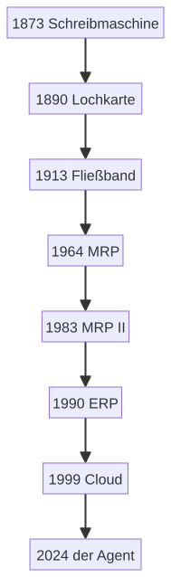

# 2. Eine kurze Geschichte des Doppelns

Die Aktenschrank wurde erfunden, weil ein Mann es leid war, nach einem Brief zu suchen.

Das ist kein Witz, und es ist keine Vereinfachung. Vor dem Hochschrank hielten Büros ihre Papiere in Fächern, in mit Band zusammengebundenen Bündeln, in Kisten, die mit dem Namen eines Kunden und dem Jahr beschriftet waren. Um irgendetwas zu finden, musste man sich erinnern, wo es abgelegt worden war, was bedeutete, dass das Büro, so wie Riverton, vom Gedächtnis seiner Angestellten gespeist wurde. Der Hochschrank, der in den letzten Jahren des neunzehnten Jahrhunderts auftauchte und sich mit erstaunlicher Geschwindigkeit in Büros verbreitete, veränderte die Bedingungen des Problems: Er machte ein Dokument nach *Kategorie* auffindbar statt nach *Erinnerung*. Ein Angelter, der den Kunden nie getroffen hatte, konnte die Schublade mit der Beschriftung A–B öffnen und die Akte finden.

Es war, seiner Zeit entsprechend, eine künstliche Intelligenz. Es hielt Informationen außerhalb eines menschlichen Kopfes, es beantwortete Fragen auf Anforderung, und es ging nie in Urlaub. Wir vergessen das, weil die Technologie aus Stahl besteht und nach Staub riecht, aber die Ambition war genau die Ambition der Maschine, die in diesem Buch besprochen wird: die Fakten aus der Person herausnehmen, sie an einen Ort legen, an dem man sie finden kann, und die Person die Arbeit tun lassen, für die eine Person nötig ist.

Maggie verbrachte die Woche nach der Ashfield-Rechnung mit dem Lesen über dieses Thema, auf die Weise, wie Menschen, die kleine Unternehmen führen, sich über Dinge informieren—spät in der Nacht, mit einem Laptop auf der Küchentischoberfläche und einem Notizbuch daneben, einem Verweis zum nächsten folgend, bis ihr Mann fragte, ob sie ins Bett komme.

Was sie fand, war keine Geschichte des stetigen Fortschritts. Es war eine Geschichte derselben Idee, die immer wieder, von verschiedenen Menschen, in verschiedenen Materialien entdeckt wurde.

---

**1873.** Die Schreibmaschine erreicht das Büro. Sie ist keine Rechenmaschine und sie speichert nichts, aber sie tut etwas, das sich als wichtiger erweist: sie macht das Schreiben einheitlich. Eine handschriftliche Bestellung ist ein Dokument mit einer Persönlichkeit; eine getippte Bestellung ist ein Dokument mit einem Format. Formate können verglichen, gezählt und abgelegt werden. Innerhalb einer Generation ist die Schreibmaschine zur Türhüterin des Büros geworden, und das Büro ist ein Ort geworden, an dem Informationen *nach Plan* produziert werden statt dann, wenn jemand dazu kommt.

**1890.** Die Volkszählung der Vereinigten Staaten wird mit Lochkarten und einer elektromechanischen Auswertmaschine durchgeführt, erbaut von Herman Hollerith. Die Volkszählung von 1880 hatte acht Jahre zur Verarbeitung gebraucht. Die Volkszählung von 1890, mit einer größeren Bevölkerung und mehr Fragen, brauchte etwa eines. Die Maschine, die es tat, wurde durch eine Fusion im Jahr 1911 und eine Umbenennung im Jahr 1924 zum Unternehmen, das wir als IBM kennen. Lochkarten würden für die nächsten siebzig Jahre der Standardweg bleiben, mit einem Computer zu sprechen, und der Grund hierfür ist lehrreich: Eine Karte ist ein Datensatz, den man halten, sortieren, fallen lassen und erneut durchlaufen kann. Es ist Papier, das eine Maschine lesen kann.

**1913.** Henry Fords fließende Montagelinie in Highland Park verwandelt die Herstellung eines Autos in eine Abfolge von getimten Schritten. Die Lektion, die die Geschäftswelt daraus zieht, betrifft wirklich keine Autos. Sie ist, dass ein Prozess *entworfen* werden kann—niedergeschrieben, gemessen und dann verbessert—statt dem Habitus der Menschen überlassen zu werden, die ihn ausführen. Frederick Winslow Taylor hatte seit den 1890er Jahren dieselbe Sache mit seiner Stoppuhr und seinem "wissenschaftlichen Management" vertreten, und die Kombination aus Taylors Stoppuhr und Fords Linie erzeugte eine Überzeugung, die das Jahrhundert dominieren würde: Wenn Sie ein Unternehmen als eine Abfolge von Schritten beschreiben kann, kann man die Schritte mechanisieren.

**1951.** Ein Computer wird verwendet, um die Gehaltsabrechnung eines Unternehmens zu berechnen. Die Maschine ist enorm, das Programm ist in Maschinenanweisungen geschrieben, und die Berechnung dauert weniger Zeit als die Herstellung der Lochkarten, die sie einliest. Aber das Prinzip ist etabliert: die langweilige, sich wiederholende, fehleranfällige Arithmetik des Büros ist genau das, wofür ein Computer gut ist.

**1964.** Ein Mann namens Joseph Orlicky, arbeitend in der Fertigungsindustrie, entwickelt eine Methode zur Berechnung, was eine Fabrik kaufen muss und wann, basierend auf dem, was sie zu bauen beabsichtigt. Es wird Materialbedarfsplanung genannt, und im selben Jahr installiert ein Unternehmen namens Black & Decker das erste System, das es verwendet, mit einem Projektleiter namens Dick Alban. Orlicky veröffentlicht das Buch im Jahr 1975—*Materialbedarfsplanung: Die neue Lebensweise in Produktion und Bestandsverwaltung*—und bis dahin fahren etwa siebenhundert Unternehmen eine Variante dieser Idee. Bis 1981 gibt es rund achthundert.

**1983.** Oliver Wight erweitert die Idee von Materialien auf die ganze Fabrik: Pläne, Kapazität, Verkaufsvorhersagen, Finanzen. Das Ergebnis wird Fertigungsressourcenplanung genannt, oder MRP II, und es ist die erste Geschäftssoftware, die vorgibt, den Zustand eines ganzen Unternehmens zu kennen.

**1990.** Eine Analystenfirma namens Gartner benötigt einen Namen für das nächste Ding—Software, die nicht nur die Fabrik plant, sondern das ganze Unternehmen führt: Verkäufe, Einkauf, Lager, Konten, Menschen. Sie nennen es Unternehmensressourcenplanung. ERP. Der Name ist ein Zufall des Marketings, der hängen blieb, und er wurde seitdem auf fast alles gedehnt, was ein Unternehmen mit einer Datenbank tut.

**1992.** SAP, ein deutsches Unternehmen, gegründet 1972 von fünf Ingenieuren, die IBM verlassen hatten, veröffentlicht R/3, ein System, das auf der Client-Server-Architektur läuft, die damals erschwinglich wurde. Es wird zum Standard, an dem jedes spätere ERP gemessen wird, und der Grund hierfür ist keine Eleganz. Es ist, dass R/3 die Prozesse eines Unternehmens in einer Weise kodiert, die Wirtschaftsprüfer, Banken und Aufsichtsbeherken erkennen.

**1999.** Ein Unternehmen namens NetLedger beginnt mit dem Verkauf von Accounting-Software, die in einem Browser läuft, auf dem Computer eines anderen, für eine monatliche Gebühr. Die Cloud-Ära der Geschäftssoftware beginnt. Es wird weitere fünfzehn Jahre dauern, bis die Idee normal wird, und weitere fünf, bis sie zum Standard wird.

**2013.** Gartner prägt "postmodernes ERP": Statt eines enormen Systems wird ein Unternehmen eine Reihe kleinerer Systeme führen, die miteinander sprechen. Die Vorhersage ist im Geist richtig und im Detail falsch—was tatsächlich geschah, ist, dass sich die kleinen Systeme vervielfachten, und das Sprechen wurde zum schwierigen Teil.

Maggie übertrug die Daten in ihr Notizbuch, zog eine Linie darunter und schrieb einen Satz, der ihren Vater hätte lachen lassen: *Jeder einzelne davon war ein Versuch, das Doppelns zu stoppen.*

## Das Muster, das sich wiederholt

Betrachten Sie die Daten erneut, und ein Rhythmus erscheint: grob alle zwanzig Jahre verspricht eine neue Technologie, das Kopieren zu beenden, und jedes Mal wird das Versprechen teilweise gehalten und teilweise gebrochen.

Die Schreibmaschine beendete das handschriftliche Duplikat und erschuf die Schreibstube. Die Fotokopiermaschine beendete das Kohlepapier und erschuf das Aktenschrank-Krisenproblem. Der Personal Computer beendete das Kontenbuch und erschuf die Ausbreitung der Tabellenkalkulation. Jeder einzelne entfernte eine spezifische Kostenstelle und fügte eine allgemeine hinzu: die Kosten des *Wissens, welche Kopie wahr ist.*

Das ERP war die erste Technologie in dieser Reihe, die die allgemeine Kostenstelle direkt angriff, indem sie bestand, dass es eine einzige Kopie geben müsse. Es dauerte dreißig Jahre, und es funktionierte—innerhalb der vier Wände eines Unternehmens. Was es nie löste, war die Grenze: das System des Kunden, das System des Lieferanten, das System des Finanzamtes, jedes mit seiner eigenen Kopie derselben Fakten.

Der Agent ist die erste Technologie in dieser Reihe, die über diese Grenze hinweg arbeiten kann, weil sie lesen kann, was ein Mensch geschrieben hat, und schreiben kann, was ein System versteht. Ob sie das Versprechen hält, ist das Thema des Rests dieses Buchs.

---

Da war ein Foto an der Bürowand, das sie tausendmal betrachtet hatte, ohne es zu sehen. Es zeigte vier Frauen an vier Schreibtischen im Jahr 1978, in dem Raum, der heute der Rechnungsraum ist, jede mit einer Schreibmaschine und einem Stapel von dünnem Papier. Ihre Mutter war die zweite von links.

"Kohlepapier," sagte Doreen, als Maggie danach fragte. "Man tippte die Rechnung, und die Kopie kam durch, darunter, auf dem dünnen rosa Blatt. Drei Kopien, wenn man Glück hatte und das Band neu war. Dann trennte man sie und schickte eine zum Kunden, eine in die Akte, und eine ins Kontenbuch."

"Und wenn man einen Fehler machte?"

"Dann tippte man es erneut. Das ganze. Und dann hatte man zwei Kopien des Fehlers, von denen eine in der Akte war, also musste man hingehen und sie finden."

Riverton hatte 1983 eine Fotokopiermaschine gekauft, und für eine Zeit glaubte das Unternehmen, es habe das Problem der Kopien gelöst. Es hatte das Problem des *Machens* von Kopien gelöst. Was es nicht gelöst hatte—was niemand gelöst hatte—war das Problem des Wissens, welche Kopie die wahre ist. Bis 1991 gab es Fotokopien von Rechnungen an drei Orten im Gebäude, und die Person, die wusste, welche der Kunde tatsächlich erhalten hatte, war Doreen, die seit 1987 dort war.

Dies ist das Muster, das sich durch die ganze Geschichte des Büros wiederholt, und es lohnt sich, es zu benennen, bevor wir weitergehen. Jede Technologie, die es leichter macht, ein Dokument zu produzieren, macht auch leichter, *ein anderes* Dokument zu produzieren, und die Kosten des zweiten fallen schneller als die Kosten der Entscheidung, welche davon zählt. Die Fotokopiermaschine vervielfachte Papier. E-Mail vervielfachte Dokumente erneut. Der gemeinsame Ordner vervielfachte Versionen. Jede Erhaltung hielt ihr Versprechen—günstiger, schneller, mehr—und jeder einzelne hinterließ dieselbe unbezahlte Rechnung: die Arbeit der Entscheidung, was wahr ist.

Ein ERP ist die erste Technologie in dieser Reihe, deren Versprechen nicht "mehr Dokumente" ist, sondern "eine Tatsache." Deshalb fühlt es sich in der Hand anders an, und warum die Installation einer solche eher einer rechtlichen Einigung gleicht als dem Kauf einer Maschine.

Es gibt einen kleinen Test, der Ihnen sagt, ob ein Unternehmen die Veränderung vollzogen hat, und er kostet nichts, ihn anzuwenden. Fragen Sie zwei Menschen, in verschiedenen Abteilungen, dieselbe Frage zum selben Kunden: wie viel sind sie uns schuldig? Weichen die Antworten voneinander ab, hat das Unternehmen immer noch Kopien. Weisen die Antworten aus, und beide Menschen können Ihnen sagen, aus welchen Dokumenten die Antwort aufgebaut ist, hat das Unternehmen ein Modell. Alles andere—die Software, die Server, die künstliche Intelligenz—is Gerüst um dieses eine Erreichen herum.

---

Weil das der Faden ist. Vom Aktenschrank zur Cloud war jede Erhaltung in der Geschichte des Büros auf denselben Verschwendung gerichtet: das zweite Mal, da eine Tatsache niedergeschrieben wird.

Der Kunde gibt seine Adresse an. Sie wird auf der Bestellung niedergschrieben. Sie wird erneut auf dem Lieferschein niedergschrieben, erneut auf der Rechnung, erneut in den Konten, erneut auf dem Etikett, und erneut von der Kontenabteilung des Kunden, wenn die Rechnung eintrifft. Fünf Kopien einer Tatsache, die einmal erklärt wurde. Jede Kopie ist eine Chance, eine Postleitzahl falsch zu tippen, und die Postleitzahl ist es, wie das Paket die Schule findet.

Ein ERP ist im Kern ein Versprechen: dass die Adresse einmal niedergschrieben wird, an einem Ort, und dass jedes Dokument, das es benötigt, *es nachschlägt* statt eine frische Kopie zu erhalten. Dieses Versprechen klingt bescheiden. Es ist es nicht. Um es zu halten, muss das System wissen, was ein Kunde ist, was eine Bestellung ist, was ein Produkt ist, und wie sie sich beziehen; es muss entscheiden, wer verändert die Adresse ändern darf und wer nicht; es muss sich erinnern, wie die Adresse letzten Monat war, weil die Rechnung, die im März gesendet wurde, immer noch die Adresse zeigen muss, an die sie gesendet wurde. Das Versprechen verwandelt einen Papierstapel in ein Modell des Unternehmens.

Und ein Modell, sobald es existiert, kann *behandelt werden* von etwas anderem als einer Person.

---

Da war noch eine weitere Sache in Maggies Notizbuch, geschrieben auf der letzten Seite jener Woche, in Handschrift, die mehr als sonst schräg stand, weil es spät war.

*Warum funktionierte irgendwelches davon?*

Sie hatte über Unternehmen gelesen, die Millionen in ERP-Systeme steckten und am Ende schlechter da waren; die Geschichten waren nicht schwer zu finden, und sie hatten sie vorsichtig gemacht. Ein System, das ein Unternehmen modelliert, ist nur nützlich, wenn das Modell *wahr* ist, und ein Modell ist nur wahr, wenn die Menschen, die die Fakten kennen, sie hineinlegen. Das ist der Widerspruch im Zentrum der ganzen Industrie: Die Software existiert, um die Menschen von der Verwaltung zu entlasten, und sie funktioniert nur, wenn Menschen die Verwaltung der Nährung des Systems tun.

Die Generation von Systemen, die nach 1990 kamen, löste dies mit Gewalt. Sie machten die Software zum einzigen Weg, die Arbeit zu tun: Man kann das Paket nicht versenden ohne den Lieferschein, man kann die Rechnung nicht drucken ohne die Bestellung, man kann den Monat nicht abschließen ohne die Bankabstimmung. Das Modell bleibt wahr, weil es keine alternative Route um es herum gibt. Deshalb fühlen ERPs wie Gefängnisse für die Menschen, die sie verwenden, und warum sie trotzdem funktionieren.

Maggie verstand den Handel. Was sie noch nicht verstand—was fast niemand verstand, bis vor Kurzem—war, dass der Handel sich zu verändern im Begriff war, weil eine Maschine gelernt hatte zu lesen.

Die Lesemaschine ist kein Aktenschrank und sie ist kein ERP. Sie ist das Ding, das, in den letzten wenigen Jahren, begonnen hat, unter dem vagen Namen der künstlichen Intelligenz in Büros aufzutauchen: ein Programm, dem ein Satz in gewöhnlicher Sprache gegeben werden kann und das beantworten oder handeln kann, ohne dass jemand eine Regel für genau diesen Satz geschrieben hat.

Wenn ein solches Programm das Modell des Unternehmens gegeben werden konnte—die Kunden, die Produkte, die Bestellungen, das Kontenbuch—dann würde die Last der Nährung des Systems fallen, nicht auf die Menschen, sondern auf die Maschine, die liest, was Menschen sagen.

Das ist die ganze Idee dieses Buchs, und es nahm den Rest des Jahres, um es real zu machen.
