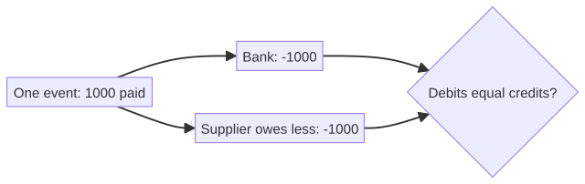

# 3. Der Mönch, der die Regeln niederschrieb

Maggies Buchhalter war ein Mann namens Gerald Pryce, der ein Büro über einer Drogerie hatte und die Gewohnheit, Fragen in der Reihenfolge zu beantworten, in der sie ihn interessierten, statt in der Reihenfolge, in der sie gestellt worden waren.

Sie ging am Donnerstag zu ihm, mit einem Ordner aus Ausdrucken und einer Frage, über die sie sich leicht schämte: *Warum überhaupt die Bücher führen?* Nicht die Steuer, sagte sie—sie verstand die Steuer. Die Doppelte Buchführung. Die Soll- und die Habenseiten, die Bilanzprüfung, die ganze aufwendige Symmetrie, die Doreen jeden Monat am Küchentisch des Büros mit einem Taschenrechner und einem Topf Tee erledigte.

Gerald nahm seine Brille ab, was ein gutes Zeichen war, und sagte: "Weil ein Händler in Venedig wissen wollte, ob er reich war."

---

Der Mann, den er meinte, war Luca Pacioli, und das relevante Datum ist 1494.

Pacioli war ein Franziskaner, ein Mathematiker und ein Lehrer von beträchtlichem Ruf in seiner eigenen Zeit. Er arbeitete in Venedig, in Florenz, in Mailand und eine Zeit lang im Haushalt eines Herzogs. Er war ein Freund von Leonardo da Vinci—Leonardo zeichnete die Illustrationen für eines seiner Bücher, und Pacioli unterrichtete ihn in Mathematik—und er war von Natur aus die Art von Mensch, die glaubt, dass alles, was es wert ist, getan zu werden, auch wert ist, ordentlich niedergeschrieben zu werden.

Im Jahre 1494 veröffentlichte er in Venedig ein Mathematik-Lehrbuch namens *Summa de arithmetica, geometria, proportioni et proportionalità*: die Zusammenfassung von Arithmetik, Geometrie, Proportionen und Proportionalität. Es war ein gewaltiges Buch, in italienischer statt in lateinischer Sprache geschrieben, damit die Händler es lesen konnten, und es deckte alles ab, was ein praktischer Geschäftsmann benötigen könnte: wie man multipliziert, wie man Zinsen berechnet, wie man Währungen umtauscht, wie man einen Fass misst.

Ein Kapitel davon beschrieb etwas, das italienische Händler seit mindestens zwei Jahrhunderten taten, und was niemand je im Druck erklärt hatte: die Methode der Doppelten Buchführung.

Die Idee ist fast beleidigend einfach, und sie ist der Grund, warum jedes Buchführungssystem der Welt, einschließlich desjenigen, das Riverton zu installieren beabsichtigte, so aussieht, wie es aussieht.

Jede Transaktion wird doppelt niedergeschrieben, an zwei verschiedenen Orten, aus zwei verschiedenen Blickrichtungen. Wenn das Unternehmen einen Lieferanten mit tausend Pfund bezahlt, dann ist das Geld auf der Bank um tausend Pfund gesunken und der dem Lieferanten geschuldete Betrag ist um tausend Pfund gesunken. Zwei Tatsachen, ein Vorgang. Wenn das Unternehmen einem Schulamt einen Schreibtisch verkauft, dann schuldet der Kunde Geld und das Unternehmen hat Einnahmen erzielt: zwei Tatsachen, ein Vorgang. Die zwei Einträge heißen Soll und Haben, und sie müssen immer gleich und entgegengesetzt sein, weil sie dieselbe Sache von beiden Seiten des Tisches beschreiben.

Die Folge ist ein sich selbst prüfendes System. Addiere jede Soll-Einträge in den Büchern und jede Haben-Einträge, und wenn sich die zwei Summen nicht ergeben, ist etwas falsch. Nicht "etwas könnte falsch sein"—falsch. Die Bücher sagen es dir. Es ist der einzige Teil der Betriebswirtschaftslehre, der eine mathematische Garantie in sich trägt, und es hat sechs Jahrhunderte von Kriegen, Währungen, Imperien und Software wegen dieser Garantie überlebt.

Gerald zeichnete es auf die Rückseite eines Umschlags, so wurde die Buchführung seit 1494 unterrichtet.

"Nun," sagte Gerald und legte den Stift nieder, "hier ist es, was dein Vater nie verstand, und was die meisten Menschen nie verstehen. Die Doppelte Buchführung ist keine Regel, die erfunden wurde, um dein Leben schwierig zu machen. Sie ist eine *Beschreibung der Realität*. Es gibt zwei Seiten zu jeder Transaktion, weil es zwei Parteien zu jeder Transaktion gibt. Die Bücher sind kein Steuerformular. Sie sind ein Modell von dem, was tatsächlich passiert ist."

---

Um zu sehen, warum die Symmetrie wichtig ist, hilft es, jemandem dabei zuzusehen, wie er sie verwendet.

Einmal im Monat nahm Doreen den Kontoauszug, die gedruckte Liste von allem, was tatsächlich das Konto des Unternehmens verlassen und hineingeflossen war, und legte sie neben die Bücher. Die zwei ergaben nie dasselbe. Sie ergeben nie dasselbe in einem Unternehmen; die Frage ist nur um wie viel, und warum.

Ein Monat lang betrug der Unterschied dreihundertzwölf Pfund. Doreen begann nicht, nach dreihundertzwölf Pfund zu suchen. Sie begann oben im Auszug und arbeitete sich nach unten, strich jede Zeile gegen die Bücher ab, und sie stellte fest, dass die Bank eine Gebühr von zwölf Pfund berechnet hatte, die Riverton nicht verbucht hatte, und dass ein Kunde eine Rechnung über dreihundert Pfund bezahlt hatte, die in den Büchern noch als unbezahlt erschien.

Zwölf und dreihundert. Der Unterschied war die Summe von zwei Dingen, die in der realen Welt passiert waren und im Modell noch nicht passiert waren. Innerhalb von zehn Minuten hatte sie zwei Einträge geschrieben—einen für die Bankgebühr, einen für den Zahlungseingang—und die zwei Spalten ergaben auf den Pfund genau dasselbe.

Das ist die ganze Kunst, und es lohnt sich zu beachten, was sie *nicht* ist. Sie ist keine Arithmetik; ein Taschenrechner hätte den Unterschied finden können. Sie ist kein Gedächtnis; der Auszug ist das Gedächtnis. Es ist die Disziplin eines Modells, das zwei Seiten hat, sodass jeder reale Vorgang einen Ort hat, um doppelt niedergeschrieben zu werden, und eine Lücke, die *lokalisiert* werden kann. Ohne die zweite Seite ist ein Unterschied von dreihundertzwölf Pfund nur eine Zahl, die falsch ist, und man sucht sie, indem man alles durchliest. Mit der zweiten Seite sagt die Zahl dir, wo man suchen soll.

Wenn ein ERP eine Rechnung verbucht, führt es Dorens zehn Minuten automatisch aus, im Moment der Erstellung der Rechnung, und es führt sie für jede Transaktion des Unternehmens aus. Das ist keine Bequemlichkeit. Es ist der Unterschied zwischen einem Unternehmen, das seine Fehler monatlich entdeckt, im Batch, und einem Unternehmen, das sie sofort entdeckt, einzeln, während die Person, die sie verursacht hat, noch im Raum steht.

---

Die Geschichte ist einen Moment mehr wert, weil sie etwas über moderne Software erklärt, das sonst beliebig erscheint.

Der älteste erhaltene Beleg für die vollständige Doppelte Buchführung ist ein Hauptbuch aus den Jahren 1299–1300, geführt von einem florentinischen Händler namens Amatino Manucci für das Unternehmen Farolfi, das von Nîmes im Süden Frankreichs handelte. Es gibt Andeutungen der Praxis noch früher, in den Aufzeichnungen florentinischer Geldwechsler auf einer Messe in Bologna im Jahre 1211. Das System verbreitete sich entlang der Handelsrouten: zu den Messen in Champagne, zu Venedig, zu Lyon, zu Antwerpen. Bis zum fünfzehnten Jahrhundert musste ein Händler, der an den großen internationalen Messen handeln wollte, seine Bücher so führen, weil es seine Partner und seine Banker taten, und weil Kredit ohne eine gemeinsame Art zu zählen unmöglich ist.

Ein ragusnischer Händler namens Benedetto Cotrugli schrieb 1458 eine Beschreibung der Methode in einem Buch namens *Della mercatura e del mercante perfetto*—über Handel und den perfekten Händler. Es wurde nicht gedruckt bis 1573, achtzig Jahre nach Poli Buch, und der Drucker kürzte es. So fiel Poli die Anerkennung zu, und der Ausdruck "Vater der Buchführung", den er wahrscheinlich als peinlich empfunden hätte, da er ganz klar war, dass er beschrieb, was andere Menschen bereits taten.

Was Poli tat, war wichtiger als es zu erfinden: er machte es *tragbar*. Ein Händler in Neapel, der die *Summa* las, konnte Bücher führen, die ein Bankier in Brügge akzeptieren würde. Eine Methode, die im Kopf einer Familie lebt, stirbt mit der Familie; eine Methode, die in einem gedruckten Buch lebt, gehört allen. Es ist derselbe Grund, aus dem wir Rezepte niedergeschrieben werden.

Sehundert Jahre später, wenn du eine Rechnung in einem ERP-System öffnest und die Worte *Belege* darunter siehst, betrachtest du Poli Kapitel, übersetzt in Software. Die Konten haben jetzt Namen—Forderungen, Verbindlichkeiten, Umsatz, Lager—and die Einträge werden automatisch gemacht, wenn du auf eine Schaltfläche namens *Verbuchen* klickst. Aber die Symmetrie ist unverändert, und die Garantie gilt weiterhin: wenn die Einträge nicht aufgehen, wird das System dich nicht das Dokument verbuchen lassen. Es ist der einzige Ort in der Business-Software, an dem die Maschine dir mit Sicherheit sagen kann, dass du einen Fehler gemacht hast.

Es hängt eine angenehme Neugier an den Mann. Im Jahre 1496 zog Poli nach Mailand, an den Hof von Ludovico Sforza, und dort traf er einen Maler und Ingenieur, der gerade an einem bronzenen Pferd arbeitete, das nie gegossen wurde. Die zwei Männer wurden Freunde; Poli unterrichtete ihn in Mathematik, und der Maler zeichnete die Illustrationen für eines von Poli's späteren Büchern, über die göttliche Proportion. Der Maler war Leonardo da Vinci. So wurden die Regeln, die das Hauptbuch eines Schreibwaren-Großhändlers in einem Marktflecken regieren, ganz wörtlich von derselben Hand gezogen, die die *Letzte Abendmahl* zeichnete—und es lohnt sich, sich zu erinnern, wenn sich Buchführung wie eine Last anfühlt, dass sie einst im selben Raum stand wie der neugierigste Geist seines Zeitalters, und als ein würdiges Thema für es betrachtet wurde.

## Warum es überlebte

Es gibt eine Frage, die es wert ist, über jede sechundsechzigjährige Praxis zu stellen: warum hat diese eine überlebt, wenn so viel anderes nicht?

Die Antwort ist nicht die Tradition. Die Doppelte Buchführung überlebte, weil sie *falsifizierbar* ist. Eine Reihe von Büchern kann von jemandem, der sie nicht geschrieben hat, geprüft werden, mit nicht mehr als Arithmetik. Diese Eigenschaft ist selten in der Betriebsführung: ein Vertrag, ein Bericht, ein Plan—keiner von ihnen kann auf dieselbe Weise geprüft werden. Das Hauptbuch kann.

Der zweite Grund ist, dass es *tragbar* ist. Poli's Regeln hängen nicht von einer Währung, einem Land oder einer Technologie ab. Sie überlebten den Florin, den Pfund, den Euro; sie überlebten Handschrift, die Schreibmaschine, die Tabelle und die Datenbank. Ein Händler aus dem Jahre 1500 könnte eine moderne Bilanzprüfung lesen und sie erkennen, was mehr ist, als über einen modernen Leser gesagt werden kann, der einem Hauptbuch aus dem Jahre 1500 gegenübersteht.

Der dritte ist, dass es *einschränkt*. Ein System, das nur aufzeichnet, was passiert ist, ist ein Tagebuch; ein System, das verweigert, eine Transaktion mit einer Seite aufzuzeichnen, ist eine Kontrolle. Diese Verweigerung ist der Grund, warum ein ERP streng wirkt, und warum die Strenge die Mühe wert ist.

---

Maggie stellte die Frage, die sie beschäftigt hatte. "Wenn die Bücher ein Modell der Realität sind, warum stimmt die Realität dann fortwährend nicht mit ihnen überein?"

Gerald lachte, und dann wurde er ernst, weil es eine gute Frage war.

"Weil das Modell nur so gut ist wie das, was hineingeht," sagte er. "Die Bücher sagen, dass das Lager zweihundert Ordner hält. Das Lager sagt, dass es einhundertachtzig hält. Eine von ihnen ist falsch, und die Bücher werden dir nicht sagen, welche, weil die Bücher nur wissen, was jemand in sie getippt hat. Das ist der Grund, warum Inventuren existieren. Das ist der Grund, warum Prüfer existieren. Die Mathematik ist perfekt; die Daten sind menschlich."

Das ist der Riss, durch den die meisten Gelder eines kleinen Unternehmens verschwinden. Nicht Betrug—Betrug ist selten und meist offensichtlich. Die gewöhnlichen Verluste sind: Lagerbestand, den das System für existent hält und der nicht ist, Rechnungen, die nie versandt wurden, Zahlungen, die nie mit der Rechnung abgeglichen wurden, für die sie bezahlt wurden, mündlich erteilte Rabatte, die nirgends verbucht wurden, und die endlosen kleinen Verzögerungen beim Ersuchen einer Person um ein Faktum, das eine Maschine hätte beantworten können.

Ein ERP ist ein Versuch, den Riss zu schließen, nicht indem man die Mathematik besser macht—die Mathematik ist seit 1494 in Ordnung—sondern indem man die *Daten* das Modell automatisch erreichen lässt, im Moment des Geschehens, von der Person, die sie verursacht hat.

Das ist der Grund, warum die Installation eines solchen Systems nicht wirklich ein IT-Projekt ist. Es ist eine Entscheidung darüber, wo die Wahrheit lebt.

---

Es gab noch eine weitere Sache, die Gerald sagte, als Maggie ihren Mantel anzog, und sie schrieb sie im Auto nieder, weil sie ihn nicht verlieren wollte.

"Dein Vater führte dieses Geschäft auf Vertrauen," sagte er. "Vertrauen in Doreen, Vertrauen in die Fahrer, Vertrauen in die Kunden, zu zahlen, wenn sie sagten, dass sie zahlen würden. Das ist kein schlechter Weg, ein Unternehmen zu führen. Es ist der Weg, wie jedes Unternehmen in diesem Land für zweihundert Jahre geführt wurde, und einige von ihnen waren sehr erfolgreich. Aber Vertrauen skaliert nicht. Es funktioniert, solange jeder jeden kennt. Im Moment, da du sechs Transporter, elf tausend Produkte und einen Kunden in einem anderen Land hast, muss Vertrauen niedergeschrieben werden, oder es wird zu einer Geschichte, die sich Menschen über das erzählen, was sie glauben, dass passiert."

Er setzte seine Brille wieder auf, was bedeutete, dass das Gespräch zu Ende war.

"Schreib es nieder," sagte er. "Dann kannst du dem Geschriebenen vertrauen."

---

Abends öffnete Maggie das Buchführungsprogramm, das Riverton seit 2014 verwendet hatte. Es war ein vollkommen anständiges Programm. Es produzierte eine Gewinn- und Verlustrechnung, eine Bilanz, eine Mehrwertsteuererklärung. Es hatte irgendwo darin den Geist von Poli, weil alle Buchführungssoftware es hat.

Aber es konnte ihr nicht sagen, wie viele Ordner im Lager waren. Es konnte ihr nicht sagen, dass die Rechnung des Schulbezirks gedruckt und nicht versandt worden war. Es konnte ihr nicht sagen, welches der elf tausend Produkte in zwei Jahren nicht einmal eine Einheit verkauft hatte, oder welcher Kunde leise aufgehört hatte zu bestellen, oder wie viel die sechs Transporter pro Lieferung im letzten Monat gekostet hatten. Es wusste um Geld. Es wusste nicht um das Geschäft.

Der Unterschied zwischen diesen zwei Dingen ist das Thema des nächsten Kapitels, und es hat einen Namen, der seit 1990 in Gebrauch ist: Enterprise Resource Planning. Ein System, das um das Geschäft weiß, nicht nur um das Geld. Und wie jede große Idee in der Geschichte der Betriebsführung begann es mit einer Fabrik, die ihre eigenen Teile nicht finden konnte.
