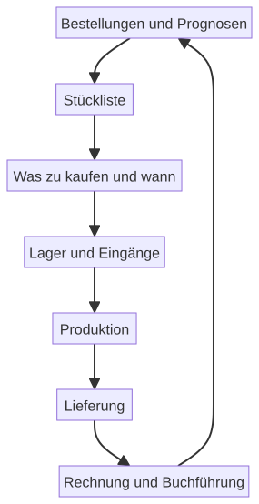

# 4. Die Maschine, die das Lager fraß

Arthur Ellery war Maggies Onkel, der jüngere Bruder ihres Vaters, und er hatte vierunddreißig Jahre als Produktionsplaner in einer Fabrik gearbeitet, die industrielle Pumpen herstellte. Er war achtundsiebzig, hielt Bienen, und er war die einzige Person, die Maggie kannte, die erklären konnte, was ein ERP ist, ohne das Wort „Lösung" zu verwenden.

Sie fuhr an einem Sonntag im Oktober zu seiner Hütte, mit einer Box der guten Kekse, und fragte ihn, wie es früher gewesen war.

„Vor was?" sagte er.

„Vor allem. Vor den Computern."

Er lachte sie auf die Weise an, wie alte Menschen die Jungen anlachen, und ging dann ins hintere Zimmer und kam mit einem Buch zurück. Es war ein Ringordner, mit Klebeband zusammengehalten, und er war vier Zoll dick.

„Das," sagte er, „ist eine Stückliste. Das ist es, woraus eine Pumpe besteht. Jedes Teil, jedes Unterdeel, jede Schraube. Und auf jeder Seite die Menge, die wir brauchten, um eine Pumpe herzustellen, und der Lieferant, und wie lange es dauerte, bis sie eintraf."

Maggie öffnete sie. Die Seiten waren getippt, mit handschriftlichen Anmerkungen in drei verschiedenen Farben, und das Ganze roch nach Staub und Zigaretten.

„Wer hat es auf dem neuesten Stand gehalten?"

„Ich. Und wenn ich im Urlaub war, niemand."

---

Das Problem, das Arthurs Ordner zu lösen versuchte, ist eines der ältesten in der Fertigung, und es ist erstaunlich schwer, es klar zu formulieren.

Man hat Aufträge für Pumpen. Um eine Pumpe herzustellen, braucht man Teile. Um Teile zu haben, muss man sie bestellen, und sie brauchen Wochen, bis sie eintreffen. Um zu wissen, wie viele man bestellen muss, muss man wissen, wie viele Pumpen man herstellen wird, was von Aufträgen abhängt, die man hat, und Aufträge, die man erwartet. Doch die Teile selbst bestehen aus Unterteilen, von denen einige in derselben Fabrik hergestellt werden, und jedes davon hat seine eigene Lieferzeit, und einige teilen sich eine Maschine, die nur eine Aufgabe zur Zeit erledigen kann. Wenn man zu viel bestellt, bindet man Geld in Regalen. Wenn man zu wenig bestellt, steht die Fabrik still, und eine stillstehende Fabrik ist das teuerste Objekt im Gebäude.

Von Hand konnte ein kompetenter Planer dies für ein paar hundert Teile erledigen. Darüber hinaus überholte die Arithmetik den Menschen. Man konnte die ganze Abhängigkeitskette nicht im Kopf behalten, und so tat man, was Arthur tat: man hielt einen Ordner, aktualisierte ihn mit Bleistift, und betete, dass niemand einen eine Frage zu einem Teil fragte, das man seit dem Frühling nicht mehr angesehen hatte.

---

In den frühen 1950er Jahren begannen zwei Flugzeugmotorenhersteller, Rolls-Royce und General Electric, diese Arithmetik auf Computer zu bringen. Es war kein kommerzielles Produkt; es war ein internes Werkzeug für ein Problem, das so teuer war, dass selbst ein computerfüllender Raum sich lohnte. Flugzeugmotoren haben zehntausende von Teilen, und ein Fehler im Plan kostet nicht eine Verspätung, er kostet ein Flugzeug.

Die Idee wurde 1964 ein Produkt, wenn ein gewisser Joseph Orlicky eine praktische Methode zur Berechnung des Bedarfs entwickelte und eine Firma namens Black & Decker das erste System installierte, das sie verwendete. Der Projektleiter hieß Dick Alban, was jene Art von Detail ist, die die Geschichte normalerweise verliert und die eine Geschichte wahr macht: es war kein Gremium, es war eine Person mit einem Problem.

Orlicky veröffentlichte die Methode 1975 als Buch, mit einem Titel, den kein Verlag heute erlauben würde: *Material Requirements Planning: The New Way of Life in Production and Inventory Management.* Bis dahin verwendeten etwa siebenhundert Unternehmen die Idee. Bis 1981 waren es achttausend.

Die Methode heißt MRP, und sie tut genau ein Ding: sie nimmt, was man herstellen will, geht die Stückliste hinab, zieht ab, was man bereits auf Lager hat, und sagt dir, was man kaufen und wann kaufen soll, dabei die Zeiten in Rechnung stellend. Wenn das offensichtlich klingt, liegt es daran, dass es funktionierte. Es wurde zur Denkweise der Fabriken.

1983 erweiterte ein gewisser Oliver Wight die Idee über die Materialien hinaus. Wenn das System bereits weiß, was die Fabrik herstellen wird, warum dann nicht auch die Menschen, die Maschinen, das Geld und die Absatzprognose planen lassen? Das Ergebnis hieß Manufacturing Resource Planning—MRP II—und es war die erste Business-Software, die beanspruchte, den Zustand eines ganzen Unternehmens zu kennen.

Bis 1989 war MRP-II-Software etwa ein Drittel des Softwareumsatzes der Branche an die amerikanische Fertigung, grob 1,2 Milliarden Dollar. Etwas hatte sich verändert: die Fabrik lief nicht mehr auf dem Ordner des Planers. Sie lief auf einem Modell, und das Modell war in einem Computer.

Arthurs Fabrik kaufte 1988 eines jener Systeme, und der erste Versuch scheiterte.

„Die Software war in Ordnung," sagte er. „Sie war besser als in Ordnung. Sie konnte Dinge tun, die ich zwanzig Jahre lang mit einem Bleistift tat, in einer Sekunde. Aber sie wollte die Lieferzeit für jedes Teil wissen, und niemand hatte je die Lieferzeiten aufgeschrieben. Sie waren in den Köpfen der Einkäufer, und die Einkäufer gaben uns die Zahlen, die wir hören wollten, weil sie nicht langsam wirken wollten. Also plante das System mit Fiktion, und die Fabrik lief nach dem Plan, und drei Monate später hatten wir ein Lager voller der falschen Teile und einen Geschäftsführer, der fragte, wer dafür verantwortlich sei."

„Wer war das?"

„Alle. Niemand. Die Einkäufer logten nicht; sie wussten wirklich nicht, weil niemand je gemessen hatte. Das ist die Sache beim Modell: Es macht nicht nur die Fehler sichtbar, die du gemacht hast. Es macht die Dinge sichtbar, die du nie wussteest, dass du nicht wusstest."

Der zweite Versuch funktionierte, und der Grund dafür hatte nichts mit Software zu tun. Die Fabrik verausgabte vier Monate damit, Lieferzeiten zu messen, Lagerbestände zu zählen und die Regeln aufschreibend, die sie immer gewohnheitsmäßig befolzt hatte. Wenn das System eingeschaltet wurde, war das Modell bereits wahr, und die einzige Aufgabe des Computers bestand darin, es schneller wahr zu halten, als es ein Mensch konnte.

Arthur war stolz darauf, auf die Weise, wie Männer seiner Generation stolz auf unattraktive Dinge waren. „Wir haben keinen Computer installiert," sagte er. „Wir haben aufgeschrieben, wie die Fabrik funktioniert. Der Computer war der leichte Teil."

---

1990 brauchte ein Analystunternehmen namens Gartner einen Namen für den nächsten Schritt. Die Fabriken hatten MRP II. Die Finanzabteilung hatte ihre eigenen Systeme. Der Vertriebs hatte ein anderes. Die Lager hatten ein weiteres. Was war, wenn ein System alles tat—nicht nur die Fabrik, sondern das ganze Unternehmen?

Sie nannten es Enterprise Resource Planning. ERP.

Der Name ist nicht korrekt, und jeder in der Branche weiß das. Er plant Ressourcen in keiner tiefgehenden Bedeutung, und „Unternehmen" ist ein Wort, das „groß" bedeutet, bis es teuer bedeutet. Aber Namen haften, und dieser haftete an einer realen Sache: eine einzelne Datenbank, in der der Kunde, das Produkt, der Auftrag, das Lager, die Rechnung und das Hauptbuch alle verbunden sind, so dass ein einmal eingegebener Fakt überall sichtbar ist.

Die Firma, die es zum Standard machte, war SAP, gegründet 1972 von fünf Ingenieuren, die IBM verlassen hatten. 1992 veröffentlichten sie R/3, das auf der Client-Server-Architektur lief, die erschwinglich wurde, und die Prozesse eines Unternehmens in einer Weise kodiert, die Wirtschaftsprüfer, Banken und Aufsichtsbeh anerkannten. Wenn du R/3 liefest, konntest du geprüft werden, wie ein großes Unternehmen geprüft wird. Für ein wachsendes Unternehmen, das an große Kunden verkaufen wollte, war das mehr wert als jede Funktion.

Zwei weitere Dinge geschahen in den 1990er Jahren, und beide sind für die Geschichte dieses Buches wichtig.

Die erste war das Jahr 2000. Eine große Zahl von Unternehmen ersetzte ihre alten Systeme Ende der 1990er Jahre, weil diese Systeme die Jahre als zwei Ziffern speicherten und, wie man fürchtete, 2000 mit 1900 verwechseln würden. Einiges der Furcht war übertrieben. Aber die Ersetzung geschah, und sie verlegte ERP aus der Fabrik in jede Art von Organisation: Krankenhäuser, Universitäten, Wohltätigkeitsorganisationen, Regierungen.

Die zweite war die Cloud. 1999 begann eine Firma namens NetLedger, Buchhaltungssoftware zu verkaufen, die in einem Browser lief, auf einem Computer eines anderen, für eine monatliche Gebühr. Es dauerte fünfzehn Jahre, bis die Idee normal wurde. Jetzt ist sie der Standard, und der Grund ist keine technische Eleganz. Es ist, dass eine kleine Firma ein System mieten kann, das sie nie hätte kaufen und betreiben können.

---

Arthur legte den Ordner weg und machte Tee, und Maggie fragte die Frage, auf die sie hingeführt hatte.

„Also warum hassen alle diese Systeme?"

Er dachte eine Weile darüber nach. „Weil sie dich zwingen, die Arbeit nach ihrer Weise zu tun," sagte er. „Und weil die Leute, die sie verkaufen, über die Menge der Arbeit lügen."

Dies ist die ehrliche Version der Geschichte, und es lohnt sich, sie klar auszusprechen, denn der Rest dieses Buches hängt davon ab.

Ein ERP ist ein Modell eines Unternehmens, und ein Modell hat Regeln. Man kann keine Rechnung verbuchen ohne einen Kunden, weil die Rechnung eine Adresse und eine Steuernummer und ein Hauptbuchkonto braucht. Man kann keine Waren versenden, die nicht auf Lager sind, es sei denn, das System erlaubt negatives Lager, das die meisten Unternehmen ausschalten. Man kann einen verbuchten Buchungsabschnitt nicht löschen, weil die Garantie von Pacioli davon abhängt, dass die Geschichte intakt ist. Jedes jener Regeln existiert aus einem guten Grund, und jedes von ihnen ist ein Streit mit jemandem, der einen Kunden am Telefon hat und braucht, dass die Sache *jetzt* geschieht.

Vervielfältige diesen Streit mit jedem Prozess im Unternehmen, und du hast den Grund, warum ERP-Projekte dafür berühmt sind, schiefzugehen. Die Software ist normalerweise nicht das Problem. Das Problem ist, dass die Installation eines ERP kein IT-Projekt ist: es ist eine Absprache darüber, wie das Unternehmen funktioniert, den Köpfen der Menschen, die dort arbeiten, entzogen, aufgeschrieben, und dann von einer Maschine erzwungen. Unternehmen, die dieses Gespräch nicht führen können—weil der Inhaber es nicht will, oder die Abteilungen sich nicht einigen, oder der Berater stundenweise bezahlt wird und sich nichts draus macht—enden mit einem teuren System, das niemand vertraut, und sie kehren zu den Fächern zurück.

Diese Schleife ist das Ganze eines Fertigungsunternehmens, und das Ganze eines Großhandelsunternehmens ebenfalls, mit „Produktion" ersetzt durch „Kommissionieren." Jedes ERP der Welt ist eine Maschine zum Wahrhalten dieser Schleife.

## Was die Werft dem Büro lehrte

Man vergisst leicht, wenn man die Geschichte des ERP liest, dass die Ideen aus Fabriken kamen und später auf Büros angewandt wurden—nicht umgekehrt.

Die Stückliste, die Lieferzeit, der Nachbestellpunkt, der dreifache Abgleich, der Kapazitätsplan: alle wurden erfunden, um eine Produktionslinie zum Stehen zu bringen, und alle erwiesen sich als ebenso gut geeignet, ein Büro zu beschreiben. Ein Angebot hat eine Lieferzeit. Eine Rechnung hat eine Stückliste, wenn man die Lieferung und den Auftrag als ihre Bestandteile zählt. Ein Monatsabschluss hat einen Kapazitätsplan.

Der Transfer funktionierte, weil ein Unternehmen ein Unternehmen ist, ob es Pumpen herstellt oder Ordner verkauft. Die Fachsprache änderte sich, und die Arithmetik nicht. Was sich veränderte, wenn die Ideen das Büro erreichten, war die *Kosten der Arithmetik*: eine Fabrik konnte 1964 einen Computer rechtfertigen, weil eine stillstehende Linie mehr kostete als die Maschine; ein Büro konnte keinen rechtfertigen, bis die Maschine weniger kostete als das Gehalt eines Schreibers.

Das ist die ganze Geschichte der letzten sechzig Jahre in einem Satz, und es erklärt, warum dieselben Ideen später, in billigeren Paketen, in kleinere Unternehmen eindringen.

---

Maggie fuhr in der Dunkelheit nach Hause, denkend über den Ordner ihres Onkels.

Was sie traf, war nicht die Technologie. Es war die *Wartung*. Jemand musste den Ordner auf dem neuesten Stand halten, und wenn dieser jemand im Urlaub war, verfiel die Wahrheit. Jedes System, das sie im letzten Monat gelesen hatte, hatte dieselbe Schwäche in seinem Zentrum: das Modell ist nur so gut wie die Person, die es speist, und Menschen sind beschäftigt, und Menschen vergessen, und Menschen gehen.

Der Traum des ERP war, dass das Speisten automatisch geschah, als Nebenprodukt des Arbeitstuns. Verkaufe etwas, und das Lager bewegt sich; bewege das Lager, und das Hauptbuch bewegt sich; sende die Rechnung, und das Guthaben des Kunden ändert sich. Meistens kam dieser Traum in Erfüllung. Was nicht in Erfüllung kam, war der Teil, in dem jemand das System nach Dingen *fragen* muss.

Dieser Teil blieb dreißig Jahre lang manuell. Du wolltest wissen, welche Kunden spät zahlen? Du öffnest einen Bericht, oder du fragst die Buchhaltungsabteilung, oder du exportierst in eine Tabelle und squintest hinein. Du wolltest vierzig Rechnungen aus vierzig Lieferscheinen erstellen? Du klickst vierzig Mal, oder du zahlst jemandem, vierzig Mal zu klicken.

Das Modell existierte. Die Maschine, die das Modell *benutzen* konnte, existierte nicht.

Dann, ganz plötzlich, existierte sie.

---

Arthur hatte noch mehr zu sagen, an der Tür, wenn die Kekse aufgebraucht und die Bienen schläfrig sind.

„Weißt du, was der schwerste Teil meines Jobs war?" sagte er. „Nicht die Arithmetik. Die Arithmetik konnte ich. Es war, dass mir niemand je sagte, wenn sich etwas änderte. Ein Lieferanten ändert eine Lieferzeit, ein Kunde ändert einen Auftrag, ein Ingenieur ändert ein Teil—und ich erfahre es drei Wochen später, wenn die Fabrik stillsteht. Der Ordner war immer einen Monat veraltet, und ich war immer der Letzte, der es wusste."

Er sah in den dunklen Garten.

„Wenn du eine Sache bauen kannst, die weiß, wann sich etwas ändert, und jemandem sagt, bevor es wichtig wird," sagte er, „dann hast du etwas gebaut, das es wert ist, zu haben."

Maggie dachte den ganzen Heimweg darüber nach. Es war, wie sie später erkannte, die beste Beschreibung einer künstlichen Intelligenz in der Wirtschaft, die sie je gehört hatte, und sie kam von einem achtundsiebzigjährigen Mann mit einem Ordner und einer Box von Keksen.
