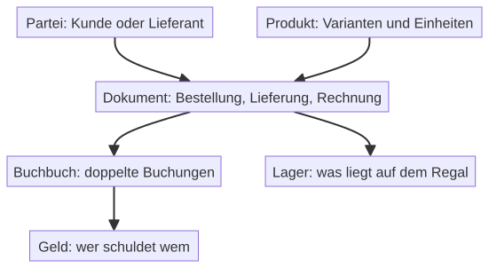

# 5. Was ein Unternehmen wirklich ist

Das Meeting, das Riverton veränderte, fand am Dienstagmorgen im kleinen Raum mit dem Kopierer statt, weil der große Raum voller Ware stand.

Maggie hatte drei Personen gebeten: Priya Raman, die den Vertrieb leitete; Tom Beck, der das Lager leitete; und Doreen, die, auf ihre Weise, alles andere leitete. Auf das Whiteboard schrieb sie ein einziges Wort.

**AUFTRAG**

"Na gut," sagte sie. "Sagt mir, was dieses Wort für euch bedeutet."

Priya begann zuerst, wie immer. "Ein Auftrag ist, was der Kunde wünscht. Artikel, Menge, Preis, Lieferdatum. Ich nehme ihn am Telefon oder über den Online-Shop an und trage ihn im System ein."

Tom sagte: "Ein Auftrag ist, was ich kommissionieren muss. Er erreicht mich als Liste von Dingen auf Regalen. Nur dass es die Hälfte der Zeit ein Lieferschein ist und die andere Hälfte eine E-Mail von Priya mit einem Bild einer handschriftlichen Notiz."

Doreen sagte: "Ein Auftrag ist, was ich in Rechnung stelle. Wenn die Ware weg ist, mache ich aus dem Auftrag eine Rechnung. Nur manchmal geht die Ware in zwei Teilen und ich rechne in zwei Teilen ab, und dann ist es kein Auftrag mehr, sondern zwei Rechnungen und ein Auftrag und eine Gutschrift für den Teil, der zurückkam."

Es herrschte eine Stille der Art, wie sie einer laut ausgesprochenen Wahrheit folgt.

"Also," sagte Maggie, "haben wir drei verschiedene Dinge, die alle Auftrag heißen."

"Vier," sagte Priya. "Da ist noch der Bestellungsschein, den wir an Lieferanten senden."

Fünf, wenn man die eigene Bestellungsnummer des Kunden mitzählt, die auf seinen Papieren stand und auf der Rechnung angegeben werden musste, sonst würde man sie nicht bezahlen. Sechs, wenn man die "Dauerauftrags", die Ashfield Academy jeden September erteilte, mitzählt, die gar kein Auftrag war, sondern eine Bestellvereinbarung.

Dies ist der Moment, in dem die meisten kleinen Unternehmen den wahren Grund entdecken, warum ihre Systeme nicht funktionieren. Sie haben kein Datenproblem. Sie haben ein *Sprach*problem. Sechs verschiedene Dinge teilen sich ein Wort, und drei verschiedene Wörter teilen sich eine Sache, und das einzige Wörterbuch ist die Erinnerung der Menschen im Raum.

Die Preisliste bewies es, eine Stunde später.

Priya nannte eine Box der guten Whiteboard-Marker mit elf Pfund vierzig. Tom sagte, es seien neun Pfund fünfundneunzig. Beide waren sich sicher. Auf dem gemeinsamen Laufwerk gab es, wie sich herausstellte, seventeen Dateien, die Preisliste hießen, datiert zwischen 2019 und diesem Dienstag, und vier von ihnen waren im letzten Monat bearbeitet worden. Die richtige Antwort hing vom Kunden ab: Ashfield hatte einen Vertragspreis seit Januar, den Priya in einer eigenen Tabelle hatte, und Tom hatte ein gedrucktes Blatt von März, das die Vertragspreise nicht enthielt, weil sie "kommerziell" waren.

Niemand log. Niemand war sogar nachlässig. Das Unternehmen hatte keinen Ort, an dem der Preis eines Produkts für einen Kunden eine *Tatsache* war; es hatte eine Gewohnheit der Vereinbarung, die per Telefon erneuert, an siebzehn Orten festgehalten wurde, von denen einer an einem beliebigen Tag richtig war und niemand wusste, welcher.

Doreen, die eine Zeit lang nichts gesagt hatte, sagte: "Deshalb halte ich die Rechnungen. Weil die Rechnung das einzige Papier ist, bei dem wir uns alle gleichzeitig geeinigt haben."

Sie beschrieb, ohne das Wort dafür zu kennen, genau das, was ein ERP speichert: nicht die Preisliste, sondern den Preis, *der für dieses Dokument galt*. Der Unterschied ist das Ganze des fünften Kapitels jeder Rechnungslegungsrichtlinie, und er ist der Grund, warum ein Dokument in einem echten System seine eigene Kopie der Fakten behält, anstatt auf eine Liste zu zeigen, die morgen geändert wird.

---

Ein ERP ist, vor allem anderen, ein Wörterbuch mit Regeln daran.

Es sagt: Es gibt eine Sache, die Auftrag heißt. Sie hat einen Kunden, ein Datum und eine Liste von Positionen; jede Position hat ein Produkt, eine Menge, einen Preis und eine Steuer. Sie hat einen Status: Entwurf, bestätigt, erledigt, storniert. Sie ist nicht dasselbe wie eine Lieferung, die das Lager verlässt, und sie ist nicht dasselbe wie eine Rechnung, die nach Geld fragt. Wenn du die Nummer der Bestellung des Kunden brauchst, ist es ein Feld auf dem Auftrag, keine Notiz im Rand.

Sobald diese Definitionen existieren, stürzen die sechs Bedeutungen zu einer zusammen, und die Streitigkeiten hören auf. Nicht, weil sich alle einigen, sondern weil der Streit sich von "was meinst du mit Auftrag?" nach "welches dieser Dinge meinen wir?" verschoben hat, und der zweite Streit kann in einer Minute beigelegt werden.

Lass mich dir also das Wörterbuch geben. Es ist klein. Vier Arten von Dingen, und alles andere in diesem Buch ist eine Konsequenz davon.

---

**Die erste Art von Ding ist eine Partei.**

Ein Kunde ist eine Partei. Ein Lieferant ist eine Partei. Deine eigene Firma ist eine Partei. Eine Bank ist eine Partei. Das Finanzamt ist eine Partei. Sie sind alle gleich geformt: ein Name, eine Adresse, eine Steuernummer, eine Währung, Zahlungsbedingungen, ein Kontakt.

Dies ist kein technischer Trick; es ist ein Stück tiefgreifender gesunder Sinn, den die Softwareindustrie Jahre brauchte, um zu akzeptieren. In einem alten System lebten Kunden in einer Datei und Lieferanten in einer anderen, und eine Firma, die beide war—which happens constantly in wholesale, because the shop you sell to also sells you things—appeared twice, with two balances, and reconciling them was a monthly misery. In a modern ERP there is one list of parties, and being a customer or a supplier is a *role* that a party plays.

The consequence is immediately practical. When Ashfield Academy both buys binders from Riverton and sells Riverton its old furniture, there is one account, one address, one credit limit, and one net balance. The paperwork is simpler because the model is truer.

**The second kind of thing is a product.**

A product is a thing you buy or sell: a box of pens, a pallet of paper, a service, a delivery charge. It has a name, a reference code, a unit of measure (each, box, pallet, kilogram, hour), a purchase price, a sale price, a tax, and—if you keep stock—a quantity on hand in each location.

Two subtleties are worth knowing, because they cause most of the confusion in real companies.

The first is the *variant*. A shirt comes in four sizes and three colours: that is one product with twelve variants, not twelve products. If you model it as twelve products, then your sales reports cannot tell you that blue sells twice as well as green, because the system thinks they are unrelated objects. If you model it as one product with variants, the report is trivial and the stock is exact.

The second is the *unit of measure*. You buy paper by the pallet and sell it by the ream. If the system does not know that a pallet is forty reams, then every stock count is an argument, and somebody has to convert by hand, and somebody eventually converts wrongly. The unit of measure is not a decoration; it is the arithmetic that keeps the warehouse honest.

**The third kind of thing is a document.**

An order, a delivery, an invoice, a payment, a stock adjustment, a purchase request: these are all documents, and they all have the same anatomy. A date, a party, a list of lines, a total, and a state.

The state is the part that people underestimate. A document is not a piece of paper; it is a thing that moves through time. A quotation is a draft that might become an order. A confirmed order may be partially delivered. An invoice may be posted and then partially paid. Each of those states is a fact about the world, and the system's job is to know which state each document is in and to refuse transitions that make no sense. You cannot deliver goods that were never ordered. You cannot pay an invoice that was never posted. You cannot cancel a delivery that has already left the building, unless you bring it back.

This is why an ERP feels strict. It is strict in the way a railway signal is strict. The strictness is the safety.

There is one more property of documents that is easy to miss and enormously important: **a document remembers its own facts.** When you confirm an order for a hundred binders at four pounds each, the order stores the price. If the price changes tomorrow, the order still says four pounds, because that is what the customer agreed to. If the customer's address changes next month, last month's invoice still shows the old address, because that is where it was sent. The system keeps a history of facts, not just a current picture. Without that, you could never prove anything to anybody.

**The fourth kind of thing is money.**

Every document that has a financial consequence produces journal entries: the two-sided statements Pacioli described in 1494. Sell something and the system records revenue and a debt from the customer. Buy something and it records an expense and a debt to the supplier. Pay a supplier and it records the money leaving the bank and the debt disappearing.

Nobody at Riverton would ever type a journal entry by hand, and that is the point. The entries are a by-product of the documents. The accountant's job stops being "record what happened" and becomes "check that what was recorded is right," which is a much better use of an accountant.

---

Maggie drew that diagram on the whiteboard, and Tom—who had said almost nothing for twenty minutes—looked at it for a long time.

"That's it?" he said. "That's the whole thing?"

"That's the whole thing," Maggie said. "Everything else is details."

Tom tapped the box marked Stock. "So if I take a pallet off the shelf and put it on a van, the system should know."

"Yes."

"And if the van comes back because the school's gate was locked, the system should know that too."

"Yes."

"And if the pallet gets damaged in the rain while it's sitting on the loading bay, and I have to write it off—"

"Then that's a document too," Maggie said. "A stock adjustment. With a reason."

Tom nodded slowly. "We've never had that," he said. "We've had a notebook. And when the notebook disagrees with the accounts, the accounts win, because the accounts are the ones the tax office sees. But the accounts are wrong, because I'm the one who knows what's actually on the shelf."

This is the single most common complaint about business software, and it is worth naming precisely, because the rest of this book is about fixing it. Tom knew the truth and could not enter it. The accounts contained a truth and could not be corrected. The gap between them was filled with a monthly ritual of stock-taking, during which the company discovered how wrong it had been, wrote off the difference, and started again.

The gap exists because entering facts into a computer has always been a separate job from doing the work. Somebody has to sit down and type. That somebody is usually busy, and the typing is usually the least interesting thing they will do that day. So the model drifts away from reality, a little at a time, and then a lot.

The promise of the system Maggie was about to install is not that the drift disappears. It is that the typing disappears. Tom will not type that he moved a pallet. He will tell the assistant, in English, that the pallet went on the van, and the assistant will make the document. The model stays true because the cost of keeping it true has fallen to nearly zero.

That is the change. Everything else—the screenshots, the installations, the diagrams—is in service of that one sentence.

---

Doreen had been quiet, which was unusual. When Maggie asked her what she thought, she said: "I think I've been doing the job of a database for thirty-one years, and nobody ever asked me whether I wanted it."

Nobody laughed, because it was not a joke.

"What would you do," Maggie asked her, "if you didn't have to remember where everything is?"

Doreen thought about it. Then she said: "I'd check things. I'd notice when a price looked wrong, or when a customer ordered something they've never ordered before. I'd have time to be nosy."

In the language of management, that is called *exception handling*, and it is the most valuable work in any office. It is also the work that never gets done, because the people who could do it are busy being databases.

Maggie wrote *be nosy* on the whiteboard, under the four boxes, and drew a circle round it.

"Right," she said. "Let's go and buy a dictionary."
