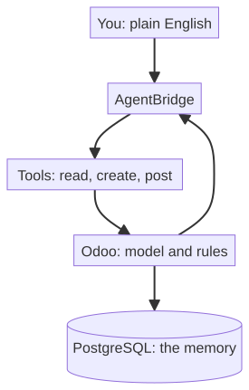

# 6. Drei Maschinen in einem Raum

Sam Okafor installierte Geschäftssysteme für kleine Unternehmen, und er hatte eine Regel: Er verkaufte niemandem ein System, bevor er deren Lager gesehen hatte.

"Er ist sehr beharrlich beim Thema Lager," sagte Priya, als sie die Vorstellung machte. "Sie hat mich zwanzig Minuten lang um unser Lager herumgehen lassen und mir dann gesagt, dass wir dreihundertvierzig Paletten hatten, von denen das System keine kannte."

"Dreihtundertvierzig-eine," sagte Sam, wenn er ins Büro kam. "Eine von ihnen war hinter der Tür."

Er war in seinen fünfzigern, trug eine Leinmenttasche statt einer Aktenkoffer, und er lehnte Kaffee ab mit der Begründung, dass er zu viel davon trank. Im kleinen Raum mit dem Kopierer nahm er ein Blatt Papier aus dem Drucker und zeichnete drei Kästen darauf.

"Recht," sagte er. "Alles, was ich dir jetzt sage, passt auf dieses Serviette. Der Rest sind Details."

---

**Das erste Kast ist der Speicher.**

Ein Geschäftssystem muss Dinge behalten. Kunden, Produkte, Aufträge, Rechnungen, Vorräte, Preise, Zahlungen. Nicht in einer Ablage, und nicht in einer Tabelle, sondern in einer Datenbank: Ein Programm, dessen einzige Aufgabe es ist, Fakten zu speichern und sie genau zurückzugeben, selbst wenn die Stromausfall mitten im Schreiben eines Vorgangs eintritt.

Die Datenbank, die Riverton verwenden würde, heißt PostgreSQL, und sie ist eine der stillen Wunder der modernen Welt. Sie entstand in den 1980er Jahren an der University of California in Berkeley, in einem Forschungsprojekt, das von einem Mann namens Michael Stonebraker geleitet wurde, und sie wird seitdem offen weiterentwickelt: Kein Unternehmen besitzt sie, jeder kann ihre Anleitung lesen, und sie betreibt einen erstaunlichen Anteil an allem—Banken, Regierungen, Websites, und bald einen Schreibwaren-Großhändler in einem Marktflecken.

Was eine Datenbank von einer Tabelle unterscheidet, ist nicht die Größe. Es sind die Versprechen.

Eine Tabelle lässt dich ein Wort in eine Zahlenspalte schreiben, und sie wird sich nicht beschweren. Eine Tabelle lässt zwei Personen dieselbe Datei öffnen und die Arbeit des jeweils anderen überschreiben. Eine Tabelle lässt dich eine halb fertige Änderung speichern. Eine Datenbank macht drei Versprechen statt dessen: dass eine Änderung entweder vollständig geschieht oder gar nicht; dass die Daten immer den Regeln genügen, die du deklariert hast; und dass zwei Personen, die gleichzeitig Änderungen vornehmen, nicht stillschweigend die Arbeit des jeweils anderen zerstören können.

Diese Versprechen haben einen unromantischen Namen—*Transaktionen*—und sie sind der Grund, warum ein Unternehmen einer Zahl auf einem Bildschirm vertrauen kann. Wenn der Gehilfe eine Rechnung erstellt, existieren entweder die Rechnung, ihre Positionen, ihre Buchungsätze und ihre Verbindung zum Auftrag alle, oder keines davon. Es gibt keinen Zustand, in dem die Rechnung existiert, aber die Buchführung nicht.

**Das zweite Kast ist das Modell.**

Oben auf dem Speicher sitzt die Sache, die weiß, was die Fakten *bedeuten*: dass eine Rechnung einen Kunden haben muss, dass eine Lieferung aus Vorräten kommen muss, dass ein Steuersatz auf ein Produkt und nicht auf eine Seite Anmerkungen gilt. Dies ist das ERP, und für Riverton ist es ein System namens Odoo.

Odoo hat eine Geschichte, die es wert ist, bekannt zu werden, weil sie erklärt, warum ein kleines Unternehmen es sich leisten kann. Es begann 2005 als ein Projekt namens TinyERP, geschrieben von einem Belgier namens Fabien Pinckaers. In 2008 wurde es in OpenERP umbenannt, und in 2014 nahm es seinen aktuellen Namen an. Es ist Open Source—die Community-Edition steht unter einer Lizenz, die jedem erlaubt, sie zu verwenden, zu studieren und zu ändern—und es ist auch ein Unternehmen, das eine reichere Edition und Unterstützung verkauft. Diese Kombination, offener Kern mit einem kommerziellen Arm, ist es, wie ein großer Teil der modernen Geschäftsssoftware finanziert wird.

Die Community-Edition ist frei, und sie ist keine Demonstration. Sie enthält Verkauf, Einkauf, Lagerbestand, Buchführung, Rechnungsstellung, Projekte, Fertigung, eine Website und ein Webshop. Odoo 20, die in diesem Buch verwendete Ausgabe, kam im September 2026. Das Unternehmen berichtet über Millionen von Benutzern; die genaue Zahl ist weniger wichtig als die Tatsache, dass die Software in vielen Sprachen von Unternehmen jeder Größe verwendet wird, und dass eine Frage darüber normalerweise schon einmal von jemandem gestellt und beantwortet wurde.

Das Wichtige am Odoo ist für unsere Zwecke, dass es *streng zu seinem Modell ist*. Es lässt dich keine Rechnung ohne Positionen verbuchen. Es lässt dich keine Waren versenden, die du nicht hast, es sei denn, du sagst ihm, dass es das erlauben soll. Es bewahrt die Geschichte. Diese Strenge ist kein Persönlichkeitsfehler; sie ist der ganze Grund, warum das System von einem Buchhalter vertraut werden kann.

**Das dritte Kast ist das Urteil.**

Dies ist das Neue, und es ist das, wovon dieses Buch wirklich handelt.

Eine Datenbank hat keine Meinungen. Ein Modell hat keine Eigeninitiative. Keine von ihnen wird jemals bemerken, dass ein Kunde aufgehört hat zu bestellen, oder dass die Preise eines Lieferanten leise gestiegen sind, oder dass die Rechnung für den Schulbezirk gedruckt und nie versandt wurde. Sie beantworten Fragen; sie stellen sie nicht.

Die dritte Maschine ist ein Agent: ein Programm, dem eine Anweisung in gewöhnlicher Sprache gegeben werden kann, die berechnet, welche Fakten es braucht, sie abholt, entscheidet, was zu tun ist, es tut, und sich rückmeldet. In Riverton heißt es AgentBridge, und es läuft auf dem gleichen Computer wie alles andere—which matters more than it sounds, and we will come back to it.

Ein Agent ist kein Chatbot. Ein Chatbot nimmt eine Frage auf und produziert Text. Ein Agent nimmt eine Anweisung auf und produziert *Wirkungen*: ein Datensatz erstellt, ein Dokument verbucht, eine E-Mail versandt. Um das sicher zu tun, braucht es zwei Dinge: eine Reihe von Werkzeugen, die es verwenden darf, und eine Reihe von Grenzen, die es nicht überschreiten kann.

Die Werkzeugen sind, im Fall Riverton, die Vorgänge des ERP selbst: nach Kunden suchen, ein Produkt lesen, einen Auftrag erstellen, ihn bestätigen, eine Rechnung verbuchen, die Buchführung eine Frage fragen. Jedes Werkzeug ist eine kleine, genau definierte Handlung mit einem Namen und einer Beschreibung, und der Agent wählt unter ihnen, wie ein neuer Angunterter unter den Knöpfen auf einem Bildschirm wählt—indem er liest, was sie tun.

Die Grenzen sind Odos eigene. Dies ist der Teil, der Maggie eine Weile brauchte, um ihn zu verstehen, und er ist es wert, langsam ausgesprochen zu werden.

Der Agent hat keinen Master-Schlüssel. Er verbindet sich mit Odoo als *Benutzer*—ein echter Benutzer-Account, mit einem Passwort und einer Reihe von Berechtigungen, für ihn vom Installateur erstellt. Wenn er das Erstellen einer Rechnung beantragt, reist die Anfrage zu Odoo, und Odoo prüft, ob dieser Benutzer erlaubt ist, auf dieser Firma, mit diesen Steuern, Rechnungen zu erstellen. Wenn die Antwort nein ist, ist die Antwort nein. Der Agent kann nicht streiten, weil der Agent nicht die Autorität ist. Odoo ist es.

Dies ist die einzelne wichtigste architektonische Entscheidung im ganzen System, und es ist der Grund, warum das Buch es einem Unternehmen empfehlen kann, das noch nie künstliche Intelligenz verwendet hat. Die Intelligenz ist neu und leicht unvorhersehbar; die Regeln sind alt und vollständig vorhersehbar. Das Neue darf nur innerhalb der Regeln des Alten handeln.

## Warum drei und nicht eins

Eine vernünftige Frage, und Sam hatte eine Antwort, die zehn Sekunden dauerte und seither bei Maggie geblieben ist.

"Weil sie unterschiedlich versagen," sagte er. "Wenn die Datenbank aufhört, weiß du es sofort: nichts funktioniert. Wenn das Modell falsch ist, findest du es langsam heraus: die Zahlen sehen seltsam aus. Wenn der Gehilfe falsch ist, findest du es spät heraus: jemandem wurde eine Antwort vertraut. Drei Maschinen bedeutet drei Arten von Versagen, und drei Arten von Versagen können auseinandergehalten werden."

Ein einzelnes Programm, das alle drei tat, wäre einfacher zu installieren und unmöglich zu diagnostizieren. Wenn es sich schlecht verhielt, hätte die Frage *ist es die Daten, die Regeln oder das Urteil?* keine Antwort, und das einzige Mittel wäre, neu zu installieren und zu hoffen.

Die Trennung hat einen zweiten Nutzen, der erst später sichtbar wird: jede Maschine kann eigen ersetzt werden. Ein Unternehmen, das die Datenbank überholt, wechselt zu einer größeren; ein Unternehmen, das das Modell überholt, wechselt zu einem anderen ERP, wobei es die Daten behält; ein Unternehmen, das den Gehilfe überholt, ändert das Modell, mit dem es spricht. Keine jener Migrationen erfordert die anderen, was der Grund ist, warum der Stapel in diesem Buch auch in fünf Jahren vernünftig bleiben wird.

---

"Wie sprechen sie miteinander?" fragte Maggie.

"Zwei Arten, und beide sind langweilig, was gut ist," sagte Sam.

Der Agent spricht mit Odoo über Odos eigene externe Schnittstelle—eine dokumentierte Art, wie ein anderes Programm Odoo bitten kann, Dinge über das Netz zu tun. Odoo nennt sie die JSON-2-API, was ein Name ist, den nur ein Programmierern lieben könnte. Was es bedeutet: Es gibt eine Tür, sie hat ein Schloss, du brauchst einen Schlüssel, und hinter der Tür sind dieselben Vorgänge, die die Bildschirme im Web verwenden. Nichts, was der Agent tun kann, ist etwas, das eine Person nicht durch Klicken tun könnte; der Agent ist einfach schneller und wird nicht müde.

Und die Werkzeugen selbst werden dem Agent mit einer Konvention beschrieben, die das Model Context Protocol, oder MCP, heißt. Es wurde von Anthropic im November 2024 als offener Standard veröffentlicht, und es tut eine einfache Sache: Es gibt einem Programm eine Standardart, zu sagen "hier ist eine Liste von Dingen, die ich tun kann, hier ist, was jedes einzelne braucht, und hier ist, was es zurückgibt." Vor ihm brauchte jeder Gehilfe einen benutzerdefinierten Connector für jedes System, und die Connectors vervielfachten sich. Mit ihm kann ein einmal geschriebenes Werkzeug von jedem Gehilfen verwendet werden, der das Protocol spricht—und es gibt nun Tausende solcher Werkzeugen in der Welt.

Rivertons ERP-Werkzeug ist eines von ihnen. Es heißt OdooTool, es ist Open Source, und es wurde von denselben Leuten geschrieben, die den Gehilfe schrieben. Seine Aufgabe ist es, der Übersetzer zu sein: der Agent sagt "erstelle einen Kunden namens Ashfield Academy", das Werkzeug verwandelt das in die genaue Abfolge von Aufrufen, die Odoo erwartet, prüft die Antworten, und meldet sich in gewöhnlicher Sprache rück.

---

Es gab noch mehr auf dem Serviette, in der Ecke, in Sam's kleiner Handschrift: *der Raum*.

"Alle drei davon laufen auf deinem Computer," sagte er. "Nicht auf einem Server in einem anderen Land. Die Datenbank, das ERP und der Gehilfe. Das heißt, das Einzige, was dieses Gebäude verläuft, ist, was du wählst, an das Sprachmodell zu senden, und wenn du das Modell lokal laufen lässt, verläuft nichts überhaupt."

Maggie fragte die naheliegende Frage. "Ist das besser?"

"Es ist anders," sagte Sam. "Es ist besser für Kontrolle und für Privatsphäre, und es ist schlechter für Bequemlichkeit, weil du dich darum kümmern musst. Es gibt keine Support-Leine, die man um elf Uhr nachts anrufen kann. Aber es gibt auch niemanden, der dich ausschalten kann, oder den Preis erhöhen kann, oder deine Kundenliste lesen kann. Für ein Unternehmen wie deins, würde ich diesen Handel nehmen."

Er fügte eine vierte Zeile zum Serviette hinzu, unter den drei Kästen, in Buchstaben so klein, dass Maggie sich vorbeugen musste: *Backups*.

"Zwei Dinge werden mit dir geschehen," sagte er. "Das erste ist, dass die Maschine bricht, oder die Stromversorgung ausfällt, oder jemand Tee auf das falsche Ding verschüttet. Das zweite ist, dass eine neue Version eines dieser Programme ankommmt und installiert werden will. Beide sind gewöhnlich. Keines von ihnen ist eine Katastrophe, vorausgesetzt, du hast eine Kopie der Datenbank von gestern und eine Notiz über das, was du geändert hast. Was eine gewöhnliche Fehlschlagung zu einer Katastrophe macht, ist, dass man entdeckt, im Moment der Fehlschlagung, dass die einzige Kopie der Speicher des Unternehmens auf der Maschine war, die gerade aufgehört hat."

"Wie oft?" fragte Maggie.

"Nächtlich für die Datenbank. Wöchentlich für den ganzen Ordner. Und einmal im Monat, öffne das Backup und prüfe, dass es enthält, was du denkst, dass es enthält. Ein unverifiziertes Backup ist ein Wunsch."

Er legte den Stift nieder. "Noch eine Sache, und dann werde ich aufhören, dich zu belehren. Entscheide jetzt, wem dies gehört. Nicht wer dafür bezahlt hat—wer *es besitzt*. Jemandem muss erlaubt sein, einer Änderung nein zu sagen, auf dem Backup zu bestehen, das Log zu lesen, wenn etwas seltsam aussieht. In einem kleinen Unternehmen ist diese Person normalerweise der Besitzer, und der Fehlschlagungsmodus ist, dass der Besitzer zu beschäftigt ist, und das System leise niemandem gehört."

Maggie sah auf das Serviette. Drei Kästen für Maschinen, ein Wort für die Person, die sich um sie kümmern muss.

Er faltete das Serviette und gab es ihr.

"Behalte das," sagte er. "Wenn etwas schiefgeht—etwas wird schiefgehen—gehe zurück zum Serviette. Frage dich, welcher der drei Kästen unglücklich ist. Neun Mal von zehn, die Antwort sagt dir, was zu tun ist."

---

An jenem Abend heftete Maggie das Serviette an das Board im Rechnungsraum, neben einem Lieferzeitplan von 2019, den niemand je heruntergenommen hatte.

Doreen sah es eine Weile an.

"Welches bin ich?" fragte sie.

Maggie dachte darüber nach. "Du bist der Teil, der bemerkt," sagte sie. "Das Serviette hat noch keinen Kasten dafür."

"Dann ist es nicht fertig," sagte Doreen, und ging zurück an ihren Schreibtisch.

Sie hatte recht, natürlich. Das Serviette hatte drei Kästen für die Maschinerie und keinen Kasten für die Person, die entscheidet, dass eine Zahl seltsam aussieht. Jedes System, das Maggie im letzten Monat gelesen hatte, hatte dieselbe Auslassung gemacht, und jedes einzelne von ihnen war für denselben Grund gescheitert: sie behandelte die Menschen als Eingabegeräte.

Das System, das sie bald installieren würde, würde diesen Fehler nicht machen, für einen Grund, der fast ein Konstruktionsunfall war. Weil der Gehilfe Anweisungen in gewöhnlicher Sprache aufnimmt, bleibt die Person im Gespräch. Doreen würde nicht von einer Datenbank ersetzt werden. Sie würde diejenige sein, die der Datenbank sagt, was sie bemerken soll.
