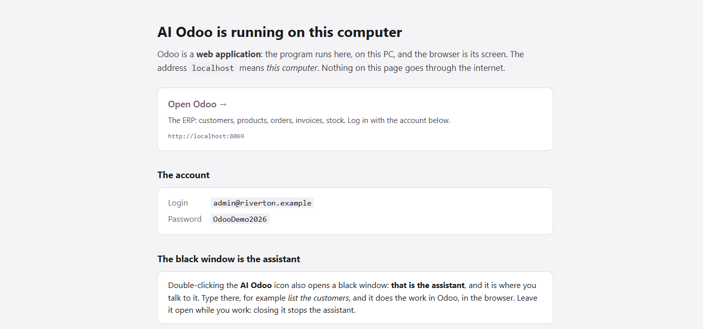

# 7. Eine Datei und ein Doppelklick

Der Ersatzschreibtisch in Riverton blickte auf ein Fenster, das auf den Hof hinausging, wo die Transporter beladen wurden.
Maggie hatte ihn selbst hergerichtet, was so viel hieß, dass sie vier Katalogkisten auf den Boden geräumt und den Schreibtisch mit einem Tuch abgewischt hatte, das nicht ganz sauber war. Darauf stellte sie einen Laptop, eine Tasse und ein Blatt Papier mit drei darauf geschriebenen Zeilen.

Sam Okafor sah auf das Papier.

"Das ist es?"

"Das ist es."

Die drei Zeilen lauteten: *Firmenname, Admin-E-Mail, Admin-Passwort*. Den Rest hatte sie der Maschine selbst ausrechnen lassen.

---

Vor dem Doppelklick gibt es vier Dinge, die eine Firma prüfen sollte, und keiner davon ist technisch.

**Ein Computer, der sonst nichts zu tun hat.** Der Stack läuft mit drei Programmen gleichzeitig—Datenbank, ERP und Assistent—und auf einem ausgelasteten Laptop werden sie mit allem anderen konkurrieren, das noch geöffnet ist. Riverton nutzte eine Maschine, die für den Webshop gekauft worden war und nie für diesen benutzt wurde. Acht Gigabyte Speicher reichen aus; sechzig sind bequem; die Festplatte braucht etwa zwölf Gigabyte frei, bevor der Installer loslegt, und er prüft das.

**Eine Internetverbindung, einmal.** Der Installer lädt die Teile herunter, die er benötigt. Danach läuft das System ohne Verbindung, mit Ausnahme des Sprachmodells, das ein Dienst in einem anderen Gebäude ist (oder auf deiner eigenen Maschine, wenn du das bevorzugst).

**Die Erlaubnis zur Installation.** Auf Windows installiert die Datenbankmaschine einen Dienst, und dafür sind Administratorrechte nötig. Falls das von dir benutzte Konto sie nicht hat, sagt der Installer das am Ende, statt still zu scheitern, und ein zweiter Lauf mit dem richtigen Konto erledigt die Arbeit.

**Ein Firmenname.** Nicht unbedingt der rechtliche Name—der Name, den du oben auf deinen Rechnungen sehen willst. Riverton nutzte "Riverton Office Supply", so wie es seine Kunden nennen.

Das ist die ganze Liste. Es gibt kein Datenbank-Passwort zu erfinden, keinen Port zu wählen, keine Konfigurationsdatei zu bearbeiten. Der Installer vergibt das Superuser-Passwort der Datenbank selbst, druckt es am Ende aus und wählt einen freien Port, falls der Standardbelegte ist. Der KI-Anbieter wird später gefragt, vom Assistenten, beim ersten Start—wo ein Schlüssel tatsächlich gegen den Dienst getestet werden kann, der ihn ausgestellt hat.

---

Die Datei heißt `install.bat`, und sie ist eine der wenigen wirklich guten Ideen in der Geschichte der Business-Software-Verteilung: eine einzelne Textdatei, klein genug zum E-Mailen, die weiß, wie man alles andere herunterlädt.

Maggie doppelklickte darauf. Ein schwarzes Fenster öffnete sich, mit einer Titelleiste, die *OdooTool-Installer* sagte, und das Erste, was es tat, war, eine Frage zu stellen.

Keine technische Frage. Es druckte vier Überschriften—*Fragen*, *Freier Platz*, *Prüfung von PostgreSQL, Python und Git*—und unter *Fragen* listete es auf, was es zu fragen gedachte. Bei einem unbeaufsichtigten Lauf gab es nichts einzutippen, weil die drei Antworten in der Umgebung standen; bei einem gewöhnlichen Lauf hätte es den Firmennamen gefragt und sonst nichts.

In dieser Reihenfolge steckt eine Designentscheidung, und es lohnt sich, sie wahrzunehmen, weil sie der Unterschied ist zwischen einem Installer, dem man vertraut, und einem, den man aufgibt. Die Überschriften kommen *vor* der Arbeit: der Installer sagt dir, was er zu fragen gedachtet hat, dann, was er gefunden hat, dann, was er zu tun gedachtet hat. Nichts wird auf halbem Weg entdeckt, wenn es zu spät ist, deinen Sinn zu ändern. Eine Person, die den ersten Bildschirm liest, kennt die Form der nächsten vierzig Minuten.

Das Fenster selbst ist bewusst schlicht—weißer Text auf Schwarz, kein Fortschrittsbalken, kein Logo, keine Animation. Das ist keine Faulheit. Ein Konsolenfenster, das eine Zeile pro echtem Ereignis druckt, ist ein Fenster, dessen Ausgabe *gelesen* werden kann, in eine E-Mail kopiert und mit dem Lauf einer anderen Person verglichen werden kann. Die Installer, die ihre Ausgabe hinter einem drehenden Kreis verstecken, sind diejenigen, die sich nicht diagnostieren lassen, wenn sie aufhören.

Die zweite Überschrift war die Festplatte: *Freier Platz auf C: 79,53 GB*. Der Installer weigert sich, unter zwölf Gigabyte zu starten, was eine Entscheidung ist, die jemand getroffen hat, der zugesehen hat, wie eine Installation in neunzig Prozent scheiterte und erklären musste, warum.

Die dritte Überschrift ergab zwei Zeilen, die es wert sind, verstanden zu werden, weil sie die Art von Sache sind, die Menschen glauben machen, ein Computer sei kaputt.

```
! TCP-Port 5432 ist auf diesem PC bereits belegt; die neue PostgreSQL hört auf 5433 statt.
PostgreSQL ist nicht installiert. Sie wird jetzt installiert mit dem 'postgres'-Superuser-Passwort, das auf 'odoo' gesetzt ist.
```

Die erste Zeile ist kein Fehler. Sie ist ein Bericht über eine gewöhnliche Sache: ein anderes Programm auf der Maschine—in diesem Fall eine Datenbank innerhalb des Windows-Subsystem für Linux, die von einem kleinen Helfer namens `wslrelay` auf die Windows-Seite weitergeleitet wurde—war bereits im Besitz des Standardports für PostgreSQL. Ports sind durchnummerierte Türen, und nur ein Programm kann hinter jeder Tür hören. Der Installer suchte die erste freie Tür nach 5432, fand 5433 und entschied sich, sie für alles zu benutzen: die Datenbank, das ERP und den Launcher. Niemand muss sich die Nummer merken; der Installer schreibt sie dort hin, wo sie geschrieben werden muss.

Die zweite Zeile ist der Installer, der sagt, was er zu tun gedachtet hat, und—das ist der Teil, der eine kleine Firma anspricht—dass er das Datenbank-Passwort selbst wählen wird. Das Asswort ist `odoo`, es ist ein lokales Konto auf diesem PC, und es hat mit keinem Konto im Internet zu tun. Der Installer druckt es am Ende, damit der Eigentümer der Maschine es später finden kann.

---

Dann begann das Warten, und das Warten ist es, worin dieses Kapitel seinen Platz im Buch verdient, weil der erste Versuch scheiterte.

Der Installer versuchte zuerst den Windows-Paketmanager, was die höfliche Art ist, Software auf Windows zu installieren. Der Paketmanager konnte seine Quelle nicht erreichen—ein Unternehmensnetzwerk, ein Hotelnetzwerk oder ein Antivirusprodukt tun das—and gab einen Fehler zurück. Der Installer sagte das, in einer Zeile, und fiel zurück auf das direkte Herunterladen des offiziellen Installers der Datenbank. Das ist das korrekte Verhalten, und darin liegt der Grund, warum das nächste Ding auf dem Bildschirm ein Download war.

Der Download war langsam. Nicht "ein wenig langsam": sechzig Kilobytes pro Sekunde, auf einer Leitung, die auf vierhundert gemessen worden war. Der Datenbankinstaller ist dreihundertsechsundachtzig Megabyte groß, was bei dieser Geschwindigkeit eine Stunde und drei Viertel ist, und die Verbindung fiel dreimal ab, bevor die Datei vollständig war. Jeder Abbruch begann die Übertragung wieder von Null, weil das der Code zur Zeit tat, und nach dem dritten Versuch gab der Installer auf und druckte den Satz, der Menschen zu einem Support-Forum schickt:

> PostgreSQL konnte nicht heruntergeladen werden (winget und der direkte Download beide fehlgeschlagen). Installiere es selbst von enterprisedb.com und führe diesen Installer erneut aus.

Dies ist der erste echte Fehler in diesem Buch, und es lohnt sich, präzise zu sein über das, was falsch war, weil es nicht das Netzwerk war.

Der Installer benutzte bereits `curl`, das eine partielle Übertragung fortsetzen kann. Aber er löschte die partielle Datei vor jedem Versuch, sodass das Fortsetzen nichts hatte, was fortzusetzen war. Auf einer schnellen Verbindung würde das niemand je bemerken. Auf einer langsamen verwandelte es einen dreißigminütigen Download in drei halbstündige Scheiterungen.

Die Korrektur ist drei Zeilen Denken und ein Dutzend Zeilen Code: behalte die partielle Datei, nenne sie nach der Version, zu der sie gehört, damit sie nie mit einer anderen verwechselt werden kann, und bitte `curl`, dort weiterzumachen, wo sie aufgehört hat (`-C -`). Eine Datei, die bereits die richtige Größe hat, wird ohne eine Übertragung wiederverwendet, und eine Datei, die *größer* ist als die deklarierte Größe, wird weggeworfen, weil sie kein Präfix der echten sein kann.

Mit dieser Änderung druckte der zweite Lauf des Installers eine einzelne Zeile und fuhr fort:

```
==> wiederverwende den verifizierten Download von 16.16-1
```

Diese Zeile ist der ganze Unterschied zwischen einem Produkt und einem Prototyp. Die erste Version bat den Benutzer, ein Netzwerkproblem zu lösen. Die zweite Version löste es und sagte das in sieben Worten.

Während die Datenbank installiert wurde—dreihundertneunzig Megabyte zu entpacken, was auf einer gewöhnlichen Festplatte ein paar Minuten dauert—druckte der Installer nichts, weil es nichts zu drucken gab. Er wartete darauf, dass der eigene Installer der Datenbank fertig wird, und der Installer der Datenbank ist von wegen still. Ein Fortschrittsbalken wäre schöner gewesen. Stille zumindest war ehrlich.

---

Die Datenbank war fertig. Der Installer prüfte, dass er sie erreichen konnte, mit dem Asswort, das er vergeben hatte, und druckte eine Zeil, um das zu sagen. Dann wandte er sich Python zu.

Python ist die Sprache, in der Odoo geschrieben ist, und der Ansatz des Installers dazu ist der einer guten Kollegin: Wenn eine nutzbare Version schon da ist, benutze sie; wenn nicht, installiere eine. Auf Windows ist dies empfindlicher, als es sich anhört, weil der `python`-Befehl auf einer modernen Maschine oft gar nicht Python ist, sondern eine Microsoft-Store-Werbung—ein kleiner Schalter, der den Store öffnet, wenn du `python` eingibst. Ein Installer, dem der Befehl vertraut, wird nichts installieren und dann später mysteriös scheitern. Dieser hier führt ihn aus und prüft die Antwort, was der einzige zuverlässige Test ist.

Dann lud er Odoo selbst herunter—eine Kopie des Quellcodes der zu installierenden Version—und die Python-Pakete, die es braucht, und erstellte die Datenbank, und lud die Basismodule. Jede jener Schritte druckt eine Zeil, und jede Zeil ist ein kleines Stück Beruhigung: *das geht weiter, und es geht in die richtige Richtung.*

Der letzte Schritt war der Assistent: die öffentliche Version herunterladen, entpacken, den Connector installieren, der es das ERP reden lässt, die Adresse des ERP und einen frisch generierten Schlüssel in die Konfiguration des Connectors schreiben und das ERP starten.

Dann druckte das Fenster eine Zusammenfassung. Es lohnt sich, sie zu zitieren, weil sie der einzige Teil der Installation ist, den ein Benutzer aufbewahren muss.

```
==> Fertig.
  SO STARTEN SIE:
    Doppelklick auf das Symbol 'AI Odoo' auf dem Desktop (oder im Startmenü).
    Im Browser öffnet sich eine Seite: sie sagt, was hier läuft, mit dem Konto und dem Link.
      'Odoo öffnen'  der ERP, wo die Daten liegen. Melden Sie sich mit dem Konto unten an.
    Ein schwarzes Fenster öffnet sich ebenfalls: das ist der Assistent. Tippen Sie dort, zum Beispiel
    'liste die Kunden', und lassen Sie es offen, während Sie arbeiten.

  Odoo (der ERP, im Browser):  http://localhost:8069
  Anmeldung: admin@riverton.example
  Passwort: OdooDemo2026
  Assistent (hier sprechen Sie mit ihm):  http://localhost:5290/OfficeManager
```

Drei jener Zeilen sind die, die Maggie auf das Blatt Papier schrieb und in die Schublade mit der Serviette legte: die Adresse, der Benutzer, das Asswort. Die vierte ist der Port, den sie nicht zu kennen brauchte, und die fünfte ist das Symbol, das sie jeden Morgen für das nächste Jahr doppelklickte.

## Was der Installer nicht tun wird

Es lohnt sich, klar zu sagen, was das Skript dir überlässt, weil eine Firma, die davon ausgeht, dass der Installer ein funktionsfähiges Unternehmen produziert, in einer Stunde enttäuscht sein wird.

Er wird **deine Kontenplan nicht wählen**, jenseits der Installation desjenigen, dein Land benutzt. die Konten, die deine Firma tatsächlich braucht—Fracht berechnet, Fracht bezahlt, die zwei oder drei Ausgaben, die zählen—sind ein Gespräch mit deinem Buchhalter.

Er wird **deine Produkte, Kunden oder Lager nicht eintragen**. Das sind die Fakten deines Unternehmens, und niemand sonst hat sie.

Er wird **nicht entscheiden, wer was tun darf**. Er erstellt den Administrator und den Benutzer des Assistenten; der Rest ist ein Urteil über deine Leute.

Er wird **den KI-Anbieter nicht für dich konfigurieren**, jenseits des Schreibens der Adresse und des Schlüssel, den du ihm im Voraus gegeben hast; bei einem gewöhnlichen fragt der Assistent beim ersten Start.

Und er wird **deine Daten nicht sichern**, weil zum Zeitpunkt seines Laufs keine Daten zu sichern gibt. Das ist das Erste, was danach einzurichten ist, und Kapitel acht erklärt, wie.

Die Aufgabe des Installers ist schmal und er tut sie gut: er stellt die drei Maschinen im Raum zusammen, verdrahtet sie miteinander und druckte die drei Fakten, die du brauchst, um dich anzumelden. Alles danach ist die Arbeit, um die dieses Buch geht.

---

Am Ende gibt es ein kleines Stück Theater, das leicht übersehen wird und das dir etwas über die
Menschen sagt, die den Installer geschrieben haben. Nach dem Ende öffnet er im Browser eine Seite,
die der Installer selbst geschrieben hat: eine Datei auf diesem Rechner, keine Website, mit einem
einzigen großen Knopf und dem Konto, das er gerade angelegt hat.



Es ist nicht der Assistent, und es ist keine Werbeseite. Es ist das Einzige, was ein Mensch in
diesem Moment braucht: eine schlichte Aussage darüber, was jetzt auf dieser Maschine läuft, eine Tür
in den ERP, und das Konto, das sie öffnet. Der Assistent ist nicht auf dieser Seite und muss es auch
nicht sein: er ist das schwarze Fenster, das dasselbe Symbol öffnet, und dort wird ein Auftrag
getippt.

Eine frühere Version dieses Installers öffnete am Ende die Dokumentationsseite des Herstellers, und
ein Leser der vorigen Auflage beschrieb, was dann geschah: er sah eine Seite über Odoo, in der
Sprache seines Browsers, schloss sie, weil sie mit seiner Installation nichts zu tun hatte, machte
einen Doppelklick auf das Symbol, landete auf einer Webseite mit einem Platzhalter-Logo und schloss
daraus, dass alles fehlgeschlagen sei. Jedes Wort jener Dokumentationsseite war wahr, und keines
handelte von *seinem* Rechner. Das auf der Abbildung schon.

Die Botschaft ist: du bist nicht fertig, du bist gerade angekommen. Die nächste Stunde ist Konfiguration, und sie ist die Stunde, die entscheidet, ob das System zur Wahrheit wird oder zu einem anderen aufgegebenen Programm. Der Installer kann diesen Teil nicht für dich tun, und er tut nicht so, als könne er.

Maggie las die Seite zweimal, schrieb Anmeldung und Passwort auf den Zettel und klickte auf *Odoo
öffnen*. Dann rief sie Doreen an, weil der Kontenplan ein Streitpunkt werden würde, und es besser
war, den Streit mit der Person zu haben, die seit dreizehn Jahren die Bücher führte, als ihn mit
einem Berater.

Dieses Gespräch ist das nächste Kapitel.
