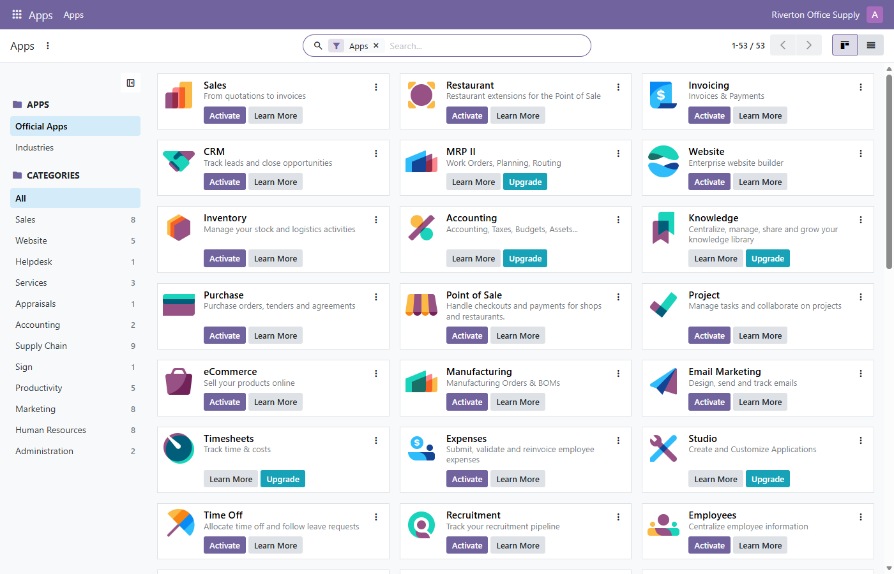
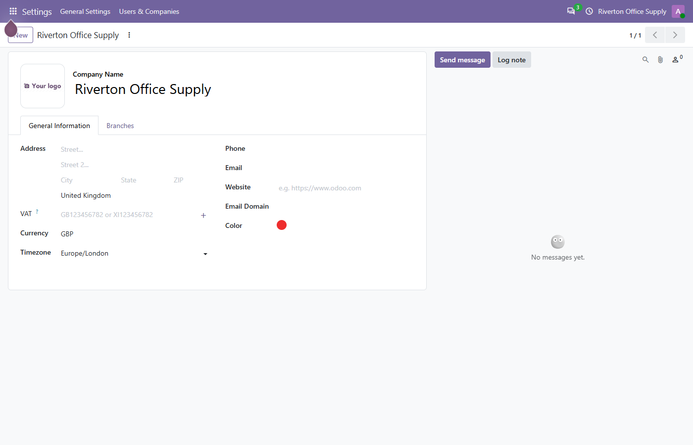

# 9. Der erste Login

Der Browser hat sich von selbst geöffnet, eine jener kleinen Höflichkeiten, die ein System fertig wirken lassen. Die Adresse war `http://localhost:8069`—`localhost` die Weise der Maschine, *diesen Computer* zu meinen, und 8069 die Tür, hinter der das ERP lauscht.

Die Seite, die erschien, war fast leer: eine weiße Karte, ein Logo aus zwei latten Formen und zwei Felder.

Maggie gab die vom Installer gedruckten Administrator-Adresse und das Passwort ein und drückte Eingabe.

Nichts Dramatisches geschah. Das ist die erste Sache, die es über das ERP zu sagen gibt: es begrüßt dich nicht. Es lobt dich nicht. Es öffnet eine Seite mit einem Menü oben und ein paar farbigen Karten und wartet darauf, daß man ihm sagt, was es ist.

Dies ist der Moment, in dem eine kleine Firma üblicherweise ihre Nerven verliert. Das System sieht leer, die Karten sind bedeutungslos, und es besteht die Versuchung, zu dem Schluß zu gelangen, dass etwas schiefgegangen ist—oder, schlimmer noch, anzufangen zu klicken, wodurch eine Firma mit vier Lagern, drei Währungen und einem Kunden namens „Test" endet.

Die leere Seite ist kein Fehler. Sie ist die Wahrheit. Das System weiß noch nichts über Riverton: nicht seinen Namen, nicht sein Geld, nicht, was es verkauft. Was es weiß, ist, wie man *ein Unternehmen* ist. Die nächste Stunde ist die Stunde, in der es lernt, welche Firma.

---

## Die erste Sache, die man ändert: die Sprache der Maschine

Odoo spricht viele Sprachen, und der Installer hat die der Maschine genommen, die auf diesem PC Italienisch war. Eine Firma in einem Marktort in England möchte ihre Rechnungen in Englisch, ihre Steuerbezeichnungen in Englisch und ihre Fehlermeldungen in Englisch, daher ist die Sprache die erste Einstellung, die verändert wird, bevor irgendetwas benannt wurde.

Die Einstellung befindet sich in den Präferenzen des Benutzers—dem kleinen Kreis oben rechts, *Mein Profil*, *Präferenzen*—und sie ist pro Benutzer, nicht pro Firma. Diese Unterscheidung lohnt sich früh zu verstehen: Odoo ist voller Einstellungen, die *dir* gehören (Sprache, Zeitzone, welche Benachrichtigungen du möchtest) und Einstellungen, die *der Firma* gehören (Währung, Steuern, das Kontenplan). Das Verändern deiner Sprache verändert für niemanden etwas; das Verändern der Währungsverändert für alle.

## Die zweite Sache: die Firma selbst

Unter *Einstellungen* ist der erste Eintrag die Firma. Es ist ein Formular mit einem Namen, einer Adresse, einer Steuernummer, einer Währung, einem Land und einem Logo, und es ist das wichtigste Formular im ganzen System, weil jedes Dokument, das das Gebäude verläßt, mit dem, was es sagt, gestempelt wird.

Drei Felder auf diesem Formular verdienen je einen Absatz.

**Der Name** ist das, was auf Rechnungen erscheint. Es ist nicht notwendig der Name, den die Firma im Gespräch verwendet; es ist der Name, den die Buchhaltung des Kunden sehen wird und der Name, den das Finanzamt gegen eine Registrierung abgleicht. Wenn sie sich unterscheiden, benutze den registrierten.

**Das Land** entscheidet über erstaunlich viel: welches Kontenplan das System anbietet, welche Steuern existieren, das Format der Adressen, die Weise, wie Daten gedruckt werden. Es ist möglich und schmerzhaft, es spät zu wählen; es ist kostenlos, es zuerst zu wählen.

**Die Währung** ist die, in der die Firma ihre Bücher führt. Nicht die Währung jeder Transaktion—Odoo behandelt Fremdwährungen, mit Wechselkursen und Gewinnen und Verlusten—sondern die Währung des Hauptbuchs. Für Riverton ist das Pfund.

Es gibt eine Warnung, die mit dem Verändern der Währung nach dem Existenz von Dokumenten verbunden ist, und sie ist keine Formalität: das Hauptbuch ist darin nominiert, und es verändert es rückwirkend, wie man die Maßeinheit eines Lagerts nach dem Vollsein der Regale verändert. Tu es jetzt, auf einem leeren System, und es ist eine Auswahlliste.

## Die dritte Sache: die Menschen

Odoo kommt mit einem Benutzer—dem Administrator—und die Versuchung ist, es für alles zu benützen, weil es der einzige ist, der existiert.

Widerstehe ihr, und widerstehe ihr aus einem Grund, der mit Sicherheitstheater nichts zu tun hat. Jedes Record im ERP erinnert sich, wer es erstellt und wer es verändert hat. Wenn alle als Administrator arbeiten, wird diese Memory nutzlos: das System wird sagen, daß *admin* die Rechnung erstellt hat, *admin* den Rabatt genehmigt hat und *admin* den Kunden gelöscht hat, und die Frage „wer hat das getan?" wird keine Antwort haben. Der Prüfpfad ist nur dann etwas wert, wenn die Menschen getrennt sind.

Für Riverton genügten vier Benutzer zum Start:

| Benutzer | Rolle | Warum |
|---|---|---|
| Administrator | volle Rechte | Konfiguration, und sonst nichts |
| Doreen | Buchhaltung, Rechnungswesen | ihr Job, und ihre Unterschrift im Hauptbuch |
| Priya | Vertrieb | Angebote, Bestellungen, Kunden |
| Tom | Lager | Wareneingänge, Lieferungen, Lageranpassungen |

Jeder von ihnen hat einen Login, ein Passwort und eine Rolle. Jeder von ihnen erscheint im Prüfpfad beim Namen. Und jeder von ihnen kann mehr oder weniger Rechte erhalten, ohne jemand anderen zu berühren.

Es gibt einen fünften Benutzer, als der niemandem sich anmeldet: der Assistent. Er wurde vom Installer erstellt, er hat seinen eigenen Schlüssel, und er hat genau die Rechte, die er braucht, um die in diesem Buch beschriebene Arbeit zu tun. Wir werden ihn im zwölften Kapitel richtig kennenlernen.

## Die vierte Sache: was die Firma tut

Die letzte Frage der ersten Stunde ist die, die entscheidet, welche Teile des ERP eingeschaltet werden. Odoo ist modular: es kann ein Rechnungswesen-Programm sein, oder ein Lager, oder eine Fabrik, oder ein Geschäft, und der Unterschied ist, welche Anwendungen installiert sind.

Für einen Großhändler ist die Antwort kurz: *Vertrieb*, *Einkauf*, *Lager*, *Rechnungswesen* und *Buchhaltung*. Nicht *Produktion* (Riverton macht nichts), nicht *Point of Sale* (es gibt kein Geschäft), nicht *Website* (der Webshop ist eine separate Sache und kann später verbunden werden). Jede installierte Anwendung fügt Menüs hinzu, und jedes Menü ist eine Einladung zur Verwirrung, wenn es niemand braucht.

Maggie installierte fünf Anwendungen in der ersten Stunde und widerstand den anderen zwanzig. Diese Zurückhaltung ist mehr wert als jede Konfiguration: ein System mit fünf Anwendungen, das jeder benutzt, ist mehr wert als ein System mit zwanzig, das niemand vertraut.

## Das Dashboard, und warum es mit Absicht leer ist

Die farbigen Karten auf dem ersten Bildschirm sind Odoos Versuch, die Frage *was soll ich ansehen?* zu beantworten, bevor du genug weißt, um sie zu fragen. Es gibt eine Karte für Vertrieb, eine für Rechnungen, eine für Lager, und jede zeigt eine Zahl und ein kleines Diagramm.

Bei einer neuen Firma zeigt jede Karte Null, und die Diagramm sind flache Linien. Das ist kein Fehler und es ist kein schlechter erster Eindruck; es ist die ehrlichste Sache, die das System zeigen konnte. Ein Dashboard, das eine plausible Zahl für eine leere Firma erfinden würde, wäre ein Dashboard, das man nie wieder vertrauen könnte.

Die Karten werden zu verschiedenen Zeiten nützlich, und zu wissen, welche man ignorieren soll, ist Teil des ersten Monats.

**Vertrieb** ist nützlich ab dem ersten Angebot. Es zeigt die Pipeline in Geld: gesendete Angebote, bestätigte Bestellungen, zu erstellende Rechnungen.

**Rechnungswesen** ist nützlich ab der ersten gebuchten Rechnung, und es ist die Karte, die Maggie jeden Morgen ansah: wie viel ist geschuldet, wie viel ist überfällig.

**Lager** ist nutzlos bis Produkte existieren und das Lager gezählt wurde, weshalb Kapitel elf vor dem Assistenten kommt.

**Buchhaltung** ist nutzlos bis der Kontenplan konfiguriert ist und die ersten Einträge gebucht wurden.

Eine Firma, die versucht, alle vier Karten in Woche eins bedeutend zu machen, wird eine zwei Wochen auf Konfiguration verbringen und ihre Nerven verlieren. Eine Firma, die drei von ihnen ignoriert und eine arbeiten lässt, wird ein System haben, das bis Freitag nützlich ist.

## Die erste Person, die nicht der Besitzer ist

Priya meldete sich am zweiten Nachmittag an, an ihrem eigenen Schreibtisch, mit dem Konto, das Maggie für sie gemacht hatte, und das Erste, was sie sagte, war: „Wo ist alles?"

Der Bildschirm, den sie sah, war nicht der Bildschirm, den Maggie angesehen hatte. Die Menüs waren kürzer. Es gab keine *Einstellungen*, keine *Benutzer*, keine *Buchhaltung* jenseits der Rechnungen, die sie sehen durfte. Es gab *Vertrieb*, mit Angeboten und Bestellungen, und *Kunden*, und ein Suchfeld.

Das ist der ganze Punkt eines Benutzers, und es lohnt sich, jemanden dabei zu beobachten, wie er zum ersten Mal darauf trifft. Dreißig Jahre lang hatte Priya in einem System gearbeitet, in dem jeder alles tun konnte, weil das System ein gemeinsamer Ordner und eine Dateiensammlung war. Die Idee, daß ein Programm ihr *weniger* zeigen würde, mit Absicht, dauerte etwa zehn Minuten, bis es sich nicht mehr wie eine Beleidigung anfühlte und wie eine Erleichterung begann.

„Ich kann nichts kaputtgehen lassen," sagte sie am Ende des Nachmittags.

„Du kannst ein Angebot kaputtgehen lassen," sagte Maggie. „Du kannst das Hauptbuch nicht kaputtgehen lassen."

Darin steckt ein tieferer Punkt, und es ist der Grund, warum die Benutzer vor allen Daten eingerichtet wurden. In einem System, in dem jeder alles tun kann, ist niemand für irgendetwas verantwortlich: wenn ein Preis falsch ist, ist er falsch, weil jemand, irgendwo, ihn getippt hat. In einem System, in dem jede Person eine Rolle hat, ist der Preis falsch, weil Priya ihn getippt hat—which klingt schärfer und ist in der Tat freundlicher, weil es bedeutet, daß der Preis behoben werden kann, und die Person, die ihn behoben hat, gedankt werden kann.

Der Assistent, wenn er ankam, wurde genau mit der gleichen Behandlung versehen. Er ist ein Benutzer in dieser Liste, mit einer Rolle, und er erscheint im Prüfpfad wie alle anderen.

## Die Seite, die dir sagt, was als nächstes zu tun ist

Der erste Bildschirm nach dem Login ist nicht das Dashboard. Es ist eine Seite namens *Erste Schritte*, und es ist die durchdachteste Sache im ganzen Programm.

Sie listet fünf Dinge auf: wähle das Land der Firma, richte deinen Kontenplan ein, füge deine Produkte hinzu, fü deine Kunden hinzu, und lade deine Kollegen ein. Jeder ist ein Link, und jeder verschwindet, wenn er erledigt ist. Wenn alle fünf erledigt sind, verschindet auch die Seite.

Steckt ein Designprinzip darin, und es lohnt sich, es zu benennen, weil die meisten Software es falsch macht: **das System sollte wissen, was es noch nicht weiß.** Ein Dashboard, das Nullen zeigt, ist ein Dashboard, das dir nichts sagt. Eine Checkliste, die sagt *du hast keine Kunden*, ist eine Checkliste, die dir genau sagt, was als nächstes zu tun ist, in der Reihenfolge, die Sinn macht.

Die Reihenfolge zählt ebenfalls. Land zuerst, weil es den Kontenplan entscheidet; Kontenplan vor Produkten, weil Produkte Einnahmenkonten brauchen; Produkte vor Kunden, weil ein Angebot beide braucht. Eine Firma, die mit Kunden beginnt—which ist das natürliche Instinkt, weil Kunden das sind, um was es ein Geschäft geht—wird in einer Stunde entdecken, daß sie nichts anbieten kann.

Maggie tat die fünf Schritte an einem Nachmittag, in der gegebenen Reihenfolge, und der einzige, den sie übersprang, war *lade deine Kollegen ein*, weil sie einen Tag haben wollte, um ihre eigenen Fehler zu machen, bevor jemand zusah.

Das war eine gute Entscheidung, und es ist das einzige Stück Rat in diesem Kapitel, das nicht in der Software steckt.

---

Bis zum Ende des Nachmittags sah die Seite anders aus. Es gab Menüs: *Vertrieb*, *Einkauf*, *Lager*, *Buchhaltung*. Es gab vier Benutzer. Es gab eine Firma mit einem Namen, einer Währung und einem Land. Es gab immer noch keine Daten—keine Kunden, keine Produkte, keine Rechnungen—aber das System wusste nun, für welche Art von Firma es arbeitete, was der Unterschied zwischen einer leeren Seite und einem leeren Hauptbuch ist.

Doreen kam um Viertel nach vier, wie vereinbart, und setzte sich davor.

Sie sah eine Weile auf den Bildschirm, ohne etwas zu sagen. Dann sagte sie: „Es ist sehr leer."

„Es ist."

„Und das wird mehr über diese Firma wissen als ich."

Maggie hatte mit der Frage in der einen oder anderen Form gerechnet und beschlossen, sie ehrlich zu beantworten.

„Es wird mehr *erinnern* als du," sagte sie. „Es wird nicht mehr wissen. Es weiß nicht, daß der Finanzbeamte von Ashfield Carol heißt, oder daß die Schultür vor acht verschlossen ist, oder daß der Manager dort ein Telefonat einer E-Mail vorzieht. Es weiß nicht, daß die blinden Ordner die sind, die verkaufen, oder daß der Papierlieferant im August unzuverlässig ist. Es weiß, was wir ihm sagen, und es vergißt nie, was ihm gesagt wurde."

Doreen erwog dies.

„Also ich bin die, die es ihr sagt," sagte sie.

„Du bist die, die entscheidet, was wahr ist. Das ist ein anderer Job als der, den du am Montag hattest."

Es war einer, und es dauerte ein paar Wochen, bis sie aufhörte, das Gefühl zu haben, daß das System sie beobachtete. Aber sie war die Erste, die bis zum Frühling zugab, daß das Hauptbuch ein Ort geworden war, den man *fragen* konnte—und daß fragen ein besserer Weg ist, einen Morgen zu verbringen, als zu suchen.

Am nächsten Morgen begannen sie mit dem Geld, weil Geld der Ort ist, an dem die Argumente jeder Firma beginnen.
