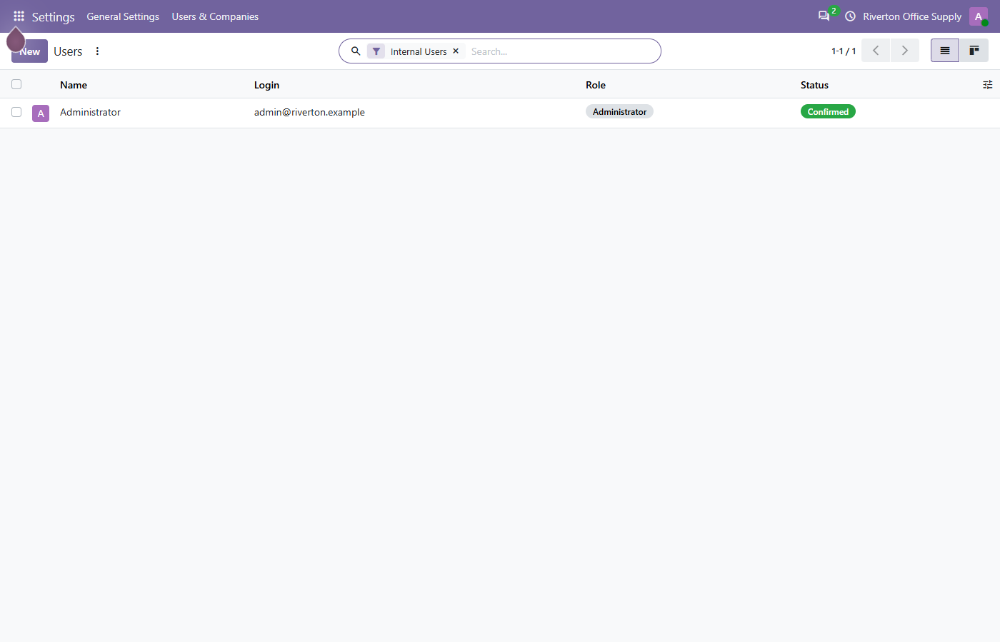

# 12. Der Schlüssel, der nur eine Tür öffnet

Das letzte Stück Konfiguration, bevor der Assistent freigelassen werden konnte, war das uninteressanteste
und zugleich das wichtigste: der Schlüssel.

Sam erklärte es am Whiteboard, in der Weise, wie er alles erklärte, mit einer Skizze, die dreißig Sekunden
brauchte und einen Streit beendete, der normalerweise eine Woche dauert.

"Jedes Schloss in diesem Gebäude hat einen Schlüssel", sagte er und zeichnette ein Rechteck für das ERP. "Die Frage
ist nicht, ob der Assistent einen Schlüssel bekommt. Die Frage ist, welche Tür er öffnet, und was er tun kann,
sobald er drinnen ist."

---

## Was ein API-Schlüssel ist

Ein API-Schlüssel ist ein Passwort, das ein Programm statt einer Person verwendet. Es ist eine lange
Zeichenkette, sie wird einmal angezeigt, und sie gehört einem *Benutzer*—nicht dem Programm und nicht der
Maschine.

Dieser letzte Punkt ist die ganze Idee des Entwurfs. Wenn der Ass sich mit Odoo verbindet, verbindet er sich
nicht als Superuser mit einer besonderen Hintertür. Er verbindet sich als Benutzerkonto, das im Fall von
Riverton *Agent* heißt, mit einem Passwort und einem Schlüssel und mit einem Satz von Berechtigungen, die
man einem neuen Mitarbeiter am ersten Tag vergeben könnte.

Das heißt drei Dinge, und jeder von ihnen ist mehr wert als die Bequemlichkeit, die er kostet.

**Die Regeln des ERP gelten für den Assistenten.** Wenn der *Agent*-Benutzer nicht berechtigt ist, Rechnungen
zu löschen, kann der Assistent keine Rechnungen löschen—nicht, weil man ihm gesagt hat, dass er es nicht tun
soll, sondern weil das ERP die Anfrage ablehnt. Die Intelligenz ist neu; die Regeln sind alt; das Neue funktioniert
im Alten.

**Der Assistent taucht in der Prüfprotokollkette auf.** Jeder Datensatz, den er erstellt, sagt *Agent* im Feld
"erstellt von", und jede Änderung, die er vornimmt, wird protokolliert. Wenn eine Rechnung um vier Uhr morgens mit
einem seltsamen Rabatt auftaucht, wird das System nicht sagen "die Maschine hat es getan"; es wird sagen, welcher
Benutzer, um welche Zeit und mit welchen Werten.

**Der Schlüssel kann widerrufen werden, ohne sonst etwas zu ändern.** Wenn der Schlüssel entgleitet, oder der
Assistent ersetzt wird, oder jemand geht, wird der Schlüssel gelöscht und der Assistant hört auf. Das ERP ändert
sich nicht, die Benutzer ändern sich nicht, und nichts muss neu installiert werden.

## Wo der Schlüssel liegt

Der Installer hat den Schlüssel während der Installation erzeugt und in die Konfiguration des Connectors
geschrieben, im eigenen Ordner des Assistenten. Er ist nicht im Buch, nicht in einer E-Mail und nicht in einem
Dokument, das weitergeleitet wird. Er ist in einer Datei, an einem Ort, mit den Dateirechten des Benutzers, der
ihn installiert hat.

Derselbe Schlüssel kann von Hand erstellt werden, und jeder Benutzer kann sich einen für sich selbst erstellen:
Er befindet sich unter dem Benutzermenü, *Mein Profil*, *Kontensicherheit*, *Neuer API-Schlüssel*. Das ERP zeigt
ihn einmal an, in einem Kästchen, mit einer Warnung, dass er nie wieder angezeigt wird—was keine Drohung ist,
sondern eine Tatsache über die Speicherung von Schlüsseln: Das System bewahrt einen Hash, nicht den Schlüssel,
daher kann es Sie später nicht daran erinnern.

## Was der Assistent tun durfte

Rivertons *Agent*-Benutzer wurde eine Rolle gegeben, und die Rolle wurde mit einer Regel gewählt, die es sich
wert ist, wiederholt zu werden: **Geben Sie dem Assistenten die Rechte des schwächsten Mitarbeiters, der den Job
hätte tun können.**

Für Riverton hieß das:

| Bereich | Rechte | Warum |
|---|---|---|
| Kunden | lesen, erstellen, ändern | er nimmt Aufträge an und fügt Kontakte hinzu |
| Produkte | lesen | er bietet Preise an; er erfindet keine Produkte |
| Verkäufe | lesen, erstellen, bestätigen | er schreibt Angebote und bestätigt Aufträge |
| Rechnungen | lesen, erstellen, verbuchen | er stellt Rechnungen aus; das Verbuchen ist die Handlung, die das Hauptbuch erstellt |
| Zahlungen | lesen, erstellen | er erfasst, was die Bank angibt |
| Einkäufe | lesen, erstellen, bestätigen | er bestellt nach, was das Lager verlangt |
| Lager | lesen, anpassen | er bewegt Bestände und erfasst Schäden |
| Buchführungskonfiguration | keine | Konfiguration ist die Arbeit einer Person |
| Benutzer und Berechtigungen | keine | niemals, unter keinen Umständen |
| Dokumente löschen | keine | wenn etwas falsch ist, wird es storniert, nicht gelöscht |

Die letzten beiden Zeilen sind die, um die man streitet. Eine Maschine, die Berechtigungen ändern kann, kann
sich selbst alles gewähren; eine Maschine, die löschen kann, kann die Prüfprotokollkette zerstören, die beweisen
würde, was sie getan hat. Beide werden ausgeschlossen, nicht, weil der Assistent in einem dramatischen Sinne
nicht vertrauenswürdig ist, sondern weil der Preis seines Ausschlusses null ist und der eines Fehlers nicht.

## Das Gespräch über das Vertrauen

Doreen, die während des größten Teils dieser Rede still gewesen war, stellte die Frage, die zählte.

"Was hält davon ab, etwas Dummes zu tun?"

"Niemand hält davon ab", sagte Sam. "Das ist die ehrliche Antwort. Er kann einen Kunden mit einem albernen Namen
erstellen oder eine Rechnung an die falsche Person verbuchen oder vier Hundert Kartons des falschen Papiers bestellen.
Was das zu einer Katastrophe macht, ist nicht; was verhindert, dass das eine Katastrophe wird, ist, dass man es sehen
kann, es rückgängig machen kann und dass es die Dinge nicht tun kann, die nicht rückgängig gemacht werden können."

"Das ist nicht sehr tröstlich."

"Nein", gab er zu. "Aber es ist dieselbe Beruhigung, die man mit einem neuen Mitarbeiter hat. Man hält sie nicht
auf, einen Fehler zu machen; man gibt ihnen einen Job mit einer Grenze, man prüft die Arbeit des ersten Monats und
man stellt sicher, dass die Fehler die Art sind, die man beheben kann."

Der Unterschied—und es ist der Unterschied, der das System benutzbar macht—is, dass die Fehler des Assistenten
*sichtbar sind in einer Weise, in der die einer Person es nicht sind*. Eine Person, die eine Menge falsch hört,
schreibt sie auf einen Auftrag und niemand bemerkt es, bis der Kunde sich beschwert. Die Version des Assistenten
desselben Fehlers ist ein Datensatz mit einem Zeitstempel, einem Benutzer, dem Werkzeug, das er aufrief, und den
Argumenten, die er übergeben hat, und sie kann in einem Protokoll gefunden werden von jedem, der daran denkt, nachzusehen.

Deshalb ist das Protokoll kein technisches Detail. Es ist die Sache, die einen Akzeptanten in einem Geschäft, in dem
Geld bewegt wird, akzeptabel macht: nicht, dass er nie irrt, sondern dass seine Fehler *auffindbar* sind.

## Der erste Test

Bevor der Assistent irgendetwas tun ließ, bat Sam ihn, nichts zu tun.

"Prüfe die Verbindung", tippte er. "Sag mir, welche Version von Odoo läuft."

Die Antwort kam in einer Sekunde zurück: die Version, der Datenbankname, der Benutzer, als den er verbunden war,
und die Firma, auf die er gezeigt wurde. Vier Fakten, alle korrekt, alle, die von einer Person im ERP in etwa der
gleichen Zeit geprüft werden konnten.

"Gut", sagte Sam. "Nun frage ihn, wie viele Kunden es gibt."

Es waren keine, weil noch niemand einen eingegeben hatte. Der Assistent sagte null, was wahr war, und was eine
interessantere Antwort ist, als es den Anschein hat: Ein System, das *null* sagen kann, ist ein System, das die
Datenbank liest, kein System, das etwas erfindet. Ein Modell, das rate, hätte eine plausable Zahl erzeugt.

"Richtig", sagte Sam und schloss seinen Laptop. "Es ist deins. Gib ihm einen Job."

## Die Berechtigung, die jeder vergisst

Es gibt eine Berechtigung in jedem ERP, die Unternehmen ohne Nachdenken gewähren, und es ist die, die alle anderen
widerruft: die Fähigkeit, die *Konfiguration* zu ändern.

Ein Benutzer, der das Kontenplan ändern kann, kann überall alles verbuchen. Ein Benutzer, der die Steuer-codes
ändern kann, kann einen Verkauf verschwinden lassen. Ein Benutzer, der die Zugriffsberechtigungen ändern kann, kann
sich selbst alles gewähren, was ihm fehlt. Die Regeln, die das Hauptbuch schützen, sind selbst Daten, und wer die
Daten ändern kann, kann die Regeln ändern.

Der Assistent ist daher völlig von den Einstellungen ausgeschlossen—nicht, weil er sie missbrauchen würde, sondern
weil die Kompetenz eines Assistenten gerade im *Tun von Dingen* liegt, und die Konfiguration ist der eine Bereich,
in dem es das Falsche zu tun unauffindbar vom Richtigen ist, bis der Prüfer kommt.

Die Regel verallgemeinert: **Automatisiere die Arbeit, nie die Regeln.** Ein Unternehmen, das einem Assistenten
erlaubt, seine eigenen Berechtigungen zu ändern, hat, im Effekt, überhaupt keine Berechtigungen; es hat eine
Vorschlagbox.

## Die erste Prüfung nach dem Erstellen eines Schlüssels

In dem Moment, in dem ein Schlüssel erstellt wird, gibt es eine Prüfung, die sich lohnt, und sie dauert zehn Sekunden.

Frage im Assistenten: *Prüfe die Verbindung zu Odoo und sag mir, welche Version läuft.*

Eine Versionsnummer und ein Datenbankname bedeuten, dass der Schlüssel funktioniert, die Adresse richtig ist und der
Benutzer das ERP erreichen kann. Ein Fehler bedeutet, dass einer der drei falsch ist, und die Fehlermeldung sagt
normalerweise, welcher.

Diese Prüfung lohnt sich zu wiederholen nach jeder Änderung an der Konfiguration—einem neuen Schlüssel, einem neuen
Port, einer neuen Maschine—weil sie die Verbindung von allem anderen abgrenzt. Wenn später etwas schiefgeht, ist die
erste Frage immer *ist es die Verbindung oder ist es die Anfrage?* und diese Anweisung beantwortet sie in einer
Sekunde.

Doreen schrieb sie auf eine Karte und klebte sie am Monitor fest. Es ist die uninteressanteste Anweisung in diesem
Buch und die, die die meiste Zeit gespart hat.

## Wenn der Schlüssel entgleitet

Ein Schlüssel, der in eine Konfigurationsdatei auf einer Maschine geschrieben ist, kann in drei Wegen entgleiten,
und alle drei sind Unternehmen passiert, die nicht nachlässig waren.

Er kann in ein Backup kopiert werden, das dann weitergegeben wird. Er kann in ein Support-Ticket eingefügt werden von
jemandem, der hilfreich sein will. Und er kann von einem anderen Programm auf derselben Maschine gelesen werden, was
der Grund ist, warum eine Maschine, die von fünf Menschen geteilt wird, kein guter Ort für einen Schlüssel ist, der
Rechnungen verbuchen kann.

Die Abhilfe besteht nicht darin, den Schlüssel mit Zeremonie zu bewachen. Die Abhilfe ist, dass der Schlüssel
*billig zu ersetzen ist*:

1. Öffne im ERP die Kontensicherheitsseite des Benutzers und lösche den Schlüssel.
2. Erstelle einen neuen und füge ihn in die Konfiguration des Connectors ein.
3. Starte den Assistenten neu.

Drei Minuten, kein Datenverlust, keine Neuinstallation. Der alte Schlüssel hört im Moment seines Löschens auf zu
funktionieren, was die Eigenschaft ist, die dies sicher macht: ein entgelterter Schlüssel ist eine Unannehmlichkeit
statt eines Vorfalls, vorausgesetzt jemand bemerkt es und widerruft ihn.

Die Sache, die ihn zu einem Vorfall macht, ist ein Schlüssel, der einem Benutzer gehört, der alles tun kann. Deshalb
hat der *Agent*-Benutzer eine Rolle, und deshalb ist der Schlüssel des Administrators nie derjenige, der einem
Programm gegeben wird.

## Ein Assistent zur Zeit

Es gibt noch einen weiteren Grenz, den es sich lohnt zu kennen, und er betrifft überhaupt keine Berechtigungen.

Der Assistent läuft auf derselben Maschine wie alles andere, und das Sprachmodell—obwohl es ein Dienst in einem
anderen Gebäude ist oder ein Modell auf deiner eigenen Grafikkarte—beantwortet eine Anfrage zur Zeit. Ein Unternehmen,
das vier Assistenten in vier Fenstern startet, wird nicht viermal so viel Arbeit bekommen; es wird vier Assistenten
bekommen, die sich abwechseln, und eine Maschine ohne verbleibenden Speicher.

Der Installer ist darum herum gebaut: ein Assistent, ein Fenster, ein Launcher, der genau eines öffnet. Die
Versuchung, ein zweites zu öffnen, um etwas anderes zu tun, während der erste denkt, ist der häufigste Weg, wie eine
kleine Installation zusammenbricht—und die Abhilfe ist nicht technisch. Sie besteht darin, zu warten, oder weniger
auf einmal zu fragen.

Riverton lernte es in der zweiten Woche, wenn Tom ein zweites Fenster öffnete, um nach dem Lagerbestand zu fragen,
während Priyas Rechnung geschrieben wurde. Die Maschine stürzte nicht ab. Sie wurde einfach langsam, dann langsamer,
und dann beantworteten beide Fenster gleichzeitig mit zwei Hälften desselben Auftrags, und Doreen verbrachte zwanzig
Minuten damit, auszurechnen, welche Rechnung real war.

Die Regel, die dabei herauskam, hängt an der Wand des Rechnungszimmers, neben der Serviette: *eine Frage zur Zeit,
und lies die Antwort.*

---

An jenem Abend saß Maggie eine Weile vor dem Fenster des Assistenten, ohne irgendetwas zu tippen.

Das Fenster war schlicht: eine Eingabe, ein Ort für die Antwort und eine kleine Zeile unten, die sagte, mit welchem
Modell es sprach. Es sah aus wie die Terminal-Fenster, die ihr Vater in den Neunzigern benutzt hatte, was entweder
tröstlich oder beängstigend war, je nach deiner Ansicht über die Neunziger.

Sie tippte: *Was kannst du tun?*

Die Antwort war eine Liste. Es konnte Kunden, Produkte, Aufträge, Rechnungen, Lagerbestand lesen; es konnte
Datensätze erstellen und ändern; es konnte die Aktionen aufrufen, die ein Dokument von einem Zustand in den anderen
bewegen; es konnte gruppieren, summieren und zählen. Es konnte die Einstellungen des Unternehmens nicht ändern,
Benutzer nicht verwalten oder nichts löschen.

Sie las sie zweimal, und dann tippte sie den Satz, der seit dem Montag im November in ihrem Kopf gest hatte, wenn
sie eine Rechnung über die Stadt gefahren war.

*Zeig mir jeden Kunden, der uns Geld schuldet und seit sechs Monaten nichts bestellt hat.*

Die Antwort brauchte vier Sekunden. Es gab noch keine Kunden, also war die Antwort ein höflicher Satz, der das so
sagte—aber der Satz enthielt die zwei Dinge, nach denen es gesucht hatte, und den Ort, an dem es gesucht hatte, was
die Sache ist, die ein guter Mitarbeiter tut, wenn die Antwort "nichts" ist.

Maggie schloss das Fenster und ging nach Hause.

Am nächsten Morgen begann sie, die Kunden einzugeben.
