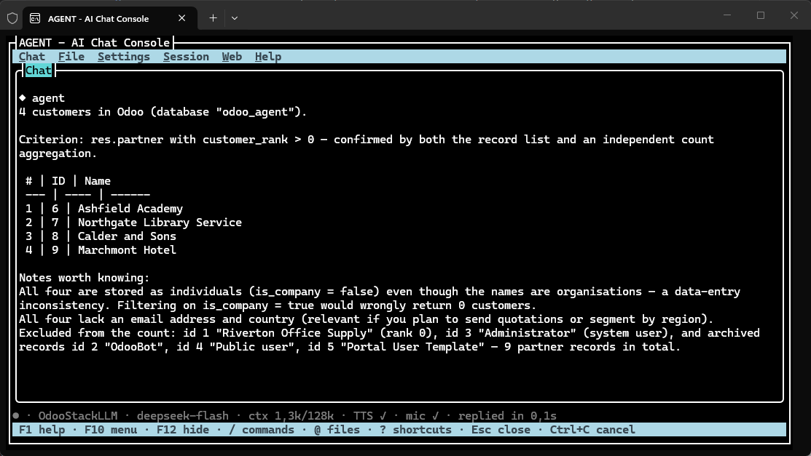

# 13. Das erste Gespräch

Beim ersten Start des Assistenten wurde ein Schlüssel angefragt.

Nicht den Schlüssel des ERP—der war während der Installation erstellt und in die Konfiguration des Connectors eingetragen worden. Es war der andere: der Schlüssel, der dem Assistenten ermöglicht, mit einem Sprachmodell zu sprechen, das heißt, der Schlüssel, der es denken lässt.

Das Fenster war das eigene des Assistenten, geöffnet durch das Odoo-Künstliche-Intelligenz-Symbol, und es sah aus wie ein Terminal aus dem Jahr 1995: eine Menüleiste oben, ein großes leeres Feld und eine Zeile unten mit einem Cursor. Vorher, beim ersten Start, gab es noch eine kurze Reihe von Fragen.

*Wähle einen Anbieter.*

Die Liste war die übliche: die großen Cloud-Dienste, ein paar Aggregatoren und die Option eines Modells, das auf der Maschine selbst läuft. Maggie wählte DeepSeek, weil es das war, das Sam wegen der Kosten empfohlen hatte, und weil das Unternehmen bereits ein Konto dafür hatte.

*Füge den Schlüssel ein.*

Sie fügte ihn ein. Das Fenster pausierte einen Moment und druckte dann eine Liste von Modellnamen—was der Moment ist, den man beachten sollte, denn es ist der Moment, in dem der Assistent *beweist*, dass der Schlüssel funktioniert. Er hatte nicht einfach das Akzeptiert, was sie eingegeben hatte; er hatte es benutzt, um den Anbieter zu fragen, was dieser tun konnte, und der Anbieter hatte geantwortet. Ein falscher Schlüssel erzeugt an dieser Stelle einen Fehler, nicht drei Tage später inmitten einer Rechnung.

Sie wählte das Modell, und das Fenster wurde geleert.

---

## Die erste Frage

Sie tippte: *Was kannst du tun?*

Die Antwort war eine Liste, und sie war länger, als sie erwartet hatte. Sie konnte Kunden, Produkte, Aufträge, Rechnungen und Lagerbestand durchsuchen; sie konnte Datensätze lesen und erstellen; sie konnte die Aktionen aufrufen, die ein Dokument vom Entwurf zur bestätigten Version bewegen; sie konnte gruppieren, summieren und zählen. Sie konnte die Einstellungen des Unternehmens nicht ändern, keine Benutzer verwalten und nichts löschen.

Sie las sie zweimal. Dann tippte sie die Frage, die sie seit November mit sich herumtrug.

*Wieviele Kunden haben wir?*

Die Antwort kam in etwa einer Sekunde zurück: *Null. Die Datenbank enthält noch keine Kundendatensätze.*

Ein Modell, das raten würde, hätte etwas wie „Sie haben etwa 40 Kunden" gesagt oder eine Liste plausibler Namen erzeugt, denn das tut ein Sprachmodell, wenn ihm Fakten fehlen: es erzeugt den wahrscheinlichsten Text. Dieses hier war dafür gebaut, *zu sehen*, und der Blick auf eine leere Tabelle erzeugt die einzige ehrliche Antwort, die es gibt.

Die Zahl oben stammt von derselben Installation, wenige Tage später, wenn die vier Demonstrationskunden existieren. Zwei Dinge daran sind es wert, zweimal gelesen zu werden: Die Antwort benennt das Kriterium (*res.partner mit customer_rank > 0*) und sagt, dass es durch einen zweiten, unabhängigen Zählvorgang bestätigt wurde; und sie liefert drei Beobachtungen, nach denen niemand gefragt hat—nämlich dass die vier Kunden als Privatpersonen statt als Unternehmen gespeichert sind, dass keiner von ihnen eine E-Mail-Adresse hat, und welche Datensätze vom Zählvorgang ausgeschlossen wurden und warum. Das ist kein Bericht. Das ist es, was ein sorgfältiger Kollege sagt, wenn er dir eine Zahl übergibt.

---

## Was zwischen Frage und Antwort geschieht

Es lohnt sich, den zweiten Vorgang zu verlangsamen, denn die Schnelligkeit überdeckt etwas, das es wert ist, verstanden zu werden.

Wenn Maggie *wieviele Kunden haben wir?* eingab, geschahen vier Dinge.

**Der Assistent las die Anweisung** und entschied, von welcher Art von Sache es war: eine Frage zur Anzahl von Datensätzen eines Typs, keine Aktion. Diese Entscheidung wird vom Sprachmodell getroffen, und sie ist der Teil, der wirklich neu ist: Niemand schrieb eine Regel, die sagt „Wenn der Satz mit ‚wieviele' beginnt, zähle etwas."

**Es wählte ein Werkzeug.** Der Connector bietet ein Dutzend Operationen, jeder mit einem Namen und einer Beschreibung. Der Assistent wählte *durchsuchen*, auf dem Modell *Kunden*, mit einem leeren Filter und einer Zählung.

**Das Werkzeug lief, in Odoo, als Benutzer Agent.** Odoo prüfte den Schlüssel, prüfte die Berechtigungen, führte die Abfrage gegen die Datenbank aus und lieferte eine Zahl.

**Der Assistent schrieb den Satz.** Er hätte einen Absatz über Kundenverwaltung schreiben können; stattdessen schrieb er eine Zeile, weil die Anweisung nach einer Zahl fragte und die Zahl null war.

Die ganze Sequenz dauerte etwa eine Sekunde, wovon die meiste Zeit dem Denken des Sprachmodells galt. Die Datenbankabfrage dauerte Mikrosekunden.

## Die Schleife, und warum sie kein Chatbot ist

Ein Chatbot nimmt eine Frage und produziert Text. Dieses Ding nimmt eine Anweisung und produziert *Arbeit*, und der Unterschied ist eine Schleife.

Die Schleife ist: denken, ein Werkzeug wählen, es ausführen, das Ergebnis lesen, erneut denken und entweder aufhören oder ein anderes Werkzeug wählen. Eine einfache Frage ist eine Runde der Schleife. Eine komplizierte Anweisung—*erstelle eine Angebotsverhandlung, bestätige sie, liefere sie und rechne sie*—ist acht oder neun Runden, jede einzeln vom Modell entschieden, gestützt auf das, was die vorherige zurückgab.

Diese Schleife ist der Grund, warum der Assistent Dinge tun kann, für die ihn niemand programmierte, und sie ist auch der Grund, warum er auf Arten scheitern kann, die ein Programm nicht kann. Ein Programm tut, was es geschrieben wurde, jedes Mal. Eine Schleife entscheidet, was als Nächstes zu tun ist, jedes Mal, und eine Entscheidung kann falsch sein.

Die Verteidigung ist dieselbe, die dieses Buch von Anfang an beschrieben hat: die Werkzeuge sind eng, die Berechtigungen sind die des ERP, und das Ergebnis ist sichtbar. Der Assistent kann nichts tun, was ein Benutzer nicht tun könnte, und alles, was er tut, wird festgehalten.

---

## Die erste Aktion

Das Erste, was der Assistent *tat*—statt zu beantworten—war, einen Kunden zu erstellen, und Maggie tat es selbst, am Terminal, mit der manuellen Öffnung.

*Erstelle einen Kunden namens Ashfield Academy, in der Mill Lane, Ashfield, mit 30-Tages-Zahlungsbedingungen, und mache die Rechnungskontaktperson Carol Whitfield.*

Der Assistent dachte einen Moment—zwei Sekunden, was länger ist als eine Abfrage—und dann:

*Kunden „Ashfield Academy" erstellt (ID 7), Adresse Mill Lane, Ashfield, Zahlungsbedingungen 30 Tage. Kontaktperson Carol Whitfield als Rechnungskontaktperson ergänzt. Möchtest du vor dem Hinzufügen des Restes nach Duplikaten suchen?*

Der letzte Satz steht in keinem Handbuch. Es ist das Modell, das eigenständig entscheidet, dass das Nächstene, was eine sorgfältige Person tun würde, das Suchen nach Duplikaten ist—weil die Anweisung *erstellen* lautete, und das Erstellen ohne Prüfen ist es, wodurch Unternehmen am Ende vier Versionen derselben Schule haben.

Maggie tippte *ja*, und der Assistent suchte nach allem, was ähnlich war. Es gab nichts, weil die Datenbank leer war. Aber die Gewohnheit war am ersten Tag etabliert: die Maschine schlägt ein Prüfen vor, die Person akzeptiert es, und nach einer Woche beginnt die Person, es ebenfalls vorzuschlagen.

## Der erste Fehler

Drei Tage später machte der Assistent seinen ersten Fehler, und er ist es wert, festgehalten zu werden, denn er war nicht die Art, die jemand erwartet hätte.

Maggie fragte: *Welche Produkte haben wir nie verkauft?*

Der Assistent antwortete mit einer Liste von vier Produkten, und Maggie, der den Katalog kannte, bemerkte, dass eines von ihnen—das A4-Papier—in der vorherigen Woche vierhundert Packungen verkauft hatte.

Die Ursache war eine Definition. Der Assistent hatte *nie verkauft* interpretiert als „keine bestätigte Auftragsposition", und das Papier war über eine Lieferung verkauft worden, die direkt erstellt wurde, ohne Auftrag, weil Tom eine dringende Anfrage eines Kunden erfüllt hatte, der telefoniert hatte.

Beide Fakten waren wahr. Die Frage war mehrdeutig, und der Assistent hatte eine der Lesarten gewählt.

Doreens Urteil, als sie davon hörte, war der Satz, der den gesamten Umgang des Unternehmens mit der Technologie prägte.

„Er hat die Frage beantwortet, die ich gestellt habe. Ich habe die falsche Frage gestellt."

Das ist keine Rechtfertigung der Maschine; es ist eine Beschreibung der Arbeit. Die Fähigkeit, einen Assistenten zu benutzen, ist in großem Maße die Fähigkeit, präzise zu fragen—und die Fähigkeit zu prüfen, wenn die Antwort wichtig ist, indem man eine zweite Frage stellt, die übereinstimmen müsste.

*Welche Produkte haben keine Auftragsposition und keine direkte Lieferung im letzten Jahr?*

Diese Version lieferte die richtige Liste, und sie dauerte vier Sekunden.

---

## Doreens erste Frage

Doreen hatte die erste Woche aus der Distanz beobachtet, in der Weise, wie jemand mit thirty-one Jahren Erfahrung einen neuen Kollegen beobachtet: höflich, und mit einer Liste von Dingen, die wahrscheinlich schiefgehen würden.

Am Freitag setzte sie sich und tippte eine Sache.

*Welche Rechnungen vom letzten Monat sind nicht bezahlt?*

Die Antwort war eine Liste von vier, mit Beträgen und überfälligen Tagen, und einer Gesamtsumme. Sie sah sie eine Weile an, dann öffnete sie das alte Buchhaltungsprogramm, führte denselben Bericht von Hand aus und verglich.

Sie stimmte überein.

„Gut," sagte sie. „Es ist derselbe Bericht. Es hat mich zwanzig Minuten gekostet und dieses Ding eine Sekunde, und es ist derselbe Bericht."

Dann stellte sie die Frage, die wichtig war.

*Warum ist der Marchmont Hotel spät?*

Der Assistent wusste es nicht und sagte es auch: Er hatte keinen Datensatz eines Telefonats, keine Notiz einer Rückfrage, keinen Grund. Was er hatte, war die Rechnung, der Fälligkeitsdatum, und die Tatsache, dass Marchmont jede vorherige Rechnung innerhalb von zehn Tagen bezahlt hatte.

„Sie haben pünktlich jeden Monat für zwei Jahre bezahlt," fügte er hinzu. „Dies ist die erste überfällige Rechnung."

Dieser Satz steht nicht in der Datenbank. Es ist ein Schluss, der aus der Datenbank gezogen wird—ein Muster, bemerkt und ausgesprochen—und es ist die Sache, die Doreen aufhörte, misstrauisch zu sein. Sie telefonierte mit Marchmont und fand heraus, dass die Rechnung an eine Buchhaltungsadresse gegangen war, die geschlossen worden war, wenn das Hotel im Oktober die Eigentümer wechselte, und dass niemand Riverton Bescheid gegeben hatte.

„Die Maschine wusste nicht, warum," sagte sie später. „Aber sie wusste, dass es seltsam war. Das war der Teil, den ich nicht erwartet hatte. Sie wusste, dass es seltsam war."

## Die Regel der ersten Woche

Bis zum Ende der ersten Woche hatte das Büro eine Regel, und sie stand mit genug großen Buchstaben auf dem Whiteboard, um von der Tür aus gelesen zu werden.

*Frage es etwas, dessen Antwort du bereits kennst.*

Die Regel klingt nach einer Zeitverschwendung und ist das Gegenteil davon. Eine Frage, deren Antwort du kennst, ist ein Test der Maschine: Wenn sie übereinstimmt, hast du gelernt, dass die Verbindung, der Schlüssel, die Definitionen und das Modell alle funktionieren, und jede spätere Antwort darf ein bisschen mehr vertraut werden. Wenn sie nicht übereinstimmt, hast du ein Problem gefunden, solange die Einsätze null sind.

Doreen benutzte sie zwei Wochen. Sie fragte nach der Anzahl der Kunden, der Summe einer Woche Rechnungen, dem Saldo auf dem Bankkonto—alles Dinge, die sie im alten System in zehn Minuten prüfen konnte. Zweimal wichen die Antworten ab, und beide Male war der Unterschied eine Definition: einmal ein Kunde, der als zwei gezählt wurde, weil er zwei Kontaktdaten hatte, einmal eine Rechnung, die ausgeschlossen wurde, weil sie eine Gutschrift war.

Diese zwei Korrekturen waren mehr wert als jedes Trainingssitzung, denn sie lehrten das Büro, wie die Maschine *denkt*—und sie lehrten die Maschine in kleinem Maße, was das Büro meint. Die Definitionen wurden in den Anweisungen und in den Daten festgehalten, und sie sind seitdem nicht mehr falsch gewesen.

## Was man von der ersten Woche erwarten kann

Drei Dinge überraschen Menschen in der ersten Woche, und alle drei sind es wert, im Voraus zu kennen.

**Sie ist langsamer, als du willst, und schneller, als du erwartest.** Eine Frage dauert zwei bis acht Sekunden, je nach Modell und Anzahl der Schritte. Das fühlt sich neben einer Suchbox langsam an und neben dem Öffnen von vier Bildschirmen instantan. Die Versuchung ist, mehrere Fragen auf einmal zu stellen, was alles langsamer macht und verschachtelte Antworten erzeugt—die mit Abstand häufigste Art, ein gutes System schlecht wirken zu lassen.

**Sie ist auf eine Art wörtlich, die wie Pedanterie fühlt.** *Zeig mir die Aufträge* wird eine Frage darüber produzieren, welche Aufträge. Das ist kein Misserfolg; es ist dasselbe Verhalten, das ein sorgfältiger neuer Mitarbeiter hat, und es ist das Verhalten, das das System sicher macht. Die Heilung ist eine bessere Anweisung, kein nachsichtigeres System.

**Sie ist besser bei Durchsuchen als bei Gesprächen.** Frag sie nach jeder Rechnung über dreißig Tagen, und sie wird dir eine vollständige, genaue Liste geben. Frag sie, was du darüber tun solltest, und sie wird dir einen sorgfältigen, generischen Absatz geben, weil die Antwort von Dingen abhängt, die sie nicht kennt. Das erste ist das Zahlen wert; das zweite nicht.

## Die vier Fragen, die der Assistent sich selbst stellt

Wenn eine Anweisung eintrifft, arbeitet der Assiment durch vier Fragen hindurch, und ihr Verständnis ist der schnellste Weg, bessere Anweisungen zu schreiben.

**Von welcher Art von Sache wird gefragt?** Eine Frage, eine Aktion oder ein Gespräch. Dies wird vom Modell entschieden, aus der Form des Satzes, und es ist der Grund, warum *wieviele Kunden haben wir* und *erstelle einen Kunden* solch unterschiedliches Verhalten erzeugen.

**Welche Werkzeuge könnten es tun?** Der Connector beschreibt jede Operation in einem Satz, und der Assiment wählt die, die übereinstimmen. Eine Anfrage, die mit keinem Werkzeug übereinstimmt, wird eine höfliche Verweigerung produzieren, was besser ist als ein Rat.

**Was sind die Argumente?** Der Name des Kunden, das Produkt, das Datum. Hier beißt die Mehrdeutigkeit: *die blauen Ordner* passt auf kein Produkt, und der Assiment wird fragen statt erfinden.

**Ist das Ergebnis, was angefragt wurde?** Nach dem Rückgabe des Werkzeugs liest der Assiment das Ergebnis und entscheidet, ob die Anweisung erfüllt wurde oder ob ein weiterer Schritt nötig ist. Diese Schleife ist es, was eine Kette von Operationen möglich macht, und sie ist auch es, was einen Fehler möglich macht—die Schleife kann sich mit etwas zufrieden geben, das nicht ist, was du meintest.

## Wie die erste Woche sich anfühlte

Maggies Notiz, geschrieben am Freitag der ersten Woche, ist die beste Zusammenfassung dieses Kapitels, die es gibt, und sie ist vier Zeilen lang.

*Tag 1: es sagte mir, dass wir keine Kunden hatten. Richtig, und leicht unhöflich.*
*Tag 2: es erstellte einen Kunden und fragte, ob ich nach Duplikaten suchen wollte. Tat ich.*
*Tag 3: es beantwortete eine Frage, die ich schlecht stellte, und Doreen hatte recht bezüglich warum.*
*Tag 4: ich hörte auf, beeindruckt zu sein, und begann, genervt zu sein, wenn es langsam war, was ich denke, bedeutet dass es funktioniert.*

Die letzte Zeile ist die, die man behält. Das Maß für ein Werkzeug, das Teil eines Unternehmens geworden ist, ist nicht Bewunderung; es ist Ungeduld. Niemand ist vom Telefon beeindruckt. Menschen sind genervt, wenn es nicht funktioniert.

Bis zum Ende der ersten Woche hatte der Assiment aufgehört, eine Demonstration zu sein, und war ein Kollege mit einer ärgerlichen Gewohnheit, wörtlich zu sein—was, wie jeder, der schon einen sehr gewissenhaften Junior verwaltet hat, ein Problem ist, mit dem man arbeiten kann.
