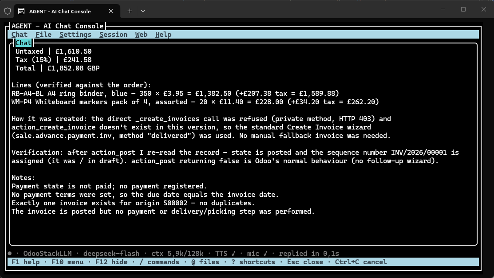

# 15. Von der Bestellung zur Rechnung

Die Ordner wurden an einem Freitagmorgen weggebracht, bei Regen, wie es Tradition ist.

Tom hat sie selbst verladen, weil der Spätfahrer zu spät kam, und er kam mit nassen Ärmeln und einem Stück Papier ins Büro: die Lieferscheininzeichnung, unterschrieben vom Hausmeister in Ashfield, mit einem Kugelschreiber, der fast leer war. Auf dem alten System würde dieses Stück Papier in eine Ablage wandern und auf Dorens Rückkehr vom Mittagessen warten, und die Rechnung wäre am Montag getippt worden.

Auf dem neuen System stellte Doreen dem Assistenten eine Frage, während Tom seinen Mantel noch auszog.

> *Welche gelieferten Bestellungen dieser Woche sind noch nicht in Rechnung gestellt?*

> *Eine: Auftragsnummer S00012, Ashfield Academy, heute Morgen geliefert. 350 × Ringordner A4 (blau),
> 20 × Whiteboard-Stifte. Bereit zur Rechnungsstellung. Soll ich die Rechnung erstellen?*

Sie sagte Ja. Das ist die ganze Transaktion, und es lohnt sich zu verstehen, was darunter vorging, denn „die Rechnung erstellen" leistet in einem einzigen Satz eine ganze Menge Arbeit.

---

## Was eine Rechnung ist

Eine Rechnung ist ein Dokument, das drei Dinge auf einmal aussagt, und genau darin liegt der Grund, warum die Buchhaltung komplizierter ist als die Arithmetik.

**Sie ist eine Zahlungsverfrage.** Das ist der Teil, den jeder kennt: Der Kunde schuldet den Betrag auf dem Blatt, bis zum Datum auf dem Blatt.

**Sie ist ein Beleg für ein besteuertes Ereignis.** In den meisten Ländern wird die Steuer fällig, wenn die Rechnung ausgestellt wird, nicht wenn das Geld eingeht. Deshalb hat eine Rechnung einen Besteuerungszeitpunkt, und deshalb kann eine Rechnung, die falsch storniert wird, ein Unternehmen eine Steuer auf Geld schulden lassen, das es nie erhalten hat.

**Sie ist ein rechtlicher Anspruch.** Wenn der Kunde nicht zahlt, ist die Rechnung der Beweis. Sie muss den eingetragenen Firmennamen und die Steuernummer des Unternehmens zeigen, die Angaben zum Kunden, eine eindeutige fortlaufende Nummer, das Datum, eine Beschreibung der gelieferten Leistung, den Betrag vor Steuer, den Satz und den Steuerbetrag sowie die Gesamtsumme. Fehlt einer dieser Punkte, ist der Anspruch schwächer; fehlt die Nummer, kann der Anspruch wertlos sein.

Ein ERP-System leistet alle drei auf einmal, und der Grund, warum es eine *auftragsgemäß bestätigte Bestellung* verlangt, bevor es eine Rechnung erstellt, ist, dass die zweite und dritte Funktion davon abhängen, dass die erste zutrifft. Man kann keine Waren in Rechnung stellen, für deren Lieferung man nicht vereinbart hat, weil sowohl der Besteuerungszeitpunkt als auch der Anspruch sich auf eine Lieferung beziehen.

## Was das Assistenten tatsächlich tat

Die Anweisung bestand aus vier Wörtern, und die Arbeit des Assistenten war eine Kette aus acht oder neun Schritten, von denen jede eine Person von Hand ausgeführt hätte.

Es suchte nach gelieferten Bestellungen ohne Rechnung. Es fand eine. Es las die Positionsdaten, Preise und Steuern der Bestellung. Es erstellte ein Rechnungsdokument, das mit der Bestellung verknüpft war—verknüpft, nicht kopiert, sodass die Rechnung stets auf das Bestellte zurückgeführt werden kann. Es berechnete die Steuer je Position. Es setzte das Rechnungsdatum auf heute und den Fälligkeitstermin gemäß den Zahlungsbedingungen des Kunden. Es ließ die Rechnung im *Entwurf*, also dem Zustand, in dem noch nichts geschehen ist.

Dann sah Doreen sie sich an und drückte die Schaltfläche, die zählt: *Verbuchen*.

## Der Moment des Verbuchens

Das Verbuchen ist das wichtigste Wort im ganzen System, und es verdient einen eigenen Abschnitt.

Vor dem Verbuchen ist eine Rechnung ein Entwurf: ein Stück Papier mit Zahlen darauf. Es kann bearbeitet, gelöscht, ignoriert werden. Im Hauptbuch hat sich nichts verändert.

Nach dem Verbuchen sind vier Dinge wahr, die vorher nicht wahr waren:

1. Die Rechnung hat eine **Nummer**, entnommen aus einer Sequenz, ohne Lücken.
2. Die Rechnung hat **Buchungssätze**: zwei für den Verkauf und die Forderung, und weitere für die Steuer.
3. Das **Kontostand** des Kunden hat sich verändert.
4. Die Rechnung kann nicht mehr bearbeitet werden. Wenn sie falsch ist, wird sie *storniert* und ein Gutschriftsformular ausgestellt—weil die Geschichte des Hauptbuchs nicht umgeschrieben werden darf.

Letzter Punkt ist es, die Menschen überrascht, und genau es macht das System prüfbar. Ein Unternehmen, das eine verbuchte Rechnung bearbeiten kann, ist ein Unternehmen, dessen Hauptbuch ein Entwurf ist. Ein Unternehmen, das es nicht kann, ist ein Unternehmen, das einem Steuerprüfer oder einer Bank oder einem Gericht beweisen kann, was es seinen Kunden gesagt hat und wann.

Doreen hat sie verbucht, und das Assistenten meldete die Nummer.

> *Rechnung INV/2026/0007 verbucht für Ashfield Academy: netto £1.524,00, MwSt. £304,80, gesamt £1.828,80.
> Fällig am 14. Juli (30 Tage).*

Die Nummer ist der Teil, der zählt. INV/2026/0007 ist die siebte Rechnung des Jahres, und es fehlt keine sechste und es ist keine achte bereits vergeben, weil die Sequenz dies nicht zulässt. Seinerhundert Jahre nach Pacioli ist die Nummerierung der Seiten immer noch die Art, wie ein Hauptbuch belegt, dass es vollständig ist.

Die obige Abbildung ist der echte Lauf, und sie enthält den lehrreichsten Abschnitt dieses Buches. Das Assistenten versuchte zuerst den direkten Weg—die private Methode, die eine Rechnung aus einer Bestellung erstellt—und das ERP-System lehnte es ab, weil private Methoden nicht von außen aufgerufen werden können. Es suchte nicht nach einem Weg um die Ablehnung herum. Es nutzte stattdessen den *dokumentierten* Weg, den Standard-Zaubershelf „Rechnung erstellen", den eine Person durch Klicken erreicht hätte, und sagte das in der Antwort: *der direkte Aufruf wurde abgelehnt (private Methode, HTTP 403), daher wurde der Standard-Zaubershelf verwendet.*

Das ist das Verhalten, das ein Unternehmen von einem Kollegen mit einem neuen System wünscht: Wenn die Tür verschlossen ist, finde die Tür, die benutzt werden soll, und sage, welche du benutzt hast. Eine Maschine, die stattdessen nach einem Weg durch die Wand suchen würde, wäre eine Maschine, die man nicht allein mit seinem Hauptbuch lassen könnte.

Die beiden Abbildungen gehören zusammen. Links die Beschreibung des Assistenten von dem, was es tat; rechts das eigene Protokoll des ERP-Systems zum Ergebnis— dieselbe Nummer, dieselbe Summe, der Zustand *Verbucht* und die Prüfspur, die sagt, wer sie erstellt hat und wann. Die Demonstrationsinstallation berechnet auf diese Produkten fifteen Prozent Steuer, weil das das von ihrer Lokalisierung konfigurierte ist; die Erzählung verwendet den zwanzig-Prozent-Standard­satz, und der Unterschied ist genau die Art von Dingen, die ein Unternehmen entdeckt, wenn es seine eigene Konfiguration liest statt anzunehmen.

---

## Der Ausdruck

Die Rechnung wurde ausgedruckt, weil die Buchhaltung von Ashfield ein PDF verlangt und weil ein Dokument, das ausgedruckt wurde, ein Dokument ist, das jemand angesehen hat.

Das Layout ist Odoo's Standardlayout, und es ist bewusst schlicht gehalten: der Name und die Adresse des Unternehmens oben, die Angaben zum Kunden, die Nummer und die Daten, die Positionen, die Summen, die Steueraufteilung und die Zahlungsbedingungen unten. Jedes Feld darauf kommt aus der Datenbank. Nichts wird doppelt getippt.

Dies ist der Punkt, an dem sich das Versprechen der ersten Kapitel endlich auf Papier zeigt: die Adresse auf der Rechnung ist die Adresse auf dem Kundenstammdatensatz, der Preis ist der Preis auf der Bestellung, die Steuer ist die Steuer auf dem Produkt, und die Gesamtsumme ist die Summe der Positionen. Es gibt keine zweite Kopie irgendeiner Tatsache, und daher keine zweite Chance, sie falsch zu tippen.

---

## Gutschriften und die Disziplin des Nicht-Löschens

Drei Wochen später kam einer der Ordner zurück. Nicht beschädigt—falsche Farbe, weil die Werbeabteilung blau bestellt hatte und der Hausmeister grün in eigenem Namen bestellt hatte, und es hatte ein Gespräch in einem Korridor gegeben, an dem niemand von Riverton beteiligt war.

Der alte Weg wäre gewesen, die Linie auf der Rechnung durchzustreichen und eine neue zu schreiben. Der neue Weg ist eine Gutschrift: ein Dokument, das einen Teil der Rechnung zurücknimmt, mit eigener Nummer, eigenen Buchungssätzen und einem Grund.

> *Erstelle eine Gutschrift für Ashfield Academy über 20 Ringordner, Grund: falsche Farbe zurückgesandt, und buche sie.*

> *Gutschrift RINV/2026/0003 verbucht für Ashfield Academy: 20 × Ringordner A4 (blau) bei £3,40, netto
> £68,00, MwSt. £13,60, gesamt £81,60. Die Rechnung INV/2026/0007 bleibt verbucht; ihre offene
> Forderung ist jetzt £1.747,20.*

Beachte den letzten Satz. Die Originalrechnung wurde nicht angefasst. Sie existiert weiter, mit ihrer ursprünglichen Gesamtsumme, weil das das ist, was versandt wurde. Die Gutschrift liegt daneben, und das *netto* ist es, was der Kunde schuldet. Zwei Dokumente, zwei Nummern, eine Wahrheit—und eine vollständige Geschichte von dem, was geschehen ist, einschließlich des Fehlers.

Das ist es, was „das Hauptbuch vergisst nicht" in der Praxis bedeutet, und es ist eine Disziplin, die entweder von Unternehmen übernommen oder bekämpft wird. Diejenigen, die sie bekämpfen, verbringen ihre Abende mit dem Abstimmen; diejenigen, die sie übernehmen, entdecken, dass die Geschichte keine Last, sondern ein Vermögenswert ist, weil sie Fragen beantwortet, an die niemand zur Zeit zu denken gedachte.

---

## Der Rechnungslauf

Eine Rechnung ist eine Demonstration. Vierhundert Rechnungen sind ein Dienstag.

Der Lauf ist der Punkt, an dem ein System entweder sein Geld verdient oder sich zu einem weiteren Bildschirm zum Klicken entwickelt, und es lohnt sich zu beschreiben, weil die Form der Arbeit sich von einer einzelnen Rechnung unterscheidet.

Dorens Anweisung, einmal pro Woche, ist ein Satz.

*Erstelle Rechnungen aus jeder gelieferten Bestellung, die noch nicht in Rechnung gestellt wurde, lasse sie im Entwurf, und gib mir die Liste mit den Summen.*

Das Assistenten produziert eine Liste—normalerweise zwischen vierzig und sechzig Bestellungen—erstellt die Rechnungen und meldet. Es bucht sie nicht. Doreen liest die Liste, prüft die erste gegen den Lieferschein, prüft die zwei größten, und dann bucht sie den Batch.

Letzter Schritt ist eine einzige Aktion in Odoo—alle auswählen, verbuchen—und dauert etwa vier Sekunden für fünfzig Rechnungen. Im alten System waren es fünfzig getrennte Vorgänge, jeder mit einem Ausgabedialog.

Drei Dinge machen den Lauf sicher, und alle drei sind das Kopieren wert.

**Es lässt sie im Entwurf.** Eine Entwurfsrechnung kann korrigiert werden; eine verbuchte nicht. Der Batch ist ein Vorschlag, bis eine Person darauf sieht.

**Es meldet die Liste vor dem Verbuchen.** Nicht danach. Die Liste ist das Ding, das genehmigt wird, nicht ein Protokoll von dem, was geschehen ist.

**Esfasst niemals eine Bestellung an, die teilweise geliefert wurde.** Diese brauchen eine Entscheidung—rechne ab, was gegangen ist, oder warte auf den Rest—und das System lässt sie aus dem Batch heraus und sagt das.

Letzter Punkt ist der Unterschied zwischen einem Assistenten und einem Skript. Ein Skript würde abrechnen, was es findet; das Assistenten weiß, dass eine teile Lieferung eine Frage ist, und es fragt sie.

## Die vier Zahlen auf einer Rechnung, die nie falsch sein dürfen

Eine Rechnung hat ein Dutzend Felder, und vier von ihnen zählen mehr als der Rest, weil ein Fehler in jedem von ihnen ein Dokument erzeugt, das die Buchhaltung des Kunden ablehnen wird—und eine Ablehnung kostet einen Monatszyklus.

**Der rechtliche Name und die Adresse des Kunden.** Nicht der Handelsname, nicht die Standortadresse. Die Buchhaltung stimmt die Rechnung mit ihrem Lieferantenstammdatensatz ab, und eine Diskrepanz schickt sie in eine Warteschlange.

**Ihre Auftragsnummer**, wenn sie eine verlangen. Viele größere Organisationen zahlen keine Rechnung ohne sie, und die Nummer muss exakt so sein, wie sie sie geschrieben haben.

**Die Steuernummer.** Ihre für die Gegenversteuerungs-Fälle, und deine, die auf jeder Rechnung gesetzlich stehen muss.

**Die Gesamtsumme in Worten und Zahlen.** In den meisten Rechtsgebügen reichen die Zahlen; in einigen sind die Worte erforderlich. Auf jeden Fall ist eine Gesamtsumme, die mit ihren eigenen Positionen nicht übereinstimmt, der schnellstmögliche Weg zu einer Rückfrage.

Das Assistenten kann drei jener vier gegen den Kundenstammdatensatz prüfen, bevor die Rechnung verbucht wird—der Name, die Auftragsreferenz, die Steuernummer—und es lohnt sich, es darum zu bitten. *Stimmt diese Rechnung im jeden Feld, das der Kunde prüfen wird, mit dem Kundenstammdatensatz überein?* ist eine Frage, die eine Maschine gut beantwortet und eine beschäftigte Person schlecht.

## Wenn der Kunde widerspricht

Die Rechnung ist rausgegangen, der Kunde sagt, sie sei falsch, und das Gespräch, das folgt, ist der Punkt, an dem die Papierarbeit eines Unternehmens entweder ein Vermögenswert oder eine Verbindlichkeit ist.

Es gibt vier Arten von Widerspruch, und jede hat eine andere Antwort.

**Die Menge ist falsch.** Der Kunde sagt, sie hätten dreizig Kisten erhalten, nicht vierzig. Die Antwort ist der Lieferschein, an der Tür unterschrieben, und die Lagerbewegung dahinter. Wenn der Schein vierzig sagt und die Unterschrift leserlich ist, ist das Gespräch kurz. Wenn der Schein vierzig sagt und die Unterschrift ein Kratzen ist, ist das Gespräch das über die nächste Lieferung.

**Der Preis ist falsch.** Der Kunde sagt, der vereinbarte Preis sei niedriger gewesen. Die Antwort ist das Angebot, das sie akzeptiert haben, das mit dem Datum gespeichert ist, und der Preisliste dahinter. Dies ist der Widerspruch, der früher unverwinbar war, weil das Angebot in einer E-Mail lebte und die E-Mail in einem Ordner jemandens.

**Die Waren wurden nie erhalten.** Die Antwort ist der Lieferschein und die Lagerbewegung, und wenn die eigene Annahmestelle des Kunden die Palette verloren hat—which happens more often than anybody admits—the evidence is what turns an argument into an internal investigation at the customer's end.

**Die Rechnung wurde nie erhalten.** Die Antwort ist das Versanddatum und die Adresse, zu der sie ging, und die häufigste Ursache ist eine Änderung der Buchhaltungsabteilung, der niemand den Lieferanten informiert hat.

In allen vier ist der Beitrag des Systems derselbe: er hält die Dokumente, er hält die Daten, und er kann sie in einer Sekunde hervorbringen. Das alte System hielt sie ebenfalls, in einem Aktenschrank, und der Unterschied war die vier Minuten, die es dauerte, sie zu finden—which is exactly long enough for the conversation to become an argument.

---

## Eine kurze Geschichte der Rechnung

Die Rechnung ist älter als der Buchdruck. Babylonische Ton tablets aus etwa 3000 v. Chr. quantitäten geliefert und geschuldete Beträge aufzeichnen; römische Kaufleute verwendeten *apocha*-Quittungen; die mittelalterlichen italienischen Bankiers, die die doppelte Buchführung erfanden, erfanden auch den Wechsel, der eine Rechnung mit einem versprochenen Anhang ist und der die Wollhandel von Flandern finanzierte.

Was sich im neunzehnten Jahrhundert änderte, war nicht das Dokument, sondern die *Nummerierung*. Als Unternehmen wuchsten und als Steuerbehörden zu interessiert begannen, wurde die fortlaufende, vorbedruckte Rechnung zur Norm—zuerst in Preußen, dann ganz Europa—weil eine Sequenz der einfachstmögliche Beweis ist, dass nichts entfernt wurde. Es ist eine Technologie so einfach, dass sie unsichtbar ist, und es ist immer noch der Grund, warum die Rechnungsnummer ein Jahr darin hat.

Die elektronische Rechnung ist das neueste Kapitel, und das uninteressanteste: es ist dasselbe Dokument, per einem anderen Weg versandt, mit denselben Nummern und denselben Regeln. Was sich geändert hat, ist nicht die Rechnung, sondern die *Kosten ihrer Erstellung*, die von einem Tipplerinachmittag zu einem Bruchteil einer Sek gefallen ist—und das ist das Thema des nächsten Kapitels, das sich um das Lager dreht.

---

Doreen druckte die Gutschrift aus, tat sie in einen Umschlag, und tat dann etwas, das sie dreizehn Jahre lang nicht getan hatte: sie warf den Umschlag weg.

„Es hat keinen Zweck, ihn zu verbuchen", sagte sie. „Carol bekommt ihn per E-Mail, bevor ich den Briefmarken geleckt habe."

Sie hatte recht, und es war das erste Mal im ganzen Projekt, dass sie eine Gewohnheit änderte, ohne darum gebeten zu werden. Das System hatte ihr nicht gesagt, dass sie Briefe zu verbuchen aufhören solle. Es hatte den Brief einfach sinnlos gemacht, und sie hatte es bemerkt.

Das, mehr als irgendeine Funktion, ist es, was ein gutes System tut: es verbietet den alten Weg nicht, es macht den neuen Weg offensichtlich besser, und dann wartet es darauf, dass Menschen es bemerken.
