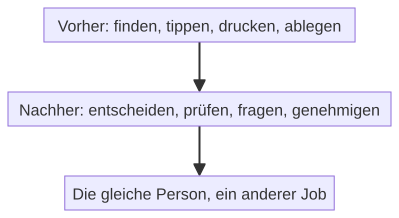

# 27. Was verändert sich im Büro

Sechs Monate nach der Installation tat Doreen Pratt etwas, das sie in einunddreißig Jahren noch nie getan hatte: Sie machte mitten im Monat Urlaub.

Nicht, weil das System es erlaubte—obwohl es das tat—sondern weil nichts kaputtging. Die Rechnungen gingen raus. Die Abschlüsse gingen raus. Die Monatsabschlussabstimmung wartete geduldig, auf die Weise, wie Software wartet, und wenn sie zurückkam, nahm sie ihr einen Nachmittag statt einer Woche.

Sie sagte Maggie das an ihrem ersten Rückkehrmorgen, stehend in der Türöffnung des Rechnungsräume, und dann sagte sie etwas, das Maggie aufschrieb.

"Das Seltsame ist, dass ich beschäftigter bin als früher. Aber es ist eine andere Art von beschäftigt. Ich suche nicht mehr nach Dingen. Ich schaue *auf* Dinge."

Dieses Kapitel geht es um diesen Unterschied, denn es ist der Teil der Automatisierung, den niemand wirbt und den jeder erlebt. Die Broschüren versprechen, dass die Maschine die Arbeit tun wird. Die Wahrheit ist interessanter: Die Maschine tut die *Verwaltung* der Arbeit, und der Mensch bleibt mit der Arbeit selbst zurück—which turns out to be the part that needed a person all along.

---

Lassen Sie uns präzise darüber sein, was sich in Riverton veränderte, denn Unschärfe ist der Feind eines nützlichen Arguments.

**Was aufhörte.** Jemand benutzte früher die Bestellung des Kunden ins Buchhaltungsprogramm einzutippen. Das hörte auf. Jemand benutzte Rechnungen einzeln auszudrucken, jede gegen den Lieferschein zu prüfen und sie in Umschläge zu legen. Das hörte auf, mostly. Jemand benutzte den monatlichen Verkaufsbericht zusammenzustellen, indem drei Tabellenkalkulationen exportiert und von Hand abgestimmt wurden. Das hörte auf. Jemand benutzte zum Lager zu laufen, um Tom zu fragen, ob ein Produkt auf Lager ist. Das hörte auf, weil die Antwort eine Frage war, die man in einem Satz stellen und in einer Sekunde erhalten konnte.

**Was begann.** Doreen begann, Preise gegen das Einkaufskonto zu prüfen, jeden Freitag, weil sie Zeit hatte und weil sie immer vermutet hatte, dass der Lieferant schleichend steigerte. Priya begann, jede Woche einen kurzen Kundenstamm, der nicht mehr bestellt hat, mit einem vermuteten Grund für jeden, an das Vertriebsteam zu senden. Tom begann, Lageranpassungen wöchentlich statt jährlich zu überprüfen, was der Firma half zu entdecken, dass ein Produkt seit 2022 in der falschen Mengeneinheit erfasst war und dass der "Verlust", den alle der Nachtschicht anlasteten, ein Rechenfehler war.

Keines dieser Dinge ist dramatisch. Zusammen sind sie der Unterschied zwischen einer Firma, die reagiert, und einer Firma, die bemerkt.

**Was sich überhaupt nicht veränderte.** Die Beziehung zu Ashfield Academy, die neunzehn Jahre alt ist und auf der Tatsache beruht, dass Carol Maggie vertraut, das Telefon zu beantworten. Die Beurteilung, welchem Kunden Kredit zu geben ist. Die Entscheidung, eine Produktlinie nicht mehr auf Lager zu halten. Das Gespräch mit einem Lieferanten, der zum dritten Mal Preise erhöht hat. Die Entschuldigung, wenn etwas schiefgeht.

Das ist die ehrliche Form der Veränderung, und es lohnt sich, sie als Regel zu formulieren, denn die Regel gilt in jeder Firma, in der sie erprobt wurde: **Automatisierung nimmt die Verwaltung einer Arbeit und lässt die Arbeit zurück.**

---

Es gibt ein historisches Parallel, das tröstlicher ist als jede Statistik.

Im Jahr 1979 veröffentlichten zwei Männer an der Harvard—Dan Bricklin und Bob Frankston—ein Programm namens VisiCalc. Es war die erste Tabellenkalkulation: ein Gitter auf einem Computerbildschirm, wo eine Veränderung in einer Zelle alles neu berechnete, was davon abhing. Vor VisiCalc war ein Finanzmodell ein Blatt Papier, ein Bleistift und ein Taschenrechner, und eine Änderung einer Annahme bedeutete, von Hand neu zu berechnen, was bedeutete, dass die meisten Modelle einmal berechnet und dann verteidigt wurden.

VisiCalc und die Tabellenkalkulationen, die nachfolgten, taten mit der Rechnung des Buchhalters, was die Waschmaschine mit der Wäsche tat. Und die Vorhersage zur Zeit war, dass Buchhalter verschwinden würden.

Sie wurden nicht verschwinden. Es gibt, wenn überhaupt, mehr von ihnen. Was verschwand, war die Arbeit der Person, die Zahlenkolonnen mit einem Bleistift aufaddierte, und was erschien, war die Arbeit der Person, die entscheidet, welche Zahlen aufzusammeln sind, prüft, ob das Modell Sinn ergibt, und dem Vorstand erklärt, warum die Zahlen sind, was sie sind. Das Werkzeug ersetzte nicht die Beurteilung. Es veränderte den *Preis* der Beurteilung, indem es die Rechnung entfernte, die davor gestanden hatte.

Dasselbe geschieht jetzt, und es geschieht schneller, und es geschieht auf einer anderen Schicht der Arbeit. Die Tabellenkalkulation entfernte die Rechnung. Der Agent entfernte die *Abruf*—den Teil der Arbeit, der darin besteht, herauszufinden, was wahr ist.

Fragen Sie Doreen, was sie 2019 tat, und sie hätte gesagt: Ich halte die Papierarbeit. Fragen Sie sie, was sie jetzt tut, und sie sagt: Ich prüfe Dinge. Die zweite Antwort ist mehr wert für die Firma, und sie ist auch die Antwort einer Person, die eine Arbeit tut statt einem System zu dienen.

---

Nichts davon geschieht von selbst, und hierin liegt, wo die meisten Firmen es falsch machen.

Das Ausfallmuster ist jedem bekannt, der ein Büro beim Übernehmen eines neuen Werkzeugs beobachtet hat. Das Werkzeug wird installiert. Ein Ausbilder kommt für einen Tag. Die enthusiastischen Menschen benutzen es; die anderen behalten ihre Tabellenkalkulation, weil die Tabellenkalkulation heute schneller ist, und das Werkzeug ist nur schneller *einmal, wenn man seine Daten hineingelegt hat*. Sechs Monate später hat die Firma zwei Systeme, von denen eines die Wahrheit ist und eines die Gewohnheit, und das Argument über welches welches ist, verschlingt mehr Zeit als entweder eins einsparnte.

Es gibt drei Dinge, die dies verhindern, und sie sind nicht technisch.

**Das erste ist, dass die Arbeit durch die neue Tür ankommen muss.** Wenn eine Bestellung noch per Telefon aufgenommen und auf ein Pad geschrieben werden kann, wird es geschehen. Wenn die Rechnung noch im alten Programm produziert werden kann, wird es geschehen. Das neue System wird zur Wahrheit am Tag, an dem es die *einzige* Route wird, und kein Tag früher. Dies ist der Grund, warum die Installation in diesem Buch mit der Entfernung der alten Abkürzungen endet, nicht mit einer Schulzungssitzung.

**Das zweite ist, dass jemand erlaubt sein muss, neugierig zu sein.** Doreens neue Arbeit—Prüfen, Bemerken, Fragen warum—existiert nur, wenn die Firma sie als Arbeit behandelt. In zu vielen Firmen wird der Person im Moment, da die Verwaltung automatisiert wird, mehr Verwaltung gegeben, weil Verwaltung messbar ist und Bemerken nicht. Die Firmen, die den Vorteil ernten, sind die, die "Bemerken" in jemandes Woche schreiben.

**Das dritte ist, dass der Maschine ein Name und ein Limit gegeben werden muss.** Nicht eine Persönlichkeit—ein Name im Sinne einer Verantwortung. Jemand muss für das verantwortlich sein, was der Assistent tut, muss sein Protokoll lesen, muss erlaubt sein, ihn auszuschalten. Ein Assistent, den niemand besitzt, ist ein Assistent, den niemand prüft, und ein Assistent, den niemand prüft, ist ein Gerücht mit einer Tastatur.

## Die neue Stellenbeschreibung

Es lohnt sich, aufzuschreiben, was Doreens Arbeit wurde, denn Stellenbeschreibungen sind, wo diese Art von Veränderung entweder real gemacht oder leise aufgegeben wird.

Vorher, in der Sprache des Büros: die Bücher führen, die Rechnungen erstellen, Geld nachjagen, die Papierablage, das Telefon beantworten, wenn es um Geld geht.

Nachher, in derselben Sprache: **das Modell wahr halten, entscheiden was eine Ausnahme ist, und die Fragen beantworten, die die Zahlen aufwerfen.**

Drei Pflichten, und jede von ihnen ist auf eine bestimmte Weise neu.

**Das Modell wahr zu halten** bedeutet die kleinen Disziplinen, die das System vertrauenswürdig machen: ein Produkt mit der richtigen Mengeneinheit, ein Kunde mit den richtigen Zahlungsbedingungen, eine Lieferung, die am Tag ihres Geschehens validiert wurde, eine Lageranpassung mit einem Grund. In der alten Welt waren diese auch ihre Arbeit, aber sie waren unsichtbar—niemand konnte die Kosten, sie falsch zu machen, erst zum Jahresende sehen. Jetzt sind sie der Unterschied zwischen einer Antwort und einer Vermutung, und sie haben eine tägliche sichtbare Konsequenz, was sie leichter zu verteidigen und schwieriger zu überspringen macht.

**Zu entscheiden, was eine Ausnahme ist** bedeutet, die Listen zu lesen. Die überfälligen Rechnungen, die Lagerung unter Minimum, die Produkte ohne Preis, die Lieferung ohne Rechnung. Das System produziert die Liste; die Person entscheidet, welche Artikel Rausch sind und welche ein Problem. Das ist eine echte Fähigkeit, und sie ist die, die mit Übung verbessert wird—nach drei Monaten konnte Doreen auf eine Liste von zwölf überfälligen Rechnungen sehen und Ihnen sagen, welche vier real waren.

**Die Fragen zu beantworten, die die Zahlen aufwerfen** ist der Teil, den niemand vorhergesagt hat. Ein System, das Fragen beantworten kann, produziert *mehr Fragen*: warum ist der Transport gestiegen, warum hat dieser Kunde leise geworden, warum ist die Marge dieses Produkts anders als im letzten Monat. Jemand muss diese nachjagen, und die Person, die sie nachjagt, ist die, die jetzt die Zeit hat.

## Was sich nicht veränderte, und warum es wichtig ist

Drei Dinge änderten sich überhaupt nicht, und es lohnt sich, das zu sagen, weil die Literatur über Automatisierung mostly über Veränderung ist.

**Das Telefon wird immer noch von einer Person beantwortet.** Carol in Ashfield ruft an, weil sie mit Maggie sprechen möchte, nicht weil sie eine Transaktion möchte. Die Beziehung ist das Geschäft, und kein System hat sie jemals verbessert.

**Die Beurteilung über Menschen wird immer noch von Menschen gemacht.** Wen man Kredit gibt, wen man hart nachjagt, wen man gehen lässt. Das System liefert die Fakten—Zahlungshistorie, Bestellmuster, überfällige Beträge—und die Fakten machen die Beurteilung besser informiert, aber sie machen sie nicht.

**Die Entschuldigung ist immer noch eine Person.** Wenn etwas schiefgeht, möchte ein Kunde eine menschliche Saye sagen hören. Eine automatisierte Entschuldigung ist schlechter als keine, weil sie bestätigt, dass niemand aufpasste.

Diese drei sind der Kern des Geschäfts, und sie sind der Grund, warum dieses Buch beharrlich darauf besteht, dass die Maschine die *Geduld* nimmt und der Mensch die *Beurteilung* behält. Eine Firma, die das Telefon, die Kreditentscheidung oder die Entschuldigung automatisiert, hat die falsche Sache automatisiert, und sie wird es auf die Weise herausfinden, auf die Firmen immer herausfinden: langsam, und dann plötzlich.

## Die Stunde im Kalender

Die wichtigste Veränderung in Riverton war kein Feature der Software. Es war eine Stunde in Doreens Kalender, jeden Freitag, betitelt *Systeme und Ausnahmen*, die niemand gebucht werden durfte.

Diese Stunde ist, wo das Bemerken geschieht: die Preisprüfung, das Protokolllesen, die Liste von Dingen, die seltsam aussehen. Ohne sie würde die durch die Automatisierung gesparte Zeit mit mehr Verwaltung gefüllt worden sein—which is what happens in most companies, and why most companies report that automation "did not really save anything".

Eine Stunde pro Woche ist fünfzig Stunden pro Jahr, was ein Bruchteil von dem ist, was das System spart. Es ist auch der Unterschied zwischen einem System, das verbessert, und einem, das verfallt. Sams Zeile—*die Software fällt nicht aus, die Gewohnheiten tun*—ist das ganze des Arguments, und die Stunde im Kalender ist, wie eine Gewohnheit geschützt wird.

---

Maggie wurde gefragt, auf einem Handelskammernessen im Frühling, ob sie "Mitarbeiter mit künstlicher Intelligenz ersetzt" habe.

Sie hatte über die Frage vorher nachgedacht, weil sie wusste, dass sie kommen würde, und sie hatte entschieden, sie ehrlich statt diplomatisch zu beantworten.

"Nein", sagte sie. "Wir haben ein Aktenführungssystem ersetzt. Die Mitarbeiter sind noch da, und sie tun die Arbeit, die das Aktenführungssystem ihnen zu verhindern verhinderte."

Die Frau, die gefragt hatte, sah skeptisch aus. "Aber Sie müssen weniger Menschen brauchen."

"Wir brauchen dieselbe Anzahl von Menschen und mehr ihrer Aufmerksamkeit", sagte Maggie. "Was, wenn Sie ein Geschäft führen, dasselbe ist wie mehr Menschen zu brauchen."

Das ist die Wahrheit davon, und es lohnt sich, es in den denkbar einfachsten Begriffen zu setzen, weil die öffentliche Unterhaltung über künstliche Intelligenz von zwei Geschichten dominiert wird, die beide falsch sind: dass die Maschine alles tun wird, und dass die Maschine alles nehmen wird. Was tatsächlich geschieht, in einer gut geführten kleinen Firma, ist, dass die Maschine den Teil der Arbeit nimmt, den niemand wollte, und die Menschen entdecken, dass sie diesen Teil so lange getan haben, dass sie vergessen haben, was der Rest der Arbeit war.

Doreen hatte, an ihrem ersten Rückkehrmorgen von jenem Urlaub, eine Lieferantenrechnung mit einem Preis gefunden, der um vier Prozent gestiegen war ohne Ankündigung. Sie hatte sie innerhalb einer Minute des Niedersetzens vor sich, weil der Assistent sie markiert hatte, während sie weg war. In 2019 hätte sie gefühlt, bezahlt und zum Jahresende entdeckt werden sollen, wenn überhaupt.

Sie sagte nicht "die Maschine fand dies". Sie sagte: "Schau dir das an. Vier Prozent, im März, und niemand hat uns Bescheid gesagt."

Das ist der Satz, zu dem dieses Buch hingearbeitet hat. Die Maschine tat das Finden. Der Mensch tat das Bemerken. Die Firma bekam den Vorteil.
