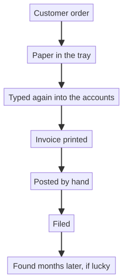

# 1. The Room Where the Paper Lives

The room had no name on the door. Everyone at Riverton Office Supply called it the invoice
room, although invoices were only a fraction of what it held: purchase orders, delivery notes,
remittance slips, credit notes, the thin pink sheets that suppliers sent when they wanted to be
paid sooner, and the thicker cream ones that customers sent when they wanted to pay later.

Maggie Ellery had inherited the room, along with the company, from her father. She had been
running Riverton for eleven years and she still began every Monday in that room, standing in the
doorway with a cup of coffee going cold in her hand, looking at the three grey filing cabinets as
if they were animals she was responsible for feeding.

The cabinets were called, in the language of the office, the Old Years, the Middle Years and the
Current Year. The Old Years had a lock nobody had a key for. The Middle Years had a drawer that
opened only when you lifted it slightly, the way you lift a suitcase whose catch has given up.
The Current Year was the one that mattered, and it was also the one that could not close, because
the folders inside it had grown fat with paper that had arrived faster than anyone had filed it.

Doreen Pratt had been keeping those cabinets for thirty-one years. She was sixty-three, she wore
a cardigan in every season, and she possessed the kind of memory that makes a company feel
safer than it is. If you asked Doreen for the delivery note from the March shipment to the
school district in Ashfield, she would not look at the cabinets. She would look at the ceiling,
move her lips slightly, and say: "That was the week Trevor's van had the alternator. Third folder
from the back, second drawer, behind the pink slips." She was right often enough that nobody had
ever thought to write down how she did it.

This is the first thing to understand about a business like Riverton, and it is the thing that
almost nobody writes about in the books on management. The company did not run on its software.
It ran on Doreen.

---

At twenty past eight that Monday, the telephone on Maggie's desk rang with the particular
brightness of a customer who is about to be disappointed.

It was Ashfield Academy, the school district that had bought from Riverton for nineteen years:
pens by the thousand, exercise books by the pallet, the good whiteboard markers that actually
erase. Their business manager was a patient woman named Carol who had, that morning, received a
delivery of four hundred ring binders and no invoice.

"Margaret," Carol said, and Maggie knew from the use of her full name that this was serious,
"we cannot pay an invoice we have not received, and we cannot close our quarter without it. And
your driver left the binders in the car park, not at the loading bay."

Maggie said the things one says. She would look into it personally. She was sorry. She would call
back within the hour.

She put the phone down and did what she had done ten thousand times: she walked to the invoice
room and asked Doreen where the paperwork was.

Doreen looked at the ceiling. She moved her lips. Then she said, "The binders went out Thursday.
The invoice should have gone with the note. Unless"—and here she paused, because she had reached
the edge of her memory and could feel the drop beyond it—"unless it went into the tray and Trevor
took it with the returns."

There were four trays in the invoice room. They were labelled *In*, *Out*, *Later* and, in a
hand that belonged to nobody who still worked at Riverton, *Trevor*. There was no Trevor any
more. There had not been a Trevor for six years. The tray remained, and paper still went into it,
because a tray with a name on it is a kind of instruction.

Maggie found the invoice in the Trevor tray, under a seed catalogue and a reminder about fire
extinguishers. It had been printed on Thursday, signed on Thursday, and never sent. It was, in
the strict sense, a complete and correct document. It had simply failed to travel.

She drove it to Ashfield herself, because the driver had already gone home and because she wanted
the twenty minutes in the car to be angry in private. On the way back she stopped at the
roundabout by the retail park and sat there longer than the traffic required, watching the
windshield wipers do their work, and she thought: *we are not bad at this. We are not lazy. We
are not stupid. So why does it feel like the company is held together with string?*

---

Here is a fact that surprised Maggie when she read it that evening, and that will probably
surprise you too.

In June 1975, a magazine called *Business Week* published a long article titled "The Office of
the Future." It described, with great confidence, a world in which the routine paperwork of
business—the record-keeping, the bookkeeping, the filing—would be handled by machines, and paper
would become a curiosity, the way the horse became a curiosity after the motor car. The
prediction was repeated so often over the following decades that it acquired a name of its own:
the paperless office.

Between 1980 and 2000, worldwide use of office paper more than doubled.

That is not a small irony; it is a large one, and it has a cause that matters for everything in
this book. Paper did not survive because offices were backward. Paper survived because it was
extremely good at one job: it was the only thing in the building that everybody could read.
The accountant could read a purchase order. The warehouse could read a delivery note. The
salesperson could read a price list. The tax inspector could read all of them. A computer in
1985 could not talk to a computer in the next room, let alone to the school district's accounts
department, so the computer printed the paper and the paper did the talking.

We did not fail to become paperless. We automated the *production* of paper. We made it cheaper
to print a document than to walk to a filing cabinet, and then we printed everything, and then we
bought more filing cabinets.

---

Riverton's Monday was not unusual, and that is exactly why it is worth telling. The same scene
plays out in a thousand variations in every town: a plumbing supplier, a printer of labels, a
family firm that installs commercial kitchens. The details change; the shape does not.

A customer asks a question that requires three facts from three places. Someone promises an
answer. The answer requires a fourth fact that lives in the head of a person who is on holiday.
By the time the fourth fact is found, the customer has called again, and the promise has become
a small piece of damage. The damage is repaired with an apology and a discount, and the discount
is recorded nowhere, because discounts that are given to repair damage are not the kind of thing
anybody wants to write down.

Multiply that by fifty-two weeks and by every department, and you arrive at the true cost of the
way most small companies work. Not theft. Not waste, in the sense that an auditor means. A tax
on remembering: the endless, invisible toll of keeping facts in human heads and paper trays, and
of moving those facts from one head to another by telephone.

There is a diagram that makes this visible, and it is worth looking at for a moment, because it
is the map of the problem this book is about.

Six steps, and at each arrow a fact is copied by a person from one medium into another. Every
copy is a chance to introduce an error, and every error costs more to find than it cost to make.
The invoice that never travelled was not an anomaly. It was the normal behaviour of a system
whose memory is distributed across trays, heads and drawers, with no single place where the truth
is kept.

It is worth putting a number on that, because the number is what changes people's minds.

The Ashfield invoice took Maggie forty minutes: twenty on the telephone, twenty in the car. Add
Doreen's ten minutes of looking, and the driver's five, and the bookkeeper's fifteen the following
week when the payment failed to arrive and had to be chased. An hour and a half of four people's
time, to deliver one piece of paper that had already been produced correctly. The invoice was
worth eight hundred and forty pounds. The company had spent perhaps sixty pounds of wages
delivering it, and nobody would ever see that sixty pounds in any report, because it is not an
expense. It is simply a day that was slightly shorter than it should have been.

Multiply sixty pounds by the number of documents a wholesaler produces in a year—orders, notes,
invoices, credits, statements, remittances—and the invisible tax becomes the largest single cost
in the business, larger than rent, larger than the vans, larger than the salaries it is paid out
of. It is invisible because it is not a line in the accounts. It is the absence of a line.

---

Maggie's father had a phrase for the business. He used to say, standing in the warehouse with
his hands behind his back, "We sell stationery, Margaret. We don't sell confusion." He meant it
as a boast about the quality of the service, and it was true: Riverton's service was good. It
was good in the way that a restaurant with a brilliant chef and no reservation book is good. It
worked while the chef was in the kitchen.

What Maggie began to suspect, that Monday evening, with the coffee cold and the invoice safely
delivered, was that the company had reached the limit of what good people can hold in their
heads. Riverton had grown from four hundred product lines to eleven thousand. It had gone from
one van to six. It had customers who ordered through a web shop that nobody quite trusted, and
suppliers in three countries who sent invoices in two currencies. Doreen's memory, extraordinary
as it was, had become a single point of failure with a cardigan.

She did not want to buy software. She had bought software. There was an accounting program that
produced beautiful reports nobody read, and a stock system that had been installed by a man who
had since emigrated, and a shared folder on the office network containing seventeen versions of
the price list, of which fourteen were wrong.

What she wanted, though she did not have the words for it yet, was a business that remembered.
One place where a customer, a product, an order, an invoice and a payment were the same fact
seen from different sides. One place that could answer the question "what is true right now?"
without a telephone call.

The rest of this book is about how a company gets that place, and what happens when an artificial
intelligence is allowed to work inside it.

---

A note on what you are about to read.

This is not a book for programmers. There is no code in it, no commands to type into a black
window, no database queries. If you can use a web browser and answer an email, you have every
skill this book requires. The technical parts are described the way you would describe them to a
colleague over lunch: what the thing does, why it does it that way, and what you should expect to
see on the screen.

Nor is it a book of theory. Every scene that follows—every installation screen, every
conversation with the assistant, every invoice it creates, every refusal it receives from the
system—was performed on a real computer, on a real installation, and photographed as it happened.
When something went wrong, and things went wrong, the failure is in the book too, because a guide
that only shows the successful path is not a guide; it is an advertisement.

The company in these pages is called Riverton Office Supply. It is a real installation with a
fictional name, set up for the writing of this book: an office-supplies wholesaler with customers,
products, a warehouse, a bank account and a tax office to satisfy. You can follow the same steps
with your own company's name, and by the end you will have the same thing Maggie wanted on that
Monday evening—a business that knows what is true, and an assistant that can act on it.

Maggie, for her part, did not know any of this yet. She knew only that she had driven forty
minutes to deliver a piece of paper that a machine should have sent, and that the feeling in her
chest was not anger any more. It was the beginning of a decision.

She went back to the office, turned on the light in the invoice room, and looked at the three
cabinets for a long moment.

"Right," she said, to nobody in particular. "Let's find out how this is supposed to work."
