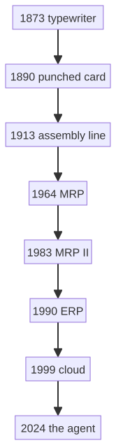

# 2. A Short History of Doing Things Twice

The filing cabinet was invented because a man got tired of looking for a letter.

That is not a joke, and it is not an oversimplification. Before the vertical file, offices kept
their paper in pigeonholes, in bundles tied with ribbon, in boxes labelled with the name of a
customer and the year. To find anything you had to remember where it had been put, which meant
that the office, like Riverton, ran on the memories of its clerks. The vertical filing cabinet,
which appeared in the last years of the nineteenth century and spread through offices with
astonishing speed, changed the terms of the problem: it made a document findable by *category*
rather than by *recollection*. A clerk who had never met the customer could open the drawer
marked A–B and find the file.

It was, in its day, an artificial intelligence. It held information outside a human head, it
answered questions on demand, and it never went on holiday. We forget this because the technology
is made of steel and smells of dust, but the ambition was exactly the ambition of the machine
that will be discussed in this book: take the facts out of the person, put them somewhere they
can be found, and let the person do the work that needs a person.

Maggie spent the week after the Ashfield invoice reading about this, in the way that people who
run small companies read about things—late at night, with a laptop on the kitchen table and a
notebook beside it, following one reference to the next until her husband asked whether she was
coming to bed.

What she found was not a story of steady progress. It was a story of the same idea being
discovered over and over, by different people, in different materials.

---

**1873.** The typewriter reaches the office. It is not a calculating machine and it does not
store anything, but it does something that turns out to matter more: it makes writing uniform.
A handwritten order is a document with a personality; a typed order is a document with a format.
Formats can be compared, counted and filed. Within a generation, the typist has become the
gatekeeper of the office, and the office has become a place where information is *produced* on
schedule rather than when somebody gets round to it.

**1890.** The United States census is counted with punched cards and an electromechanical
tabulating machine, built by Herman Hollerith. The census of 1880 had taken eight years to
process. The census of 1890, with a larger population and more questions, took about one. The
machine that did it became, through a merger in 1911 and a renaming in 1924, the company we know
as IBM. Punch cards would remain the standard way to talk to a computer for the next seventy
years, and the reason is instructive: a card is a record you can hold, sort, drop, and re-run.
It is paper that a machine can read.

**1913.** Henry Ford's moving assembly line at Highland Park turns the manufacture of a car into
a sequence of timed steps. The lesson the business world takes from it is not really about cars.
It is that a process can be *designed*—written down, measured, and then improved—instead of
being left to the habits of the people performing it. Frederick Winslow Taylor had been arguing
the same thing since the 1890s with his stopwatch and his "scientific management," and the
combination of Taylor's stopwatch and Ford's line produced a conviction that would dominate the
century: if you can describe a business as a series of steps, you can mechanise the steps.

**1951.** A computer is used to calculate payroll for a company. The machine is enormous, the
program is written in machine instructions, and the calculation takes less time than the
preparation of the punched cards it reads. But the principle is established: the boring,
repetitive, error-prone arithmetic of the office is exactly what a computer is good at.

**1964.** A man named Joseph Orlicky, working with the manufacturing industry, develops a way of
calculating what a factory needs to buy and when, based on what it intends to build. It is called
Material Requirements Planning, and in the same year a company called Black & Decker installs
the first system that uses it, with a project leader named Dick Alban. Orlicky publishes the
book in 1975—*Material Requirements Planning: The New Way of Life in Production and Inventory
Management*—and by then about seven hundred companies are running some version of the idea. By
1981 there are roughly eight thousand.

**1983.** Oliver Wight extends the idea from materials to the whole factory: schedules, capacity,
sales forecasts, finance. The result is called Manufacturing Resource Planning, or MRP II, and it
is the first business software that pretends to know the state of an entire company.

**1990.** An analyst firm called Gartner needs a name for the next thing—software that does not
just plan the factory but runs the whole enterprise: sales, purchasing, stock, accounts, people.
They call it Enterprise Resource Planning. ERP. The name is an accident of marketing that stuck,
and it has been stretched ever since to cover almost anything a company does with a database.

**1992.** SAP, a German company founded in 1972 by five engineers who had left IBM, releases R/3,
a system that runs on the client-server architecture that was then becoming affordable. It
becomes the standard against which every later ERP is measured, and the reason is not elegance.
It is that R/3 encodes a company's processes in a way that auditors, banks and regulators
recognise.

**1999.** A company called NetLedger starts selling accounting software that runs in a browser,
on somebody else's computer, for a monthly fee. The cloud era of business software begins. It
will take another fifteen years for the idea to become normal, and another five for it to become
the default.

**2013.** Gartner coins "postmodern ERP": instead of one enormous system, a company will run a
set of smaller systems that talk to each other. The prediction is right in spirit and wrong in
detail—what actually happened is that the small systems multiplied, and the talking became the
hard part.

Maggie copied the dates into her notebook, drew a line under them, and wrote a sentence that
would have made her father laugh: *Every one of these was an attempt to stop doing things twice.*

## The pattern that repeats

Look at the dates again and a rhythm appears: roughly every twenty years, a new technology promises
to end the copying, and every time the promise is kept in part and broken in part.

The typewriter ended the handwritten duplicate and created the typing pool. The photocopier ended
the carbon copy and created the filing crisis. The personal computer ended the ledger book and
created the spreadsheet sprawl. Each one removed a specific cost and added a general one: the cost
of *knowing which copy is true*.

The ERP was the first technology in the series that attacked the general cost directly, by insisting
that there be one copy. It took thirty years, and it worked—inside the four walls of a company. What
it never solved was the boundary: the customer's system, the supplier's system, the tax office's
system, each with its own copy of the same facts.

The agent is the first technology in the series that can work across that boundary, because it can
read what a human wrote and write what a system understands. Whether it keeps the promise is the
subject of the rest of this book.

---

There was a photograph on the office wall that she had looked at a thousand times without seeing.
It showed four women at four desks in 1978, in the room that was now the invoice room, each with a
typewriter and a stack of flimsy paper. Her mother was the second from the left.

"Carbon paper," Doreen said, when Maggie asked about it. "You typed the invoice and the copy came
through underneath, on the thin pink sheet. Three copies if you were lucky and your ribbon was
new. Then you separated them and sent one to the customer, one to the file, and one to the
accounts book."

"And if you made a mistake?"

"You typed it again. All of it. And then you had two copies of the mistake, one of which was in
the file, so you had to go and find it."

Riverton had bought a photocopier in 1983, and for a while the company believed it had solved the
problem of copies. It had solved the problem of *making* copies. What it had not solved—what
nobody had solved—was the problem of knowing which copy was the true one. By 1991 there were
photocopies of invoices in three places in the building, and the person who knew which one the
customer had actually received was Doreen, who had been there since 1987.

This is the pattern that repeats through the whole history of the office, and it is worth naming
before we go any further. Every technology that makes it easier to produce a document also makes
it easier to produce *another* document, and the cost of the second one falls faster than the
cost of deciding which one matters. The photocopier multiplied paper. Email multiplied documents
again. The shared folder multiplied versions. Each invention kept its promise—cheaper, faster,
more—and each one left the same unpaid bill: the work of deciding what is true.

An ERP is the first technology in that series whose promise is not "more documents" but "one
fact." That is why it feels different in the hand, and why installing one is more like a legal
settlement than like buying a machine.

There is a small test that tells you whether a company has made the change, and it costs nothing
to apply. Ask two people, in different departments, the same question about the same customer:
how much do they owe us? If the answers differ, the company still has copies. If the answers
agree, and both people can tell you which documents the answer is built from, the company has a
model. Everything else—the software, the servers, the artificial intelligence—is scaffolding
around that one achievement.

---

Because that is the thread. From the filing cabinet to the cloud, every invention in the history
of the office has been aimed at the same waste: the second time a fact is written down.

The customer gives their address. It is written on the order. It is written again on the delivery
note, again on the invoice, again in the accounts, again on the label, and again by the accounts
department of the customer when the invoice arrives. Five copies of a fact that was stated once.
Each copy is a chance to mistype a postcode, and the postcode is how the parcel finds the school.

An ERP is, at heart, a promise: that the address will be written down once, in one place, and
that every document which needs it will *look it up* instead of being given a fresh copy. That
promise sounds modest. It is not. To keep it, the system must know what a customer is, what an
order is, what a product is, and how they relate; it must decide who is allowed to change the
address and who is not; it must remember what the address was last month, because the invoice
that was sent in March must still show the address it was sent to. The promise turns a pile of
paper into a model of the company.

And a model, once it exists, can be *acted upon* by something other than a person.

---

There was one more thing in Maggie's notebook, written on the last page of that week, in
handwriting that slanted more than usual because it was late.

*Why did any of this work?*

She had read about companies that spent millions on ERP systems and ended up worse off; the
stories were not hard to find, and they had made her cautious. A system that models a company is
only useful if the model is *true*, and a model is true only if the people who know the facts put
them in. That is the paradox at the centre of the whole industry: the software exists to relieve
people of administration, and it only works if people do the administration of feeding it.

The generation of systems that came after 1990 solved this by force. They made the software the
only way to do the work: you cannot ship the parcel without the delivery note, you cannot print
the invoice without the order, you cannot close the month without the bank reconciliation. The
model stays true because there is no alternative route around it. This is why ERPs feel like
prisons to the people who use them, and why they work anyway.

Maggie understood the trade. What she did not yet understand—what almost nobody understood until
quite recently—was that the trade was about to change, because a machine had learned to read.

The reading machine is not a filing cabinet and it is not an ERP. It is the thing that, in the
last few years, has started to appear in offices under the vague name of artificial intelligence:
a program that can be given a sentence in ordinary language and can answer, or act, without
anybody having written a rule for that particular sentence.

If such a program could be given the model of the company—the customers, the products, the
orders, the ledger—then the burden of feeding the system would fall, not on the people, but on
the machine that reads what people say.

That is the whole idea of this book, and it took the rest of the year to make it real.
