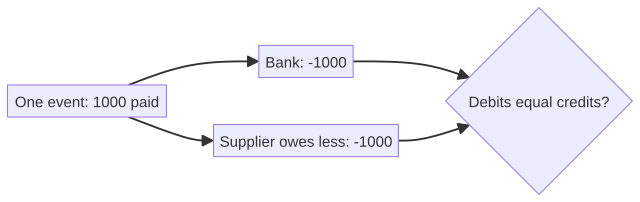

# 3. The Friar Who Wrote Down the Rules

Maggie's accountant was a man named Gerald Pryce, who had an office above a chemist's shop and
a habit of answering questions in the order in which they interested him rather than the order in
which they had been asked.

She went to see him on a Thursday, with a folder of printouts and a question she was slightly
ashamed of: *why do we have to do the books at all?* Not the tax, she said—she understood the
tax. The double entry. The debits and the credits, the trial balance, the whole elaborate
symmetry that Doreen performed every month at the kitchen table of the office with a calculator
and a pot of tea.

Gerald took his glasses off, which was a good sign, and said: "Because a merchant in Venice
wanted to know whether he was rich."

---

The man he meant was Luca Pacioli, and the date that matters is 1494.

Pacioli was a Franciscan friar, a mathematician, and a teacher of considerable fame in his own
time. He worked in Venice, in Florence, in Milan, and for a while in the household of a duke. He
was a friend of Leonardo da Vinci—Leonardo drew the illustrations for one of his books, and
Pacioli taught him mathematics—and he was, by temperament, the sort of person who believes that
anything worth doing is worth writing down properly.

In 1494, in Venice, he published a mathematics textbook called *Summa de arithmetica, geometria,
proportioni et proportionalità*: the summary of arithmetic, geometry, proportions and
proportionality. It was an enormous book, written in Italian rather than Latin so that merchants
could read it, and it covered everything a practical man of business might need: how to multiply,
how to calculate interest, how to exchange currencies, how to measure a barrel.

One chapter of it described something that Italian merchants had been doing for at least two
hundred years, and which nobody had ever explained in print: the method of keeping accounts by
double entry.

The idea is almost insultingly simple, and it is the reason every accounting system in the world,
including the one that Riverton was about to install, looks the way it does.

Every transaction is written down twice, in two different places, from two different points of
view. If the company pays a supplier a thousand pounds, then the money in the bank has gone down
by a thousand and the amount owed to the supplier has gone down by a thousand. Two facts, one
event. If the company sells a desk to the school, then the customer owes money and the company
has earned revenue: two facts, one event. The two entries are called a debit and a credit, and
they must always be equal and opposite, because they are describing the same thing from both
sides of the table.

The consequence is a self-checking system. Add up every debit in the books and every credit, and
if the two totals do not agree, something is wrong. Not "something might be wrong"—wrong. The
books tell you. It is the only part of business administration that has a mathematical guarantee
built into it, and it has survived six centuries of wars, currencies, empires and software
because of that guarantee.

Gerald drew it on the back of an envelope, which is how accounting has been taught since 1494.

"Now," Gerald said, putting the pen down, "here is what your father never understood, and what
most people never understand. The double entry is not a rule invented to make your life
difficult. It is a *description of reality*. There are two sides to every transaction because
there are two parties to every transaction. The books are not a tax form. They are a model of
what actually happened."

---

To see why the symmetry matters, it helps to watch somebody use it.

Once a month, Doreen took the bank statement, the printed list of everything that had actually
left and entered the company's account, and laid it beside the accounts. The two never agreed.
They never agree in any company; the question is only by how much, and why.

One month, the difference was three hundred and twelve pounds. Doreen did not start looking for
three hundred and twelve pounds. She started at the top of the statement and worked down, ticking
each line against the books, and she found that the bank had charged a fee of twelve pounds that
Riverton had not recorded, and that a customer had paid an invoice of three hundred pounds that
the books still showed as unpaid.

Twelve and three hundred. The difference was the sum of two things that had happened in the real
world and had not yet happened in the model. Within ten minutes she had written two entries—one
for the bank charge, one for the receipt—and the two columns agreed to the penny.

That is the whole art, and it is worth noticing what it is *not*. It is not arithmetic; a
calculator could have found the difference. It is not memory; the statement is the memory. It is
the discipline of a model that has two sides, so that every real event has a place to be recorded
twice, and a gap that can be *localised*. Without the second side, a difference of three hundred
and twelve pounds is just a number that is wrong, and you search for it by reading everything.
With the second side, the number tells you where to look.

When an ERP posts an invoice, it performs Doreen's ten minutes automatically, at the moment the
invoice is created, and it performs it for every transaction in the company. That is not a
convenience. It is the difference between a company that discovers its errors monthly, in a
batch, and a company that discovers them immediately, one at a time, while the person who caused
them is still in the room.

---

The history is worth a moment more, because it explains something about modern software that
otherwise looks arbitrary.

The earliest surviving evidence of full double-entry bookkeeping is a ledger from 1299–1300,
kept by a Florentine merchant named Amatino Manucci for the Farolfi company, which traded from
Nîmes in the south of France. There are hints of the practice even earlier, in the records of
Florentine money changers at a fair in Bologna in 1211. The system spread along the trade routes:
to the Champagne fairs, to Venice, to Lyon, to Antwerp. By the fifteenth century, a merchant who
wanted to do business at the great international fairs had to keep his accounts this way, because
his partners and his bankers did, and because credit is impossible without a shared way of
counting.

A Ragusan merchant called Benedetto Cotrugli wrote a description of the method in 1458, in a book
called *Della mercatura e del mercante perfetto*—on trade and the perfect merchant. It was not
printed until 1573, eighty years after Pacioli's book, and the printer shortened it. So Pacioli
got the credit, and the phrase "father of accounting," which he would probably have found
embarrassing, since he was quite clear that he was describing what other people already did.

What Pacioli did was more important than inventing it: he made it *portable*. A merchant in
Naples who read the *Summa* could keep books that a banker in Bruges would accept. A method that
lives in the head of a family dies with the family; a method that lives in a printed book belongs
to everyone. It is the same reason we write down recipes.

Six hundred years later, when you open an invoice in an ERP system and see the words *Journal
Entries* underneath it, you are looking at Pacioli's chapter, translated into software. The
accounts have names now—Debtors, Creditors, Sales, Stock—and the entries are made automatically
when you click a button marked *Post*. But the symmetry is unchanged, and the guarantee still
holds: if the entries do not balance, the system will not let you post the document. It is the
one place in business software where the machine can tell you, with certainty, that you have
made a mistake.

There is a pleasant curiosity attached to the man. In 1496 Pacioli moved to Milan, to the court
of Ludovico Sforza, and there he met a painter and engineer who was then working on a bronze horse
that was never cast. The two men became friends; Pacioli taught him mathematics, and the painter
drew the illustrations for one of Pacioli's later books, on divine proportion. The painter was
Leonardo da Vinci. So the rules that govern the ledger of a stationery wholesaler in a market town
were, quite literally, drawn by the same hand that drew the *Last Supper*—and it is worth
remembering, when accounting feels like a chore, that it once stood in the same room as the most
curious mind of its age, and was considered a fit subject for it.

## Why it survived

There is a question worth asking about any six-hundred-year-old practice: why did this one survive
when so much else did not?

The answer is not tradition. Double entry survived because it is *falsifiable*. A set of books can be
checked, by somebody who did not write them, with no more than arithmetic. That property is rare in
administration: a contract, a report, a plan—none of them can be checked the same way. The ledger
can.

The second reason is that it is *portable*. Pacioli's rules do not depend on a currency, a country or
a technology. They survived the florin, the pound, the euro; they survived handwriting, the
typewriter, the spreadsheet and the database. A merchant from 1500 could read a modern trial balance
and recognise it, which is more than can be said for a modern reader confronting a 1500 ledger.

The third is that it *constrains*. A system that only records what happened is a diary; a system that
refuses to record a transaction with one side is a control. That refusal is why an ERP feels strict,
and why the strictness is worth the trouble.

---

Maggie asked the question that had been bothering her. "If the books are a model of reality, why
does reality keep disagreeing with them?"

Gerald laughed, and then he was serious, because it was a good question.

"Because the model is only as good as what goes into it," he said. "The books say the warehouse
holds two hundred binders. The warehouse says it holds a hundred and eighty. One of them is
wrong, and the books will not tell you which, because the books only know what somebody typed
into them. That is why stock takes exist. That is why auditors exist. The mathematics is perfect;
the data is human."

This is the crack into which most of the money in a small company disappears. Not fraud—fraud is
rare and usually obvious. The ordinary losses are: stock that the system thinks exists and does
not, invoices that were never sent, payments that were never matched to the invoice they paid,
discounts given verbally and recorded nowhere, and the endless small delays of asking a person
for a fact that a machine could have answered.

An ERP is an attempt to close the crack, not by making the mathematics better—the mathematics has
been fine since 1494—but by making the *data* arrive at the model automatically, at the moment the
event happens, from the person who caused it.

That is why the installation of such a system is not really an IT project. It is a decision about
where the truth lives.

---

There was one more thing Gerald said, as Maggie was putting her coat on, and she wrote it down in
the car because she did not want to lose it.

"Your father ran this business on trust," he said. "Trust in Doreen, trust in the drivers, trust
in the customers to pay when they said they would. That is not a bad way to run a company. It is
how every company in this country was run for two hundred years, and some of them were very
successful. But trust does not scale. It works while everybody knows everybody. The moment you
have six vans, eleven thousand products and a customer in another country, trust has to be
written down, or it becomes a story people tell each other about what they think is happening."

He put his glasses back on, which meant the conversation was over.

"Write it down," he said. "Then you can trust the writing."

---

That evening Maggie opened the accounting program that Riverton had been using since 2014. It was
a perfectly respectable program. It produced a profit and loss account, a balance sheet, a VAT
return. It had, somewhere inside it, the ghost of Pacioli, because all accounting software does.

But it could not tell her how many binders were in the warehouse. It could not tell her that the
school district's invoice had been printed and not sent. It could not tell her which of the
eleven thousand products had not sold a single unit in two years, or which customer had quietly
stopped ordering, or how much the six vans had cost per delivery last month. It knew about money.
It did not know about the business.

The difference between those two things is the subject of the next chapter, and it has a name
that has been in use since 1990: Enterprise Resource Planning. A system that knows about the
business, not just about the money. And like every grand idea in the history of administration,
it began with a factory that could not find its own parts.
