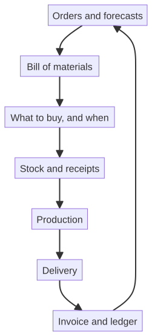

# 4. The Machine That Ate the Warehouse

Arthur Ellery was Maggie's uncle, her father's younger brother, and he had spent thirty-four
years as a production planner in a factory that made industrial pumps. He was seventy-eight, he
kept bees, and he was the only person Maggie knew who could explain what an ERP was without
using the word "solution."

She drove out to his cottage on a Sunday in October, with a box of the good biscuits, and asked
him what it had been like before.

"Before what?" he said.

"Before all of it. Before computers."

He laughed at her in the way that old men laugh at the young, and then he went into the back room
and came out with a book. It was a ring binder, held together with tape, and it was four inches
thick.

"That," he said, "is a bill of materials. That is what a pump is made of. Every part, every
sub-part, every screw. And on every page, the quantity we needed to make one pump, and the
supplier, and how long it took to arrive."

Maggie opened it. The pages were typed, with handwritten annotations in three different colours,
and the whole thing smelled of dust and cigarettes.

"Who kept it up to date?"

"I did. And when I was on holiday, nobody did."

---

The problem Arthur's binder was trying to solve is one of the oldest in manufacturing, and it is
surprisingly hard to state clearly.

You have orders for pumps. To build a pump you need parts. To have parts you must order them,
and they take weeks to arrive. To know how many to order, you must know how many pumps you are
going to build, which depends on orders you have and orders you expect. But the parts themselves
are made of sub-parts, some of which are made in the same factory, and each of those has its own
lead time, and some of them share a machine that can only do one job at a time. If you order too
much, you tie up money in shelves. If you order too little, the factory stops, and a stopped
factory is the most expensive object in the building.

By hand, a competent planner could do this for a few hundred parts. Beyond that, the arithmetic
outran the human. You could not hold the whole web of dependencies in your head, and so you did
what Arthur did: you kept a binder, you updated it in pencil, and you prayed that nobody asked
you a question about a part you had not looked at since the spring.

---

In the early 1950s, two aero-engine manufacturers, Rolls-Royce and General Electric, began to put
this arithmetic on computers. It was not a commercial product; it was an internal tool for a
problem so expensive that even a room-sized computer was worth it. Aero engines have tens of
thousands of parts, and a mistake in the plan does not cost a delay, it costs an aircraft.

The idea became a product in 1964, when a man named Joseph Orlicky worked out a practical method
for calculating requirements and a company called Black & Decker installed the first system to
use it. The project leader was named Dick Alban, which is the kind of detail that history usually
loses and that makes a story true: it was not a committee, it was a person with a problem.

Orlicky published the method as a book in 1975, with a title that no publisher today would allow:
*Material Requirements Planning: The New Way of Life in Production and Inventory Management.*
By then about seven hundred companies were using the idea. By 1981, eight thousand were.

The method is called MRP, and it does exactly one thing: it takes what you intend to build, walks
down the bill of materials, subtracts what you already have in stock, and tells you what to buy
and when, taking lead times into account. If that sounds obvious, it is because it worked. It
became the way factories think.

In 1983, a man named Oliver Wight extended the idea beyond materials. If the system already knows
what the factory is going to build, why not let it plan the people, the machines, the money and
the sales forecast too? The result was called Manufacturing Resource Planning—MRP II—and it was
the first business software that claimed to know the state of an entire company.

By 1989, MRP II software was about a third of the software industry's sales to American
manufacturing, roughly 1.2 billion dollars. Something had changed: the factory no longer ran on
the planner's binder. It ran on a model, and the model was in a computer.

Arthur's factory bought one of those systems in 1988, and the first attempt failed.

"The software was fine," he said. "It was better than fine. It could do things I'd been doing
with a pencil for twenty years, in a second. But it wanted to know the lead time for every part,
and nobody had ever written the lead times down. They were in the buyers' heads, and the buyers
gave us the numbers they thought we wanted to hear, because they didn't want to look slow. So the
system planned with fiction, and the factory ran on the plan, and three months later we had a
warehouse full of the wrong parts and a managing director asking who was responsible."

"Who was?"

"Everybody. Nobody. The buyers weren't lying; they genuinely didn't know, because nobody had ever
measured. That's the thing about a model: it doesn't just expose the mistakes you made. It
exposes the things you never knew you didn't know."

The second attempt worked, and the reason it worked had nothing to do with software. The factory
spent four months measuring lead times, counting stock and writing down the rules it had always
followed by habit. By the time the system was switched on, the model was already true, and the
computer's only job was to keep it true faster than a person could.

Arthur was proud of that, in the way that men of his generation were proud of unglamorous things.
"We didn't install a computer," he said. "We wrote down how the factory worked. The computer was
the easy part."

---

In 1990, an analyst firm called Gartner needed a name for the next step. The factories had MRP
II. The finance department had its own systems. The sales office had another. The warehouses had
another. What if one system did all of it—not just the factory, but the whole enterprise?

They called it Enterprise Resource Planning. ERP.

The name is not accurate, and everybody in the industry knows it. It does not plan resources in
any deep sense, and "enterprise" is a word that means "big" until it means "expensive." But names
are sticky, and this one stuck to a real thing: a single database in which the customer, the
product, the order, the stock, the invoice and the ledger are all connected, so that a fact
entered once is visible everywhere.

The company that made it a standard was SAP, founded in 1972 by five engineers who had left IBM.
In 1992 they released R/3, which ran on the client-server architecture that was becoming
affordable, and which encoded a company's processes in a way that auditors, banks and regulators
recognised. If you ran R/3, you could be audited the way a large company is audited. For a
growing business that wanted to sell to large customers, that was worth more than any feature.

Two other things happened in the 1990s, and both matter for the story of this book.

The first was the year 2000. A great many companies replaced their old systems in the late 1990s
because those systems stored years as two digits and would, it was feared, confuse 2000 with
1900. Some of the fear was overdone. But the replacement happened, and it moved ERP from the
factory into every kind of organisation: hospitals, universities, charities, governments.

The second was the cloud. In 1999 a company called NetLedger began selling accounting software
that ran in a browser, on somebody else's computer, for a monthly fee. It took fifteen years for
the idea to become normal. Now it is the default, and the reason is not technical elegance. It is
that a small company can rent a system it could never have afforded to buy and run.

---

Arthur put the binder away and made tea, and Maggie asked the question she had been leading up
to.

"So why does everybody hate these systems?"

He thought about it for a while. "Because they make you do the work their way," he said. "And
because the people who sell them lie about how much work it is."

This is the honest version of the history, and it is worth saying plainly, because the rest of
this book depends on it.

An ERP is a model of a company, and a model has rules. You cannot post an invoice without a
customer, because the invoice needs an address and a tax number and a ledger account. You cannot
ship goods that are not in stock, unless the system allows negative stock, which most companies
turn off. You cannot delete a posted journal entry, because Pacioli's guarantee depends on the
history being intact. Every one of those rules exists for a good reason, and every one of them is
an argument with somebody who has a customer on the phone and needs the thing to happen *now*.

Multiply that argument by every process in the company, and you have the reason ERP projects are
famous for going wrong. The software is not usually the problem. The problem is that installing
an ERP is not an IT project: it is an agreement about how the company works, extracted from the
heads of the people who work there, written down, and then enforced by a machine. Companies that
cannot have that conversation—because the owner does not want to, or the departments do not
agree, or the consultant is paid by the hour and does not care—end up with an expensive system
that nobody trusts, and they go back to the trays.

That loop is the whole of a manufacturing business, and the whole of a wholesale business too,
with "production" replaced by "picking." Every ERP in the world is a machine for keeping that
loop true.

## What the factory floor taught the office

It is easy to forget, reading the history of ERP, that the ideas came from factories and were later
applied to offices—not the other way round.

The bill of materials, the lead time, the reorder point, the three-way match, the capacity plan: all
of them were invented to stop a production line, and all of them turned out to describe an office
just as well. A quotation has a lead time. An invoice has a bill of materials, if you count the
delivery and the order as its components. A month-end has a capacity plan.

The transfer worked because a business is a business, whether it makes pumps or sells binders. The
vocabulary changed and the arithmetic did not. What changed, when the ideas reached the office, was
the *cost of the arithmetic*: a factory could justify a computer in 1964 because a stopped line cost
more than the machine; an office could not justify one until the machine cost less than a clerk's
salary.

That is the whole story of the last sixty years in one sentence, and it explains why the same ideas
keep arriving in smaller companies, later, in cheaper packages.

---

Maggie drove home in the dark, thinking about her uncle's binder.

What struck her was not the technology. It was the *maintenance*. Somebody had to keep the binder
up to date, and when that somebody was on holiday, the truth decayed. Every system she had read
about in the last month had the same weakness at its centre: the model is only as good as the
person who feeds it, and people are busy, and people forget, and people leave.

The dream of the ERP was that the feeding would happen automatically, as a by-product of doing
the work. Sell something and the stock moves; move the stock and the ledger moves; send the
invoice and the customer's balance changes. Mostly, that dream came true. What did not come true
was the part where somebody has to *ask* the system for things.

That part stayed manual for thirty years. You wanted to know which customers were late paying?
You opened a report, or you asked the accounts department, or you exported to a spreadsheet and
squinted at it. You wanted to create forty invoices from forty delivery notes? You clicked forty
times, or you paid somebody to click forty times.

The model existed. The machine that could *use* the model did not.

Then, quite suddenly, it did.

---

Arthur had one more thing to say, at the door, with the biscuits finished and the bees asleep.

"You know what the hardest part of my job was?" he said. "Not the arithmetic. The arithmetic I
could do. It was that nobody ever told me when something changed. A supplier changes a lead time,
a customer changes an order, an engineer changes a part—and I find out three weeks later, when
the factory stops. The binder was always a month out of date, and I was always the last to know."

He looked at the dark garden.

"If you can build a thing that knows when something changes, and tells somebody before it
matters," he said, "then you've built something worth having."

Maggie thought about that all the way home. It was, she realised later, the best description of
an artificial intelligence in business that she had ever heard, and it had come from a
seventy-eight-year-old man with a binder and a box of biscuits.
