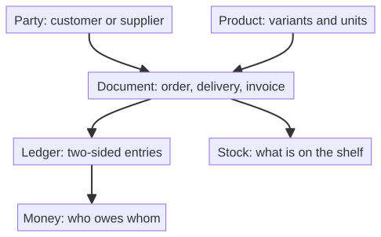

# 5. What a Business Really Is

The meeting that changed Riverton took place on a Tuesday morning in the small room with the
photocopier, because the big room was full of stock.

Maggie had asked three people: Priya Raman, who ran sales; Tom Beck, who ran the warehouse; and
Doreen, who ran, in the way that she did, everything else. On the whiteboard she wrote a single
word.

**ORDER**

"Right," she said. "Tell me what that word means to you."

Priya went first, because she always did. "An order is what the customer wants. Item, quantity,
price, delivery date. I take it on the phone or through the web shop, and I put it in the
system."

Tom said, "An order is what I have to pick. It comes down to me as a list of things on shelves.
Except half the time it's a delivery note, and half the time it's an email from Priya with a
picture of a handwritten note."

Doreen said, "An order is what I invoice. When the goods have gone, I turn the order into an
invoice. Except sometimes the goods go in two parts and I invoice in two parts, and then it's not
one order any more, it's two invoices and one order and a credit note for the bit that came
back."

There was a silence of the kind that follows a truth being said out loud.

"So," Maggie said, "we have three different things, all called order."

"Four," said Priya. "There's also the purchase order we send to suppliers."

Five, if you counted the customer's own purchase order number, which appeared on their paperwork
and had to be quoted on the invoice or they would not pay it. Six, if you counted the "standing
order" that Ashfield Academy placed every September, which was not an order at all but an
agreement to order.

This is the moment where most small companies discover the real reason their systems do not work.
They do not have a data problem. They have a *language* problem. Six different things share one
word, and three different words share one thing, and the only dictionary is the memory of the
people in the room.

The price list proved it, an hour later.

Priya quoted a box of the good whiteboard markers at eleven pounds forty. Tom said it was nine
ninety-five. Both were certain. On the shared drive there were, it turned out, seventeen files
called a price list, dated between 2019 and that Tuesday, and four of them had been edited in the
last month. The correct answer depended on the customer: Ashfield had a contract price from
January, which Priya had in a spreadsheet of her own, and Tom had a printed sheet from March
which did not include the contract prices because they were "commercial."

Nobody was lying. Nobody was even careless. The company had no place where the price of a product
for a customer was a *fact*; it had a habit of agreement, renewed by telephone, recorded in
seventeen places, of which one was correct on any given day and nobody knew which.

Doreen, who had said nothing for a while, said: "This is why I keep the invoices. Because the
invoice is the only piece of paper where we all agreed at the same time."

She was describing, without knowing the word for it, exactly what an ERP stores: not the price
list, but the price *that applied to that document*. The distinction is the whole of chapter
five of any accounting standard, and it is the reason a document in a real system keeps its own
copy of the facts rather than pointing at a list that will change tomorrow.

---

An ERP is, before anything else, a dictionary with rules attached.

It says: there is a thing called a Sales Order. It has a customer, a date, and a list of lines;
each line has a product, a quantity, a price and a tax. It has a state: draft, confirmed, done,
cancelled. It is not the same thing as a Delivery, which is what leaves the warehouse, and it is
not the same thing as an Invoice, which is what asks for money. When you need the customer's
purchase order number, it is a field on the Sales Order, not a note in the margin.

Once those definitions exist, the six meanings collapse into one, and the arguments stop. Not
because everybody agrees, but because the argument has moved from "what do you mean by order?" to
"which of these things are we talking about?", and the second argument can be settled in a
minute.

So let me give you the dictionary. It is small. Four kinds of thing, and everything else in this
book is a consequence of them.

---

**The first kind of thing is a party.**

A customer is a party. A supplier is a party. Your own company is a party. A bank is a party. The
tax office is a party. They are all the same shape: a name, an address, a tax number, a currency,
payment terms, a contact.

This is not a technical trick; it is a piece of deep good sense that took the software industry
years to accept. In an old system, customers lived in one file and suppliers in another, and a
company that was both—which happens constantly in wholesale, because the shop you sell to also
sells you things—appeared twice, with two balances, and reconciling them was a monthly misery.
In a modern ERP there is one list of parties, and being a customer or a supplier is a *role* that
a party plays.

The consequence is immediately practical. When Ashfield Academy both buys binders from Riverton
and sells Riverton its old furniture, there is one account, one address, one credit limit, and
one net balance. The paperwork is simpler because the model is truer.

**The second kind of thing is a product.**

A product is a thing you buy or sell: a box of pens, a pallet of paper, a service, a delivery
charge. It has a name, a reference code, a unit of measure (each, box, pallet, kilogram, hour), a
purchase price, a sale price, a tax, and—if you keep stock—a quantity on hand in each location.

Two subtleties are worth knowing, because they cause most of the confusion in real companies.

The first is the *variant*. A shirt comes in four sizes and three colours: that is one product
with twelve variants, not twelve products. If you model it as twelve products, then your sales
reports cannot tell you that blue sells twice as well as green, because the system thinks they are
unrelated objects. If you model it as one product with variants, the report is trivial and the
stock is exact.

The second is the *unit of measure*. You buy paper by the pallet and sell it by the ream. If the
system does not know that a pallet is forty reams, then every stock count is an argument, and
somebody has to convert by hand, and somebody eventually converts wrongly. The unit of measure is
not a decoration; it is the arithmetic that keeps the warehouse honest.

**The third kind of thing is a document.**

An order, a delivery, an invoice, a payment, a stock adjustment, a purchase request: these are
all documents, and they all have the same anatomy. A date, a party, a list of lines, a total, and
a state.

The state is the part that people underestimate. A document is not a piece of paper; it is a
thing that moves through time. A quotation is a draft that might become an order. A confirmed
order may be partially delivered. An invoice may be posted and then partially paid. Each of those
states is a fact about the world, and the system's job is to know which state each document is in
and to refuse transitions that make no sense. You cannot deliver goods that were never ordered.
You cannot pay an invoice that was never posted. You cannot cancel a delivery that has already
left the building, unless you bring it back.

This is why an ERP feels strict. It is strict in the way a railway signal is strict. The
strictness is the safety.

There is one more property of documents that is easy to miss and enormously important: **a
document remembers its own facts.** When you confirm an order for a hundred binders at four
pounds each, the order stores the price. If the price changes tomorrow, the order still says four
pounds, because that is what the customer agreed to. If the customer's address changes next month,
last month's invoice still shows the old address, because that is where it was sent. The system
keeps a history of facts, not just a current picture. Without that, you could never prove
anything to anybody.

**The fourth kind of thing is money.**

Every document that has a financial consequence produces journal entries: the two-sided
statements Pacioli described in 1494. Sell something and the system records revenue and a debt
from the customer. Buy something and it records an expense and a debt to the supplier. Pay a
supplier and it records the money leaving the bank and the debt disappearing.

Nobody at Riverton would ever type a journal entry by hand, and that is the point. The entries are
a by-product of the documents. The accountant's job stops being "record what happened" and becomes
"check that what was recorded is right," which is a much better use of an accountant.

---

Maggie drew that diagram on the whiteboard, and Tom—who had said almost nothing for twenty
minutes—looked at it for a long time.

"That's it?" he said. "That's the whole thing?"

"That's the whole thing," Maggie said. "Everything else is details."

Tom tapped the box marked Stock. "So if I take a pallet off the shelf and put it on a van, the
system should know."

"Yes."

"And if the van comes back because the school's gate was locked, the system should know that too."

"Yes."

"And if the pallet gets damaged in the rain while it's sitting on the loading bay, and I have to
write it off—"

"Then that's a document too," Maggie said. "A stock adjustment. With a reason."

Tom nodded slowly. "We've never had that," he said. "We've had a notebook. And when the notebook
disagrees with the accounts, the accounts win, because the accounts are the ones the tax office
sees. But the accounts are wrong, because I'm the one who knows what's actually on the shelf."

This is the single most common complaint about business software, and it is worth naming
precisely, because the rest of this book is about fixing it. Tom knew the truth and could not
enter it. The accounts contained a truth and could not be corrected. The gap between them was
filled with a monthly ritual of stock-taking, during which the company discovered how wrong it
had been, wrote off the difference, and started again.

The gap exists because entering facts into a computer has always been a separate job from doing
the work. Somebody has to sit down and type. That somebody is usually busy, and the typing is
usually the least interesting thing they will do that day. So the model drifts away from reality,
a little at a time, and then a lot.

The promise of the system Maggie was about to install is not that the drift disappears. It is that
the typing disappears. Tom will not type that he moved a pallet. He will tell the assistant, in
English, that the pallet went on the van, and the assistant will make the document. The model
stays true because the cost of keeping it true has fallen to nearly zero.

That is the change. Everything else—the screenshots, the installations, the diagrams—is in
service of that one sentence.

---

Doreen had been quiet, which was unusual. When Maggie asked her what she thought, she said: "I
think I've been doing the job of a database for thirty-one years, and nobody ever asked me
whether I wanted it."

Nobody laughed, because it was not a joke.

"What would you do," Maggie asked her, "if you didn't have to remember where everything is?"

Doreen thought about it. Then she said: "I'd check things. I'd notice when a price looked wrong,
or when a customer ordered something they've never ordered before. I'd have time to be nosy."

In the language of management, that is called *exception handling*, and it is the most valuable
work in any office. It is also the work that never gets done, because the people who could do it
are busy being databases.

Maggie wrote *be nosy* on the whiteboard, under the four boxes, and drew a circle round it.

"Right," she said. "Let's go and buy a dictionary."
