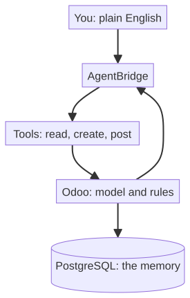

# 6. Three Machines in One Room

Sam Okafor installed business systems for small companies, and he had a rule: he would not sell
anybody a system until he had seen their warehouse.

"He's very insistent about the warehouse," Priya said, when she made the introduction. "He made
me walk round ours for twenty minutes and then told me we had three hundred and forty pallets
that the system didn't know about."

"Three hundred and forty-one," Sam said, when he came to the office. "One of them was behind the
door."

He was in his fifties, he carried a canvas bag instead of a briefcase, and he refused coffee on
the grounds that he drank too much of it. In the small room with the photocopier, he took a sheet
of paper from the printer and drew three boxes on it.

"Right," he said. "Everything I'm going to tell you fits on this napkin. The rest is details."

---

**The first box is the memory.**

A business system has to remember things. Customers, products, orders, invoices, stock, prices,
payments. Not in a filing cabinet, and not in a spreadsheet, but in a database: a program whose
only job is to store facts and give them back accurately, even if the electricity fails halfway
through writing one.

The database that Riverton was going to use is called PostgreSQL, and it is one of the quiet
wonders of the modern world. It was born at the University of California at Berkeley in the
1980s, in a research project led by a man named Michael Stonebraker, and it has been developed in
the open ever since: no company owns it, anybody can read its instructions, and it runs a
surprising share of everything—banks, governments, websites, and, soon, a stationery wholesaler
in a market town.

What makes a database different from a spreadsheet is not the size. It is the promises.

A spreadsheet will let you type a word into a column of numbers, and it will not complain. A
spreadsheet will let two people open the same file and overwrite each other's work. A spreadsheet
will let you save a half-finished change. A database makes three promises instead: that a change
either happens completely or not at all; that the data always satisfies the rules you declared;
and that two people changing things at the same time cannot silently destroy each other's work.

Those promises have an unglamorous name—*transactions*—and they are the reason a company can
trust a number on a screen. When the assistant creates an invoice, either the invoice, its lines,
its ledger entries and its link to the order all exist, or none of them do. There is no state in
which the invoice exists but the ledger does not.

**The second box is the model.**

On top of the memory sits the thing that knows what the facts *mean*: that an invoice must have a
customer, that a delivery must come from stock, that a tax rate applies to a product and not to a
page of notes. This is the ERP, and for Riverton it is a system called Odoo.

Odoo has a history worth knowing, because it explains why a small company can afford it. It began
in 2005 as a project called TinyERP, written by a Belgian named Fabien Pinckaers. In 2008 it was
renamed OpenERP, and in 2014 it took its current name. It is open source—the community edition is
under a licence that lets anybody use, study and change it—and it is also a company, which sells a
richer edition and support. That combination, open core with a commercial arm, is how a great
deal of modern business software is funded.

The community edition is free, and it is not a demo. It contains sales, purchasing, inventory,
accounting, invoicing, projects, manufacturing, a website and a web shop. Odoo 20, the release
used in this book, arrived in September 2026. The company reports millions of users; the exact
number matters less than the fact that the software is used, in many languages, by companies of
every size, and that a question about it has usually been asked and answered by somebody before.

The important thing about Odoo, for our purposes, is that it is *strict about its model*. It will
not let you post an invoice with no lines. It will not let you ship goods you do not have, unless
you tell it to allow that. It keeps the history. That strictness is not a personality defect; it
is the whole reason the system can be trusted by an accountant.

**The third box is the judgement.**

This is the new one, and it is the one this book is really about.

A database has no opinions. A model has no initiative. Neither of them will ever notice that a
customer has stopped ordering, or that a supplier's prices have crept up, or that the invoice for
the school district was printed and never sent. They answer questions; they do not ask them.

The third machine is an agent: a program that can be given an instruction in ordinary language,
work out which facts it needs, fetch them, decide what to do, do it, and report back. At Riverton
it is called AgentBridge, and it runs on the same computer as everything else—which matters more
than it sounds, and we will come back to it.

An agent is not a chatbot. A chatbot takes a question and produces text. An agent takes an
instruction and produces *effects*: a record created, a document posted, an email sent. To do
that safely it needs two things: a set of tools it is allowed to use, and a set of limits it
cannot cross.

The tools, in Riverton's case, are the operations of the ERP itself: search for customers, read a
product, create an order, confirm it, post an invoice, ask the ledger a question. Each tool is a
small, well-defined action with a name and a description, and the agent chooses among them the way
a new employee chooses among the buttons on a screen—by reading what they do.

The limits are Odoo's own. This is the part that took Maggie a while to understand, and it is
worth stating slowly.

The agent does not have a master key. It connects to Odoo as a *user*—a real user account, with a
password and a set of permissions, created for it by the installer. When it asks to create an
invoice, the request travels to Odoo, and Odoo checks whether that user is allowed to create
invoices, on that company, with those taxes. If the answer is no, the answer is no. The agent
cannot argue, because the agent is not the authority. Odoo is.

This is the single most important architectural decision in the whole system, and it is the
reason the book can recommend it to a company that has never used artificial intelligence before.
The intelligence is new and slightly unpredictable; the rules are old and completely
predictable. The new thing is only allowed to act inside the rules of the old thing.

## Why three and not one

A reasonable question, and Sam had an answer that took ten seconds and has stayed with Maggie ever
since.

"Because they fail differently," he said. "If the database stops, you know immediately: nothing
works. If the model is wrong, you find out slowly: the numbers look odd. If the assistant is wrong,
you find out late: somebody trusted an answer. Three machines means three kinds of failure, and
three kinds of failure can be told apart."

A single program that did all three would be simpler to install and impossible to diagnose. When it
misbehaved, the question *is it the data, the rules or the judgement?* would have no answer, and the
only remedy would be to reinstall and hope.

The separation has a second benefit that only appears later: each machine can be replaced on its
own. A company that outgrows the database moves to a bigger one; a company that outgrows the model
moves to another ERP, keeping the data; a company that outgrows the assistant changes the model it
talks to. None of those migrations requires the others, which is why the stack in this book will
still be reasonable in five years.

---

"How do they talk to each other?" Maggie asked.

"Two ways, and both of them are boring, which is good," Sam said.

The agent talks to Odoo through Odoo's own external interface—a documented way for another program
to ask Odoo to do things over the network. Odoo calls it the JSON-2 API, which is a name only a
programmer could love. What it means is: there is a door, it has a lock, you need a key, and
behind the door are the same operations the web screens use. Nothing the agent can do is
something a person could not do by clicking; the agent is simply faster and does not get tired.

And the tools themselves are described to the agent using a convention called the Model Context
Protocol, or MCP. It was published by Anthropic in November 2024 as an open standard, and it does
one simple thing: it gives a program a standard way to say "here is a list of things I can do,
here is what each one needs, and here is what it returns." Before it, every assistant needed a
custom connector for every system, and the connectors multiplied. With it, a tool written once can
be used by any assistant that speaks the protocol—and there are now thousands of such tools in the
world.

Riverton's ERP tool is one of them. It is called OdooTool, it is open source, and it was written
by the same people who wrote the assistant. Its job is to be the translator: the agent says
"create a customer called Ashfield Academy," the tool turns that into the exact sequence of calls
Odoo expects, checks the answers, and reports back in plain language.

---

There was one more thing on the napkin, in the corner, in Sam's small handwriting: *the room*.

"All three of these run on your computer," he said. "Not on a server in another country. The
database, the ERP and the assistant. That means the only thing that leaves this building is what
you choose to send to the language model, and if you run the model locally, nothing leaves at
all."

Maggie asked the obvious question. "Is that better?"

"It's different," Sam said. "It's better for control and for privacy, and it's worse for
convenience, because you have to look after it. There's no support line to call at eleven at
night. But there's also nobody who can switch you off, or raise the price, or read your customer
list. For a company like yours, I'd take that trade."

He added a fourth line to the napkin, under the three boxes, in letters so small that Maggie had
to lean in: *backups*.

"Two things will happen to you," he said. "The first is that the machine will break, or the power
will go, or somebody will spill tea on the wrong thing. The second is that a new version of one of
these programs will arrive and want to be installed. Both of those are ordinary. Neither of them
is a disaster, provided you have a copy of the database from yesterday and a note of what you
changed. What turns an ordinary failure into a disaster is discovering, at the moment of the
failure, that the only copy of your company's memory was on the machine that just stopped."

"How often?" Maggie asked.

"Nightly for the database. Weekly for the whole folder. And once a month, open the backup and
check that it contains what you think it contains. An unverified backup is a wish."

He put the pen down. "One more thing, and then I'll stop lecturing you. Decide now who owns this.
Not who paid for it—who *owns* it. Somebody has to be allowed to say no to a change, to insist on
the backup, to read the log when something looks odd. In a small company that person is usually
the owner, and the failure mode is that the owner is too busy, and the system quietly becomes
nobody's."

Maggie looked at the napkin. Three boxes for machines, one word for the person who has to look
after them.

He folded the napkin and handed it to her.

"Keep that," he said. "When something goes wrong—and something will—go back to the napkin. Ask
yourself which of the three boxes is unhappy. Nine times out of ten, the answer tells you what to
do."

---

That evening, Maggie pinned the napkin to the board in the invoice room, next to a delivery
schedule from 2019 that nobody had ever taken down.

Doreen looked at it for a while.

"Which one is me?" she asked.

Maggie thought about it. "You're the bit that notices," she said. "The napkin doesn't have a box
for that yet."

"Then it's not finished," Doreen said, and went back to her desk.

She was right, of course. The napkin had three boxes for the machinery and no box for the person
who decides that a number looks wrong. Every system Maggie had read about in the last month had
made the same omission, and every one of them had failed for the same reason: they treated the
people as input devices.

The system she was about to install would not make that mistake, for a reason that was almost an
accident of design. Because the assistant takes instructions in ordinary language, the person
stays in the conversation. Doreen would not be replaced by a database. She would be the one
telling the database what to notice.
