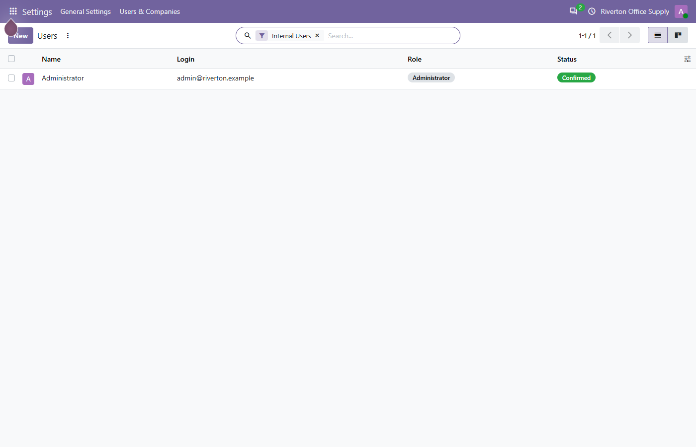

# 12. The Key That Opens One Door Only

The last piece of configuration before the assistant could be let loose was the least interesting
and the most important: the key.

Sam explained it on the whiteboard, in the way he explained everything, with a diagram that took
thirty seconds and settled an argument that usually takes a week.

"Every lock in this building has a key," he said, drawing a rectangle for the ERP. "The question is
not whether the assistant gets a key. The question is which door it opens, and what it can do once
it is inside."

---

## What an API key is

An API key is a password that a program uses instead of a person. It is a long string of characters,
it is shown once, and it belongs to a *user*—not to the program, and not to the machine.

That last point is the whole of the design. When the assistant connects to Odoo, it does not connect
as a superuser with a special back door. It connects as a user account called, in Riverton's case,
*Agent*, with a password and a key, and with a set of permissions that a person could have given to
a new employee on their first day.

Which means three things, and each of them is worth more than the convenience it costs.

**The ERP's rules apply to the assistant.** If the *Agent* user is not allowed to delete invoices,
the assistant cannot delete invoices—not because the assistant has been told not to, but because the
ERP will refuse the request. The intelligence is new; the rules are old; the new thing works inside
the old thing.

**The assistant appears in the audit trail.** Every record it creates says *Agent* in the "created
by" field, and every change it makes is logged. If an invoice appears at four in the morning with a
strange discount, the system will not say "the machine did it"; it will say which user, at what
time, and with what values.

**The key can be revoked without changing anything else.** If the key leaks, or the assistant is
replaced, or somebody leaves, the key is deleted and the assistant stops. The ERP does not change,
the users do not change, and nothing has to be reinstalled.

## Where the key lives

The installer generated the key during the installation and wrote it into the connector's
configuration, in the assistant's own folder. It is not in the book, not in an email, and not in a
document that gets forwarded. It is in one file, on one machine, with the file permissions of the
user who installed it.

The same key can be created by hand, and every user can create one for themselves: it is under the
user menu, *My Profile*, *Account Security*, *New API Key*. The ERP shows it once, in a box, with a
warning that it will never be shown again—which is not a threat, it is a fact about how keys are
stored: the system keeps a hash, not the key, so it cannot remind you later.

## What the assistant was allowed to do

Riverton's *Agent* user was given a role, and the role was chosen with a rule that is worth
repeating: **give the assistant the rights of the least powerful employee who could do the job.**

For Riverton, that meant:

| Area | Rights | Why |
|---|---|---|
| Customers | read, create, edit | it takes orders and adds contacts |
| Products | read | it quotes; it does not invent products |
| Sales | read, create, confirm | it writes quotations and confirms orders |
| Invoices | read, create, post | it bills; posting is the act that creates the ledger |
| Payments | read, create | it registers what the bank says |
| Purchases | read, create, confirm | it reorders what the warehouse asks for |
| Inventory | read, adjust | it moves stock and records damage |
| Accounting settings | none | configuration is a person's job |
| Users and permissions | none | never, under any circumstances |
| Deleting documents | none | if something is wrong, it is cancelled, not erased |

The last two lines are the ones to defend. A machine that can change permissions can grant itself
anything; a machine that can delete can destroy the audit trail that would prove what it did. Both
are excluded not because the assistant is untrusted in some dramatic sense, but because the cost of
excluding them is zero and the cost of a mistake is not.

## The conversation about trust

Doreen, who had been quiet through most of this, asked the question that mattered.

"What stops it from doing something stupid?"

"Nothing stops it," Sam said. "That's the honest answer. It can create a customer with a silly
name, or post an invoice to the wrong person, or order four hundred boxes of the wrong paper. What
stops that from being a disaster is that you can see it, and undo it, and that it cannot do the
things that cannot be undone."

"That's not very reassuring."

"No," he agreed. "But it's the same reassurance you have with a new employee. You don't stop them
from making a mistake; you give them a job with a limit, you check the first month's work, and you
make sure the mistakes are the kind you can fix."

The difference—and it is the difference that makes the system usable—is that the assistant's
mistakes are *visible in a way a person's are not*. A person who mishears a quantity writes it on an
order and nobody notices until the customer complains. The assistant's version of the same mistake
is a record with a timestamp, a user, the tool it called and the arguments it passed, and it can be
found in a log by anybody who thinks to look.

That is why the log is not a technical detail. It is the thing that makes an agent acceptable in a
business where money moves: not that it never errs, but that its errors are *findable*.

## The first test

Before letting the assistant do anything, Sam asked it to do nothing.

"Check the connection," he typed. "Tell me which version of Odoo is running."

The answer came back in a second: the version, the database name, the user it was connected as, and
the company it was pointed at. Four facts, all correct, all of which could be checked by a human in
the ERP in about the same time.

"Good," Sam said. "Now ask it how many customers there are."

There were none, because nobody had entered any yet. The assistant said zero, which was true, and
which is a more interesting answer than it looks: a system that can say *zero* is a system that is
reading the database, not a system that is making something up. A model that guesses would have
produced a plausible number.

"Right," Sam said, closing his laptop. "It's yours. Give it a job."

## The permission that everybody forgets

There is one permission in every ERP that companies grant without thinking, and it is the one that
undoes all the others: the ability to change the *configuration*.

A user who can edit the chart of accounts can post anything anywhere. A user who can edit the tax
codes can make a sale disappear. A user who can change the access rights can grant themselves
anything they lack. The rules that protect the ledger are themselves data, and whoever can change
the data can change the rules.

The assistant is therefore excluded from settings entirely—not because it would abuse them, but
because an agent's competence is precisely in *doing things*, and configuration is the one area where
doing the wrong thing is indistinguishable from doing the right thing until the auditor arrives.

The rule generalises: **automate the work, never the rules.** A company that lets an assistant change
its own permissions has, in effect, no permissions at all; it has a suggestion box.

## The first check after creating a key

The moment a key is created, there is one check worth doing, and it takes ten seconds.

In the assistant, ask: *check the connection to Odoo and tell me which version is running.*

A version number and a database name mean the key works, the address is right, and the user can
reach the ERP. An error means one of the three is wrong, and the error message usually says which.

That check is worth repeating after any change to the configuration—a new key, a new port, a new
machine—because it isolates the connection from everything else. When something later goes wrong, the
first question is always *is it the connection or is it the question?* and this instruction answers
it in a second.

Doreen wrote it on a card and stuck it to the monitor. It is the least interesting instruction in
this book and the one that has saved the most time.

## When the key leaks

A key that is written into a configuration file on a machine can leak in three ways, and all three
have happened to companies that were not careless.

It can be copied into a backup that is then shared. It can be pasted into a support ticket by
somebody trying to be helpful. And it can be read by another program on the same machine, which is
the reason a computer shared by five people is not a good place for a key that can post invoices.

The remedy is not to guard the key with ceremony. The remedy is that the key is *cheap to replace*:

1. In the ERP, open the user's account security page and delete the key.
2. Create a new one and paste it into the connector's configuration.
3. Restart the assistant.

Three minutes, no data lost, no reinstallation. The old key stops working the instant it is deleted,
which is the property that makes this safe: a leaked key is a nuisance rather than an incident,
provided somebody notices and revokes it.

The thing that makes it an incident is a key belonging to a user who can do everything. Which is why
the *Agent* user has a role, and why the administrator's key is never the one given to a program.

## One agent at a time

There is one more limit worth knowing, and it is not about permissions at all.

The assistant runs on the same machine as everything else, and the language model—whether it is a
service in another building or a model on your own graphics card—answers one request at a time. A
company that starts four agents in four windows will not get four times the work; it will get four
agents taking turns, and a machine with no memory left.

The installer is built around this: one assistant, one window, a launcher that opens exactly one.
The temptation to open a second, to do something else while the first is thinking, is the most
common way a small installation falls over—and the fix is not technical. It is to wait, or to ask
for less at once.

Riverton learned it in the second week, when Tom opened a second window to ask about stock while
Priya's invoice was being written. The machine did not crash. It simply became slow, then slower,
and then both windows answered at once with two halves of the same job, and Doreen spent twenty
minutes working out which invoice was real.

The rule that came out of it is on the wall of the invoice room, next to the napkin: *one question
at a time, and read the answer.*

---

That evening Maggie sat in front of the assistant's window for a while without typing anything.

The window was plain: a prompt, a place for the answer, and a small line at the bottom saying which
model it was talking to. It looked like the terminal windows her father had used in the nineties,
which was either reassuring or alarming depending on your view of the nineties.

She typed: *What can you do?*

The answer was a list. It could read customers, products, orders, invoices, stock; it could create
and change records; it could call the actions that move a document from one state to another; it
could group and total and count. It could not change the company's settings, manage users, or delete
anything.

She read it twice, and then she typed the sentence that had been in her head since the Monday in
November when she drove an invoice across town.

*Show me every customer who owes us money and hasn't ordered anything in six months.*

The answer took four seconds. There were no customers yet, so the answer was a polite sentence
saying so—but the sentence included the two things it had looked for and the place it had looked,
which is what a good employee does when the answer is "nothing."

Maggie closed the window and went home.

The next morning, she started entering the customers.
