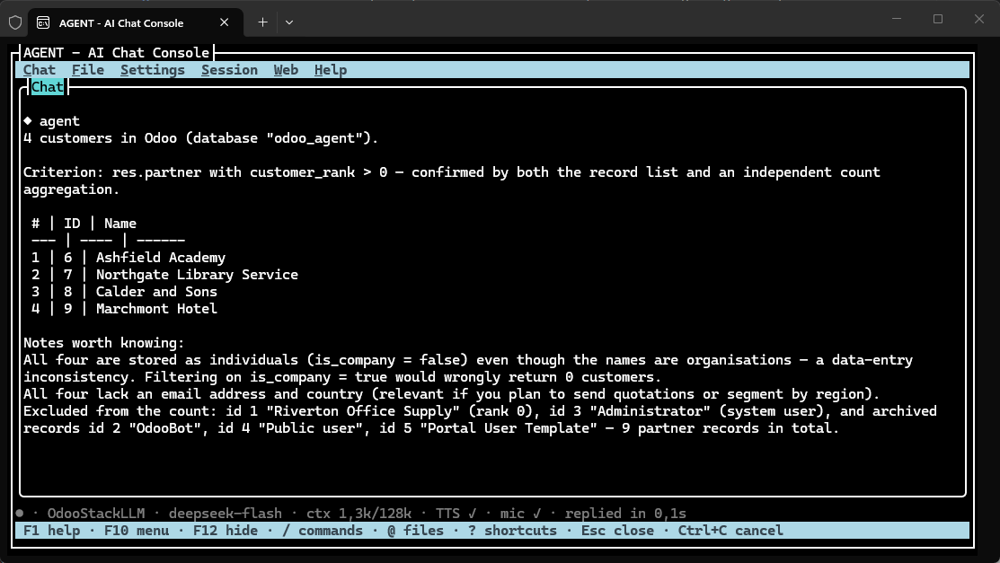

# 13. The First Conversation

The first time the assistant was started, it asked for a key.

Not the ERP's key—that had been created during the installation and written into the connector's
configuration. This was the other one: the key that lets the assistant talk to a language model,
which is to say, the key that lets it think.

The window was the assistant's own, opened by the AI Odoo icon, and it looked like a terminal from
1995: a menu bar across the top, a large empty area, and a line at the bottom with a cursor. On the
first start, before that, there was a short series of questions.

*Choose a provider.*

The list was the usual one: the big cloud services, a couple of aggregators, and the option of a
model running on the machine itself. Maggie chose DeepSeek, because it was the one Sam had
recommended for cost, and because the company already had an account for it.

*Paste the key.*

She pasted it. The window paused for a second and then printed a list of model names—which is the
moment worth noticing, because it is the moment the assistant *proved* that the key works. It had
not simply accepted what she typed; it had used it to ask the provider what it could do, and the
provider had answered. A key that is wrong produces an error at that point, not three days later in
the middle of an invoice.

She picked the model, and the window cleared.

---

## The first question

She typed: *What can you do?*

The answer was a list, and it was longer than she expected. It could search customers, products,
orders, invoices and stock; it could read and create records; it could call the actions that move a
document from draft to confirmed; it could group, total and count. It could not change the company's
settings, manage users, or delete anything.

She read it twice. Then she typed the question she had been carrying since November.

*How many customers do we have?*

The answer came back in about a second: *Zero. The database has no customer records yet.*

A model that guessed would have said something like "you have approximately 40 customers" or
produced a table of plausible names, because that is what a language model does when it has no
facts: it produces the most likely text. This one had been built to *look*, and looking at an empty
table produces the only honest answer there is.

The figure above is from the same installation a few days later, when the four demonstration
customers existed. Two things in it are worth reading twice: the answer names the criterion
(*res.partner with customer_rank > 0*) and says it was confirmed by a second, independent count; and
it volunteers three observations nobody asked for—that the four customers are stored as individuals
rather than companies, that none of them has an email address, and which records were excluded from
the count and why. That is not a report. That is what a careful colleague says when they hand you a
number.

---

## What happens between the question and the answer

It is worth slowing the second down, because the speed hides something worth understanding.

When Maggie typed *how many customers do we have?*, four things happened.

**The assistant read the instruction** and decided what kind of thing it was: a question about the
number of records of a type, not an action. That decision is made by the language model, and it is
the part that is genuinely new: nobody wrote a rule that says "if the sentence begins with how many,
count something."

**It chose a tool.** The connector offers a dozen operations, each with a name and a description.
The assistant picked *search*, on the model *customers*, with an empty filter and a count.

**The tool ran, in Odoo, as the Agent user.** Odoo checked the key, checked the permissions, ran the
query against the database, and returned a number.

**The assistant wrote the sentence.** It could have written a paragraph about customer management;
instead it wrote one line, because the instruction asked for a number and the number was zero.

The whole sequence took about a second, most of which was the language model thinking. The database
query took microseconds.

## The loop, and why it is not a chatbot

A chatbot takes a question and produces text. This thing takes an instruction and produces *work*,
and the difference is a loop.

The loop is: think, choose a tool, run it, read the result, think again, and either stop or choose
another tool. A simple question is one turn of the loop. A complicated instruction—*create a
quotation, confirm it, deliver it and invoice it*—is eight or nine turns, each one decided by the
model based on what the previous one returned.

That loop is why the assistant can do things nobody programmed it to do, and it is also why it can
go wrong in ways a program cannot. A program does what it was written to do, every time. A loop
decides what to do next, every time, and a decision can be wrong.

The defence is the one this book has described from the beginning: the tools are narrow, the
permissions are the ERP's, and the result is visible. The assistant cannot do anything a user could
not do, and everything it does is written down.

---

## The first action

The first thing the assistant *did*—rather than answered—was create a customer, and Maggie did it
herself, at the terminal, with the manual open.

*Create a customer called Ashfield Academy, at Mill Lane, Ashfield, with thirty days payment terms,
and make the invoice contact Carol Whitfield.*

The assistant thought for a moment—two seconds, which is longer than a query—and then:

*Created customer "Ashfield Academy" (ID 7), address Mill Lane, Ashfield, payment terms 30 days.
Contact Carol Whitfield added as invoice contact. Would you like me to check for duplicates before
you add the rest?*

The last sentence is not in any manual. It is the model deciding, on its own, that the next thing a
careful person would do is check for duplicates—because the instruction said *create*, and creating
without checking is how companies end up with four versions of the same school.

Maggie typed *yes*, and the assistant searched for anything similar. There was nothing, because the
database was empty. But the habit had been established on the first day: the machine proposes a
check, the person accepts it, and after a week the person starts proposing it too.

## The first mistake

Three days later, the assistant made its first mistake, and it is worth recording because it was
not the kind anybody expected.

Maggie asked: *Which products have we never sold?*

The assistant answered with a list of four products, and Maggie, who knew the catalogue, noticed
that one of them—the A4 paper—had sold four hundred reams the previous week.

The cause was a definition. The assistant had interpreted *never sold* as "no confirmed sales order
line," and the paper had been sold through a delivery that was created directly, without an order,
because Tom had filled an urgent request from a customer who telephoned.

Both facts were true. The question was ambiguous, and the assistant had picked one reading.

Doreen's verdict, when she heard about it, was the sentence that shaped the company's whole approach
to the technology.

"It answered the question I asked. I asked the wrong question."

That is not a defence of the machine; it is a description of the work. The skill of using an
assistant is, to a large extent, the skill of asking precisely—and the skill of checking, when the
answer matters, by asking a second question that would have to agree.

*Which products have no sales order line and no direct delivery in the last year?*

That version produced the right list, and it took four seconds.

---

## Doreen's first question

Doreen had watched the first week from a distance, in the way that somebody with thirty-one years of
experience watches a new colleague: politely, and with a list of things that would probably go
wrong.

On the Friday she sat down and typed one thing.

*Which invoices from last month have not been paid?*

The answer was a list of four, with amounts and days overdue, and a total. She looked at it for a
while, then opened the old accounting program, ran the same report by hand, and compared.

They matched.

"Right," she said. "It's the same report. It took me twenty minutes and it took that thing a second,
and it's the same report."

Then she asked the question that mattered.

*Why is Marchmont Hotel late?*

The assistant did not know, and said so: it had no record of a telephone call, no note of a query, no
reason. What it had was the invoice, the due date, and the fact that Marchmont had paid every
previous invoice within ten days.

*They have paid on time every month for two years,* it added. *This is the first late invoice.*

That sentence is not in the database. It is a conclusion drawn from the database—a pattern, noticed
and stated—and it is the thing that made Doreen stop being suspicious. She telephoned Marchmont, and
found that the invoice had gone to an accounts address that had been closed when the hotel changed
owners in October, and that nobody had told Riverton.

"The machine didn't know why," she said afterwards. "But it knew it was strange. That's the bit I
didn't expect. It knew it was strange."

## The first week's rule

By the end of the first week the office had one rule, and it was written on the whiteboard in
letters large enough to read from the door.

*Ask it something you already know the answer to.*

The rule sounds like a waste of time and it is the opposite. A question whose answer you know is a
test of the machine: if it agrees, you have learned that the connection, the key, the definitions
and the model are all working, and every later answer can be trusted a little more. If it disagrees,
you have found a problem while the stakes are zero.

Doreen used it for a fortnight. She asked for the count of customers, the total of a week's
invoices, the balance on the bank account—all things she could check in the old system in ten
minutes. Twice the answers differed, and both times the difference was a definition: once a customer
counted as two because it had two contacts, once an invoice was excluded because it was a credit
note.

Those two corrections were worth more than any training session, because they taught the office how
the machine *thinks*—and they taught the machine, in a small way, what the office means. The
definitions were fixed in the instructions and in the data, and they have not been wrong since.

## What to expect from the first week

Three things surprise people in the first week, and all three are worth knowing in advance.

**It is slower than you want, and faster than you expect.** A question takes two to eight seconds,
depending on the model and the number of steps. That feels slow next to a search box and
instantaneous next to opening four screens. The temptation is to ask several questions at once,
which makes everything slower and produces interleaved answers—the single most common way to make a
good system feel bad.

**It is literal in a way that feels like pedantry.** *Show me the orders* will produce a question
about which orders. That is not a failure; it is the same behaviour a careful new employee has, and
it is the behaviour that makes the system safe. The cure is a better instruction, not a more
forgiving system.

**It is better at sweeps than at conversations.** Ask it for every invoice over thirty days and it
will give you a complete, accurate list. Ask it what you should do about them and it will give you a
careful, generic paragraph, because the answer depends on things it does not know. The first is
worth paying for; the second is not.

## The four questions the assistant asks itself

When an instruction arrives, the assistant works through four questions, and understanding them is
the fastest way to write better instructions.

**What kind of thing is being asked?** A question, an action, or a conversation. This is decided by
the model, from the shape of the sentence, and it is why *how many customers do we have* and *create
a customer* produce such different behaviour.

**Which tools could do it?** The connector describes each operation in a sentence, and the assistant
picks the ones that match. A request that does not match any tool will produce a polite refusal,
which is better than a guess.

**What are the arguments?** The customer's name, the product, the date. This is where ambiguity
bites: *the blue binders* does not match a product, and the assistant will ask rather than invent.

**Is the result what was asked for?** After the tool returns, the assistant reads the result and
decides whether the instruction has been satisfied or whether another step is needed. That loop is
what makes a chain of operations possible, and it is also what makes a mistake possible—the loop can
satisfy itself with something that is not what you meant.

## What the first week felt like

Maggie's note, written on the Friday of the first week, is the best summary of this chapter that
exists, and it is four lines long.

*Day 1: it told me we had no customers. Correct, and slightly rude.*
*Day 2: it created a customer and asked whether I wanted to check for duplicates. I did.*
*Day 3: it answered a question I asked badly, and Doreen was right about why.*
*Day 4: I stopped being impressed and started being annoyed when it was slow, which I think means
it's working.*

That last line is the one to keep. The measure of a tool that has become part of a business is not
admiration; it is impatience. Nobody is impressed by the telephone. People are annoyed when it does
not work.

By the end of the first week, the assistant had stopped being a demonstration and had become a
colleague with an irritating habit of being literal—which, as anybody who has managed a very
conscientious junior knows, is a problem you can work with.
