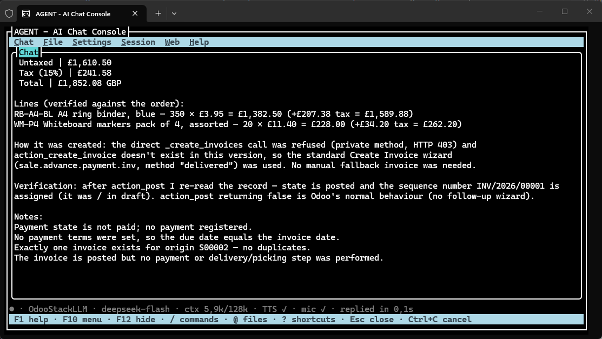

# 15. From Order to Invoice

The binders left on a Friday morning, in the rain, which is traditional.

Tom loaded them himself because the driver was late, and he came back into the office with wet
sleeves and a piece of paper: the delivery note, signed by the caretaker at Ashfield, with a
biro that had nearly run out. On the old system that piece of paper would have gone into a tray and
waited for Doreen to come back from lunch, and the invoice would have been typed on Monday.

On the new system, Doreen asked the assistant a question while Tom was still taking his coat off.

> *Which delivered orders from this week are not yet invoiced?*

> *One: sales order S00012, Ashfield Academy, delivered this morning. 350 × Ring binder A4 (blue),
> 20 × Whiteboard markers. Ready to invoice. Shall I create the invoice?*

She said yes. That is the whole of the transaction, and it is worth understanding what happened
underneath, because "create the invoice" is doing a great deal of work in a single sentence.

---

## What an invoice is

An invoice is a document that says three things at once, and it is the reason accounting is more
complicated than arithmetic.

**It is a request for payment.** This is the part everybody knows: the customer owes the amount on
the page, by the date on the page.

**It is a record of a taxable event.** In most countries the tax becomes due when the invoice is
issued, not when the money arrives. That is why an invoice has a tax point, and why an invoice
cancelled in the wrong way can leave a company owing tax on money it never received.

**It is a legal claim.** If the customer does not pay, the invoice is the evidence. It must show the
company's registered name and tax number, the customer's details, a unique sequential number, the
date, a description of what was supplied, the amount before tax, the rate and amount of tax, and the
total. Miss any of those and the claim is weaker; miss the number and the claim may be worthless.

An ERP does all three at once, and the reason it insists on a *confirmed order* before it will
create an invoice is that the second and third functions depend on the first being true. You cannot
invoice goods you have not agreed to supply, because the tax point and the claim both refer to a
supply.

## What the assistant actually did

The instruction was four words, and the assistant's work was a chain of eight or nine steps, each of
which a person would have done by hand.

It searched for delivered orders that had no invoice. It found one. It read the order's lines,
prices and taxes. It created an invoice document linked to the order—linked, not copied, so that the
invoice can always be traced back to what was ordered. It calculated the tax per line. It set the
invoice date to today and the due date according to the customer's payment terms. It left the
invoice in *draft*, which is the state in which nothing has happened yet.

Then Doreen looked at it and pressed the button that matters: *Post*.

## The moment of posting

Posting is the most important verb in the whole system, and it is worth a section of its own.

Before posting, an invoice is a draft: a piece of paper with numbers on it. It can be edited,
deleted, ignored. Nothing in the ledger has changed.

After posting, four things are true that were not true before:

1. The invoice has a **number**, taken from a sequence, with no gaps.
2. The invoice has **journal entries**: two for the sale and the debt, and more for the tax.
3. The customer's **balance** has changed.
4. The invoice can no longer be edited. If it is wrong, it is *cancelled* and a credit note is
   issued—because the ledger's history is not allowed to be rewritten.

That last point is the one that surprises people, and it is the one that makes the system auditable.
A company that can edit a posted invoice is a company whose ledger is a draft. A company that
cannot is a company that can prove, to a tax inspector or a bank or a court, what it told its
customers and when.

Doreen posted it, and the assistant reported the number.

> *Invoice INV/2026/0007 posted for Ashfield Academy: net £1,524.00, VAT £304.80, total £1,828.80.
> Due 14 July (30 days).*

The number is the part that matters. INV/2026/0007 is the seventh invoice of the year, and there is
no sixth missing and no eighth already used, because the sequence does not allow it. Six hundred
years after Pacioli, the numbering of the pages is still how a ledger proves it is complete.

The figure above is the real run, and it contains the most instructive passage in this book. The
assistant tried the direct route first—the private method that creates an invoice from an order—and
the ERP refused it, because private methods cannot be called from outside. It did not look for a way
around the refusal. It used the *documented* route instead, the standard "Create Invoice" wizard that
a person would have reached by clicking, and it said so in the answer: *the direct call was refused
(private method, HTTP 403), so the standard wizard was used.*

That is the behaviour a company wants from a colleague with a new system: when the door is locked,
find the door that is meant to be used, and say which one you used. A machine that instead hunted
for a way through the wall would be a machine you could not leave alone with your ledger.

The two figures belong together. On the left, the assistant's account of what it did; on the right,
the ERP's own record of the result—the same number, the same total, the state *Posted*, and the
audit trail that says who created it and when. The demonstration installation applies fifteen per
cent tax on these products because that is what its localisation configured; the narrative uses the
twenty per cent standard rate, and the difference is exactly the kind of thing a company discovers
when it reads its own configuration instead of assuming it.

---

## The print

The invoice was printed, because Ashfield's accounts department asks for a PDF and because a
document that has been printed is a document somebody has looked at.

The layout is Odoo's standard one, and it is deliberately plain: the company's name and address at
the top, the customer's details, the number and dates, the lines, the totals, the tax breakdown, and
the payment terms at the bottom. Every field on it comes from the database. Nothing is typed twice.

This is the point at which the promise of the first chapters is finally visible on paper: the
address on the invoice is the address on the customer record, the price is the price on the order,
the tax is the tax on the product, and the total is the sum of the lines. There is no second copy of
any fact, and therefore no second chance to mistype it.

---

## Credit notes, and the discipline of not deleting

Three weeks later, one of the binders came back. Not damaged—wrong colour, because the art
department had asked for blue and the caretaker had ordered green in her own name, and there had
been a conversation in a corridor that nobody at Riverton was part of.

The old way would have been to cross out the line on the invoice and write a new one. The new way is
a credit note: a document that reverses part of the invoice, with its own number, its own ledger
entries, and a reason.

> *Create a credit note for Ashfield Academy for 20 ring binders, reason: wrong colour returned, and
> post it.*

> *Credit note RINV/2026/0003 posted for Ashfield Academy: 20 × Ring binder A4 (blue) at £3.40, net
> £68.00, VAT £13.60, total £81.60. The invoice INV/2026/0007 remains posted; its outstanding
> balance is now £1,747.20.*

Notice the last sentence. The original invoice was not touched. It still exists, with its original
total, because that is what was sent. The credit note sits beside it, and the *net* is what the
customer owes. Two documents, two numbers, one truth—and a complete history of what happened,
including the mistake.

That is what "the ledger does not forget" means in practice, and it is a discipline that companies
either adopt or fight. The ones that fight it spend their evenings reconciling; the ones that adopt
it discover that the history is not a burden but an asset, because it answers questions nobody
thought to ask at the time.

---

## The invoice run

One invoice is a demonstration. Four hundred invoices is a Tuesday.

The run is the point at which a system either earns its keep or becomes another screen to click, and
it is worth describing because the shape of the work is different from a single invoice.

Doreen's instruction, once a week, is one sentence.

*Create invoices from every delivered order that has not been invoiced yet, leave them in draft, and
give me the list with totals.*

The assistant produces a list—usually between forty and sixty orders—creates the invoices, and
reports. It does not post them. Doreen reads the list, checks the first one against the delivery
note, checks the two largest, and then posts the batch.

That last step is a single action in Odoo—select all, post—and it takes about four seconds for fifty
invoices. In the old system it was fifty separate operations, each with a print dialog.

Three things make the run safe, and all three are worth copying.

**It leaves them in draft.** A draft invoice can be corrected; a posted one cannot. The batch is a
proposal until a person looks at it.

**It reports the list before posting.** Not after. The list is the thing being approved, not a record
of what happened.

**It never touches an order that is partially delivered.** Those need a decision—invoice what has
gone, or wait for the rest—and the system leaves them out of the batch and says so.

The last point is the difference between an assistant and a script. A script would invoice whatever
it found; the assistant knows that a partial delivery is a question, and it asks it.

## The four numbers on an invoice that must never be wrong

An invoice has a dozen fields and four of them matter more than the rest, because an error in any of
them produces a document the customer's accounts department will reject—and a rejection costs a
cycle of a month.

**The customer's legal name and address.** Not the trading name, not the site address. The accounts
department matches the invoice to its vendor master, and a mismatch sends it to a queue.

**Their purchase order number**, when they require one. Many larger organisations will not pay an
invoice without it, and the number has to be exactly as they wrote it.

**The tax number.** Theirs, for the reverse-charge cases, and yours, which is on every invoice by
law.

**The total, in words and figures.** In most jurisdictions the figures are enough; in some, the
words are required. Either way, a total that disagrees with its own lines is the fastest possible
route to a query.

The assistant can check three of those four against the customer record before the invoice is
posted—the name, the purchase order reference, the tax number—and it is worth asking it to. *Does
this invoice match the customer record in every field the customer will check?* is a question a
machine answers well and a busy person answers badly.

## When the customer disputes

The invoice went out, the customer says it is wrong, and the conversation that follows is where a
company's paperwork is either an asset or a liability.

There are four kinds of dispute, and each has a different answer.

**The quantity is wrong.** The customer says they received thirty boxes, not forty. The answer is
the delivery note, signed at the door, and the stock move behind it. If the note says forty and the
signature is legible, the conversation is short. If the note says forty and the signature is a
scribble, the conversation is about the next delivery.

**The price is wrong.** The customer says the agreed price was lower. The answer is the quotation
they accepted, which is stored, with the date, and the pricelist behind it. This is the dispute that
used to be unwinnable, because the quotation lived in an email and the email lived in somebody's
folder.

**The goods were never received.** The answer is the delivery note and the stock move, and if the
customer's own receiving department lost the pallet—which happens more often than anybody
admits—the evidence is what turns an argument into an internal investigation at the customer's end.

**The invoice was never received.** The answer is the send date and the address it went to, and the
most common cause is a change of accounts department that nobody told the supplier about.

In all four, the system's contribution is the same: it holds the documents, it holds the dates, and
it can produce them in a second. The old system held them too, in a filing cabinet, and the
difference was the four minutes it took to find them—which is exactly long enough for the
conversation to become an argument.

---

## A short history of the invoice

The invoice is older than the printing press. Babylonian clay tablets from around 3000 BC record
quantities delivered and amounts owed; Roman merchants used *apocha* receipts; the medieval Italian
bankers who invented double-entry bookkeeping also invented the bill of exchange, which is an
invoice with a promise attached and which financed the wool trade of Flanders.

What changed in the nineteenth century was not the document but the *numbering*. As companies grew,
and as tax authorities began to take an interest, the sequential, pre-printed invoice became the
norm—first in Prussia, then across Europe—because a sequence is the simplest possible proof that
nothing has been removed. It is a technology so simple that it is invisible, and it is still the
reason your invoice number has a year in it.

The electronic invoice is the newest chapter, and the least interesting one: it is the same
document, sent by a different route, with the same numbers and the same rules. What has changed is
not the invoice but the *cost of producing it*, which has fallen from a typist's afternoon to a
fraction of a second—and that is the subject of the next chapter, which is about the warehouse.

---

Doreen printed the credit note, put it in an envelope, and then did something she had not done in
thirty-one years: she threw the envelope away.

"There's no point posting it," she said. "Carol gets it by email before I've licked the stamp."

She was right, and it was the first time in the whole project that she had changed a habit without
being asked. The system had not told her to stop posting letters. It had simply made the letter
pointless, and she had noticed.

That, more than any feature, is what a good system does: it does not forbid the old way, it makes
the new way obviously better, and then it waits for people to notice.
