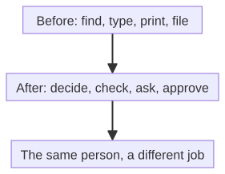

# 27. What Changes in the Office

Six months after the installation, Doreen Pratt did something she had never done in thirty-one
years: she took a holiday in the middle of the month.

Not because the system allowed it—although it did—but because nothing broke. The invoices went
out. The statements went out. The month-end reconciliation waited, patiently, in the way that
software waits, and when she came back it took her an afternoon instead of a week.

She told Maggie about it on her first morning back, standing in the doorway of the invoice room,
and then she said something that Maggie wrote down.

"The strange thing is, I'm busier than I was. But it's a different kind of busy. I'm not looking
for things any more. I'm looking *at* things."

This chapter is about that difference, because it is the part of automation that nobody
advertises and everybody experiences. The brochures promise that the machine will do the work. The
truth is more interesting: the machine does the *administration* of the work, and the person is
left with the work itself—which turns out to be the part that needed a person all along.

---

Let us be precise about what changed at Riverton, because vagueness is the enemy of a useful
argument.

**What stopped.** Somebody used to retype the customer's order into the accounts program. That
stopped. Somebody used to print invoices one at a time, check each against the delivery note, and
put them in envelopes. That stopped, mostly. Somebody used to compile the monthly sales report by
exporting three spreadsheets and reconciling them by hand. That stopped. Somebody used to walk to
the warehouse to ask Tom whether a product was in stock. That stopped, because the answer was a
question you could ask in a sentence and get in a second.

**What started.** Doreen began checking prices against the purchase ledger every Friday, because
she had time and because she had always suspected the supplier was creeping. Priya began sending a
short list of customers who had stopped ordering, with a suggested reason for each, to the sales
team every Monday. Tom began reviewing stock adjustments weekly instead of annually, which is how
the company discovered that one product had been entered in the wrong unit of measure since 2022
and that the "loss" everyone had blamed on the night shift was an arithmetic error.

None of those things is dramatic. Together they are the difference between a company that reacts
and a company that notices.

**What did not change at all.** The relationship with Ashfield Academy, which is nineteen years
old and based on the fact that Carol trusts Maggie to answer the telephone. The judgement about
which customer to give credit to. The decision to stop stocking a product line. The conversation
with a supplier who has raised prices for the third time. The apology when something goes wrong.

This is the honest shape of the change, and it is worth stating as a rule, because the rule holds
in every company where it has been tried: **automation removes the administration of a job and
leaves the job.**

---

There is a historical parallel that is more comforting than any statistic.

In 1979, two men at Harvard—Dan Bricklin and Bob Frankston—released a program called VisiCalc. It
was the first spreadsheet: a grid on a computer screen where a change in one cell recalculated
everything that depended on it. Before VisiCalc, a financial model was a sheet of paper, a pencil
and a calculator, and changing an assumption meant recalculating by hand, which meant that most
models were calculated once and then defended.

VisiCalc, and the spreadsheets that followed, did to the accountant's arithmetic what the washing
machine did to the laundry. And the prediction at the time was that accountants would disappear.

They did not disappear. There are, if anything, more of them. What disappeared was the job of the
person who added up columns of figures with a pencil, and what appeared was the job of the person
who decides which figures to add up, checks whether the model makes sense, and explains to the
board why the numbers are what they are. The tool did not replace the judgement. It changed the
*price* of the judgement, by removing the arithmetic that had been standing in front of it.

The same thing is happening now, and it is happening faster, and it is happening to a different
layer of the work. The spreadsheet removed the arithmetic. The agent removes the *retrieval*—the
part of the job that consists of finding out what is true.

Ask Doreen what she did in 2019 and she would have said: I keep the paperwork. Ask her what she
does now and she says: I check things. The second answer is worth more to the company, and it is
also the answer of somebody who is doing a job rather than serving a system.

---

None of this happens by itself, and this is where most companies get it wrong.

The failure mode is well known to anybody who has watched an office adopt a new tool. The tool is
installed. A trainer comes for a day. The enthusiastic people use it; the others keep their
spreadsheet, because the spreadsheet is faster *today*, and the tool is only faster *once you have
put your data in it*. Six months later the company has two systems, one of which is the truth and
one of which is the habit, and the argument about which is which consumes more time than either
saved.

There are three things that prevent this, and they are not technical.

**The first is that the work must arrive through the new door.** If an order can still be taken by
telephone and written on a pad, it will be. If the invoice can still be produced in the old
program, it will be. The new system becomes the truth on the day it becomes the *only* route, and
not a day before. This is why the installation in this book ends with the old shortcuts removed,
not with a training session.

**The second is that somebody must be allowed to be nosy.** Doreen's new job—checking, noticing,
asking why—only exists if the company treats it as work. In too many firms, the moment the
administration is automated, the person is given more administration, because administration is
measurable and noticing is not. The companies that get the benefit are the ones that write
"noticing" into somebody's week.

**The third is that the machine must be given a name and a limit.** Not a personality—a name in
the sense of a responsibility. Somebody must be answerable for what the assistant does, must read
its log, must be allowed to switch it off. An assistant that nobody owns is an assistant that
nobody checks, and an assistant that nobody checks is a rumour with a keyboard.

## The new job description

It is worth writing down what Doreen's job became, because job descriptions are where this kind of
change is either made real or quietly abandoned.

Before, in the language of the office: keep the books, raise the invoices, chase the money, file the
paperwork, answer the telephone when it is about money.

After, in the same language: **keep the model true, decide what is an exception, and answer the
questions that the numbers raise.**

Three duties, and each of them is new in a specific way.

**Keeping the model true** means the small disciplines that make the system trustworthy: a product
with the right unit of measure, a customer with the right payment terms, a delivery validated on the
day it happened, a stock adjustment with a reason. In the old world these were also her job, but
they were invisible—nobody could see the cost of getting them wrong until the year end. Now they are
the difference between an answer and a guess, and they have a daily visible consequence, which makes
them easier to defend and harder to skip.

**Deciding what is an exception** means reading the lists. The overdue invoices, the stock below
minimum, the products with no price, the delivery without an invoice. The system produces the list;
the person decides which items are noise and which are a problem. That is a genuine skill, and it is
the one that improves with practice—after three months, Doreen could look at a list of twelve
overdue invoices and tell you which four were real.

**Answering the questions that the numbers raise** is the part nobody predicted. A system that can
answer questions produces *more questions*: why is carriage up, why has this customer gone quiet,
why is this product's margin different from last month. Somebody has to chase those, and the person
who chases them is the one who now has the time.

## What did not change, and why it matters

Three things did not change at all, and it is worth saying so because the literature on automation
is mostly about change.

**The telephone is still answered by a person.** Carol at Ashfield calls because she wants to talk to
Maggie, not because she wants a transaction. The relationship is the business, and no system has ever
improved it.

**The judgement about people is still made by people.** Who to give credit to, who to chase hard,
who to let go. The system provides the facts—payment history, order pattern, overdue amounts—and the
facts make the judgement better informed, but they do not make it.

**The apology is still a person's.** When something goes wrong, a customer wants to hear a human
being say sorry. An automated apology is worse than none, because it confirms that nobody was
paying attention.

Those three are the core of the business, and they are the reason this book keeps insisting that
the machine takes the *patience* and the person keeps the *judgement*. A company that automates the
telephone, the credit decision or the apology has automated the wrong thing, and it will find out in
the way that companies always find out: slowly, and then suddenly.

## The hour in the diary

The most important change at Riverton was not a feature of the software. It was an hour in Doreen's
diary, every Friday, labelled *systems and exceptions*, which nobody was allowed to book over.

That hour is where the noticing happens: the price check, the log reading, the list of things that
look odd. Without it, the time saved by the automation would have been filled with more
administration—which is what happens in most companies, and why most companies report that
automation "did not really save anything".

An hour a week is fifty hours a year, which is a fraction of what the system saves. It is also the
difference between a system that improves and one that decays. Sam's line—*the software does not
fail, the habits do*—is the whole of the argument, and the hour in the diary is how a habit is
protected.

---

Maggie was asked, at a chamber of commerce dinner in the spring, whether she had "replaced staff
with artificial intelligence."

She had thought about the question beforehand, because she knew it was coming, and she had
decided to answer it honestly rather than diplomatically.

"No," she said. "We replaced a filing system. The staff are still here, and they are doing the
work that the filing system was preventing them from doing."

The woman who had asked looked sceptical. "But you must need fewer people."

"We need the same number of people and more of their attention," Maggie said. "Which, if you run a
business, is the same as needing more people."

That is the truth of it, and it is worth putting in the plainest possible terms, because the
public conversation about artificial intelligence is dominated by two stories that are both
wrong: that the machine will do everything, and that the machine will take everything. What
actually happens, in a well-run small company, is that the machine takes the part of the work that
nobody wanted, and the people discover that they have been doing that part for so long that they
have forgotten what the rest of the job was.

Doreen, on her first morning back from that holiday, had found a supplier invoice with a price
that had gone up by four per cent without notice. She had it in front of her within a minute of
sitting down, because the assistant had flagged it while she was away. In 2019 it would have been
filed, paid, and discovered at the year end, if at all.

She did not say "the machine found this." She said: "Look at this. Four per cent, in March, and
nobody told us."

That is the sentence this book has been working towards. The machine did the finding. The person
did the noticing. The company got the benefit.
