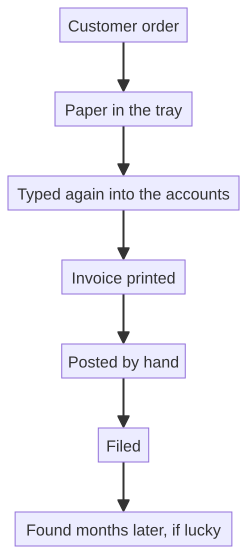

# 1. La habitación donde vive el papel

La habitación no tenía nombre en la puerta. Todos en Riverton Office Supply la llamaban la habitación de las facturas, aunque las facturas eran solo una fracción de lo que contenía: pedidos de compra, albaranes de entrega, justificantes de pago, notas de crédito, las hojas rosadas y finas que los proveedores enviaban cuando querían ser pagos antes, y las más gruesas y crema que los clientes enviaban cuando querían pagar más tarde.

Maggie Ellery había heredado la habitación, junto con la empresa, de su padre. Llevaba once años al mando de Riverton y aún comenzaba cada lunes en esa habitación, de pie en el umbral con una taza de café enfriándose en la mano, mirando los tres archivadores grises como si fueran animales de los que era responsable para alimentarlos.

Los archivadores se llamaban, en el lenguaje de la oficina, los Años Viejos, los Años Intermedios y el Año Actual. Los Años Viejos tenían una cerradura para la que nadie tenía llave. Los Años Intermedios tenían un cajón que solo se abría si lo levantabas ligeramente, de la misma forma en que levantas una maleta cuya hebillha rendido los planos. El Año Actual era el que importaba, y también era el que no podía cerrarse, porque las carpetas en su interior se habían engrosado con papel que había llegado más rápido de lo que nadie lo había archivado.

Doreen Pratt llevaba treinta y un años cuidando esos archivadores. Tenía sixty-three años, llevaba un cárdigan en todas las estaciones, y poseía el tipo de memoria que hace que una empresa se sienta más segura de lo que realmente es. Si le pedías a Doreen el albarán de la entrega de marzo al distrito escolar de Ashfield, no miraría los archivadores. Miraría el techo, movería ligeramente los labios y diría: "Fue la semana en que la furgoneta de Trevor tuvo problemas con el alternador. Tercera carpeta desde atrás, segundo cajón, detrás de los justificantes rosados." Acertaba con frecuencia suficiente como para que nadie hubiera pensado nunca en anotar cómo lo hacía.

Esta es la primera cosa que hay que entender sobre un negocio como Riverton, y es justo aquello que casi nadie escribe en los libros de gestión. La empresa no funcionaba con su software. Funcionaba con Doreen.

---

A las veinte de esa mañana de lunes, el teléfono del despacho de Maggie sonó con la particular intensidad de un cliente a punto de ser decepcionado.

Era la Academia de Ashfield, el distrito escolar que compraba a Riverton desde hacía diecinueve años: bolígrafos por miles, cuadernos por paletas, los buenos marcadores para pizarra que realmente se borran. Su administradora era una mujer paciente llamada Carol que esa mañana había recibido una entrega de cuatrocientos binders con anillas y ninguna factura.

"Margaret," dijo Carol, y Maggie supo por el uso de su nombre completo que aquello era serio, "no podemos pagar una factura que no hemos recibido, y no podemos cerrar nuestro trimestre sin ella. Y tu conductor dejó los binders en el aparcamiento, no en la plataforma de carga."

Maggie dijo las cosas que se dicen. Investigaría el asunto personalmente. Sentía mucho. Llamaría de nuevo en la hora.

Colgó el teléfono y hizo lo que había hecho diez mil veces: caminó hacia la habitación de las facturas y le preguntó a Doreen dónde estaba el papeleo.

Doreen miró el techo. Movió los labios. Luego dijo: "Los binders salieron el jueves. La factura debería haber salido con el albarán. A menos que"—y aquí se detuvo, porque había llegado al borde de su memoria y podía sentir el abismo más allá—"a menos que fuera a la bandeja y Trevor la llevara con las devoluciones."

Había cuatro bandejas en la habitación de las facturas. Estaban etiquetadas *Entrada*, *Salida*, *Más tarde* y, en una letra que pertenecía a nadie que siguiera trabajando en Riverton, *Trevor*. No había ningún Trevor ya más. No había habido un Trevor en seis años. La bandeja seguía estando, y el papel seguía entrando en ella, porque una bandeja con un nombre es una especie de instrucción.

Maggie encontró la factura en la bandeja de Trevor, debajo de un catálogo de semillas y de un recordatorio sobre extintores de incendio. Había sido impresa el jueves, firmada el jueves, y nunca enviada. Era, en el sentido estricto, un documento completo y correcto. Simplemente había fallado al viajar.

La llevó a Ashfield ella misma, porque el conductor ya se había ido a casa y porque quería que los veinte minutos en el coche fueran de enfadar-se en privado. En el camino de vuelta se detuvo en la rotonda junto al parque comercial y se quedó allí más tiempo del que exigía el tráfico, observando cómo las escobillas del parabrisas cumplían su trabajo, y pensó: *no somos malos en esto. No somos perezosos. No somos tontos. ¿Por qué entonces sentimos que la empresa se mantiene unida con cuerda?*

---

Aquí hay un dato que sorprendió a Maggie cuando lo leyó esa noche, y que probablemente también te sorprenderá a ti.

En junio de 1975, una revista llamada *Business Week* publicó un artículo largo titulado "La oficina del futuro."Describía, con gran confianza, un mundo en que el papeleo rutinario de los negocios—el registro de documentación, la contabilidad, el archivamiento—sería gestionado por máquinas, y el papel se convertiría en una curiosidad, de la misma forma en que el caballo se convirtió en una curiosidad tras el automóvil. La predicción se repitió con tanta frecuencia en las décadas siguientes que adquirió su propio nombre: la oficina sin papel.

Entre 1980 y 2000, el uso mundial de papel de oficina se más que duplicó.

Eso no es una ironía pequeña; es una grande, y tiene una causa que importa para todo en este libro. El papel no sobrevivió porque las oficinas fueran atrasadas. El papel sobrevivió porque era excelente en un solo trabajo: era lo único en el edificio que todos podían leer. El contable podía leer un pedido de compra. El almacén podía leer un albarán. El vendedor podía leer una lista de precios. El inspector de podía leer todos ellos. Una computadora en 1985 no podía comunicarse con una computadora de la habitación contigua, y mucho menos con el departamento de cuentas del distrito escolar, así que la computadora imprimía el papel y el papel hacía el habla.

No fallamos en convertirnos en una oficina sin papel. Automatizamos la *producción* del papel. Hicimos más barato imprimir un documento que caminar hasta un archivador, y luego imprimimos todo, y luego compramos más archivadores.

---

El lunes de Riverton no era inusual, y es exactamente por eso que vale la pena contarlo. La misma escena se repite en mil variaciones en cada pueblo: un proveedor de fontanería, un impresor de etiquetas, una empresa familiar que instala cocinas comerciales. Los detalles cambian; la forma no.

Un cliente hace una pregunta que requiere tres datos de tres lugares. Alguien promete una respuesta. La respuesta requiere un cuarto dato que vive en la cabeza de una persona que está de vacaciones. Para cuando se encuentra el cuarto dato, el cliente ha vuelto a llamar, y la promesa se ha convertido en una pequeña pieza de daño. El daño se repara con una disculpa y un descuento, y el descuento se registra en cualquier lugar, porque los descuentos que se dan para reparar daño no son el tipo de cosa que nadie quiere anotar.

Multiplica eso por cincuenta y dos semanas y por cada departamento, y llegarás al verdadero costo de la forma en que la mayoría de las pequeñas empresas trabajan. No es robo. No es despilfarro, en el sentido que un auditor significa. Es un impuesto sobre el recuerdo: la interminable e invisible peaje de mantener datos en cabezas humanas y bandejas de papel, y de mover esos datos de una cabeza a otra por teléfono.

Hay un diagrama que hace esto visible, y vale la pena mirarlo por un momento, porque es el mapa del problema del que trata este libro.

Seis pasos, y en cada flecha un dato es copiado por una persona de un medio a otro. Cada copia es una oportunidad para introducir un error, y cada error cuesta más encontrarlo de lo que costó hacerlo. La factura que nunca viajó no era una anomalía. Era el comportamiento normal de un sistema cuya memoria está distribuida entre bandejas, cabezas y cajones, sin un solo lugar donde se guarde la verdad.

Vale la pena ponerle un número a eso, porque el número es lo que cambia la mente de las personas.

La factura de Ashfield le tomó a Maggie cuarenta minutos: veinte al teléfono, veinte en el coche. Suma los diez minutos de Doreen mirando, y los cinco del conductor, y los quince de la contable a la semana siguiente cuando el pago no llegó y tuvo que perseguirse. Una hora y media del tiempo de cuatro personas, para entregar una sola pieza de papel que ya había sido producida correctamente. La factura valía ochocientos cuarenta libras. La empresa había gastado quizás sesenta libras de salarios en entregarla, y nadie jamás vería esas sesenta libras en ningún informe, porque no es un gasto. Simplemente es un día que fue ligeramente más corto de lo que debería haber sido.

Multiplica sesenta libras por el número de documentos que produce un mayorista en un año—pedidos, albaranes, facturas, créditos, estados de cuenta, justificantes de pago—y el impuesto invisible se convierte en el mayor costo único del negocio, mayor que el alquiler, mayor que las furgonetas, mayor que los salarios de los que se paga. Es invisible porque no es una línea en las cuentas. Es la ausencia de una línea.

---

El padre de Maggie tenía una frase para el negocio. Solía decir, de pie en el almacén con las manos a la espalda, "Vendemos papelería, Margaret. No vendemos confusión." Lo decía como un orgullo sobre la calidad del servicio, y era cierto: el servicio de Riverton era bueno. Era bueno de la misma forma en que es bueno un restaurante con un chef brillante y sin libro de reservas. Funcionaba mientras el chef estaba en la cocina.

Lo que Maggie comenzó a sospechar, esa noche de lunes, con el café frío y la factura entregada de forma segura, era que la empresa había alcanzado el límite de lo que las buenas personas pueden mantener en sus cabezas. Riverton había pasado de cuatrocientas líneas de producto a once mil. Había pasado de una furgoneta a seis. Tenía clientes que pedían a través de una tienda web que nadie confiaba del todo, y proveedores en tres países que enviaban facturas en dos monedas. La memoria de Doreen, extraordinaria como era, se había convertido en un punto único de falla con un cárdigan.

No quería comprar software. Había comprado software. Había un programa de contabilidad que producía informes preciosos que nadie leía, y un sistema de existencias que había sido instalado por un hombre que desde entonces había emigrado, y una carpeta compartida en la red de la oficina que contenía diecisiete versiones de la lista de precios, de las cuales catorce estaban equivocadas.

Lo que quería, aunque aún no tenía las palabras para ello, era un negocio que recordara. Un solo lugar donde un cliente, un producto, un pedido, una factura y un pago fueran el mismo dato visto desde distintos lados. Un solo lugar que pudiera responder a la pregunta "¿qué es lo verdadero ahora mismo?" sin una llamada telefónica.

El resto de este libro trata sobre cómo una empresa consigue ese lugar, y sobre lo que ocurre cuando se permite que una inteligencia artificial trabaje en su interior.

---

Una nota sobre lo que estás a punto de leer.

Este no es un libro para programadores. No hay código en él, ni comandos que escribir en una ventana negra, ni consultas a bases de datos. Si puedes usar un navegador web y responder un correo electrónico, tienes todas las habilidades que este libro requiere. Las partes técnicas se describen de la forma en que las describirías a un colega durante el almuerzo: qué hace la cosa, por qué la hace de esa forma, y qué deberías esperar ver en la pantalla.

Tampoco es un libro de teoría. Cada escena que sigue—cada pantalla de instalación, cada conversación con el asistente, cada factura que crea, cada negativa que recibe del sistema—fue realizada en una computadora real, en una instalación real, y fotografiada tal como ocurría. Cuando algo salía mal, y las cosas salían mal, el fallo está también en el libro, porque una guía que solo muestra el camino exitoso no es una guía; es un anuncio publicitario.

La empresa en estas páginas se llama Riverton Office Supply. Es una instalación real con un nombre ficticio, montada para la escritura de este libro: un mayorista de papelería con clientes, productos, un almacén, una cuenta bancaria y una oficina de impuestos que satisfacer. Puedes seguir los mismos pasos con el nombre de tu propia empresa, y para el final tendrás la misma cosa que Maggie quería esa noche de lunes—un negocio que sabe qué es lo verdadero, y un asistente que puede actuar sobre ello.

Maggie, por su parte, aún no sabía nada de esto. Solo sabía que había conducido cuarenta minutos para entregar una pieza de papel que una máquina debería haber enviado, y que el sentimiento en su pecho ya no era enfado. Era el comienzo de una decisión.

Volvió a la oficina, encendió la luz en la habitación de las facturas, y miró los tres archivadores por un largo momento.

"Vale," dijo, para nadie en particular. "Vamos a descubrir cómo se supone que esto funciona."
