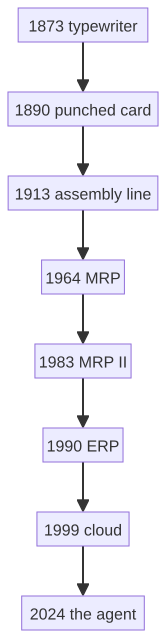

# 2. Una breve historia de hacer las cosas dos veces

El archivador se inventó porque un hombre se cansó de buscar una carta.

Eso no es una broma, y no es una simplificación excesiva. Antes del archivo vertical, las oficinas guardaban sus papeles en huecos para palomas, en manojos atados con cinta, en cajas etiquetadas con el nombre de un cliente y el año. Para encontrar algo había que recordar dónde había sido guardado, lo que significaba que la oficina, como Riverton, funcionaba con las memorias de sus oficinistas. El archivador vertical, que apareció en los últimos años del siglo XIX y se extendió por las oficinas con velocidad asombrosa, cambió los términos del problema: hacía que un documento fuera localizable por *categoría* en lugar de por *recuerdo*. Un oficinista que nunca había conocido al cliente podía abrir el cajón marcado de la A a la B y encontrar el expediente.

Fue, en su época, una inteligencia artificial. Guardaba información fuera de la cabeza humana, respondía a las preguntas bajo demanda, y nunca se iba de vacaciones. Olvidamos esto porque la tecnología está hecha de acero y huele a polvo, pero la ambición era exactamente la misma ambición de la máquina que se discutirá en este libro: sacar los datos de la persona, ponerlos en un lugar donde puedan encontrarse, y dejar que la persona haga el trabajo que necesita a una persona.

Maggie pasó la semana siguiente a la factura de Ashfield leyendo sobre esto, de la manera en que la gente que dirige pequeñas empresas lee sobre las cosas—de noche, con un portátil sobre la mesa de la cocina y un cuaderno a su lado, siguiendo una referencia tras otra hasta que su marido le preguntó si iba a la cama.

Lo que encontró no era una historia de progreso constante. Era una historia de la misma idea siendo descubida una y otra vez, por distintas personas, en distintos materiales.

---

**1873.** La máquina de escribir llega a la oficina. No es una máquina de calcular y no almacena nada, pero hace algo que resulta importar más: hace que la escritura sea uniforme. Una orden manuscrita es un documento con personalidad; una orden mecanografiada es un documento con formato. Los formatos pueden compararse, contarse y archivarse. En una generación, la mecanógrafa se ha convertido en la guardiana de la oficina, y la oficina se ha convertido en un lugar donde la información se *produce* según un calendario en lugar de cuando alguien llega hasta ello.

**1890.** El censo de los Estados Unidos se cuenta con tarjetas perforadas y una máquina tabuladora electromecánica, construida por Herman Hollerith. El censo de 1880 había tardado ocho años en procesarse. El censo de 1890, con una población mayor y más preguntas, tardó alrededor de uno. La máquina que lo hizo se convirtió, a través de una fusión en 1911 y un cambio de nombre en 1924, en la empresa que conocemos como IBM. Las tarjetas perforadas seguirían siendo la forma estándar de hablar con un ordenador durante los próximos setenta años, y la razón es instructiva: una tarjeta es un registro que puedes sostener, ordenar, dejar caer, y reejecutar. Es papel que una máquina puede leer.

**1913.** La línea de montaje móvil de Henry Ford en Highland Park convierte la fabricación de un coche en una secuencia de pasos cronometrados. La lección que el mundo de los negocios extrae de ello no es realmente sobre coches. Es que un proceso puede ser *diseñado*—escrito, medido, y luego mejorado—en lugar de ser dejado a los hábitos de las personas que lo realizan. Frederick Winslow Taylor había estado defendiendo lo mismo desde los años 1890 con su cronómetro y su "administración científica", y la combinación del cronómetro de Taylor y la línea de Ford produjo una convicción que dominaría el siglo: si puedes describir un negocio como una serie de pasos, puedes mecanizar los pasos.

**1951.** Se usa un ordenador para calcular la nómina de una empresa. La máquina es enorme, el programa está escrito en instrucciones de máquina, y el cálculo toma menos tiempo que la preparación de las tarjetas perforadas que lee. Pero el principio queda establecido: la aburrida, repetitiva y propensa a errores aritmética de la oficina es exactamente lo que un ordenador hace bien.

**1964.** Un hombre llamado Joseph Orlicky, trabajando en la industria manufacturera, desarrolla una forma de calcular qué necesita comprar una fábrica y cuándo, en función de lo que pretende construir. Se llama Planificación de las Necesidades de Materiales, y en el mismo año una empresa llamada Black & Decker instala el primer sistema que lo usa, con un líder de proyecto llamado Dick Alban. Orlicky publica el libro en 1975—*Material Requirements Planning: The New Way of Life in Production and Inventory Management*—y para entonces unos setecientos son ya las empresas que ejecutan alguna versión de la idea. Para 1981 hay aproximadamente ocho mil.

**1983.** Oliver Wight extiende la idea desde los materiales a toda la fábrica: calendarios, capacidad, previsiones de ventas, finanzas. El resultado se llama Planificación de los Recursos de Manufactura, o MRP II, y es el primer software de negocios que pretende conocer el estado de toda una empresa.

**1990.** Una firma de análisis llamada Gartner necesita un nombre para lo siguiente—software que no solo planifica la fábrica sino que gestiona toda la empresa: ventas, compras, existencias, cuentas, personas. Lo llaman Planificación de los Recursos de la Empresa. ERP. El nombre es un accidente de marketing que se quedó, y ha sido estirado desde entonces para cubrir casi cualquier cosa que una empresa hace con una base de datos.

**1992.** SAP, una empresa alemana fundada en 1972 por cinco ingenieros que habían dejado a IBM, lanza R/3, un sistema que corre sobre la arquitectura cliente-servidor que entonces se estaba voliendo asequible. Se convierte en el estándar frente al que toda ERP posterior es medida, y la razón no es la elegancia. Es que R/3 codifica los procesos de una empresa de una manera que los auditores, los bancos y los reguladores reconocen.

**1999.** Una empresa llamada NetLedger empieza a vender software contable que corre en un navegador, en el ordenador de otra persona, por una cuota mensual. Comienza la era en la nube del software de negocios. Tomará otros quince años para que la idea se vuelva normal, y otros cinco para que se vuelva el valor por defecto.

**2013.** Gartner acuña "ERP postmoderno": en lugar de un sistema enorme, una empresa correrá un conjunto de sistemas más pequeños que hablan entre sí. La predicción es correcta en el espíritu y incorrecta en el detalle—lo que realmente ocurrió es que los sistemas pequeños se multiplicaron, y el hablar se convirtió en la parte difícil.

Maggie copió las fechas en su cuaderno, dibujó una línea bajo ellas, y escribió una frase que habría hecho reír a su padre: *Cada una de estas fue un intento de dejar de hacer las cosas dos veces.*

## El patrón que se repite

Mira de nuevo las fechas y aparece un ritmo: aproximadamente cada veinte años, una nueva tecnología promete acabar con la copia, y cada vez la promesa se cumple en parte y se rompe en parte.

La máquina de escribir acabó con la copia manuscrita y creó el grupo de mecanógrafas. La fotocopiadora acabó con la copia carbón y creó la crisis de archivo. El ordenador personal acabó con el libro mayor y creó la expansión de las hojas de cálculo. Cada uno eliminó un costo específico y añadió uno general: el costo de *saber qué copia es la verdadera*.

El ERP fue la primera tecnología de la serie que atacó el costo general directamente, al insistir en que hubiera una sola copia. Tuvieron que pasar treinta años, y funcionó—dentro de las cuatro paredes de una empresa. Lo que nunca resolvió fue la frontera: el sistema del cliente, el sistema del proveedor, el sistema de la oficina de impuestos, cada uno con su propia copia de los mismos datos.

El agente es la primera tecnología de la serie que puede trabajar a través de esa frontera, porque puede leer lo que un humano escribió y escribir lo que un sistema entiende. Si cumple la promesa es el tema del resto de este libro.

---

Había una foto en la pared de la oficina que había mirado mil veces sin verla. Mostraba a cuatro mujeres en cuatro escritorios en 1978, en la sala que ahora era la sala de facturas, cada una con una máquina de escribir y una pila de papel frágil. Su madre era la segunda desde la izquierda.

"Papel carbón," dijo Doreen, cuando Maggie le preguntó por él. "Mecanografiabas la factura y la copia salía por debajo, en la hoja rosa delgada. Tres copias si tenías suerte y tu cinta era nueva. Luego las separabas y enviabas una al cliente, una al archivo, y una al libro de cuentas."

"¿Y si cometías un error?"

"Lo mecanografiabas de nuevo. Todo. Y entonces tenías dos copias del error, una de las cuales estaba en el archivo, así que tenías que ir a buscarla."

Riverton había comprado una fotocopiadora en 1983, y durante un tiempo la empresa creyó haber resuelto el problema de las copias. Había resuelto el problema de *hacer* copias. Lo que no había resolvido—lo que nadie había resolvido—era el problema de saber qué copia era la verdadera. Para 1991 había copias de facturas en tres lugares del edificio, y la persona que sabía cuál había recibido realmente el cliente era Doreen, que había estado allí desde 1987.

Este es el patrón que se repite a lo largo de toda la historia de la oficina, y vale la pena nombrarlo antes de seguir adelante. Cada tecnología que facilita producir un documento también facilita producir *otro* documento, y el costo del segundo cae más rápido que el costo de decidir cuál importa. La fotocopiadora multiplicó el papel. El correo electrónico multiplicó de nuevo los documentos. La carpeta compartida multiplicó las versiones. Cada invención cumplió su promesa—más barato, más rápido, más—y cada una dejó la misma cuenta sin pagar: el trabajo de decidir qué es verdadero.

Un ERP es la primera tecnología de esa serie cuya promesa no es "más documentos" sino "un solo dato." Es por eso que se siente distinto en la mano, y por qué instalar uno se parece más a un acuerdo legal que a comprar una máquina.

Hay una pequeña prueba que te dice si una empresa ha hecho el cambio, y no cuesta nada aplicarla. Pregunta a dos personas, en distintos departamentos, la misma pregunta sobre el mismo cliente: ¿cuánto nos deben? Si las respuestas difieren, la empresa todavía tiene copias. Si las respuestas coinciden, y ambas personas pueden decirte de qué documentos se construye la respuesta, la empresa tiene un modelo. Todo lo demás—el software, los servidores, la inteligencia artificial—andamiaje alrededor de ese único logro.

---

Porque ese es el hilo. Desde el archivador hasta la nube, cada invención en la historia de la oficina ha estado dirigida al mismo despilfarro: la segunda vez que un dato se escribe.

El cliente da su dirección. Se escribe en la orden. Se escribe de nuevo en la nota de entrega, de nuevo en la factura, de nuevo en las cuentas, de nuevo en la etiqueta, y de nuevo por el departamento de cuentas del cliente cuando llega la factura. Cinco copias de un dato que fue declarado una sola vez. Cada copia es una oportunidad de escribir mal un código postal, y el código postal es cómo el paquete encuentra la escuela.

Un ERP es, en su corazón, una promesa: que la dirección se escribirá una sola vez, en un solo lugar, y que cada documento que la necesite la *consultará* en lugar de recibir una copia nueva. Esa promesa suena modesta. No lo es. Para cumplirla, el sistema debe saber qué es un cliente, qué es una orden, qué es un producto, y cómo se relacionan; debe decidir quién tiene permiso para cambiar la dirección y quién no; debe recordar cuál era la dirección el mes pasado, porque la factura que se envió en marzo todavía debe mostrar la dirección a la que se envió. La promesa convierte una pila de papel en un modelo de la empresa.

Y un modelo, una vez que existe, puede ser *accionado* por algo distinto de una persona.

---

Había una cosa más en el cuaderno de Maggie, escrita en la última página de esa semana, en una caligrafía que se inclinaba más de lo normal porque era tarde.

*¿Por qué funcionaba nada de esto?*

Había leído sobre empresas que gastaron millones en sistemas ERP y terminaron peor paradas; las historias no eran difíciles de encontrar, y la habían vuelto cautelosa. Un sistema que modela una empresa solo es útil si el modelo es *verdadero*, y un modelo es verdadero solo si las personas que conocen los datos los meten. Ese es el paradoja en el centro de toda la industria: el software existe para liberar a las personas de la administración, y solo funciona si las personas hacen la administración de alimentarlo.

La generación de sistemas que vino después de 1990 resolvió esto por la fuerza. Hicieron del software la única forma de hacer el trabajo: no puedes expedir el paquete sin la nota de entrega, no puedes imprimir la factura sin la orden, no puedes cerrar el mes sin la conciliación bancaria. El modelo se mantiene verdadero porque no hay ruta alternativa a su alrededor. Es por eso que los ERPs se sienten como prisiones para las personas que los usan, y por qué funcionan de todos modos.

Maggie entendía el trato. Lo que aún no entendía—lo que casi nadie entendió hasta hace muy poco—era que el trato estaba a punto de cambiar, porque una máquina había aprendido a leer.

La máquina de leer no es un archivador y no es un ERP. Es la cosa que, en los últimos años, ha empezado a aparecer en las oficinas bajo el nombre vago de inteligencia artificial: un programa que puede darse una frase en lengua ordinaria y puede responder, o actuar, sin que nadie haya escrito una regla para esa frase concreta.

Si tal programa pudiera darse el modelo de la empresa—los clientes, los productos, las órdenes, el libro mayor—entonces la carga de alimentar el sistema caería, no sobre las personas, sino sobre la máquina que lee lo que dicen las personas.

Ese es el entero idea de este libro, y tomó el resto del año para hacerlo real.
