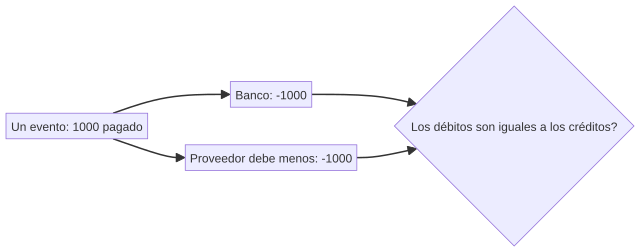

# 3. El fraque escribió las reglas

El contador de Maggie era un hombre llamado Gerald Pryce, que tenía una oficina encima de una droguería y el hábito de responder las preguntas en el orden en que le interesaban, más que en el orden en que habían sido formuladas.

Ella fue a verlo un jueves, con una carpeta de impresiones y una pregunta de la que se sentía ligeramente avergonzada: *¿por qué tenemos que llevar los libros en absoluto?* No el impuesto, dijo—ella entendía el impuesto. La partida doble. Los débitos y los créditos, el balance de comprobación, toda la elaborada simetría que Doreen realizaba cada mes en la mesa de la cocina de la oficina con una calculadora y una tetera de té.

Gerald se quitó las gafas, lo cual era una buena señal, y dijo: "Porque un mercader en Venecia quería saber si era rico."

---

El hombre a quien se refería era Luca Pacioli, y la fecha que importa es 1494.

Pacioli era un fraque franciscano, un matemático y un docente de considerable fama en su propio tiempo. Trabajó en Venecia, en Florencia, en Milán, y por un tiempo en el hogar de un duque. Era amigo de Leonardo da Vinci—Leonardo dibujó las ilustraciones para uno de sus libros, y Pacioli le enseñó matemáticas—y era, por temperamento, el tipo de persona que cree que cualquier cosa que vale la pena hacer vale la pena escribir correctamente.

En 1494, en Venecia, publicó un libro de texto de matemáticas titulado *Summa de arithmetica, geometria, proportioni et proportionalità*: el resumen de aritmética, geometría, proporciones y proporcionalidad. Era un libro enorme, escrito en italiano en vez de latín para que los mercaderes pudieran leerlo, y cubría todo lo que un hombre práctico de negocios podría necesitar: cómo multiplicar, cómo calcular intereses, cómo cambiar monedas, cómo medir un barril.

Un capítulo de él describía algo que los mercaderes italianos venían haciendo por al menos doscientos años, y que nadie había explicado jamás impreso: el método de llevar cuentas por partida doble.

La idea es casi insultantemente simple, y es la razón por la que todo sistema contable en el mundo, incluyendo el que Riverton estaba a punto de instalar, luce como luce.

Cada transacción se escribe dos veces, en dos lugares diferentes, desde dos puntos de vista diferentes. Si la empresa paga a un proveedor mil libras, entonces el dinero en el banco ha bajado en mil y la cantidad debida al proveedor ha bajado en mil. Dos hechos, un evento. Si la empresa vende un escritorio a la escuela, entonces el cliente debe dinero y la empresa ha ganado ingresos: dos hechos, un evento. Las dos entradas se llaman débito y crédito, y deben ser siempre iguales y opuestas, porque están describiendo la misma cosa desde ambos lados de la mesa.

La consecuencia es un sistema que se verifica a sí mismo. Suma cada débito en los libros y cada crédito, y si los dos totales no coinciden, algo está mal. No "algo podría estar mal"—mal. Los libros te lo dicen. Es la única parte de la administración de negocios que tiene un garantía matemática integrada en ella, y ha sobrevivido a seis siglos de guerras, monedas, imperios y software por esa garantía.

Gerald lo dibujó en el reverso de un sobre, que es así como se ha enseñado la contabilidad desde 1494.

"Ahora," dijo Gerald, dejando la pluma, "aquí está lo que tu padre nunca entendió, y lo que la mayoría de la gente nunca entiende. La partida doble no es una regla inventada para hacer tu vida difícil. Es una *descripción de la realidad*. Hay dos lados en cada transacción porque hay dos partes en cada transacción. Los libros no son un formulario de impuestos. Son un modelo de lo que realmente ocurrió."

---

Para ver por qué importa la simetría, ayuda observar a alguien usándola.

Una vez al mes, Doreen tomaba el extracto bancario, la lista impresa de todo lo que realmente había salido y entrado en la cuenta de la empresa, y la colocaba al lado de las cuentas. Las dos nunca coincidían. Nunca coinciden en ninguna empresa; la pregunta es sólo de cuánto, y por qué.

Un mes, la diferencia era de trescientos doce libras. Doreen no empezó a buscar trescientos doce libras. Empezó en la parte superior del extracto y trabajó hacia abajo, marcando cada línea contra los libros, y encontró que el banco había cobrado una comisión de doce libras que Riverton no había registrado, y que un cliente había pagado una factura de trescientos libras que los libros todavía mostraban como no pagada.

Doce y trescientos. La diferencia era la suma de dos cosas que habían ocurrido en el mundo real y que todavía no habían ocurrido en el modelo. Dentro de diez minutos había escrito dos entradas—una por la comisión del banco, una por el recibo—y las dos columnas coincidían hasta el último centavo.

Ese es todo el arte, y vale la pena notar qué *no* es. No es aritmética; una calculadora habría podido encontrar la diferencia. No es memoria; el extracto es la memoria. Es la disciplina de un modelo que tiene dos lados, de modo que cada evento real tiene un lugar donde ser registrado dos veces, y una brecha que puede ser *localizada*. Sin el segundo lado, una diferencia de trescientos doce libras es sólo un número que está mal, y lo buscas leyendo todo. Con el segundo lado, el número te dice dónde buscar.

Cuando un ERP registra una factura, realiza los diez minutos de Doreen automáticamente, en el momento en que la factura se crea, y la realiza para cada transacción de la empresa. Eso no es una comodidad. Es la diferencia entre una empresa que descubre sus errores mensualmente, en un lote, y una empresa que los descubre inmediatamente, uno a la vez, mientras la persona que los causó todavía está en la habitación.

---

La historia vale un momento más, porque explica algo sobre el software moderno que de otra manera parecería arbitrario.

La evidencia superviviente más temprana de la partida doble completa es un libro mayor de 1299–1300, mantenido por un mercader florentino llamado Amatino Manucci para la empresa Farolfi, que comerciaba desde Nîmes en el sur de Francia. Hay indicios de la práctica aún más temprano, en los registros de los cambiadores de dinero florentinos en una feria en Bolonia en 1211. El sistema se extendió a lo largo de las rutas comerciales: a las ferias de Champaña, a Venecia, a Lyon, a Amberes. Para el siglo XV, un mercader que quería hacer negocios en las grandes ferias internacionales tenía que llevar sus cuentas de esa manera, porque sus socios y sus banqueros lo hacían, y porque el crédito es imposible sin una manera compartida de contar.

Un mercader de Ragusa llamado Benedetto Cotrugli escribió una descripción del método en 1458, en un libro titulado *Della mercatura e del mercante perfetto*— sobre el comercio y el mercader perfecto. No se imprimió hasta 1573, ochenta años después del libro de Pacioli, y el impresor lo acortó. Así que Pacioli se llevó el crédito, y la frase "padre de la contabilidad", la cual probablemente habría encontrado vergonzosa, ya que estaba bastante claro que describía lo que otras personas ya hacían.

Lo que Pacioli hizo fue más importante que inventarlo: lo hizo *portable*. Un mercader en Nápoles que leyera la *Summa* podía llevar libros que un banquero en Brujas aceptaría. Un método que vive en la cabeza de una familia muere con la familia; un método que vive en un libro imperto pertenece a todos. Es la misma razón por la que escribimos las recetas.

Seiscientos años después, cuando abras una factura en un sistema ERP y veas las palabras *Entradas de Diario* debajo de ella, estás mirando el capítulo de Pacioli, traducido a software. Las cuentas tienen nombres ahora—Deudores, Acreedores, Ventas, Existencias—y las entradas se hacen automáticamente cuando haces clic en un botón marcado *Registrar*. Pero la simetría no ha cambiado, y la garantía sigue vigente: si las entradas no equilibran, el sistema no te dejará registrar el documento. Es el único lugar en el software de negocios donde la máquina puede decirte, con certeza, que has cometido un error.

Hay una curiosidad agradable adjunta al hombre. En 1496 Pacioli se mudó a Melán, a la corte de Ludovico Sforza, y allí conoció a un pintor e ingeniero que entonces trabajaba en un caballo de bronce que nunca se fundió. Los dos hombres se hicieron amigos; Pacioli le enseñó matemáticas, y el pintor dibujó las ilustraciones para uno de los libros posteriores de Pacioli, sobre la proporción divina. El pintor era Leonardo da Vinci. Así que las reglas que gobiernan el libro mayor de un mayorista de papelería en un pueblo de mercado fueron, literalmente, dibujadas por la misma mano que dibujó la *Última Cena*—y vale la pena recordar, cuando la contabilidad se siente como una carga, que una vez estuvo en la misma habitación que la mente más curiosa de su época, y se consideró un sujeto digno para ella.

## Por qué sobrevivió

Hay una pregunta worth asking about any six-hundred-year-old practice: why did this one survive when so much else did not?

La respuesta no es la tradición. La partida doble sobrevivió porque es *falsable*. Un conjunto de libros puede ser verificado, por alguien que no los escribió, con no más que aritmética. Esa propiedad es rara en la administración: un contrato, un informe, un plan—ninguno de ellos puede ser verificado de la misma manera. El libro mayor sí puede.

El segundo motivo es que es *portable*. Las reglas de Pacioli no dependen de una moneda, un país o una tecnología. Sobrevivieron al florín, a la libra, al euro; sobrevivieron a la escritura a mano, a la máquina de escribir, a la hoja de cálculo y a la base de datos. Un mercader de 1500 podría leer un balance de comprobación moderno y reconocerlo, lo cual es más de lo que puede decirse sobre un lector moderno enfrentando un libro mayor de 1500.

El tercero es que *restringe*. Un sistema que sólo registra lo que ocurrió es un diario; un sistema que se niega a registrar una transacción con un lado es un control. Esa negación es por lo que un ERP se siente estricto, y por lo que la estrictez vale la pena.

---

Maggie hizo la pregunta que la había estado molestando. "Si los libros son un modelo de la realidad, ¿por qué la realidad sigue sin coincidir con ellos?"

Gerald se rio, y luego se puso serio, porque era una buena pregunta.

"Porque el modelo sólo es tan bueno como lo que se introduce en él," dijo. "Los libros dicen que el almacén contiene doscientos encuadernadores. El almacén dice que contiene ciento ochenta. Uno de ellos está mal, y los libros no te dirán cuál, porque los libros sólo saben lo que alguien tecleó en ellos. Es por eso que existen los inventarios. Es por eso que existen los auditores. Las matemáticas son perfectas; los datos son humanos."

Esta es la grieta por la que desaparece la mayor parte del dinero en una pequeña empresa. No fraude—el fraude es raro y usualmente obvio. Las pérdidas ordinarias son: existencias que el sistema cree que existen y que no, facturas que nunca se enviaron, pagos que nunca se coincidieron con la factura que pagaban, descuentos dados verbalmente y registrados en ninguna parte, y los pequeños retrasos infinitos de pedirle a una persona un dato que una máquina podría haber respondido.

Un ERP es un intento de cerrar la grieta, no haciendo las matemáticas mejores—las matemáticas han sido buenas desde 1494—sino haciendo que los *datos* lleguen al modelo automáticamente, en el momento en que el evento ocurre, desde la persona que lo causó.

Es por eso que la instalación de tal sistema no es realmente un proyecto de TI. Es una decisión sobre dónde vive la verdad.

---

Había una cosa más que dijo Gerald, mientras Maggie se ponía el abrigo, y ella la anotó en el coche porque no quería perderla.

"Tu padre dirigía este negocio con confianza," dijo. "Confianza en Doreen, confianza en los conductores, confianza en los clientes para pagar cuando decían que pagarían. Eso no es una mala manera de dirigir una empresa. Es así como se dirigió toda empresa en este país durante doscientos años, y algunas de ellas fueron muy exitosas. Pero la confianza no escala. Funciona mientras todos conocen a todos. El momento en que tienes seis furgonetas, once mil productos y un cliente en otro país, la confianza tiene que escribirse, o se convierte en una historia que la gente se cuenta mutuamente sobre lo que creen que está ocurriendo."

Puso sus gafas de nuevo, lo cual significaba que la conversación había terminado.

"Escríbelo," dijo. "Luego puedes confiar en lo escrito."

---

Esa noche Maggie abrió el programa de contabilidad que Riverton venía usando desde 2014. Era un programa perfectamente respectable. Producía una cuenta de pérdidas y ganancias, un balance general, una declaración de IVA. Tenía, en algún lugar dentro de él, el fantasma de Pacioli, porque todo software de contabilidad lo tiene.

Pero no podía decirle cuántos encuadernadores había en el almacén. No podía decirle que la factura del distrito escolar había sido impresa y no enviada. No podía decirle cuál de los once mil productos no había vendido una sola unidad en dos años, o qué cliente había dejado de ordenar en silencio, o cuánto costaban las seis furgonetas por entrega el mes pasado. Sabía sobre el dinero. No sabía sobre el negocio.

La diferencia entre esas dos cosas es el tema del siguiente capítulo, y tiene un nombre que ha estado en uso desde 1990: Planificación de Recursos Empresariales. Un sistema que sabe sobre el negocio, no sólo sobre el dinero. Y como toda gran idea en la historia de la administración, comenzó con una fábrica que no podía encontrar sus propias partes.
