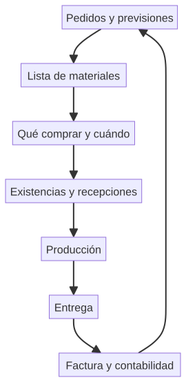

# 4. La máquina que devoró el almacén

Arthur Ellery era el tío de Maggie, el hermano menor de su padre, y había treinta y cuatro años trabajando como planificador de producción en una fábrica que fabricbombas industriales. Tenía seventy-ocho años, criaba abejas, y era la única persona que Maggie conocía capaz de explicar qué era un ERP sin usar la palabra "solución."

Ella condujo hasta su cabaña un domingo de octubre, con una caja de las buenas galletas, y le preguntó cómo había sido antes.

"¿Antes de qué?" dijo.

"Antes de todo esto. Antes de los ordenadores."

Él se rió de ella de la forma en que se ríen los hombres mayores de los jóvenes, y luego entró a la habitación trasera y salió con un libro. Era un cuaderno con anillas, unido con cinta adhesiva, y tenía cuatro pulgadas de grosor.

"Eso," dijo, "es una lista de materiales. Eso es de qué está hecha una bomba. Cada pieza, cada subpieza, cada tornillo. Y en cada página, la cantidad que necesitábamos para fabricar una bomba, y el proveedor, y cuánto tiempo tardaba en llegar."

Maggie lo abrió. Las páginas estaban mecanografiadas, con anotaciones manuscritas en tres colores distintos, y todo el conjunto olía a polvo y a cigarrillos.

"¿Quién lo mantenía actualizado?"

"Yo. Y cuando estaba de vacaciones, nadie."

---

El problema que el cuaderno de Arthur intentaba resolver es uno de los más antiguos en la fabricación, y es sorprendentemente difícil de formular con claridad.

Tienes pedidos de bombas. Para fabricar una bomba necesitas piezas. Para tener piezas debes pedirlas, y tardan semanas en llegar. Para saber cuántas pedir, debes saber cuántas bombas vas a fabricar, lo que depende de los pedidos que tienes y de los que esperas. Pero las propias piezas están hechas de subpiezas, algunas de las cuales se fabrican en la misma fábrica, y cada una tiene su propio tiempo de entrega, y algunas comparten una máquina que solo puede hacer un trabajo a la vez. Si pides demasiado, inmovilizas dinero en estanterías. Si pides demasiado poco, la fábrica se para, y una fábrica parada es el objeto más caro que hay en el edificio.

A mano, un planificador competente podía hacer esto para un par de cientos de piezas. Más allá de eso, la aritmética superaba al humano. No podías contener toda la red de dependencias en tu cabeza, así que hacías lo que hacía Arthur: mantenías un cuaderno, lo actualizabas a lápiz, y rezabas para que nadie te hiciera una pregunta sobre una pieza que no habías revisado desde la primavera.

---

A principios de los años cincuenta, dos fabricantes de motores aeronáuticos, Rolls-Royce y General Electric, comenzaron a poner esta aritmética en ordenadores. No era un producto comercial; era una herramienta interna para un problema tan caro que incluso un ordenador del tamaño de una habitación valía la pena. Los motores aeronáuticos tienen decenas de miles de piezas, y un error en el plan no cuesta un retraso, cuesta un avión.

La idea se convirtió en un producto en 1964, cuando un hombre llamado Joseph Orlicky desarrolló un método práctico para calcular los requisitos y una llamada Black & Decker instaló el primer sistema en usarlo. El líder del proyecto se llamaba Dick Alban, que es el tipo de detalle que la historia suele perder y que hace que una historia sea verdadera: no era un comité, era una persona con un problema.

Orlicky publicó el método como libro en 1975, con un título que ningún editor permitiría hoy: *Material Requirements Planning: The New Way of Life in Production and Inventory Management.* Para entonces ya unas setecientas empresas usaban la idea. En 1981, ocho mil.

El método se llama MRP, y hace exactamente una cosa: toma lo que pretendes fabricar, recorre la lista de materiales, resta lo que ya tienes en existencias, y te dice qué comprar y cuándo, teniendo en cuenta los tiempos de entrega. Si eso suena obvio, es porque funcionaba. Se convirtió en la forma en que piensan las fábricas.

En 1983, un hombre llamado Oliver Wight amplió la idea más allá de los materiales. Si el sistema ya sabe qué va a fabricar la fábrica, ¿por qué no dejar que planifique también a las personas, a las máquinas, a el dinero y a la previsión de ventas? El resultado se llamó Manufacturing Resource Planning—MRP II—y fue el primer software empresarial que afirmaba conocer el estado de toda una empresa.

En 1989, el software MRP II representaba un tercio de las ventas de la industria del software a la fabricación americana, unos 1.200 millones de dólares. Había cambiado algo: la fábrica ya no funcionaba sobre el cuaderno del planificador. Funcionaba sobre un modelo, y el modelo estaba en un ordenador.

La fábrica de Arthur compró uno de esos sistemas en 1988, y el primer intento falló.

"El software estaba bien," dijo. "Estaba mejor que bien. Podía hacer cosas que yo había estado haciendo con un lápiz durante veinte años, en un segundo. Pero quería saber el tiempo de entrega de cada pieza, y nadie había escrito nunca los tiempos de entrega. Estaban en las cabezas de los compradores, y los compradores nos daban los números que creían que queríamos oír, porque no querían parecer lentos. Así que el sistema planificaba con ficción, y la fábrica corría sobre el plan, y tres meses después teníamos un almacén lleno de las piezas equivocadas y un director gestionando preguntando quién era el responsable."

"¿Quién era?"

"Todos. Nadie. Los compradores no mentían; genuinamente no sabían, porque nadie había medido nunca. Esa es la cosa sobre un modelo: no solo expone los errores que cometiste. Expone las cosas que nunca supiste que no sabías."

El segundo intento funcionó, y la razón por la que funcionó no tenía nada que ver con el software. La fábrica gastó cuatro meses midiendo tiempos de entrega, contando existencias y escribiendo las reglas que siempre había seguido por hábito. Para cuando el sistema se activó, el modelo ya era verdadero, y el único trabajo del ordenador era mantenerlo más rápido de lo que una persona podía.

Arthur se sintió orgulloso de eso, de la forma en que los hombres de su generación se sentían orgullosos de cosas sin glamour. "No instalamos un ordenador," dijo. "Escribimos cómo funcionaba la fábrica. El ordenador era la parte fácil."

---

En 1990, una firma de análisis llamada Gartner necesitaba un nombre para el siguiente paso. Las fábricas tenían MRP II. El departamento de finanzas tenía sus propios sistemas. La oficina de ventas tenía otro. Los almacenes tenían otro. ¿Y si un solo sistema hiciera todo esto—no solo la fábrica, sino toda la empresa?

Lo llamaron Enterprise Resource Planning. ERP.

El nombre no es preciso, y todos en la industria lo saben. No planifica recursos en ningún sentido profundo, y "empresa" es una palabra que significa "grande" hasta que significa "caro." Pero los nombres se pegan, y este se pegó a una cosa real: una base de datos única en la que el cliente, el producto, el pedido, las existencias, la factura y el libro mayor están todos conectados, de modo que un dato introducido una sola vez es visible en todas partes.

La empresa que lo convirtió en un estándar fue SAP, fundada en 1972 por cinco ingenieros que habían dejado a IBM. En 1992 lanzaron R/3, que corría sobre la arquitectura cliente-servidor que se estaba volviendo asequible, y que codificaba los procesos de una empresa de una forma que los auditores, los bancos y los reguladores reconocían. Si corrías R/3, podías ser auditado de la forma en que se audita a una empresa grande. Para un negocio en crecimiento que quería vender a clientes grandes, eso valía más que cualquier función.

Otras dos cosas ocurrieron en los años noventa, y ambas importan para la historia de este libro.

La primera fue el año 2000. Muchísimas empresas reemplazaron sus viejos sistemas a finales de los noventa porque esos sistemas almacenaban los años con dos dígitos y temían, se temía, confundir 2000 con 1900. Parte del miedo era exagerado. Pero el reemplazo ocurrió, y movió el ERP desde la fábrica a todo tipo de organizaciones: hospitales, universidades, organizaciones benéficas, gobiernos.

La segunda fue la nube. En 1999 una llamada NetLedger comenzó a vender software contable que corría en un navegador, en el ordenador de otra persona, por una cuota mensual. Tardó quince años en que la idea se volviera normal. Ahora es el valor por defecto, y la razón no es la elegancia técnica. Es que una pequeña empresa puede alquilar un sistema que nunca habría podido comprar y mantener.

---

Arthur guardó el cuaderno y preparó el té, y Maggie hizo la pregunta que venía preparando.

"¿Así que por qué odia todos estos sistemas?"

Pensó en ello por un rato. "Porque te obligan a hacer el trabajo a su manera," dijo. "Y porque quienes los venden mienten sobre cuánto trabajo es."

Esta es la versión honesta de la historia, y vale la pena decirlo claramente, porque el resto de este libro depende de ello.

Un ERP es un modelo de una empresa, y un modelo tiene reglas. No puedes registrar una factura sin un cliente, porque la factura necesita una dirección y un número de impuestos y una cuenta de libro mayor. No puedes expedir mercancía que no esté en existencias, a menos que el sistema permita existencias negativas, que la mayoría de las empresas desactivan. No puedes eliminar una entrada de diario registrada, porque la garantía de Pacioli depende de que la historia esté intacta. Cada una de esas reglas existe por una buena razón, y cada una de ellas es una discusión con alguien que tiene un cliente al teléfono y necesita que la cosa ocurra *ahora*.

Multiplica esa discusión por cada proceso de la empresa, y tienes la razón por la que los proyectos ERP son famosos por salir mal. El software no suele ser el problema. El problema es que instalar un ERP no es un proyecto de TI: es un acuerdo sobre cómo funciona la empresa, extraído de las cabezas de las personas que trabajan allí, escrito, y luego hecho cumplir por una máquina. Las empresas que no pueden tener esa conversación—porque el dueño no quiere, o los departamentos no coinciden, o el consultor es pagado por hora y no le importa—terminan con un sistema caro que nadie confía, y vuelven a las bandejas.

Ese bucle es el conjunto de un negocio manufacturero, y el conjunto de un negocio mayorista también, con "producción" reemplazado por "picking." Cada ERP del mundo es una máquina para mantener ese bucle verdadero.

## Lo que el suelo de la fábrica enseñó a la oficina

Es fácil olvidar, leyendo la historia del ERP, que las ideas vinieron de las fábricas y luego se aplicaron a las oficinas—no al revés.

La lista de materiales, el tiempo de entrega, el punto de reorden, la triple verificación, el plan de capacidad: todos ellos fueron inventados para detener una línea de producción, y todos ellos terminaron describir una oficina tan bien como otra. Una cotización tiene un tiempo de entrega. Una factura tiene una lista de materiales, si cuentas la entrega y el pedido como sus componentes. Un cierre de mes tiene un plan de capacidad.

La transferencia funcionó porque un negocio es un negocio, ya sea que fabrique bombas o venda cuadernos. El vocabulario cambió y la aritmética no. Lo que cambió, cuando las ideas llegaron a la oficina, fue el *coste de la aritmética*: una fábrica podía justificar un ordenador en 1964 porque una línea detenida costaba más que la máquina; una oficina no podía justificar uno hasta que la máquina costaba menos que el salario de un oficinista.

Ese es el conjunto de la historia de los últimos sesenta años en una sola frase, y explica por qué las mismas ideas siguen llegando a empresas más pequeñas, más tarde, en paquetes más baratos.

---

Maggie condujo de vuelta a casa en la oscuridad, pensando en el cuaderno de su tío.

Lo que la impactó no fue la tecnología. Fue el *mantenimiento*. Alguien tenía que mantener el cuaderno actualizado, y cuando ese alguien estaba de vacaciones, la verdad se degradaba. Cada sistema que había leído en el último mes tenía la misma debilidad en su centro: el modelo es tan bueno como la persona que lo alimenta, y las personas están ocupadas, y las personas olvidan, y las personas se van.

El sueño del ERP era que el alimentación ocurriera automáticamente, como un subproducto de hacer el trabajo. Vende algo y las existencias se mueven; mueve las existencias y el libro mayor se mueve; envía la factura y el saldo del cliente cambia. Mayormente, ese sueño se hizo realidad. Lo que no se hizo realidad fue la parte donde alguien tiene que *preguntarle* al sistema por las cosas.

Esa parte se quedó manual durante treinta años. Querías saber qué clientes pagaban tarde? Abrías un informe, o preguntabas al departamento de contabilidad, o exportabas a una hoja de cálculo y entrecerrabas los ojos para mirarla. Querías crear cuarenta facturas de cuarenta notas de entrega? Hacíes cuarenta clics, o pagabas a alguien para hacer cuarenta clics.

El modelo existía. La máquina que podría *usar* el modelo no existía.

Luego, de repente, existía.

---

Arthur tenía una cosa más que decir, en la puerta, con las galletas acabadas y las abejas dormidas.

"¿Sabes cuál era la parte más difícil de mi trabajo?" dijo. "No la aritmética. La aritmética yo la podía hacer. Era que nadie me decía nunca cuándo cambiaba algo. Un proveedor cambia un tiempo de entrega, un cliente cambia un pedido, un ingeniero cambia una pieza—y me entero tres semanas después, cuando la fábrica se para. El cuaderno siempre estaba un mes desactualizado, y yo siempre el último en saberlo."

Miró el jardín oscuro.

"Si puedes construir una cosa que sepa cuándo cambia algo, y le avisa a alguien antes de que importe," dijo, "entonces has construido algo que vale la pena tener."

Maggie pensó en eso durante todo el camino a casa. Era, se dio cuenta más tarde, la mejor descripción de una inteligencia artificial en los negocios que ella había oído nunca, y había venido de un hombre de seventy-ocho años con un cuaderno y una caja de galletas.
