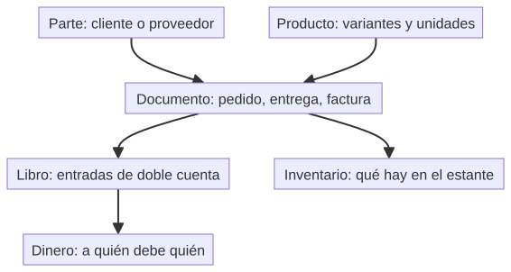

# 5. Qué es realmente una empresa

La reunión que cambió a Riverton tuvo lugar un martes por la mañana en la pequeña sala con la fotocopiadora, porque la sala grande estaba llena de existencias.

Maggie había pedido tres personas: Priya Raman, que dirigía las ventas; Tom Beck, que dirigía el almacén; y Doreen, que dirigía, a su manera, todo lo demás. En la pizarra escribió una sola palabra.

**PEDIDO**

"Vale," dijo. "Decidme qué significa para vosotros esa palabra."

Priya habló primero, como siempre hacía. "Un pedido es lo que quiere el cliente. Artículo, cantidad, precio, fecha de entrega. Lo cojo por teléfono o a través de la tienda web, y lo meto en el sistema."

Tom dijo: "Un pedido es lo que tengo que preparar. Me llega como una lista de cosas en estantes. Salvo que a veces sea un albarán de entrega, y a veces sea un correo de Priya con la foto de una nota manuscrita."

Doreen dijo: "Un pedido es lo que facturo. Cuando las mercancías han salido, convierto el pedido en una factura. Salvo que a veces las mercancías salgan en dos partes y yo facture en dos partes, y entonces ya no es un pedido, son dos facturas y un pedido y una nota de crédito para la parte que volvió."

Hubo un silencio del tipo que sigue a una verdad dicha en voz alta.

"Entonces," dijo Maggie, "tenemos tres cosas distintas, llamadas todas pedido."

"Cuatro," dijo Priya. "También está el pedido de compra que mandamos a los proveedores."

Cinco, si contabas el número de pedido de compra del propio cliente, que aparecía en sus papeles y tenía que citarse en la factura o no la pagarían. Seis, si contabas el "pedido firme" que hacía Ashfield Academy cada septiembre, que no era un pedido en absoluto sino un acuerdo para pedir.

Este es el momento en que la mayoría de las pequeñas empresas descuben la razón real por la que sus sistemas no funcionan. No tienen un problema de datos. Tienen un problema de *lenguaje*. Seis cosas distintas comparten una palabra, y tres palabras distintas comparten una cosa, y el único diccionario es la memoria de las personas de la sala.

La lista de precios lo demostró, una hora después.

Priya citó una caja de los buenos marcadores para pizarra a once libras con cuarenta. Tom dijo que eran nueve con noventa y cinco. Ambos estaban seguros. En la unidad compartida resultaron haber, se descubrió, diecisiete archivos llamados lista de precios, fechados entre 2019 y ese martes, y cuatro de ellos habían sido editados en el último mes. La respuesta correcta dependía del cliente: Ashfield tenía un precio de contrato desde enero, que Priya tenía en una hoja de cálculo suya, y Tom tenía una hoja impresa de marzo que no incluía los precios de contrato porque eran "comerciales."

Nadie mentía. Nadie era incluso imprudente. La empresa no tenía un lugar donde el precio de un producto para un cliente fuera un *hecho*; tenía un hábito de acuerdo, renovado por teléfono, registrado en diecisiete lugares, de los cuales uno era correcto en un día dado y nadie sabía cuál.

Doreen, que no había dicho nada durante un rato, dijo: "Por eso mantengo las facturas. Porque la factura es la única hoja en la que todos coincidimos al mismo tiempo."

Estaba describiendo, sin conocer la palabra para ello, exactamente lo que almacena un ERP: no la lista de precios, sino el precio *que aplicaba a ese documento*. La distinción es toda la quinta capítulo de cualquier norma contable, y es la razón por la que un documento en un sistema real conserva su propia copia de los hechos en lugar de señalar a una lista que cambiará mañana.

---

Un ERP es, antes que nada, un diccionario con reglas adjuntas.

Dice: hay una cosa llamada Pedido de Venta. Tiene un cliente, una fecha, y una lista de líneas; cada línea tiene un producto, una cantidad, un precio y un impuesto. Tiene un estado: borrador, confirmado, hecho, cancelado. No es lo mismo que una Entrega, que es lo que sale del almacén, y no es lo mismo que una Factura, que es lo que pide dinero. Cuando necesitas el número de pedido de compra del cliente, es un campo en el Pedido de Venta, no una nota en el margen.

Una vez que existen esas definiciones, los seis significados colapsan en uno, y los argumentos se detienen. No porque todos coincidan, sino porque el argumento ha pasado de "qué quieres decir con pedido?" a "cuál de estas cosas estamos hablando?", y el segundo argumento se puede resolver en un minuto.

Así que déjame darte el diccionario. Es pequeño. Cuatro clases de cosas, y todo lo demás en este libro es una consecuencia de ellas.

---

**La primera clase de cosa es una parte.**

Un cliente es una parte. Un proveedor es una parte. Tu propia empresa es una parte. Un banco es una parte. La oficina de impuestos es una parte. Son todas de la misma forma: un nombre, una dirección, un número de impuestos, una moneda, condiciones de pago, un contacto.

Esto no es un truco técnico; es una pieza de buen sentido profundo que llevó a la industria del software años en aceptar. En un sistema antiguo, los clientes vivían en un archivo y los proveedores en otro, y una empresa que era a la vez ambas—which ocurre constantemente en el mayorista, porque la tienda a la que vendes también te vende cosas—aparecía dos veces, con dos saldos, y conciliarlos era una miseria mensual. En un ERP moderno hay una lista de partes, y ser cliente o proveedor es un *rol* que una parte juega.

La consecuencia es inmediatamente práctica. Cuando Ashfield Academy a la vez compra separadores en Riverton y vende Riverton su viejo mobiliario, hay una cuenta, una dirección, un límite de crédito, y un saldo neto. El papeleo es más simple porque el modelo es más veraz.

**La segunda clase de cosa es un producto.**

Un producto es una cosa que compras o vendes: una caja de bolígrafos, una paleta de papel, un servicio, un cargo de entrega. Tiene un nombre, un código de referencia, una unidad de medida (cada uno, caja, paleta, kilogramo, hora), un precio de compra, un precio de venta, un impuesto, y—si mantienes existencias—una cantidad disponible en cada ubicación.

Dos sutilezas valen la pena conocerlas, porque causan la mayor parte de la confusión en las empresas reales.

La primera es la *variante*. Una camisa viene en cuatro tallas y tres colores: eso es un producto con doce variantes, no doce productos. Si lo modelas como doce productos, entonces tus informes de ventas no pueden decirte que la azul se vende el doble que la verde, porque el sistema piensa que son objetos sin relación. Si lo modelas como un producto con variantes, el informe es trivial y la existencia es exacta.

La segunda es la *unidad de medida*. Compras papel por paletas y lo vendes por resmas. Si el sistema no sabe que una paleta es cuarenta resmas, entonces cada recuento de existencias es un argumento, y alguien tiene que convertir a mano, y alguien eventualmente convierte mal. La unidad de medida no es una decoración; es la aritmética que mantiene honesto al almacén.

**La tercera clase de cosa es un documento.**

Un pedido, una entrega, una factura, un pago, un ajuste de existencias, una solicitud de compra: todos son documentos, y todos tienen la misma anatomía. Una fecha, una parte, una lista de líneas, un total, y un estado.

El estado es la parte que la gente subestima. Un documento no es una hoja de papel; es una cosa que se mueve a través del tiempo. Una cotización es un borrador que podría convertirse en un pedido. Un pedido confirmado puede ser entregado parcialmente. Una factura puede ser registrada y luego pagada parcialmente. Cada uno de esos estados es un hecho sobre el mundo, y el trabajo del sistema es saber en qué estado está cada documento y rechazar transiciones que no tienen sentido. No puedes entregar mercancías que nunca se pidieron. No puedes pagar una factura que nunca se registró. No puedes cancelar una entrega que ya ha salido del edificio, a menos que la devuelvas.

Por eso un ERP se siente estricto. Es estricto a la manera de una señal de ferrocarril. La estrictez es la seguridad.

Hay una más propiedad de los documentos que es fácil pasar por alto y enormemente importante: **un documento recuerda sus propios hechos.** Cuando confirmas un pedido de cien separadores a cuatro libras cada uno, el pedido almacena el precio. Si el precio cambia mañana, el pedido sigue diciendo cuatro libras, porque eso es lo que el cliente acordó. Si la dirección del cliente cambia el próximo mes, la factura del último mes sigue mostrando la dirección vieja, porque ahí es donde se envió. El sistema conserva una historia de hechos, no solo una imagen actual. Sin eso, nunca podrías probar nada a nadie.

**La cuarta clase de cosa es el dinero.**

Todo documento que tiene una consecuencia financiera produce asientos contables: las afirmaciones de dos caras que Pacioli describió en 1494. Vende algo y el sistema registra ingresos y una deuda del cliente. Compra algo y registra un gasto y una deuda con el proveedor. Paga a un proveedor y registra el dinero saliendo del banco y la deuda desapareciendo.

Nadie en Riverton escribiría nunca un asiento contable a mano, y ese es el punto. Los asientos son un subproducto de los documentos. El trabajo del contable deja de ser "registrar lo que ocurrió" y se convierte en "comprobar que lo registrado es correcto", lo cual es un uso mucho mejor de un contable.

---

Maggie dibujó ese diagram en la pizarra, y Tom—que había dicho casi nada durante veinte minutos—lo miró durante mucho rato.

"¿Eso es todo?" dijo. "¿Es toda la cosa?"

"Es toda la cosa," dijo Maggie. "Todo lo demás son detalles."

Tom golpeó la caja marcada Existencias. "Así que si saco una paleta de la estantería y la pongo en una furgoneta, el sistema debería saberlo."

"Sí."

"Y si la furgoneta vuelve porque la puerta de la escuela estaba cerrada, el sistema debería saberlo también."

"Sí."

"Y si la paleta se estroza con la lluvia mientras está sentada en la plataforma de carga, y tengo que anotarla como baja—"

"Entonces eso también es un documento," dijo Maggie. "Un ajuste de existencias. Con una razón."

Tom asintió lentamente. "Nunca hemos tenido eso," dijo. "Hemos tenido un cuaderno. Y cuando el cuaderno discrepa con las cuentas, ganan las cuentas, porque las cuentas son las que ve la oficina de impuestos. Pero las cuentas están equivocadas, porque soy yo quien sabe qué hay realmente en la estantería."

Esta es la queja más común sobre el software de empresa, y vale la pena nombrarla con precisión, porque el resto de este libro trata de arreglarla. Tom conocía la verdad y no podía introducirla. Las cuentas contenían una verdad y no podían corregirse. El hueco entre ellas se llenaba con un ritual mensual de recuento de existencias, durante el cual la empresa descubría cuán equivocada había sido, anotaba la diferencia como baja, y volvía a empezar.

El hueco existe porque introducir hechos en un ordenador siempre ha sido un trabajo aparte de hacer el trabajo. Alguien tiene que sentarse y escribir. Ese alguien suele estar ocupado, y escribir suele ser la cosa menos interesante que harán ese día. Así que el modelo se aleja de la realidad, un poco a la vez, y luego mucho.

La prom del sistema que Maggie estaba a punto de instalar no es que el alejamiento desaparezca. Es que la escritura desaparece. Tom no escribirá que movió una paleta. Le dirá al asistente, en inglés, que la paleta fue a la furgoneta, y el asistente hará el documento. El modelo se mantiene veraz porque el coste de mantenerlo veraz ha caído a casi cero.

Ese es el cambio. Todo lo demás—las capturas de pantalla, las instalaciones, los diagramas—está al servicio de esa única frase.

---

Doreen había estado callada, lo cual era inusual. Cuando Maggie le preguntó qué pensaba, dijo: "Creo que he estado haciendo el trabajo de una base de datos durante treinta y un años, y nadie me preguntó nunca si lo quería."

Nadie se rio, porque no era una broma.

"¿Qué harías," le preguntó Maggie, "si no tuvieras que recordar dónde está todo?"

Doreen pensó en ello. Luego dijo: "Comprobaría cosas. Notaría cuando un precio pareciera equivocado, o cuando un cliente pidiera algo que nunca han pedido antes. Tendría tiempo para ser curiosa."

En el lenguaje de la gestión, eso se llama *manejo de excepciones*, y es el trabajo más valioso en cualquier oficina. También es el trabajo que nunca se hace, porque las personas que podrían hacerlo están ocupadas siendo bases de datos.

Maggie escribió *ser curiosa* en la pizarra, debajo de las cuatro cajas, y dibujó un círculo a su alrededor.

"Vale," dijo. "Vamos a comprar un diccionario."
