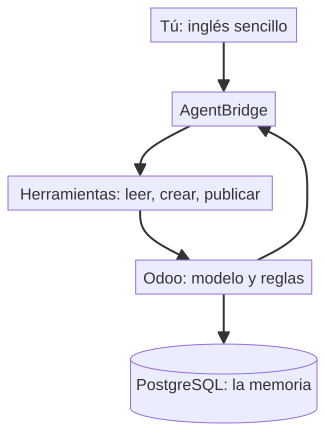

# 6. Tres máquinas en una habitación

Sam Okafor instalaba sistemas de gestión para pequeñas empresas, y tenía una regla: no le vendía ningún sistema a nadie hasta que había visto su almacén.

«Es muy insistente con el almacén», dijo Priya cuando hizo la presentación. «Me hizo dar veinte minutos rodeando el nuestro y luego me dijo que teníamos trescientos cuarenta y cuatro paletas que el sistema no conocía.»

«Cientos cuarenta y cinco», dijo Sam cuando llegó a la oficina. «Uno de ellos estaba detrás de la puerta.»

Tenía cincuenta años, llevaba una bolsa de lino en lugar de un maletín, y rechazaba el café con el argumento de que tomaba demasiado. En la pequeña habitación con la fotocopiadora, sacó una hoja de papel de la impresora y dibujó tres cuadros en ella.

«Bien», dijo. «Todo lo que voy a decirte cabe en esta servilleta. El resto son detalles.»

---

**El primer cuadro es la memoria.**

Un sistema de gestión tiene que recordar cosas. Clientes, productos, pedidos, facturas, existencias, precios, pagos. No en un archivador, y no en una hoja de cálculo, sino en una base de datos: un programa cuya única función es almacenar datos y devolverlos con precisión, incluso si la electricidad falla a mitad de la escritura de uno.

La base de datos que Riverton iba a usar se llama PostgreSQL, y es una de las maravillas silenciosas del mundo moderno. Nació en la Universidad de California en Berkeley en los años 80, en un proyecto de investigación liderado por un hombre llamado Michael Stonebraker, y ha sido desarrollado de forma abierta desde entonces: ninguna empresa lo posee, cualquiera puede leer sus instrucciones, y mueve una parte sorprendente de todo—bancos, gobiernos, páginas web, y, pronto, un mayorista de papelería en un pueblo de mercado.

Lo que hace diferente a una base de datos de una hoja de cálculo no es el tamaño. Son las promesas.

Una hoja de cálculo te deja escribir una palabra en una columna de números, y no se queja. Una hoja de cálculo te deja que dos personas abran el mismo archivo y sobreescriban el trabajo de la otra. Una hoja de cálculo te deja guardar un cambio a medias. Una base de datos hace tres promesas en su lugar: que un cambio ocurre por completo o no en absoluto; que los datos siempre cumplen las reglas que declaraste; y que dos personas cambiando cosas al mismo tiempo no pueden destruir silenciosamente el trabajo de la otra.

Esas promesas tienen un nombre poco atractivo—*transacciones*—y son la razón por la que una empresa puede confiar en un número en la pantalla. Cuando el asistente crea una factura, o bien la factura, sus líneas, sus entradas de libro y su enlace con el pedido existen todos, o ninguno de ellos lo hace. No hay un estado en el que la factura exista pero el libro no.

**El segundo cuadro es el modelo.**

Encima de la memoria se encuentra la cosa que sabe qué *significan* los datos: que una factura debe tener un cliente, que una entrega debe salir de existencias, que una tasa impositiva se aplica a un producto y no a una página de notas. Este es el ERP, y para Riverton es un sistema llamado Odoo.

Odoo tiene una historia que vale la pena conocer, porque explica por qué una pequeña empresa puede permitírselo. Comenzó en 2005 como un proyecto llamado TinyERP, escrito por un belga llamado Fabien Pinckaers. En 2008 fue renombrado OpenERP, y en 2014 tomó su nombre actual. Es de código abierto—la edición de la comunidad está bajo una licencia que permite a cualquiera usar, estudiar y modificar—and también es una empresa, que vende una edición más rica y soporte. Esa combinación, núcleo abierto con un brazo comercial, es como se financia gran parte del software de gestión moderno.

La edición de la comunidad es gratuita, y no es una demostración. Contiene ventas, compras, inventario, contabilidad, facturación, proyectos, fabricación, una página web y una tienda web. Odoo 20, la versión usada en este libro, llegó en septiembre de 2026. La empresa reporta millones de usuarios; el número exacto importa menos que el hecho de que el software se usa, en muchos idiomas, por empresas de todos los tamaños, y que una pregunta sobre él suele haber sido hecha y respondida por alguien antes.

Lo importante sobre Odoo, para nuestros fines, es que es *estricto con su modelo*. No te deja publicar una factura sin líneas. No te deja enviar bienes que no tienes, a menos que le digas que permita eso. Mantiene la historia. Esa estrictitud no es un defecto de personalidad; es toda la razón por la que el sistema puede ser confiado por un contable.

**El tercer cuadro es el juicio.**

Este es el nuevo, y es el que este libro realmente trata.

Una base de datos no tiene opiniones. Un modelo no tiene iniciativa. Ninguno de ellos nunca notará que un cliente ha dejado de pedir, o que los precios de un proveedor se han elevado poco a poco, o que la factura del distrito escolar se imprimió y nunca se envió. Hacen preguntas; no las formulan.

La tercera máquina es un agente: un programa que puede recibir una instrucción en lenguaje ordinario, calcular qué datos necesita, obtenerlos, decidir qué hacer, hacerlo, y informar de vuelta. En Riverton se llama AgentBridge, y corre en la misma computadora que todo lo demás—lo cual importa más de lo que suena, y volveremos a ello.

Un agente no es un chatbot. Un chatbot toma una pregunta y produce texto. Un agente toma una instrucción y produce *efectos*: un registro creado, un documento publicado, un correo enviado. Para hacerlo con seguridad necesita dos cosas: un conjunto de herramientas que se le permite usar, y un conjunto de límites que no puede cruzar.

Las herramientas, en el caso de Riverton, son las operaciones del propio ERP: buscar clientes, leer un producto, crear un pedido, confirmarlo, publicar una factura, hacerle una pregunta al libro. Cada herramienta es una acción pequeña y bien definida con un nombre y una descripción, y el agente elige entre ellas de la manera en que un empleado nuevo elige entre los botones de una pantalla—leyendo qué hacen.

Los límites son los de Odoo. Esta es la parte que le tomó a Maggie un tiempo entender, y vale la pena formularla despacio.

El agente no tiene una llave maestra. Se conecta a Odoo como un *usuario*—una cuenta de usuario real, con una contraseña y un conjunto de permisos, creada para él por el instalador. Cuando pide crear una factura, la solicitud viaja hasta Odoo, y Odoo comprueba si ese usuario está permitido crear facturas, en esa empresa, con esos impuestos. Si la respuesta es no, la respuesta es no. El agente no puede discutir, porque el agente no es la autoridad. Odoo lo es.

Este es la decisión arquitectónica más importante del sistema entero, y es la razón por la que el libro puede recomendarlo a una empresa que nunca ha usado inteligencia artificial antes. La inteligencia es nueva y ligeramente impredecible; las reglas son viejas y completamente impredecibles. La cosa nueva solo está permitida a actuar dentro de las reglas de la cosa vieja.

## Por qué tres y no uno

Una pregunta razonable, y Sam tenía una respuesta que tomó diez segundos y se ha quedado con Maggie desde entonces.

«Porque fallan de manera diferente», dijo. «Si la base de datos se detiene, lo sabes de inmediato: nada funciona. Si el modelo está equivocado, lo descubres lentamente: los números parecen extraños. Si el asistente está equivocado, lo descubres tarde: alguien confió en una respuesta. Tres máquinas significa tres clases de falla, y tres clases de falla pueden distinguirse.»

Un único programa que hiciera las tres sería más simple de instalar y imposible de diagnosticar. Cuando se comportaba mal, la pregunta *¿es la data, las reglas o el juicio?* no tendría respuesta, y el único remedio sería reinstalar y esperar.

La separación tiene un segundo beneficio que solo aparece más tarde: cada máquina puede ser reemplazada por su cuenta. Una empresa que se hace grande para la base de datos pasa a una más grande; una empresa que se hace grande para el modelo pasa a otro ERP, manteniendo la data; una empresa que se hace grande para el asistente cambia el modelo con el que habla. Ninguna de esas migraciones requiere las otras, lo cual es por lo que el conjunto en este libro seguirá siendo razonable dentro de cinco años.

---

«¿Cómo se hablan entre sí?», preguntó Maggie.

«De dos maneras, y ambas son aburridas, lo cual es bueno», dijo Sam.

El agente habla con Odoo a través de la interfaz externa de Odoo—una manera documentada para que otro programa le pida a Odoo hacer cosas por la red. Odoo la llama la API JSON-2, que es un nombre que solo un programador podría amar. Lo que significa es: hay una puerta, tiene una cerradura, necesitas una llave, y detrás de la puerta están las mismas operaciones que usan las pantallas web. Nada de lo que el agente puede hacer es algo que una persona no pudiera hacer haciendo clic; el agente simplemente es más rápido y no se cansa.

Y las herramientas mismas se describen al agente usando una convención llamada Model Context Protocol, o MCP. Fue publicada por Anthropic en noviembre de 2024 como un estándar abierto, y hace una cosa simple: le da a un programa una manera estándar de decir «aquí está la lista de cosas que puedo hacer, aquí está qué necesita cada una, y aquí está qué devuelve». Antes de ella, cada asistente necesitaba un conector a medida para cada sistema, y los conectores se multiplicaban. Con ella, una herramienta escrita una vez puede ser usada por cualquier asistente que hable el protocolo—y ahora hay miles de tales herramientas en el mundo.

La herramienta ERP de Riverton es una de ellas. Se llama OdooTool, es de código abierto, y fue escrita por las mismas personas que escribieron al asistente. Su función es ser el traductor: el agente dice «crea un cliente llamado Ashfield Academy», la herramienta convierte eso en la secuencia exacta de llamadas que Odoo espera, comprueba las respuestas, y informa de vuelta en lenguaje llano.

---

Había una cosa más en la servilleta, en la esquina, en la pequeña caligrafía de Sam: *la habitación*.

«Las tres corren en tu computadora», dijo. «No en un servidor en otro país. La base de datos, el ERP y el asistente. Eso significa que la única cosa que sale de este edificio es lo que eliges enviar al modelo de lenguaje, y si corres el modelo localmente, nada sale en absoluto.»

Maggie hizo la pregunta obvia. «¿Es mejor?»

«Es diferente», dijo Sam. «Es mejor para el control y para la privacidad, y es peor para la comodidad, porque tienes que cuidarlo. No hay línea de soporte a la que llamar a las once de la noche. Pero tampoco hay nadie que pueda apagarte, o subir el precio, o leer tu lista de clientes. Para una empresa como la tuya, yo tomaría ese intercambio.»

Añadió una cuarta línea a la servilleta, debajo de los tres cuadros, en letras tan pequeñas que Maggie tuvo que inclinarse: *respaldos*.

«Dos cosas te van a pasar», dijo. «La primera es que la máquina se romperá, o se irá la luz, o alguien volcará té sobre la cosa equivocada. La segunda es que llegará una nueva versión de uno de estos programas y querrá ser instalado. Ambas son ordinarias. Ninguna es un desastre, con tal de que tengas una copia de la base de datos de ayer y una nota de lo que cambiaste. Lo que convierte una falla ordinaria en un desastre es descubrir, en el momento de la falla, que la única copia de la memoria de tu empresa estaba en la máquina que se acabas de detener.»

«¿Con qué frecuencia?», preguntó Maggie.

«Noche para la base de datos. Semana para la carpeta entera. Y una vez al mes, abre el respaldo y comprueba que contiene lo que crees que contiene. Un respaldo no verificado es un deseo.»

Dejó la pluma. «Una cosa más, y luego dejaré de regañarte. Decide ahora quién es el dueño de esto. No quién pagó por él—quién *posee* él. Alguien tiene que estar permitido a decir que no a un cambio, a insistir en el respaldo, a leer el registro cuando algo parece extraño. En una pequeña empresa esa persona suele ser el dueño, y el modo de falla es que el dueño está demasiado ocupado, y el sistema silenciosamente se vuelve de nadie.»

Maggie miró la servilleta. Tres cuadros para las máquinas, una palabra para la persona que tiene que cuidar de ellas.

Dobló la servilleta y se la entregó.

«Guárdala», dijo. «Cuando algo salga mal—y algo saldrá—vuelve a la servilleta. Pregúntate cuál de los tres cuadros está infeliz. Nueve veces de cada diez, la respuesta te dice qué hacer.»

---

Esa noche, Maggie clavó la servilleta en la tabla de la sala de facturación, junto a un horario de entregas de 2019 que nadie había retirado nunca.

Doreen la miró por un rato.

«¿Cuál soy yo?», preguntó.

Maggie pensó en ello. «Eres la parte que nota», dijo. «La servilleta todavía no tiene un cuadro para eso.»

«Entonces no está terminada», dijo Doreen, y volvió a su escritorio.

Tenía razón, por supuesto. La servilleta tenía tres cuadros para la maquinaria y ningún cuadro para la persona que decide que un número parece equivocado. Todo sistema que Maggie había leído en el último mes había hecho la misma omisión, y cada uno de ellos había fallado por la misma razón: trataban a las personas como dispositivos de entrada.

El sistema que estaba a punto de instalar no haría ese error, por una razón que era casi un accidente de diseño. Porque el asistente toma instrucciones en lenguaje ordinario, la persona se queda en la conversación. Doreen no sería reemplazada por una base de datos. Sería ella la que le dice a la base de datos qué notar.
