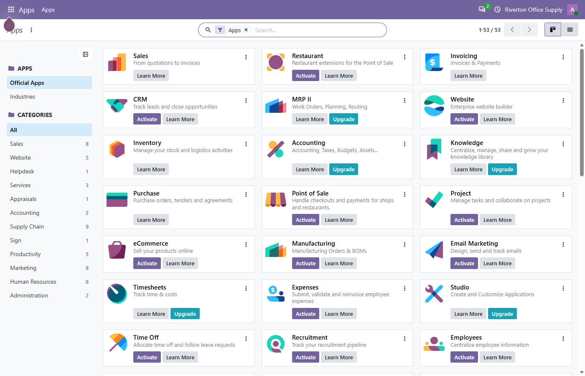

# 10. Enseñar al sistema la forma de la empresa

El debate sobre el plan general de cuentas duró dos días y fue, al fin, sobre si Riverton era una papelería o una empresa.

El plan general de cuentas es la lista de contenedores en los que una empresa ordena su dinero. Cada libra que se mueve se coloca en uno de ellos: venta de mercancías, venta de servicios, transporte facturado, transporte pagado, salarios, alquiler, luz, comisiones bancarias, existencias, clientes, proveedores, IVA. Una pequeña tiene quizás cuarenta contenedores; una grande, cuatrocientos; la diferencia no es sofisticación, es el número de preguntas que las cuentas tienen que responder.

Doreen quería cuarenta. Maggie quería doce.

"No se trata de querer", dijo Doreen, el segundo matin, con la paciencia de quien explica algo por tercera vez. "Si no puedo separar el transporte que facturo del transporte que pago, no puedo decirte si las entregas ganan dinero."

"¿No puedes mirar las facturas?"

"No sin leer cuatrocientas facturas."

Eso, Maggie lo concedió, era un punto justo, y es la regla que resuelve todo debate sobre el plan general de cuentas: **un contenedor gana su lugar si hay alguien que hará una pregunta que solo ese contenedor puede responder.** El transporte facturado y el transporte pagado ganan el suyo. "Gastos varios" no; es un contenedor que existe para que nadie tenga que decidir, y se convierte en el lugar donde el dinero de la empresa va a ser olvidado.

---

## Lo que el sistema trae consigo

Odoo no te pide que inventes un plan general de cuentas. Te pregunta en qué país estás, y luego instala el plan que los contadores de ese país esperan—el mismo número, los mismos nombres, los mismos códigos fiscales—para que tu auditor reconozca el lugar, y para que la declaración del impuesto tenga de dónde proceder.

Para Riverton eso significaba instalar la localización contable del Reino Unido. Es uno de un centenar de paquetes así; el instalador ya había descargado el código, y activarlo tomó un minuto en la pantalla de *Aplicaciones*.

Cuando terminó, el módulo de contabilidad tenía un plan general de cuentas, un conjunto de impuestos, cuatro libros contables y un año fiscal. Nada de eso era todavía de Riverton, y todo era un punto de partida razonable—que es exactamente lo que debe ser un plan general de cuentas.

Las cuentas están numeradas, y la numeración no es arbitraria. El primer dígito es la clase: 1 para activos, 2 para pasivos, 3 para patrimonio neto, 4 para ingresos, 5 para gastos, 6 para el coste de mercancías. Un contador que lee un balance de comprobación puede decir a simple vista qué tipo de número está mirando, en cualquier empresa del país, sin conocer la empresa.

Dore recorrió la lista con un lápiz, y hizo tres cosas.

**No eliminó nada.** Una cuenta sin actividad no cuesta nada, y eliminar una que un auditor espera encontrar es una conversación que nadie quiere.

**Renombró cuatro cuentas** para igualar las palabras que Riverton usa realmente. El sistema llamaba a una "Mercancía"; Riverton la llama "Estoc—comprado". El nombre en la pantalla debe ser el nombre en la conversación, o la gente no lo usará.

**Añadió dos cuentas**: una para el transporte facturado a clientes, otra para el transporte pagado a transportistas. Esas eran las dos preguntas que quería responder, y ahora podía.

## Las tres preguntas que deciden el plan

Doreen y Maggie resolvieron su debate con tres preguntas, y valen la pena anotarlas porque sirven para cualquier empresa.

**¿Qué le preguntarás cada mes?** Las respuestas se convirtieron en cuentas: venta de mercancías, venta de transporte, compra de mercancías, compra de transporte, salarios, alquiler. Nada que nadie preguntaría no obtuvo una cuenta.

**¿Qué necesita ver la oficina de impuestos por separado?** Las respuestas eran pocas—ventas gravadas, ventas a tipo cero, exentas—y no son opcionales. Un plan que no puede producir las casillas de la declaración es un plan que será reconstruido en pánico.

**¿Qué pediría un auditor en primer lugar?** Las respuestas eran el banco, los clientes, los proveedores y las existencias. Esas cuatro tienen que estar limpias, conciliadas y comprensibles a simple vista, porque es donde está el dinero.

Dieciséis cuentas salieron de esas tres preguntas, más las cuentas fiscales que la localización ya había creado. Es un plan más pequeño que el que dibujaría un contador y más grande que el que necesitaría un contador con una hoja de cálculo, lo cual está más o menos bien.

## Los ajustes fáciles de pasar por alto, y que cuestan más

Cinco ajustes en el formulario de la empresa son fáciles de saltar y caros de descubrir más tarde, porque aparecen en cada documento que sale del edificio.

**El logotipo.** Pequeño, y lo primero que un cliente nota. Una empresa que envía facturas con el logotipo predeterminado de Odoo le ha dicho al cliente algo sobre la atención que presta.

**Los datos bancarios.** Van en el pie de página de cada factura. Una empresa que los añade a mano a cada documento eventualmente añadirá la cuenta equivocada a una de ellas, y esa es una conversación con un cliente que pagó a la empresa equivocada.

**Los términos de pago predeterminados. Treinta días, o fin de mes siguiente, o catorce días. Ajustarlos en la empresa significa que cada nuevo cliente los hereda, y las excepciones son las excepciones en lugar de la regla.**

**Los impuestos predeterminados.** El impuesto aplicado a un nuevo producto si nadie elige uno. Si esto está mal, cada nuevo producto está mal, y el error es invisible hasta la primera declaración.

**El fin del año fiscal.** La mayoría de las empresas usan el año calendario, y algunas no. El ajuste decide cuándo se cierra el año, y cambiarlo más tarde es una operación genuinamente dolorosa.

Ninguno de estos es difícil, y todos son el tipo de cosa que se salta en una tarde ajetreada y se descubre en marzo. La regla que salva la tarde: **rellena el formulario de la empresa como si un cliente la viera, porque un cliente la verá.**

## Los impuestos

Un impuesto en un ERP no es un porcentaje. Es una pequeña máquina con una entrada y una salida: toma una línea de una factura, calcula el impuesto, decide en qué cuenta va el impuesto, y recuerda el período al que pertenece para que la declaración pueda producirse.

La localización instaló los tipos estándar: veinte por ciento en la mayoría de mercancías, cinco por ciento en algunas (como asientos de coche para niños y ciertos materiales ahorradores de energía), cero en libros y en la mayoría de alimentos. Riverton vende papelería, que es gravada, y papel, que es gravado, y un servicio ocasional, que también es gravado. El tipo de cinco por ciento está ahí y se usará casi nunca, lo cual está bien; lo importante es que existe, para que nadie invente un cuarto tipo en el mostrador.

Hay una trampa que vale la pena nombrar, porque atrapa a empresas cada año: **el impuesto se configura por producto, no por factura.** Si un producto está fijado al impuesto equivocado, cada factura que lo contenga estará mal, y el error lo encontrará la oficina de impuestos en lugar de un cliente. El formulario de producto tiene un campo para ello, y rellenar ese campo correctamente una sola vez vale más que cualquier cantidad de comprobaciones más tarde.

## Los libros contables

El dinero entra y sale a través de un pequeño número de puertas, y Odoo las llama libros contables: *Facturas de clientes*, *Facturas de proveedores*, *Banco*, *Caja*, *Operaciones varias*. Cada libro tiene un código—INV, BILL, BNK, CSH, MISC—y cada documento registrado a través de él recibe un número en secuencia.

La secuencia importa más de lo que parece. El número de una factura debe ser único y debe seguir al anterior, porque es eso lo que hace que el libro sea verificable: si la factura 2026/0042 falta, un auditor preguntará adónde fue. Odoo aplica esto negándose a registrar un documento que rompería la secuencia, que es una de las pequeñas rigurosidades que hacen que el sistema valga la pena tenerlo.

## Lo que no se configuró, y por qué

Hay una larga lista de cosas que una empresa *puede* configurar el primer día, y casi todas deben esperar.

**Moneda múltiple.** Riverton compra a un proveedor de la zona euro, así que eventualmente sí. El primer día, no: las tasas de cambio, las ganancias y pérdidas, y el tratamiento de las facturas en moneda extranjera son un tema propio, y hacerlas antes de que funcione la facturación básica es cómo una empresa termina con un libro que nadie entiende.

**Contabilidad analítica.** La capacidad de etiquetar cada línea con un proyecto, un departamento o un centro de coste. Útil para una empresa con proyectos; un impuesto para una empresa sin ellos.

**Múltiples empresas.** Odoo puede contener varias empresas en una base de datos, con transacciones entre empresas. Riverton es una empresa. Añadir una segunda el primer día es cómo una empresa descubre, en marzo, que la mitad de sus facturas pertenecen a la entidad legal equivocada.

**Presupuestos, activos, ingresos diferidos, costos de aterrizaje.** Todos reales, todos útiles, todos para más tarde.

El principio es el que Sam escribió en la servilleta y Maggie fijó en la tabla: instala lo que usarás este mes. Un ajuste que nadie usa no es una capacidad; es un lugar donde eventualmente alguien cometerá un error.

---

## El banco, y el saldo inicial

Hay una más pieza de configuración que una empresa descubre tarde y desea haber hecho antes: el banco.

Odoo instala un libro bancario sin banco detrás. Conectarlo a la cuenta real significa introducir los datos de la cuenta, y luego—esta es la parte que nadie espera—decidir cómo entra el dinero *existente* de la empresa al sistema.

Una empresa que lleva treinta años comerciando no empieza con cero en el banco. Empieza con lo que diga el extracto el día que el sistema entra en producción, y con una historia que vive en el antiguo programa de contabilidad. Hay dos formas honestas de manejar eso, y una deshesta.

La forma honesta, para una pequeña empresa, es una **entrada inicial**: una sola entrada contable, fechada el día anterior al en vivo, que declara lo que la empresa posee y debe—saldo bancario, valor de existencias, lo que deben los clientes, lo que se debe a los proveedores—y que cuadra con la cuenta de patrimonio neto. Es una foto fija, es verificable, y toma una tarde con el balance del año anterior.

La otra forma honesta es **traer la historia dentro**: importar las facturas y facturas antiguas para que los clientes deudores y proveedores acrenciados de antigüedad sean documentos reales en lugar de un solo bloque. Más trabajo, más útil, y vale la pena si los clientes suelen pagar tarde—porque en el momento que el asistente puede listar facturas vencidas, necesita facturas que listar.

La forma deshonesta es escribir el saldo bancario en un campo que parece aceptarlo. Lo aceptará. Y luego el libro no cuadrará, y alguien pasará un finde semana descubriendo por qué.

Doreen eligió la entrada inicial, con los clientes deudores de antigüedad importados como documentos, y la tarde que le tomó fue la primera vez que usó el sistema para algo que realmente le importaba. Ya no estaba configurando software. Estaba moviendo los números de su empresa de un conjunto de libros a otro, y comprobando, línea por línea, que nada se había perdido en el camino.

---

## La primera entrada

El tercer por la tarde, Doreen registró el primer documento.

No era una factura, y no era una venta. Era un pago bancario: doscientas libras de la cuenta de la empresa a la cuenta de un proveedor, por papel entregado en octubre. Creó el proveedor, creó la factura, registró el pago, y vio cómo los tres documentos se enlazaban entre sí—factura a proveedor, pago a factura, ambos al banco.

Luego abrió el libro y miró lo que el sistema había escrito.

Dos entradas. Doscientas libras salen del banco; doscientas libras se descuentan de lo que la empresa debe al proveedor. Igual y opuesto, en dos cuentas distintas, fechadas el día del pago. La regla de Pacioli, realizada por una máquina en una fracción de segundo, en una base de datos en una carpeta en un perfil de usuario.

Se recostó y dijo algo que Maggie anotó, porque fue el momento en que el sistema dejó de ser software y se convirtió en la memoria de la empresa.

"Es lo mismo que mi libro", dijo. "Es exactamente lo mismo que mi libro. Solo yo puedo hacerle preguntas."

Eso es toda la primera semana. No una transformación: un reconocimiento. Las reglas que sigue el sistema son las reglas que ella había estado siguiendo a mano durante treinta y un años, escritas por otra persona, hace seis siglos, y ahora aplicadas por una máquina que nunca se cansa y nunca se olvida de escribir la segunda línea.

El resto del libro es lo que ocurre cuando puedes hacerle preguntas—y cuando otra cosa puede hacérselas por ti.
