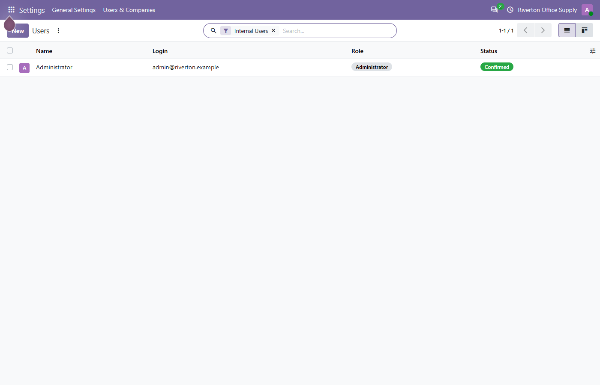

# 12. La clave que abre una sola puerta

La última pieza de configuración antes de dejar que el asistente actuara por su cuenta era la menos interesante
y, a la vez, la más importante: la clave.

Sam la explicó en la pizarra, de la manera en que explicaba todo, con un diagrama que le tomó treinta segundos
y resolvió un argumento que normalmente lleva una semana.

"Toda la cerradura de este edificio tiene su clave", dijo, dibujando un rectángulo para el ERP. "La pregunta no
es si el asistente obtiene una clave. La pregunta es qué puerta abre, y qué puede hacer una vez que está dentro."

---

## Qué es una clave de API

Una clave de API es una contraseña que un programa utiliza en lugar de una persona. Es una cadena larga de caracteres,
se muestra una sola vez, y pertenece a un *usuario*—no al programa, ni a la máquina.

Ese último punto es todo el diseño. Cuando el asistente se conecta a Odoo, no se conecta como superusuario con una
puerta trasera especial. Se conecta como una cuenta de usuario que, en el caso de Riverton, se llama *Agente*, con una
contraseña y una clave, y con un conjunto de permisos que una persona podría haber dado a un nuevo empleado en su primer
día.

Lo que significa tres cosas, y cada una de ellas vale más que la comodidad que cuesta.

**Las reglas del ERP se aplican al asistente.** Si el usuario *Agente* no puede facturar facturas, el asistente no puede
facturar facturas—no porque se le haya dicho que no lo haga, sino porque el ERP rechazará la solicitud. La inteligencia es
nueva; las reglas son viejas; la cosa nueva funciona dentro de la cosa vieja.

**El asistente aparece en el registro de auditoría.** Cada registro que crea dice *Agente* en el campo "creado por", y
cada cambio que realiza se registra. Si una factura aparece a las cuatro de la mañana con un descuento extraño, el sistema
no dirá "la máquina lo hizo"; dirá qué usuario, a qué hora, y con qué valores.

**La clave puede revocarse sin cambiar nada más.** Si la clave se filtra, o se reemplaza al asistente, o alguien se va, la
clave se elimina y el asistente se detiene. El ERP no cambia, los usuarios no cambian, y nada tiene que reinstalarse.

## Dónde vive la clave

El instalador generó la clave durante la instalación y la escribió en la configuración del conector, en la carpeta propia
del asistente. No está en el libro, ni en un correo electrónico, ni en un documento que se reenvía. Está en un único archivo,
en una única máquina, con los permisos de archivo del usuario que lo instaló.

La misma clave puede crearse a mano, y cada usuario puede crear una para sí mismo: se encuentra en el menú de usuario,
*Mi Perfil*, *Seguridad de la cuenta*, *Nueva clave de API*. El ERP la muestra una sola vez, en un recuadro, con una
advertencia de que nunca más se volverá a mostrar—whicho no es una amenaza, es un hecho sobre cómo se almacenan las claves:
el sistema guarda un hash, no la clave, por lo que no puede recordártela después.

## Qué se permitía que hiciera el asistente

El usuario *Agente* de Riverton recibió un rol, y el rol se eligió con una regla que vale la pena repetir: **dar al
asistente los derechos del empleado menos poderoso que pudiera hacer el trabajo.**

Para Riverton, eso significaba:

| Área | Derechos | Por qué |
|---|---|---|
| Clientes | leer, crear, editar | toma pedidos y añade contactos |
| Productos | leer | cotiza; no inventa productos |
| Ventas | leer, crear, confirmar | escribe cotizaciones y confirma pedidos |
| Facturas | leer, crear, registrar | factura; el registro es el acto que crea el libro mayor |
| Pagos | leer, crear | registra lo que dice el banco |
| Compras | leer, crear, confirmar | reposiciona lo que pide el almacén |
| Inventario | leer, ajustar | mueve existencias y registra daños |
| Configuración contable | ninguno | la configuración es trabajo de una persona |
| Usuarios y permisos | ninguno | nunca, bajo ninguna circunstancia |
| Eliminación de documentos | ninguno | si algo está mal, se cancela, no se borra |

Las dos últimas líneas son las que hay que defender. Una máquina que puede cambiar permisos puede concederse cualquier cosa;
una máquina que puede eliminar puede destruir el registro de auditoría que probaría lo que hizo. Ambas se excluyen no porque
el asistente sea no confiable en algún sentido dramático, sino porque el costo de excluirlas es cero y el costo de un error no
lo es.

## La conversación sobre la confianza

Doreen, quien había estado callada durante gran parte de esto, hizo la pregunta que importaba.

"¿Qué lo impide hacer algo estúpido?"

"Nada lo impide", dijo Sam. "Esa es la respuesta honesta. Puede crear un cliente con un nombre tonto, o registrar una factura
para la persona equivocada, o pedir cuatro mil cajas del papel equivocado. Lo que impide que eso sea un desastre es que puedes
verlo, deshacerlo, y que no puede hacer las cosas que no se pueden deshacer."

"Eso no es muy reconfortante."

"No", convenió. "Pero es la misma reconfortancia que tienes con un nuevo empleado. No les impides cometer un error; les das un
trabajo con un límite, revisas el trabajo del primer mes, y te aseguras de que los errores son del tipo que puedes arreglar."

La diferencia—y es la diferencia que hace que el sistema sea utilizable—es que los errores del asistente son *visibles de una
manera en que los de una persona no lo son*. Una persona que escucha mal una cantidad la escribe en un pedido y nadie se da cuenta
hasta que el cliente se queja. La versión del asistente del mismo error es un registro con una marca de tiempo, un usuario, la
herramienta que llamó y los argumentos que pasó, y puede encontrarse en un registro por cualquiera que piense en buscarlo.

Es por eso que el registro no es un detalle técnico. Es lo que hace aceptable a un agente en un negocio donde el dinero se mueve:
no que nunca erre, sino que sus errores son *localizables*.

## La primera prueba

Antes de dejar que el asistente hiciera algo, Sam le pidió que no hiciera nada.

"Comprueba la conexión", escribió. "Dime qué versión de Odoo está en ejecución."

La respuesta llegó en un segundo: la versión, el nombre de la base de datos, el usuario con el que estaba conectado, y la
empresa a la que apuntaba. Cuatro datos, todos correctos, todos los que un humano podría comprobar en el ERP en aproximadamente el
mismo tiempo.

"Bien", dijo Sam. "Ahora pídele cuántos clientes hay."

No había ninguno, porque nadie había introducido ninguno todavía. El asistente dijo cero, lo cual era cierto, y lo cual es una
respuesta más interesante de lo que parece: un sistema que puede decir *cero* es un sistema que está leyendo la base de datos, no
un sistema que está inventando algo. Un modelo que adivinaría habría producido un número plausible.

"Correcto", dijo Sam, cerrando su portátil. "Es tuyo. Dale un trabajo."

## El permiso que todos olvidan

Hay un único permiso en todo ERP que las empresas conceden sin pensar, y es el que anula a todos los demás: la capacidad de
cambiar la *configuración*.

Un usuario que puede editar el plan de cuentas puede registrar cualquier cosa en cualquier lugar. Un usuario que puede editar los
códigos fiscales puede hacer que una venta desaparezca. Un usuario que puede cambiar los derechos de acceso puede concederse
cualquier cosa que le falte. Las reglas que protegen el libro mayor son ellas mismas datos, y quien puede cambiar los datos puede
cambiar las reglas.

El asistente, por tanto, se excluye de la configuración por completo—no porque la abusaría, sino porque la competencia de un
agente reside precisamente en *hacer cosas*, y la configuración es la única área donde hacer la cosa equivocada es
indistinguible de hacer la cosa correcta hasta que llega el auditor.

La regla se generaliza: **automatiza el trabajo, nunca las reglas.** Una empresa que deja que un asistente cambie sus propios
permisos tiene, en efecto, cero permisos; tiene una caja de sugerencias.

## La primera comprobación tras crear una clave

En el momento en que se crea una clave, hay una única comprobación que vale la pena hacer, y toma diez segundos.

En el asistente, pregunta: *comprueba la conexión a Odoo y dime qué versión está en ejecución.*

Un número de versión y un nombre de base de datos significan que la clave funciona, que la dirección es correcta, y que el usuario
puede llegar al ERP. Un error significa que uno de los tres está mal, y el mensaje de error suele decir cuál.

Esa comprobación vale la pena repetirla tras cualquier cambio en la configuración—una nueva clave, un nuevo puerto, una nueva
máquina—porque aísla la conexión de todo lo demás. Cuando algo más tarde sale mal, la primera pregunta es siempre *¿es la
conexión o es la pregunta?* y esta instrucción lo responde en un segundo.

Doreen lo escribió en una tarjeta y la pegó al monitor. Es la instrencia menos interesante de este libro y la que ha ahorrado
más tiempo.

## Cuando la clave se filtra

Una clave escrita en un archivo de configuración en una máquina puede filtrarse de tres maneras, y las tres han ocurrido a
empresas que no fueron descuidadas.

Puede copiarse en un respaldo que luego se comparte. Puede pegarse en un ticket de soporte por alguien que intenta ser útil. Y
puede ser leída por otro programa en la misma máquina, que es la razón por la que una máquina compartida por cinco personas no es
un buen lugar para una clave que puede facturar facturas.

El remedio no es guardar la clave con ceremonias. El remedio es que la clave es *barata de reemplazar*:

1. En el ERP, abre la página de seguridad de la cuenta del usuario y elimina la clave.
2. Crea una nueva y pégala en la configuración del conector.
3. Reinicia el asistente.

Tres minutos, sin datos perdidos, sin reinstalación. La clave vieja deja de funcionar en el instante en que se elimina, que es la
propiedad que hace que esto sea seguro: una clave filtrada es una molestia más que un incidente, con tal de que alguien la note y la
revoque.

Lo que la convierte en un incidente es una clave perteneciente a un usuario que puede hacerlo todo. Que es por lo que el usuario
*Agente* tiene un rol, y por lo que la clave del administrador nunca es la que se da a un programa.

## Un agente a la vez

Hay un límite más que vale la pena conocer, y no tiene nada que ver con los permisos.

El asistente se ejecuta en la misma máquina que todo lo demás, y el modelo de lenguaje—ya sea un servicio en otro edificio o un
modelo en tu propia tarjeta gráfica—responde a una solicitud a la vez. Una empresa que arranca cuatro agentes en cuatro ventanas no
obtendrá cuatro veces el trabajo; obtendrá cuatro agentes turnándose, y una máquina sin memoria libre.

El instalador está construido alrededor de esto: un asistente, una ventana, un lanzador que abre exactamente uno. La tentación de
abrir una segunda ventana, de hacer otra cosa mientras la primera está pensando, es la forma más común en que una instalación
pequeña se derrumba—y el arreglo no es técnico. Es esperar, o pedir menos a la vez.

Riverton lo aprendió en la segunda semana, cuando Tom abrió una segunda ventana para preguntar por el stock mientras se escribía la
factura de Priya. La máquina no se cayó. Simplemente se volvió lenta, luego más lenta, y luego ambas ventanas respondieron a la vez
con dos mitades del mismo trabajo, y Doreen pasó veinte minutos tratando de averuar cuál era la factura real.

La regla que salió de está en la pared de la sala de facturas, junto al servilleta: *una pregunta a la vez, y lee la respuesta.*

---

Esa noche Maggie se sentó frente a la ventana del asistente por un rato sin escribir nada.

La ventana era sencilla: un aviso, un lugar para la respuesta, y una pequeña línea en la parte inferior que dice qué modelo está
hablando. Se parecía a las ventanas de terminal que usaba su padre en los noventa, lo cual era o bien reconfortante o bien
alarmante, dependiendo de tu opinión sobre los noventa.

Escribió: *¿Qué puedes hacer?*

La respuesta era una lista. Podía leer clientes, productos, pedidos, facturas, stock; podía crear y cambiar registros; podía
llamar a las acciones que mueven un documento de un estado a otro; podía agrupar, sumar y contar. No podía cambiar la configuración
de la empresa, administrar usuarios, o eliminar nada.

La leyó dos veces, y luego escribió la frase que había estado en su cabeza desde el lunes de noviembre cuando condujo una factura a
través de la ciudad.

*Muéstrame a cada cliente que nos debe dinero y que no ha pedido nada en seis meses.*

La respuesta tardó cuatro segundos. No había clientes todavía, así que la respuesta fue una frase educada diciéndolo—pero la frase
incluía las dos cosas que había buscado y el lugar donde había buscado, que es lo que hace un buen empleado cuando la respuesta es
"nada".

Maggie cerró la ventana y se fue a casa.

A la mañana siguiente, comenzó a introducir los clientes.
