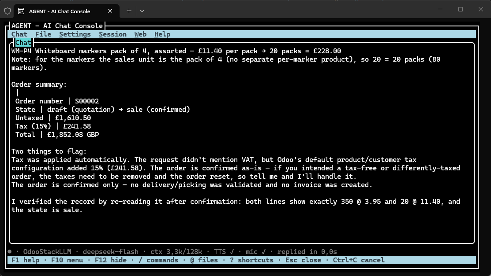

# 14. Una cotización para un cliente

El primer trabajo real que hizo el asistente en Riverton fue una cotización, y era para el cliente cuya factura había dado inicio a toda la historia.

La Ashfield Academy quería cuatrocientos cuadernos con anillas y veinte cajas de marcadores para pizarra blanca, para el inicio del trimestre de verano. Priya tenía la solicitud en un correo electrónico, que había leído dos veces, porque las cantidades eran inusuales: cuatrocientos cuadernos con anillas suponían lo que se consumía en un trimestre, y veinte cajas de marcadores superaban lo que la escuela había pedido jamás a la vez.

En el sistema antiguo esto le habría tomado doce minutos: abrir el programa de contabilidad, buscar al cliente, crear una cotización, añadir dos líneas, consultar los precios en la hoja de cálculo que contenía los precios contractuales, aplicar el descuento, imprimirla, enviarla por correo, archivarla. En el nuevo sistema le tomó cuarenta segundos, y los doce minutos se fueron a un lugar más útil—una llamada telefónica a Carol en Ashfield para preguntar si los marcadores eran para toda la escuela o para el departamento de arte, que es el tipo de pregunta que evita una devolución.

Esto es lo que Priya escribió.

> *Crea una cotización para Ashfield Academy de 400 cuadernos con anillas formato A4, azules, y 20 cajas de marcadores para pizarra blanca, de colores surtidos, a los precios contractuales. Entrega en la escuela, a fin de la próxima semana.*

Y esto es lo que respondió.

> *Cotización S00012 creada para Ashfield Academy: 400 × Cuaderno con anillas A4 (azul) a £3.40, 20 × Marcadores para pizarra blanca (paquete de 4, surtidos) a £11.40. Neto £1,588.00, IVA £317.60, total £1,905.60. Fecha de entrega fijada para el viernes 27 de junio. La cotización está en borrador—di "confirmar" cuando quieras que se convierta en pedido.*

Cuarenta segundos, y cada número en ella era verificable.

---

## La lista de precios, y por qué el precio contractual no es un descuento

El precio que el asistente usó para Ashfield—£3.40 por un cuaderno que figura a £3.95—provenía ni del registro del producto ni de un descuento. Provenía de una *lista de precios*, y la distinción es una que las empresas cometen durante años.

Una lista de precios en Odoo es un conjunto de reglas adjuntas a un cliente (o a un grupo de clientes, o a una moneda): para este producto, o esta categoría, o todo, aplica este precio, o este porcentaje de descuento, o esta fórmula. Ashfield tiene una lista de precios contractual desde enero, acordada en una reunión, firmada en una sola página, y dice lo que la escuela paga por los doce productos que compra regularmente.

La diferencia entre una lista de precios y un descuento no es cosmética.

Un **descuento** es un ajuste a un precio, aplicado a un documento, por una persona, en el momento de la venta. Es visible en la cotización, es auditable, y es una decisión que alguien tomó.

Una **lista de precios** es el precio. No es un ajuste; es lo que el cliente paga, y el precio de lista es un número distinto que este cliente nunca ve. Una cotización para Ashfield que mostrara £3.95 con un descuento de quince por ciento sería *correcta* y también sería una pequeña ofensa: le diría al cliente que el precio real de la empresa es más alto y que se les está haciendo un favor.

Hay una tercera posibilidad, que es lo que hacen realmente la mayoría de las pequeñas empresas: una hoja de cálculo con los precios contractuales en ella, consultada por una persona, y escrita a mano en la cotización. Eso funciona hasta que la persona está de vacaciones, la hoja de cálculo está desactualizada, o el contrato se renegocia y la hoja de cálculo no.

## Qué ocurre cuando el precio es incorrecto

Toda empresa tiene una historia sobre un precio que fue incorrecto en una cotización, y todas las historias tienen la misma forma: el error se encontró después de que el pedido fuera confirmado, se telefoneó al cliente, y alguien tuvo que decidir si honrar el precio o explicar el error.

La decisión suele ser honrarlo—la diferencia es pequeña y la relación no—y el costo se da por descontado como una lección. Lo que la empresa aprende de esa lección suele ser lo incorrecto: *ser más cuidadoso*, en lugar de *hacer del precio un hecho más que un recuerdo*.

Una lista de precios hace del precio un hecho. Vive en un solo lugar, está fechada, aplica a cada documento para ese cliente, y cuando el contrato se renegocia alguien lo cambia una sola vez. El asistente la lee de la misma manera que lo haría una persona, salvo que no puede olvidar cuál hoja de cálculo es la actual.

Lo único que una lista de precios no puede hacer es *decidir*. Si Ashfield obtiene quince por ciento de descuento sobre el precio de lista, o un precio fijo, o un precio que sube con el índice del papel, es una decisión comercial tomada por personas. El trabajo del sistema es aplicarla exactamente, cada vez, y hacerla visible cuando cambia—que es el tema de la siguiente sección.

## La cotización que cambió un precio

Tres meses después, Priya hizo una pregunta que antes no había sido posible.

*¿Qué clientes están pagando un precio que no ha cambiado desde enero, y qué nos costaría subirlo en tres por ciento?*

La respuesta fue una lista de nueve clientes y un número: unas £4,100 al año de ingresos adicionales, con la aritmética por cliente. Los precios no habían cambiado porque nadie había mirado, y nadie había mirado porque mirar requería abrir nueve listas de precios y compararlas con los precios de compra, lo que habría tomado una tarde.

Si subir o no los precios es una decisión comercial, y Riverton los subió para cuatro de los nueve y dejó a los demás sin tocar por razones que no tenían nada que ver con la aritmética. Pero la decisión se tomó con un número delante, en diez segundos, en lugar de postergarse otro año más.

Ese es de nuevo el patrón: la máquina no decide. Hace que la decisión sea lo suficientemente barata como para tomarla.

---

## Lo que realmente ocurrió

Vale la pena ralentizar esto, porque la velocidad no es la parte interesante.

El asistente no sabía qué era un cuaderno con anillas. Nunca había visto el contrato de Ashfield Academy, y no tenía idea de qué es un trimestre escolar. Lo que tenía era un conjunto de herramientas y una descripción de lo que hace cada una, y un modelo de la empresa que otra persona había construido.

Así que cuando llegó la instrucción de Priya, el asistente hizo lo que hace un empleado nuevo en su primer día: buscó las cosas.

Buscó en los clientes un nombre que coincidiera con *Ashfield Academy* y encontró uno—y, porque es cauteloso por diseño, habría preguntado si hubiera encontrado dos. Buscó en los productos *cuaderno con anillas* y encontró un producto con variantes, y escogió el azul porque Priya había dicho azul. Buscó los marcadores y encontró el paquete de cuatro, surtidos. Preguntó al ERP por el precio de cada uno, para ese cliente, en esa fecha, que es una pregunta distinta de "cuál es el precio de este producto" y la diferencia es todo el capítulo diez.

Luego creó la cotización: un documento con un cliente, una fecha, dos líneas, un cálculo de impuestos y un estado. Y luego se detuvo, porque una cotización en borrador no es un compromiso, y lo dijo.

Esa última frase es lo más importante que hizo el asistente. No confirmó el pedido. No reservó el stock. No envió nada a nadie. Produjo una *propuesta*, y le dijo a Priya que la propuesta estaba esperando por ella.

---

## La máquina de estados, y por qué importa

Una cotización, un pedido y una factura no son tres documentos. Son tres estados de la misma intención, y las transiciones entre ellos son los momentos en que una empresa se compromete.

**Borrador.** Una propuesta. Nada ha sido prometido, no se ha reservado stock, el precio puede cambiar. En Odoo esto se llama cotización, y tiene una fecha de validez, porque un precio cotizado en junio no es necesariamente un precio en septiembre.

**Confirmado.** Un pedido. La empresa ha prometido entregar, a un precio, para una fecha. Se reserva stock (o, en una empresa que no reserva, al menos se registra la intención), y el documento obtiene un número que aparecerá en la nota de entrega y en la factura.

**Entregado.** Las mercancías han salido. Ahora hay un movimiento de stock, y un papel que el cliente firmó.

**Facturado.** Se ha pedido el dinero. Ahora hay una entrada de libro mayor, y un punto de impuesto.

**Pagado.** El dinero ha llegado. Ahora hay una transacción bancaria que tiene que coincidir con la factura, que es el paso donde la mayoría de las pequeñas empresas pierden el rastro de su efectivo.

Cada transición es una decisión, y el trabajo del ERP es asegurarse de que la decisión se toma deliberadamente. Una cotización que se convierte en pedido sin que nadie decida es una promesa que la empresa no sabía que había hecho. Un pedido que se convierte en factura antes de que las mercancías salgan es un punto de impuesto que se ha movido sin permiso.

Priya leyó la cotización, cambió una cosa—redujo los cuadernos con anillas a trescientos cincuenta, porque el departamento de arte había encontrado un armario lleno—and la confirmó.

> *Cambia la cantidad de cuadernos con anillas a 350 y confirma el pedido.*

> *Pedido de ventas S00012 confirmado: 350 × Cuaderno con anillas A4 (azul), 20 × Marcadores para pizarra blanca. Total £1,712.40. Fecha de entrega viernes 27 de junio. Stock reservado: 350 cuadernos con anillas disponibles, marcadores disponibles.*

Observa qué añadió el asistente al final: *stock reservado, disponible*. No se le había pedido. Lo verificó, porque lo siguiente que ocurriría sería una entrega, y una entrega que no puede hacerse es peor que una cotización que no puede confirmarse.

La figura de arriba vale la pena leerla con cuidado, porque es la conducta por la que este capítulo ha estado argumentando, capturada más que descrita. El asistente informa del número de pedido, del estado (*borrador → venta*), del amount exento de impuestos, del impuesto y del total; luego ofrece dos cosas que no se le pidieron—que el impuesto se aplicó automáticamente en quince por ciento, y que confirmar un pedido no crea ni una entrega ni una factura. Y termina diciendo cómo verificó: *Verifiqué el registro volviéndolo a leer después de la confirmación.*

Esa última frase es la diferencia entre un asistente y un formulario. Un formulario te dice qué guardó. Un colega te dice qué hizo y cómo sabe que funcionó.

---

## Una breve historia de la cotización

La palabra *cotización* proviene del latín *quotare*, numerar—la misma raíz que *quote* en el sentido de citar un pasaje. En el comercio ha significado, desde al menos cuatrocientos años, una declaración de precio ofrecida a un comprador, y su estatus legal ha sido discutido en los tribunales desde entonces.

El argumento es siempre el mismo: ¿es una cotización una oferta, que se convierte en contrato cuando se acepta, o una invitación al trato, que es meramente una posición inicial? La respuesta depende del redactado, del contexto y de la jurisdicción, y es la razón por la que un formulario de cotización suele llevar una línea como *esta cotización es válida por treinta días* y *sujeta a disponibilidad*.

Un ERP no resuelve la pregunta legal, pero hace algo relacionado y útil: registra *cuál* cotización se envió, *cuándo*, *a quién*, y *qué decía*. Cuando un cliente telefonea en septiembre y dice "me cotizaron cuatrocientas libras", la empresa puede encontrar el documento y ver si decía cuatrocientos o cuatrocientos cincuenta, y en qué fecha, y para cuántos.

Eso no es una cosa pequeña. En el sistema antiguo, la respuesta vivía en un hilo de correos electrónicos, en una copia impresa en una bandeja, y en la memoria de Priya—en ese orden de fiabilidad.

---

## Lo que el asistente no hizo

Tres cosas vale la pena notar en lo que *no* ocurrió.

No aplicó un descuento. Ashfield tiene un precio contractual, que es un mecanismo distinto de un descuento, y el asistente usó el precio contractual porque eso es lo que dice el registro del cliente. Si Priya hubiera querido un descuento, habría tenido que pedirlo, y el descuento habría sido registrado—que es la diferencia entre un precio y un favor.

No escogió la fecha de entrega por su cuenta. Tomó *fin de la próxima semana* y lo convirtió en una fecha, que es un pequeño acto de interpretación, y dijo qué fecha había escogido para que Priya pudiera corregirla.

Y no envió la cotización. Enviar es una acción con un cliente al otro extremo, y el asistente no tiene herramienta para el correo electrónico en la configuración de Riverton—deliberadamente. La cotización se imprimió a un PDF por el ERP y se adjuntó a un correo electrónico por una persona, lo que tomó a Priya treinta segundos y mantuvo el último paso, el uno en que un documento sale del edificio, en manos humanas.

Algunas empresas querrán automatizar ese paso, y el sistema puede hacerlo. Riverton decidió, en el primer mes, que nada se enviaría a un cliente sin que una persona lo mirara. Es una decisión que una empresa puede reconsiderar; no es una decisión que una empresa debería tomar por accidente.

---

El pedido permaneció en el sistema durante dos días, esperando la fecha de entrega.

El jueves, Tom le hizo una pregunta al asistente que Priya no había pensado en preguntar.

> *Qué pedidos están por entregarse en los próximos tres días, y si hay stock para todos ellos?*

La respuesta fue una lista de cuatro pedidos y una frase que cambió la semana: los cuadernos con anillas para Ashfield estaban ahí, los marcadores estaban ahí, pero el pedido para Northgate Library Service necesitaba doce cajas de papel A4 y había nueve.

Nueve cajas, y una promesa de entregar el lunes. Ese es el tipo de hecho que solía descubrirse por un conductor en la bahía de carga, y se descubrió en su lugar un jueves por la tarde por alguien que pensó en preguntar.
