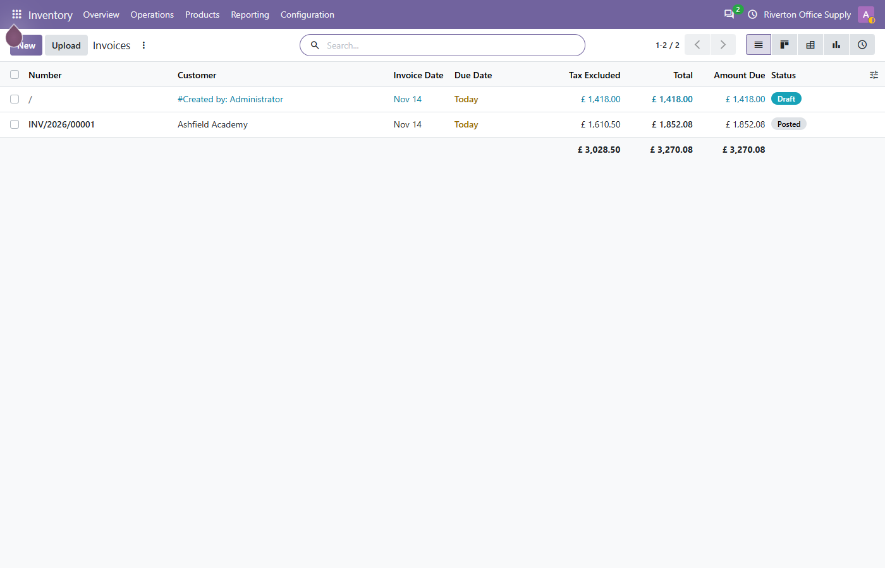

# 15. Del pedido a la factura

Los archivadores quedaron el viernes por la mañana, con lluvia, que es lo tradicional.

Tom los cargó él mismo porque el conductor se había retrasado, y volvió a la oficina con las mangas
mojadas y un trozo de papel: la nota de entrega, firmada por el conserje de Ashfield, con un bolígrafo
que casi se había agotado. En el sistema antiguo ese trozo de papel habría caído en una bandeja y
habría esperado a que Doreen volviera del almuerzo, y la factura habría sido mecanografiada el lunes.

En el nuevo sistema, Doreen le hizo una pregunta al asistente mientras Tom todavía se estaba quitando
el abrigo.

> *¿Qué pedidos entregados de esta semana aún no han sido facturados?*

> *Uno: el pedido de venta S00012, Academia Ashfield, entregado esta mañana. 350 × Archivador A4 (azul),
> 20 × Marcadores para pizarra. Listo para facturar. ¿Creo la factura?*

Ella dijo que sí. Esa es toda la transacción, y vale la pena entender lo que ocurre debajo, porque
"crear la factura" está haciendo un montón de trabajo en una sola frase.

---

## Qué es una factura

Una factura es un documento que dice tres cosas a la vez, y es la razón por la que la contabilidad es
más complicada que la aritmética.

**Es una solicitud de pago.** Esta es la parte que todo el mundo conoce: el cliente debe la cantidad de
la página, para la fecha de la página.

**Es un registro de un evento gravable.** En la mayoría de los países el impuesto se devenga cuando se
emite la factura, no cuando llega el dinero. Por eso la factura tiene un punto de gravamen, y por eso
una factura cancelada de forma incorrecta puede dejar a una empresa debiendo impuestos sobre un dinero
que nunca recibió.

**Es una reclamación legal.** Si el cliente no paga, la factura es la prueba. Debe mostrar el nombre
registrado de la empresa y su número de impuestos, los datos del cliente, un número único y
secuencial, la fecha, una descripción de lo suministrado, la cantidad antes de impuestos, el tipo y la
cantidad de impuestos, y el total. Se pierde fuerza en la reclamación si falta cualquiera de esos datos;
falta el número y la reclamación puede ser inútil.

Un ERP hace las tres a la vez, y la razón por la que exige un *pedido confirmado* antes de crear una
factura es que la segunda y la tercera función dependen de que la primera sea cierta. No se puede
facturar mercancía que no se ha acordado suministrar, porque el punto de gravamen y la reclamación se
refieren ambos a un suministro.

## Lo que el asistente hizo realmente

La instrucción era de cuatro palabras, y el trabajo del asistente fue una cadena de ocho o nueve pasos,
cada uno de los cuales una persona habría hecho a mano.

Buscó pedidos entregados que no tuvieran factura. Encontró uno. Leyó las líneas, los precios y los
impuestos del pedido. Creó un documento de factura vinculado al pedido—vinculado, no copiado, de modo
que la factura siempre se pueda rastrear hasta lo pedido. Calculó el impuesto por línea. Puso la fecha
de la factura como hoy y la fecha de vencimiento según los términos de pago del cliente. Dejó la factura
en *borrador*, que es el estado en el que todavía no ha pasado nada.

Luego Doreen la miró y pulsó el botón que importa: *Registrar*.

## El momento del registro

Registrar es el verbo más importante de todo el sistema, y merece una sección propia.

Antes de registrar, una factura es un borrador: un trozo de papel con números. Se puede editar,
eliminar, ignorar. Nada en el libro mayor ha cambiado.

Tras el registro, cuatro cosas son ciertas que no lo eran antes:

1. La factura tiene un **número**, tomado de una secuencia, sin huecos.
2. La factura tiene **asientos contables**: dos para la venta y la deuda, y más para el impuesto.
3. El **saldo** del cliente ha cambiado.
4. La factura ya no se puede editar. Si está mal, se *cancela* y se emite un abono—porque no se permite
   reescribir la historia del libro mayor.

Ese último punto es el que sorprende a la gente, y es el que hace que el sistema sea verificable. Una
empresa que puede editar una factura registrada es una empresa cuyo libro mayor es un borrador. Una
empresa que no puede es una empresa que puede demostrar, ante un inspector de impuestos, un banco o un
tribunal, lo que dijo a sus clientes y cuándo.

Doreen la registró, y el asistente informó del número.

> *Factura INV/2026/0007 registrada para la Academia Ashfield: neto £1.524,00, IVA £304,80, total
> £1.828,80. Vence el 14 de julio (30 días).*

El número es la parte que importa. INV/2026/0007 es la seventh factura del año, y no falta la sexta ni
está ya usada la octava, porque la secuencia no lo permite. Seiscientos años después de Pacioli, la
numeración de las páginas sigue siendo cómo un libro mayor prueba que es completo.

La figura de arriba es la ejecución real, y contiene el pasaje más instructivo de este libro. El
asistente intentó primero la ruta directa—el método privado que crea una factura desde un pedido—y el
ERP lo rechazó, porque los métodos privados no se pueden llamar desde fuera. No buscó una forma de
saltear el rechazo. Usó en su lugar la ruta *documentada*, el asistente estándar "Crear factura" al que
una persona habría llegado haciendo clic, y lo dijo en la respuesta: *la llamada directa fue rechazada
(método privado, HTTP 403), así que se usó el asistente estándar.*

Ese es el comportamiento que una empresa quiere de un colega con un sistema nuevo: cuando la puerta está
cerrada con llave, busca la puerta que se supone que se usa, y dice cuál usó. Una máquina que en su lugar
buscara una forma de atravesar la pared sería una máquina con la que no se la podría dejar sola con tu
libro mayor.

Las dos figuras van juntas. A la izquierda, la cuenta que da el asistente de lo que hizo; a la derecha, el
propio registro del ERP del resultado—el mismo número, el mismo total, el estado *Registrada*, y la
huela de auditoría que dice quién la creó y cuándo. La instalación de demostración aplica un impuesto de
quince por ciento a estos productos porque así lo configuró su localización; la narración usa el tipo
estándar de veinte por ciento, y la diferencia es exactamente el tipo de cosa que una empresa descubre
cuando lee su propia configuración en vez de dársela por supuesto.

---

## La impresión

La factura se imprimió, porque el departamento de contabilidad de Ashfield pide un PDF y porque un
documento que se ha impreso es un documento que alguien ha mirado.

El diseño es el estándar de Odoo, y es deliberadamente sencillo: el nombre y la dirección de la empresa
arriba, los datos del cliente, el número y las fechas, las líneas, los totales, el desglose del impuesto,
y los términos de pago abajo. Cada campo de él procede de la base de datos. Nada se mecanografía dos veces.

Este es el momento en el que la promesa de los primeros capítulos se hace finalmente visible en papel: la
dirección de la factura es la dirección del registro del cliente, el precio es el precio del pedido, el
impuesto es el impuesto del producto, y el total es la suma de las líneas. No hay una segunda copia de
ningún hecho, y por tanto no hay una segunda oportunidad de mecanografiarlo mal.

---

## Los abonos, y la disciplina de no eliminar

Tres semanas después, uno de los archivadores volvió. Dañado no—de color equivocado, porque el
departamento de arte había pedido azul y el conserje había pedido verde en su propio nombre, y había habido
una conversación en un pasillo del que nadie de Riverton formaba parte.

La forma antigua habría sido tachar la línea de la factura y escribir una nueva. La forma nueva es un abono:
un documento que invierte parte de la factura, con su propio número, sus propios asientos contables, y un
motivo.

> *Crea un abono para la Academia Ashfield de 20 archivadores, motivo: color devuelto equivocado, y
> registrándolo.*

> *Abono RINV/2026/0003 registrado para la Academia Ashfield: 20 × Archivador A4 (azul) a £3,40, neto
> £68,00, IVA £13,60, total £81,60. La factura INV/2026/0007 sigue registrada; su saldo pendiente es ahora
> £1.747,20.*

Fíjate en la última frase. La factura original no se tocó. Sigue existiendo, con su total original, porque
eso es lo que se envió. El abono se sitúa a su lado, y el *neto* es lo que debe el cliente. Dos documentos,
dos números, una sola verdad—y una historia completa de lo ocurrido, incluido el error.

Eso es lo que significa "el libro mayor no se acuerda de nada" en la práctica, y es una disciplina que las
empresas o adoptan o combaten. Las que la combaten gastan las veladas conciliando; las que la adoptan
descubren que la historia no es una carga sino un activo, porque responde a preguntas que nadie pensó en
hacer en aquel momento.

---

## La ejecución de facturas

Una factura es una demostración. Cuatrocientas facturas es un martes.

La ejecución es el momento en el que un sistema gana su pan o se convierte en otra pantalla en la que hacer
clic, y vale la pena describirla porque la forma del trabajo es distinta de una sola factura.

La instrucción de Doreen, una vez a la semana, es una frase.

*Crea facturas de todos los pedidos entregados que aún no hayan sido facturados, déjalos en borrador, y
dame la lista con los totales.*

El asistente produce una lista—entre cuarenta y sesenta pedidos por lo normal—, crea las facturas, e
informa. No las registra. Doreen lee la lista, comprueba la primera contra la nota de entrega, comprueba las
dos más grandes, y luego registra el lote.

Ese último paso es una sola acción en Odoo—seleccionar todo, registrar—y tarda unos cuatro segundos para
cincuenta facturas. En el sistema antiguo eran cincuenta operaciones separadas, cada una con un diálogo de
impresión.

Tres cosas hacen que la ejecución sea segura, y las tres vale la pena copiarlas.

**Los deja en borrador.** Una factura en borrador se puede corregir; una registrada no. El lote es una
propuesta hasta que una persona lo mira.

**Informa de la lista antes de registrar.** No después. La lista es lo que se aprueba, no un registro de lo
ocurrido.

**Nunca toca un pedido que se ha entregado parcialmente.** Esos necesitan una decisión—facturar lo que se ha
ido, o esperar el resto—y el sistema los deja fuera del lote y lo dice.

El último punto es la diferencia entre un asistente y un script. Un script facturaría lo que encontrara; el
asistente sabe que una entrega parcial es una pregunta, y la hace.

## Los cuatro números de una factura que nunca deben estar mal

Una factura tiene una docena de campos y cuatro de ellos importan más que el resto, porque un error en
cualquiera de ellos produce un documento que el departamento de contabilidad del cliente rechazará—y un
rechazo cuesta un ciclo de un mes.

**El nombre legal y la dirección del cliente.** No el nombre comercial, no la dirección del sitio. El
departamento de contabilidad hace coincidir la factura con su maestro de proveedores, y una discrepancia la
envía a una cola.

**Su número de orden de compra**, cuando lo exigen. Muchas organizaciones mayores no pagarán una factura
sin él, y el número tiene que ser exactamente como lo escribieron.

**El número de impuestos.** El suyo, para los casos de inversión de sujeto pasivo, y el tuyo, que va en toda
factura por ley.

**El total, en palabras y cifras.** En la mayoría de las jurisdicciones bastan las cifras; en algunas se
exigen las palabras. De cualquier forma, un total que no coincide con sus propias líneas es la ruta más
rápida posible a una consulta.

El asistente puede comprobar tres de esos cuatro contra el registro del cliente antes de registrar la
factura—el nombre, la referencia de orden de compra, el número de impuestos—y vale la pena pedírselo. *¿Esta
factura coincide con el registro del cliente en cada campo que el cliente comprobará?* es una pregunta que
una máquina responde bien y una persona ocupada responde mal.

## Cuando el cliente disputa

La factura salió, el cliente dice que está mal, y la conversación que sigue es donde el papeleo de una
empresa es un activo o un pasivo.

Hay cuatro clases de disputa, y cada una tiene una respuesta distinta.

**La cantidad está mal.** El cliente dice que recibieron treinta cajas, no cuarenta. La respuesta es la nota
de entrega, firmada en la puerta, y el movimiento de stock detrás de ella. Si la nota dice cuarenta y la
firma es legible, la conversación es corta. Si la nota dice cuarenta y la firma es un garabato, la
conversación es sobre la próxima entrega.

**El precio está mal.** El cliente dice que el precio acordado era más bajo. La respuesta es la cotización
que aceptaron, que está almacenada, con la fecha, y la lista de precios detrás de ella. Esta es la disputa
que antes se consideraba imposible de ganar, porque la cotización vivía en un correo y el correo vivía en el
carpeta de alguien.

**Las mercancías nunca se recibieron.** La respuesta es la nota de entrega y el movimiento de stock, y si el
propio departamento de recepción del cliente perdió la paleta—que ocurre más a menudo de lo que nadie
admite—, la prueba es lo que convierte un argumento en una investigación interna en el lado del cliente.

**La factura nunca se recibió.** La respuesta es la fecha de envío y la dirección a la que se envió, y la
causa más común es un cambio de departamento de contabilidad que nadie comunicó al proveedor.

En las cuatro, la contribución del sistema es la misma: guarda los documentos, guarda las fechas, y las puede
producir en un segundo. El sistema antiguo también las guardaba, en un archivador, y la diferencia eran los
cuatro minutos que se tardaban en encontrarlas—que es exactamente el tiempo suficiente para que la
conversación se convierta en un argumento.

---

## Una breve historia de la factura

La factura es más antigua que la imprenta. Las tablillas de arcilla babilónicas de alrededor del 3000 a.C.
registran cantidades entregadas y amounts debidos; los comerciantes romanos usaban recibos *apocha*; los
banqueros italianos medievales que inventaron la contabilidad por partida doble también inventaron la letra
de cambio, que es una factura con una promesis adjunta y que financió el comercio de la lana de Flandes.

Lo que cambió en el siglo XIX no fue el documento sino el *número*. A medida que las empresas crecían, y a
medida que las autoridades fiscales empezaron a interesarse, la factura secuencial y preimpresa se convirtió
en la norma—primero en Prusia, luego por toda Europa—porque una secuencia es la prueba más simple posible de
que no se ha retirado nada. Es una tecnología tan simple que es invisible, y sigue siendo la razón por la que
el número de tu factura lleva un año.

La factura electrónica es el capítulo más nuevo, y el menos interesante: es el mismo documento, enviado por
una ruta distinta, con los mismos números y las mismas reglas. Lo que ha cambiado no es la factura sino el
*coste de producirla*, que ha caído desde la tarde de una mecanógrafa hasta una fracción de segundo—y ese es
el tema del próximo capítulo, que trata sobre el almacén.

---

Dore imprimió el abono, lo metió en un sobre, y luego hizo algo que no había hecho en treinta y un años:
tiró el sobre.

"No sirve de nada registrarlo," dijo. "Carol lo recibe por correo antes de que haya lamido el sello."

Tenía razón, y fue la primera vez en todo el proyecto que cambió un hábito sin que se le pidiera. El sistema
no le había dicho que dejara de registrar cartas. Simplemente había hecho que la carta fuera inútil, y ella
lo había notado.

Eso, más que cualquier función, es lo que hace un buen sistema: no prohíbe la forma antigua, hace que la forma
nueva sea obviamente mejor, y luego espera a que la gente lo note.
