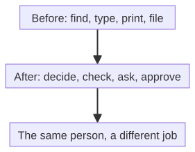

# 27. Qué cambia en la oficina

Seis meses después de la instalación, Doreen Pratt hizo algo que nunca había hecho en treinta y un años: se tomó un día de vacaciones a mitad de mes.

No porque el sistema se lo permitiera—aunque así era—, sino porque no se rompió nada. Las facturas salieron. Los estados de cuenta salieron. La conciliación de fin de mes esperó, pacientemente, de la manera en que el software espera, y cuando volvió a regresar le tomó una tarde en lugar de una semana.

Le contó a Maggie ese primer día de regreso, de pie en el umbral de la sala de facturas, y luego dijo algo que Maggie anotó.

"Lo extraño es que estoy más ocupada que antes. Pero es una ocupación distinta. Ya no busco cosas. Ahora miro *las cosas*."

Este capítulo trata sobre esa diferencia, porque es la parte de la automatización que nadie anuncia y que todos experimentan. Los folletos prometen que la máquina hará el trabajo. La verdad es más interesante: la máquina hace la *administración* del trabajo, y la persona queda con el trabajo en sí—which resulta ser la parte que siempre necesitó a una persona.

---

Seamos precisos sobre qué cambió en Riverton, porque la vaguedad es la enemiga de un argumento útil.

**Qué dejó de hacerse.** Alguien solía reescribir el pedido del cliente en el programa de contabilidad. Eso dejó de hacerse. Alguien solía imprimir las facturas una a una, comprobar cada una contra la nota de entrega, y meterlas en sobres. Eso dejó de hacerse, en gran parte. Alguien solía compilar el informe mensual de ventas exportando tres hojas de cálculo y conciliándolas a mano. Eso dejó de hacerse. Alguien solía caminar hasta el almacén para preguntar a Tom si un producto estaba en existencias. Eso dejó de hacerse, porque la respuesta era una pregunta que se podía formular en una frase y obtener en un segundo.

**Qué empezó a hacerse.** Doreen empezó a comprobar los precios contra el libro de compras todos los viernes, porque tenía tiempo y porque siempre había sospechado que el proveedor se iba subiendo. Priya empezó a enviar una lista corta de clientes que habían dejado de pedir, con una razón sugerida para cada uno, al equipo de ventas todos los lunes. Tom empezó a revisar los ajustes de existencias semanalmente en lugar de anualmente, que es como la empresa descubrió que un producto había sido introducido en la unidad de medida equivocada desde 2022 y que la "pérdida" que todos habían atribuido al turno de noche era un error aritmético.

Ninguno de esos cambios es dramático. Juntos son la diferencia entre una empresa que reacciona y una empresa que se da cuenta.

**Qué no cambió en absoluto.** La relación con Ashfield Academy, que tiene diecinueve años de antigüedad y se basa en el hecho de que Carol confía en Maggie para contestar el teléfono. El juicio sobre a qué cliente conceder crédito. La decisión de dejar de tener en existencias una línea de productos. La conversación con un proveedor que ha subido los precios por tercera vez. La disculpa cuando algo sale mal.

Esta es la forma honesta del cambio, y vale la pena establecerlo como regla, porque la regla se cumple en toda empresa donde se ha intentado: **la automatización elimina la administración de un trabajo y deja el trabajo.**

---

Existe un paralelo histórico más reconfortante que cualquier estadística.

En 1979, dos hombres de Harvard—Dan Bricklin y Bob Frankston—publicaron un programa llamado VisiCalc. Era la primera hoja de cálculo: una cuadrícula en la pantalla de una computadora donde un cambio en una celda recalculaba todo lo que dependía de ella. Antes de VisiCalc, un modelo financiero era una hoja de papel, un lápiz y una calculadora, y cambiar una suposición significaba recalcular a mano, lo que significaba que la mayoría de los modelos se calculaban una sola vez y luego se defendían.

VisiCalc, y las hojas de cálculo que le siguieron, hicieron con la aritmética del contable lo que la lavadora hizo con la colada. Y la predicción en aquel momento era que los contables desaparecerían.

No desaparecieron. Si acaso, hay más de ellos. Lo que desapareció fue el trabajo de la persona que sumaba columnas de cifras con un lápiz, y lo que apareció fue el trabajo de la persona que decide qué cifras sumar, comprueba si el modelo tiene sentido, y explica a la junta por qué los números son como son. La herramienta no reemplazó el juicio. Cambió el *precio* del juicio, al eliminar la aritmética que había estado de pie delante de él.

Lo mismo está ocurriendo ahora, y ocurre más deprisa, y ocurre en una capa distinta del trabajo. La hoja de cálculo eliminó la aritmética. El agente elimina la *recuperación*—la parte del trabajo que consiste en averiguar qué es verdadero.

Pregúntale a Doreen qué hacía en 2019 y habría dicho: mantengo el papeleo. Pregúntale qué hace ahora y dice: compruebo cosas. La segunda respuesta vale más para la empresa, y también es la respuesta de alguien que hace un trabajo en lugar de servir a un sistema.

---

Ninguno de esto ocurre por sí solo, y es aquí donde la mayoría de las empresas lo hacen mal.

El modo de fallo es bien conocido para cualquiera que haya observado a una oficina adoptar una nueva herramienta. La herramienta se instala. Un formador viene un día. Las personas entusiastas la usan; las demás conservan su hoja de cálculo, porque la hoja de cálculo es más rápida *hoy*, y la herramienta solo es más rápida *una vez que has metido tus datos en ella*. Seis meses después la empresa tiene dos sistemas, uno de los cuales es la verdad y uno de los cuales es el hábito, y el argumento sobre cuál es cuál consume más tiempo que el que ahorró cualquiera de los dos.

Hay tres cosas que impiden esto, y no son técnicas.

**La primera es que el trabajo debe llegar por la nueva puerta.** Si un pedido todavía se puede tomar por teléfono y escribir en un bloc, se tomará. Si la factura todavía se puede producir en el programa viejo, se producirá. El nuevo sistema se convierte en la verdad el día en que se convierte en la única ruta, y no un día antes. Es por eso que la instalación de este libro termina con las rutas rápidas viejas eliminadas, no con una sesión de formación.

**La segunda es que se debe permitir a alguien ser curioso.** El nuevo trabajo de Doreen—comprobar, darse cuenta, preguntar por qué—solo existe si la empresa lo trata como trabajo. En demasiadas empresas, en el momento en que la administración se automatiza, se le da a la persona más administración, porque la administración es medible y darse cuenta no lo es. Las empresas que obtienen el beneficio son las que escriben "darse cuenta" en la semana de alguien.

**La tercera es que se debe darle a la máquina un nombre y un límite.** No una personalidad—un nombre en el sentido de una responsabilidad. Alguien debe ser responsable de lo que hace el asistente, debe leer su registro, debe ser permitido para apagarlo. Un asistente que nadie posee es un asistente que nadie comprueba, y un asistente que nadie comprueba es un rumor con un teclado.

## La nueva descripción del trabajo

Vale la pena anotar en qué se convirtió el trabajo de Doreen, porque las descripciones de trabajo son donde este tipo de cambio se hace real o se abandona en silencio.

Antes, en el lenguaje de la oficina: llevar los libros, emitir las facturas, perseguir el dinero, archivar el papeleo, contestar el teléfono cuando se trata de dinero.

Después, en el mismo lenguaje: **mantener verdadero el modelo, decidir qué es una excepción, y contestar las preguntas que levantan los números.**

Tres deberes, y cada uno de ellos es nuevo de una manera específica.

**Mantener verdadero el modelo** significa las pequeñas disciplinas que hacen que el sistema sea digno de confianza: un producto con la unidad de medida correcta, un cliente con los términos de pago correctos, una entrega validada el día en que ocurrió, un ajuste de existencias con una razón. En el mundo viejo esto también era su trabajo, pero era invisible—nadie podía ver el costo de equivocarse con ellos hasta el fin de año. Ahora son la diferencia entre una respuesta y un supuesto, y tienen una consecuencia visible diaria, lo que los hace más fáciles de defender y más difíciles de saltarse.

**Decidir qué es una excepción** significa leer las listas. Las facturas vencidas, las existencias por debajo del mínimo, los productos sin precio, la entrega sin factura. El sistema produce la lista; la persona decide qué artículos son ruido y cuáles son un problema. Ese es un hábito genuino, y es el que mejora con la práctica—después de tres meses, Doreen podía mirar una lista de doce facturas vencidas y decirte cuáles cuatro eran reales.

**Contestar las preguntas que levantan los números** es la parte que nadie predijo. Un sistema que puede responder preguntas produce *más preguntas*: por qué sube el transporte, por qué este cliente se ha quedado en silencio, por qué el margen de este producto es distinto al del mes pasado. Alguien tiene que perseguir esas, y la persona que las persigue es la que ahora tiene tiempo.

## Qué no cambió, y por qué importa

Tres cosas no cambiaron en absoluto, y vale la pena decirlo porque la literatura sobre automatización es principalmente sobre el cambio.

**El teléfono sigue siendo contestado por una persona.** Carol en Ashfield llama porque quiere hablar con Maggie, no porque quiera una transacción. La relación es el negocio, y ningún sistema la ha mejorado nunca.

**El juicio sobre las personas sigue siendo hecho por personas.** A quién conceder crédito, a quién perseguir con fuerza, a quién dejar ir. El sistema proporciona los hechos—historial de pagos, patrón de pedidos, amounts vencidos—y los hechos hacen el juicio mejor informado, pero no lo hacen.

**La disculpa sigue siendo de una persona.** Cuando algo sale mal, un cliente quiere oír a un ser humano disculparse. Una disculpa automatizada es peor que ninguna, porque confirma que nadie estaba atendiendo.

Esas tres son el núcleo del negocio, y son la razón por la que este libro sigue insistiendo en que la máquina toma la *paciencia* y la persona conserva el *juicio*. Una empresa que automatiza el teléfono, la decisión de crédito o la disculpa ha automatizado la cosa equivocada, y lo descubrirá de la manera en que las empresas siempre descubren: lentamente, y luego de repente.

## La hora en el calendario

El cambio más importante en Riverton no era una función del software. Era una hora en el calendario de Doreen, todos los viernes, etiquetada *sistemas y excepciones*, que nadie tenía permitido reservar.

Esa hora es donde ocurre el darse cuenta: la comprobación de precios, la lectura del registro, la lista de cosas que parecen extrañas. Sin ella, el tiempo ahorrado por la automatización se habría llenado con más administración—que es lo que ocurre en la mayoría de las empresas, y por qué la mayoría de las empresas informan de que la automatización "no really ahorró nada".

Una hora a la semana son cincuenta horas al año, que es una fracción de lo que el sistema ahorra. También es la diferencia entre un sistema que mejora y uno que decae. La línea de Sam—*el software no falla, los hábitos sí*—es todo el argumento, y la hora en el calendario es cómo se protege un hábito.

---

Se le preguntó a Maggie, en una cena de la cámara de comercio en la primavera, si había "reemplazado al personal con inteligencia artificial."

Había pensado en la pregunta con antelación, porque sabía que venía, y había decidido responderla honestamente en lugar de diplomáticamente.

"No," dijo. "Reemplazamos un sistema de archivo. El personal sigue aquí, y hacen el trabajo que el sistema de archivo les impedía hacer."

La mujer que había preguntado parecía escéptica. "Pero debes necesitar menos personas."

"Necesitamos el mismo número de personas y más de su atención," dijo Maggie. "Lo cual, si gestionas un negocio, es lo mismo que necesitar más personas."

Esa es la verdad del asunto, y vale la pena expresarla en los términos más llanos posibles, porque la conversación pública sobre la inteligencia artificial está dominada por dos historias que son ambas incorrectas: que la máquina hará todo, y que la máquina lo tomará todo. Lo que realmente ocurre, en una pequeña empresa bien gestionada, es que la máquina toma la parte del trabajo que nadie quería, y las personas descubren que han estado haciendo esa parte durante tanto tiempo que han olvidado cuál era el resto del trabajo.

Doreen, en su primer día de regreso de esas vacaciones, había encontrado una factura de un proveedor con un precio que había subido un cuatro por ciento sin aviso. La tenía delante de ella en un minuto de sentarse, porque el asistente la había marcado mientras ella estaba de ausencia. En 2019 habría sido archivada, pagado, y descubierto al fin de año, si es que se descubría.

No dijo "la máquina encontró esto." Dijo: "Miren esto. Cuatro por ciento, en marzo, y nadie nos lo dijo."

Esa es la frase en la que este libro ha estado trabajando. La máquina hizo el hallazgo. La persona hizo el darse cuenta. La empresa obtuvo el beneficio.
