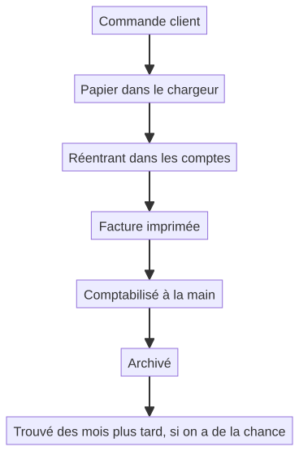

# 1. La pièce où le papier vit

La pièce n'avait pas de nom sur la porte. Tous les employés de Riverton Office Supply l'appelaient la pièce des factures, bien que les factures ne représentent qu'une fraction de ce qu'elle contenait : les commandes fournisseurs, les bons de livraison, les avis de paiement, les avis de crédit, les fines feuilles roses que les fournisseurs envoient lorsqu'ils veulent être payés plus vite, et les feuilles crème plus épaisses que les clients envoient lorsqu'ils veulent payer plus tard.

Maggie Ellery avait hérité de la pièce, ainsi que de l'entreprise, de son père. Elle dirigeait Riverton depuis onze ans et elle continuait à commencer chaque lundi dans cette pièce, debout dans l'encadrement de la porte avec une tasse de café qui se refroidissait dans sa main, à regarder les trois armoires grises comme si elles étaient des animaux dont elle avait la responsabilité de nourrir.

Les armoires portaient, dans le langage du bureau, les noms des Vieilles Années, des Années du Milieu et de l'Année Courante. Les Vieilles Années avaient un cadenas pour lequel personne n'avait de clé. Les Années du Milieu avaient un tiroir qui ne s'ouvrait que si on le soulevait légèrement, à la façon dont on soulève une valise dont la fermeture a fini par lâcher. L'Année Courante était celle qui comptait, et c'était aussi celle qui ne pouvait pas se refermer, car les classeurs qui s'y trouvaient avaient grossi de papier arrivé plus vite que quiconque ne l'avait classé.

Doreen Pratt classait ces armoires depuis trente-et-ans. Elle avait soixante-trois ans, elle portait un cardigan à toutes les saisons, et elle possédait ce genre de mémoire qui fait qu'une entreprise semble plus sûre qu'elle ne l'est. Si vous demandiez à Doreen le bon de livraison de l'expédition de mars vers le district scolaire d'Ashfield, elle ne regarderait pas les armoires. Elle regarderait le plafond, bougerait légèrement les lèvres, et dirait : « C'était la semaine où le van de Trevor avait eu l'alternateur. Troisième classeur depuis le fond, second tiroir, derrière les avis roses. » Elle avait souvent raison, à tel point que personne n'avait jamais pensé à consigner comment elle s'y prenait.

Voilà la première chose à comprendre au sujet d'une entreprise comme Riverton, et c'est précisément ce que presque personne ne mentionne dans les livres de gestion. L'entreprise ne fonctionnait pas sur son logiciel. Elle fonctionnait sur Doreen.

---

À huit heures vingt ce lundi-là, le téléphone sur le bureau de Maggie sonna avec la luminosité particulière d'un client sur le point d'être déçu.

C'était l'Académie d'Ashfield, le district scolaire qui achetait chez Riverton depuis dix-neuf ans : des stylos par milliers, des cahiers par palettes, les bons marqueurs de tableau blanc qui s'effacent réellement. Le gestionnaire de leur entreprise était une femme patiente nommée Carol qui avait reçu, ce matin-là, une livraison de quatre cents classeurs et aucune facture.

« Margaret », dit Carol, et Maggie comprit, à l'usage de son nom complet, que c'était sérieux, « nous ne pouvons pas payer une facture que nous n'avons pas reçue, et nous ne pouvons pas cloître notre trimestre sans elle. Et votre chauffeur a laissé les classeurs dans le parking, pas à la quai de chargement. »

Maggie dit les choses qu'on dit. Elle s'en occuperait personnellement. Elle était désolée. Elle rappellerait dans l'heure.

Elle posa le téléphone et fit ce qu'elle avait fait dix mille fois : elle se rendit dans la pièce des factures et demanda à Doreen où se trouvait le papier.

Doreen regarda le plafond. Elle bougea les lèvres. Puis elle dit : « Les classeurs sont partis jeudi. La facture devrait être partie avec le bon. À moins » — et ici elle s'arrêta, car elle avait atteint le bord de sa mémoire et pouvait sentir la chute qui s'étendait au-delà — « à moins qu'elle soit entrée dans le plateau et que Trevor l'ait emportée avec les retours. »

Il y avait quatre plateaux dans la pièce des factures. Ils portaient les étiquettes *Entrée*, *Sortie*, *Plus tard* et, dans une écriture qui n'appartenait à personne travaillant encore chez Riverton, *Trevor*. Il n'y avait plus de Trevor. Il n'y avait pas de Trevor depuis six ans. Le plateau restait, et le papier continuait à y entrer, car un plateau portant un nom est une sorte d'instruction.

Maggie trouva la facture dans le plateau Trevor, sous un catalogue de graines et un rappel concernant les extincteurs. Elle avait été imprimée jeudi, signée jeudi, et jamais envoyée. Elle était, au sens strict, un document complet et correct. Elle avait simplement échoué à voyager.

Elle la porta à Ashfield elle-même, car le chauffeur était déjà rentré et parce qu'elle voulait que les vingt minutes de route servent à se fâcher en privé. Sur le chemin du retour, elle s'arrêta au rond-point près du parc commercial et s'y assit plus longtemps que le trafic ne l'exigeait, à regarder les essuies-glace accomplir leur travail, et elle pensa : *nous ne sommes pas mauvais à ça. Nous ne sommes pas paresseux. Nous ne sommes pas idiots. Alors pourquoi cela semble-t-il que l'entreprise est tenue ensemble avec de la ficelle ?*

---

Voici un fait qui surprit Maggie quand elle le lut ce soir-là, et qui vous surprendra probablement aussi.

En juin 1975, un magazine appelé *Business Week* publia un long article intitulé « L'office du futur ». Il décrivait, avec une grande confiance, un monde dans lequel le papier administratif routinier des affaires — le maintien des registres, la comptabilité, le classement — serait géré par des machines, et que le papier deviendrait une curiosité, à la façon dont le cheval est devenu une curiosité après la voiture à moteur. La prédiction fut répétée si souvent au cours des décennies suivantes qu'elle acquit son propre nom : le bureau sans papier.

Entre 1980 et 2000, l'utilisation mondiale du papier de bureau plus que doublée.

Ce n'est pas une ironie mineure ; c'est une ironie majeure, et elle a une cause qui importe pour tout dans ce livre. Le papier n'a pas survécu parce que les bureaux étaient arriérés. Le papier a survécu parce qu'il était extrêmement bon dans un seul travail : c'était la seule chose dans le bâtiment que tout le monde pouvait lire. Le comptable pouvait lire une commande fournisseur. L'entrepôt pouvait lire un bon de livraison. Le commercial pouvait lire une liste de prix. L'inspecteur des taxes pouvait tout lire. Un ordinateur en 1985 ne pouvait pas parler à un ordinateur de la pièce suivante, encore moins au service comptable du district scolaire, donc l'ordinateur imprimait le papier et le papier parlait.

Nous n'avons pas échoué à devenir sans papier. Nous avons automatisé la *production* du papier. Nous avons rendu l'impression d'un document moins chère que la marche vers une armoire, puis nous avons imprimé tout, puis nous avons acheté d'autres armoires.

---

Le lundi de Riverton n'était pas exceptionnel, et c'est exactement pourquoi il vaut la peine d'être raconté. La même scène se joue mille variations dans chaque ville : un fournisseur en plomberie, un imprimeur d'étiquettes, une entreprise familiale qui installe des cuisines commerciales. Les détails changent ; la forme ne change pas.

Un client pose une question qui nécessite trois faits provenant de trois endroits. Quelqu'un promet une réponse. La réponse nécessite un quatrième fait qui vit dans la tête d'une personne qui est en vacances. Au moment où le quatrième fait est trouvé, le client a de nouveau appelé, et la promesse est devenue un petit morceau de dégât. Le dégât est réparé avec une excuse et une réduction, et la réduction est consignée partout, car les réductions données pour réparer un dégât ne sont pas le genre de chose que quiconque veut consigner.

Multipliez cela par cinquante-deux semaines et par chaque service, et vous arrivez au vrai coût de la façon dont la plupart des petites entreprises fonctionnent. Pas du vol. Pas du gaspillage, au sens qu'un auditeur emploie. Une taxe sur le souvenir : la toll infinie et invisible du maintien des faits dans les têtes humaines et les plateaux de papier, et du déplacement de ces faits d'une tête à l'autre par téléphone.

Il existe un diagramme qui rend cela visible, et il vaut la peine de le regarder un instant, car c'est la carte du problème dont ce livre traite.

Six étapes, et à chaque flèche un fait est copié par une personne d'un média dans un autre. Chaque copie est une chance d'introduire une erreur, et chaque erreur coûte plus cher à trouver qu'elle n'a coûté à produire. La facture qui n'a jamais voyagé n'était pas une anomalie. C'était le comportement normal d'un système dont la mémoire est répartie entre plateaux, têtes et tiroirs, sans endroit unique où la vérité est conservée.

Vaut la peine de chiffrer cela, car le chiffre est ce qui fait changer d'avis les gens.

La facture d'Ashfield prit à Maggie quarante minutes : vingt au téléphone, vingt dans la voiture. Ajoutez les dix minutes de recherche de Doreen, et les cinq du chauffeur, et les quinze de la comptable la semaine suivante quand le paiement échoua à arriver et dut être relancé. Une heure et demie du temps de quatre personnes, pour livrer une seule pièce de papier qui avait déjà été produite correctement. La facture valait huit cents quarante livres. L'entreprise avait dépensé peut-être soixante livres de salaire pour la livrer, et personne ne verrait jamais cette soixante livres dans quel que rapport que ce soit, car ce n'est pas une dépense. C'est simplement une journée qui fut légèrement plus courte qu'elle n'aurait dû l'être.

Multipliez soixante livres par le nombre de documents qu'un grossiste produit en une année — commandes, bons, factures, crédits, relevés, paiements — et la taxe invisible devient le plus grand coût unique de l'entreprise, plus grand que le loyer, plus grand que les vans, plus grand que les salaires desquels elle est versée. Elle est invisible parce qu'elle n'est pas une ligne dans les comptes. C'est l'absence d'une ligne.

---

Le père de Maggie avait une expression pour l'entreprise. Il avait l'habitude de dire, debout dans l'entrepôt avec les mains dans le dos, « Nous vendons de la papeterie, Margaret. Nous ne vendons pas la confusion. » Il le disait comme un orgueil concernant la qualité du service, et c'était vrai : le service de Riverton était bon. Il était bon à la façon dont un restaurant avec un chef brillant et sans livre de réservations est bon. Il fonctionnait pendant que le chef était en cuisine.

Ce que Maggie commença à soupçonner, ce lundi soir, au café froid et la facture livrée en sûreté, c'est que l'entreprise avait atteint la limite de ce que les bonnes personnes peuvent maintenir dans leurs têtes. Riverton era passé de quatre cents lignes de produits à onze mille. Elle era passée d'un van à six. Elle avait des clients qui commandaient par un shop web que personne ne faisait tout à fait confiance, et des fournisseurs dans trois pays qui envoyaient des factures en deux devises. La mémoire de Doreen, extraordinaire fût-elle, era devenue un point de défaillance unique avec un cardigan.

Elle ne voulait pas acheter de logiciel. Elle avait acheté de logiciels. Il existait un programme de comptabilité qui produisait de beaux rapports que personne ne lisait, et un système de stock qui avait été installé par un homme qui avait depuis émigré, et un dossier partagé sur le réseau du bureau contenant dix-sept versions de la liste de prix, dont quatorze étaient fausses.

Ce qu'elle voulait, bien qu'elle n'ait pas encore les mots pour le dire, c'était une entreprise qui se souvenait. Un seul endroit où un client, un produit, une commande, une facture et un paiement ne formaient qu'un seul et même fait vu sous différents angles. Un seul endroit qui pouvait répondre à la question « qu'est-ce qui est vrai maintenant ? » sans appel téléphonique.

Le reste de ce livre traite de la façon dont une entreprise obtient cet endroit, et de ce qui se passe lorsqu'une intelligence artificielle est autorisée à travailler à l'intérieur.

---

Une note sur ce que vous êtes sur le point de lire.

Ce n'est pas un livre pour programmeurs. Il n'y a pas de code en lui, pas de commandes à taper dans une fenêtre noire, pas de requêtes de base de données. Si vous savez utiliser un navigateur web et répondre à un courriel, vous avez toutes les compétences que ce livre exige. Les parties techniques sont décrites de la façon dont vous les décririez à un collègue par-dessus un déjeuner : ce que fait la chose, pourquoi elle le fait de cette façon, et ce que vous devriez vous attendre à voir sur l'écran.

Ni ce n'est un livre de théorie. Chaque scène qui suit — chaque écran d'installation, chaque conversation avec l'assistant, chaque facture qu'il crée, chaque refus qu'il reçoit du système — fut réalisé sur un vrai ordinateur, sur une vraie installation, et photographié tel qu'il se produisait. Quand quelque chose se passait mal, et que des choses se passaient mal, l'échec est aussi dans le livre, car un guide qui montre uniquement le chemin réussi n'est pas un guide ; c'est une publicité.

L'entreprise dans ces pages s'appelle Riverton Office Supply. C'est une vraie installation portant un nom fictif, mise en place pour l'écriture de ce livre : un grossiste en fournitures de bureau ayant des clients, des produits, un entrepôt, un compte bancaire et un office des taxes à satisfaire. Vous pouvez suivre les mêmes étapes avec le nom de votre propre entreprise, et d'ici la fin vous aurez la même chose que Maggie souhaitait ce lundi soir — une entreprise qui sait ce qui est vrai, et un assistant qui peut agir en conséquence.

Maggie, pour sa part, ne savait encore rien de tout cela. Elle savait seulement qu'elle avait conduit quarante minutes pour livrer une pièce de papier qu'une machine aurait dû envoyer, et que le sentiment dans sa poitrine n'était plus de la colère. C'était le début d'une décision.

Elle retourna au bureau, alluma la lumière dans la pièce des factures, et regarda les trois armoires pendant un long moment.

« Bien », dit-elle, à personne en particulier. « Découvrons comment ceci est censé fonctionner. »
