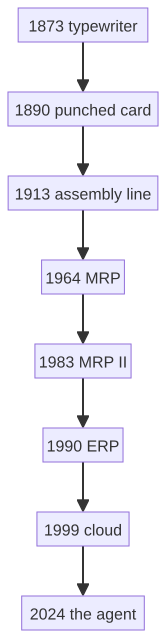

# 2. Une brève histoire de faire les choses deux fois

Le classeur a été inventé parce qu'un homme en a eu marre de chercher une lettre.

Ce n'est pas une blague, et ce n'est pas une simplification excessive. Avant le fichier vertical, les bureaux conservaient leurs papiers dans des casiers à lettres, dans des paquets liés par un ruban, dans des étiquetés du nom d'un client et de l'année. Pour trouver quoi que ce soit, il fallait se souvenir de l'endroit où c'avait été rangé, ce qui faisait que le bureau, comme Riverton, fonctionnait sur les souvenirs de ses employés de bureau. Le classeur vertical, qui apparut dans les dernières années du XIXe siècle et se répandit dans les bureaux à une vitesse étonnante, changea les termes du problème : il rendait un document trouvable par *catégorie* plutôt que par *souvenir*. Un employé de bureau qui n'avait jamais rencontré le client pouvait ouvrir le tiroir marqué A–B et trouver le dossier.

C'était, à son époque, une intelligence artificielle. Il contenait de l'information à l'extérieur d'une tête humaine, il répondait aux demandes à la demande, et il ne partait jamais en vacances. Nous oublions cela parce que la technologie est faite d'acier et sent la poussière, mais l'ambition était exactement l'ambition de la machine qui fera l'objet de ce livre : sortir les faits de la personne, les mettre quelque part où ils peuvent être trouvés, et laisser la personne faire le travail qui nécessite une personne.

Maggie passa la semaine suivant la facture d'Ashfield à se renseigner à ce sujet, de la façon dont les gens qui gèrent des petites entreprises se renseignent sur les choses—la nuit tardive, avec un ordinateur portable sur la table de cuisine et un carnet à côté, suivant une référence à la suivante jusqu'à ce que son mari demande si elle venait se coucher.

Ce qu'elle trouva n'était pas une histoire de progrès constant. C'était une histoire de la même idée découverte encore et encore, par des gens différents, dans des matériaux différents.

---

**1873.** La machine à écrire arrive au bureau. Ce n'est pas une machine à calculer et elle ne stocke rien, mais elle fait quelque chose qui s'avère plus important : elle rend l'écriture uniforme. Une commande manuscrite est un document avec une personnalité ; une commande tapée est un document avec un format. Les formats peuvent être comparés, comptés et classés. En une génération, la dactylographe est devenue la gardienne de la porte du bureau, et le bureau est devenu un endroit où l'information est *produite* selon un calendrier plutôt que quand quelqu'un s'en occupe.

**1890.** Le recensement des États-Unis est compté avec des cartes perforées et une machine à calculer électromécanique, construite par Herman Hollerith. Le recensement de 1880 avait pris huit ans à traiter. Le recensement de 1890, avec une population plus nombreuse et plus de questions, prit environ une année. La machine qui le fit devint, par une fusion en 1911 et un changement de nom en 1924, la compagnie que nous connaissons sous le nom d'IBM. Les cartes perforées resteraient la façon standard de parler à un ordinateur pendant les soixante-dix prochaines années, et la raison est instructive : une carte est un record que vous pouvez tenir, trier, laisser tomber, et relancer. C'est du papier qu'une machine peut lire.

**1913.** La ligne d'assemblage mobile d'Henry Ford à Highland Park transforme la fabrication d'une voiture en une série d'étapes chronométrées. La leçon que le monde des affaires en tire n'est pas vraiment au sujet des voitures. C'est qu'un processus peut être *conçu*—écrit, mesuré, puis amélioré—au lieu d'être laissé aux habitudes des gens qui le réalisent. Frederick Winslow Taylor argumentait la même chose depuis les années 1890 avec son chronomètre et son « gestion scientifique », et la combinaison du chronomètre de Taylor et de la ligne de Ford produisit une conviction qui dominerait le siècle : si vous pouvez décrire une entreprise comme une série d'étapes, vous pouvez mécaniser les étapes.

**1951.** Un ordinateur est utilisé pour calculer les payes d'une compagnie. La machine est énorme, le programme est écrit en instructions machine, et le calcul prend moins de temps que la préparation des cartes perforées qu'elle lit. Mais le principe est établi : l'arithmétique ennuyeuse, répétitive et sujette aux erreurs du bureau est exactement ce qu'un ordinateur sait bien faire.

**1964.** Un homme nommé Joseph Orlicky, travaillant avec l'industrie manufacturière, développe une façon de calculer ce qu'une usine a besoin d'acheter et quand, basé sur ce qu'elle intentionne de construire. On l'appelle Planification des Matières Premières à Besoins, et dans la même année une compagnie nommée Black & Decker installe le premier système qui l'utilise, avec un chef de projet nommé Dick Alban. Orlicky publie le livre en 1975—*Material Requirements Planning: The New Way of Life in Production and Inventory Management*—et à ce moment-là environ sept cents compagnies font fonctionner quelque version de l'idée. D'ici 1981 il y en a environ huit mille.

**1983.** Oliver Wight étend l'idée des matières à toute l'usine : calendriers, capacité, prévisions de vente, finances. Le résultat est appelé Planification des Ressources de Fabrication, ou MRP II, et c'est le premier logiciel d'affaires qui prétend connaître l'état d'une entreprise entière.

**1990.** Une firme d'analystes nommée Gartner a besoin d'un nom pour la prochaine chose—un logiciel qui ne planifie pas seulement l'usine mais fait fonctionner toute l'entreprise : ventes, achats, stock, comptes, gens. Ils l'appellent Planification des Ressources d'Entreprise. ERP. Le nom est un accident du marketing qui a tenu, et il a été étendu depuis pour couvrir presque tout ce qu'une compagnie fait avec une base de données.

**1992.** SAP, une compagnie allemande fondée en 1972 par cinq ingénieurs qui avaient quitté IBM, publie R/3, un système qui fonctionne sur l'architecture client-serveur qui devenait alors abordable. Il devient la norme à laquelle toute ERP ultérieure est mesurée, et la raison n'est pas l'élégance. C'est que R/3 encode les processus d'une compagnie d'une façon que les auditeurs, les banques et les régulateurs reconnaissent.

**1999.** Une compagnie nommée NetLedger commence à vendre un logiciel de comptabilité qui fonctionne dans un navigateur, sur l'ordinateur de quelqu'un d'autre, pour des frais mensuels. L'ère du cloud du logiciel d'affaires commence. Il prendra quinze autres années pour que l'idée devienne normale, et cinq autres pour qu'elle devienne le défaut.

**2013.** Gartner invente l'« ERP postmoderne » : au lieu d'un seul système énorme, une compagnie fera fonctionner un ensemble de petits systèmes qui parlent entre eux. La prédiction est juste dans l'esprit et fausse dans les détails—ce qui s'est réellement passé est que les petits systèmes se sont multipliés, et que le parler est devenu la partie difficile.

Maggie copia les dates dans son carnet, dessina une ligne sous elles, et écrivit une sentence qui aurait fait rire son père : *Chacune de celles-ci était une tentative de cesser de faire les choses deux fois.*

## Le motif qui se répète

Regardez encore les dates et un rythme apparaît : toutes les vingt années environ, une nouvelle technologie promet de mettre fin à la copie, et à chaque fois la promesse est tenue en partie et brisée en partie.

La machine à écrire mit fin à la copie manuscrite et créa le pool de dactylographes. La photocopieuse mit fin à la copie carbone et créa la crise du classement. L'ordinateur personnel mit fin au livre grand livre et créa l'envahissement du tableur. Chacun retira un coût spécifique et ajouta un coût général : le coût de *savoir quelle copie est vraie*.

L'ERP fut la première technologie de la série qui attaqua le coût général directement, en insistant pour qu'il y ait une seule copie. Il prit trente années, et ça marcha—à l'intérieur des quatre murs d'une compagnie. Ce qu'il ne résolut jamais fut la limite : le système du client, le système du fournisseur, le système de l'administration des impôts, chacun avec sa propre copie des mêmes faits.

L'agent est la première technologie de la série qui peut fonctionner au-delà de cette limite, parce qu'il peut lire ce qu'un humain a écrit et écrire ce qu'un système comprend. S'il tient la promesse est le sujet du reste de ce livre.

---

Il y avait une photographie sur le mur du bureau qu'elle avait regardée mille fois sans la voir. Elle montrait quatre femmes à quatre bureaux en 1978, dans la pièce qui était maintenant la pièce des factures, chacune avec une machine à écrire et une pile de papier frêle. Sa mère était la deuxième depuis la gauche.

« Papier carbone », dit Doreen, quand Maggie lui demanda à ce sujet. « Vous tapiez la facture et la copie passait en dessous, sur la feuille rose fine. Trois copies si vous aviez de la chance et que votre ruban était neuf. Puis vous les sépariez et vous en envoyiez une au client, une au fichier, et une au livre des comptes. »

« Et si vous faisiez une erreur ? »

« Vous la tapiez à nouveau. Tout. Et puis vous aviez deux copies de l'erreur, dont une était dans le fichier, donc vous deviez y aller et la trouver. »

Riverton avait acheté une photocopieuse en 1983, et pendant un moment la compagnie crut avoir résolu le problème des copies. Elle avait résolu le problème de *faire* des copies. Ce qu'elle n'avait pas résolu—ce que personne n'avait résolu—était le problème de savoir quelle copie était la vraie. D'ici 1991 il y avait des photocopies de factures dans trois endroits du bâtiment, et la personne qui savait laquelle le client avait réellement reçue était Doreen, qui y était depuis 1987.

C'est le motif qui se répète dans toute l'histoire du bureau, et il vaut la peine de le nommer avant d'aller plus loin. Chaque technologie qui rend plus facile la production d'un document rend aussi plus facile la production d'*un autre* document, et le coût de le second tombe plus vite que le coût de décider lequel importe. La photocopieuse a multiplié le papier. L'e-mail a multiplié les documents à nouveau. Le dossier partagé a multiplié les versions. Chaque invention tint sa promesse—moins cher, plus vite, plus—and chacune laissa la même facture impayée : le travail de décider ce qui est vrai.

Un ERP est la première technologie de cette série dont la promesse n'est pas « plus de documents » mais « un seul fait ». C'est pourquoi il se sent différent dans la main, et pourquoi en installer un est plus comme un règlement légal que comme l'achat d'une machine.

Il y a un petit test qui vous dit si une compagnie a fait le changement, et il ne coûte rien à appliquer. Demandez à deux gens, dans différents départements, la même question au sujet du même client : de combien doivent-ils nous être redevables ? Si les réponses diffèrent, la compagnie a encore des copies. Si les réponses concordent, et que les deux gens peuvent vous dire quels documents la réponse est construite à partir, la compagnie a un modèle. Tout le reste—le logiciel, les serveurs, l'intelligence artificielle—is échafaudage autour de cette seule réalisation.

---

Parce que c'est le fil conducteur. Du classeur au cloud, chaque invention dans l'histoire du bureau a été dirigée vers le même gaspillage : la seconde fois qu'un fait est écrit.

Le client donne son adresse. Elle est écrite sur la commande. Elle est écrite à nouveau sur la note de livraison, à nouveau sur la facture, à nouveau dans les comptes, à nouveau sur l'étiquette, et à nouveau par le département des comptes du client quand la facture arrive. Cinq copies d'un fait qui fut énoncé une fois. Chaque copie est une chance de mal typer un code postal, et le code postal est la façon dont le colis trouve l'école.

Un ERP est, au fond, une promesse : que l'adresse sera écrite une fois, en un seul endroit, et que chaque document qui en a besoin va *le chercher* au lieu de se faire donner une copie fraîche. Cette promesse semble modeste. Elle ne l'est pas. Pour la tenir, le système doit savoir ce qu'est un client, ce qu'est une commande, ce qu'est un produit, et comment ils se rapportent ; il doit décider qui est autorisé à changer l'adresse et qui ne l'est pas ; il doit se souvenir de ce que l'adresse était le mois dernier, parce que la facture qui fut envoyée en mars doit encore montrer l'adresse à laquelle elle fut envoyée. La promesse transforme une pile de papier en un modèle de la compagnie.

Et un modèle, une fois qu'il existe, peut être *agis sur* par quelque chose d'autre qu'une personne.

---

Il y avait une chose de plus dans le carnet de Maggie, écrite sur la dernière page de cette semaine, dans une écriture qui s'inclinait plus que d'habitude parce qu'il était tard.

*Pourquoi tout ceci a-t-il marché ?*

Elle avait lu au sujet des compagnies qui dépensaient des millions dans des systèmes ERP et se retrouvaient pire loties ; les histoires n'étaient pas difficiles à trouver, et elles l'avaient rendue prudente. Un système qui modèle une compagnie n'est utile que si le modèle est *vrai*, et un modèle est vrai seulement si les gens qui connaissent les faits les y mettent. C'est le paradoxe au centre de toute l'industrie : le logiciel existe pour soulager les gens de l'administration, et il ne marche que si les gens font l'administration de le nourrir.

La génération de systèmes qui vint après 1990 résolut ceci par la force. Ils firent du logiciel la seule façon de faire le travail : vous ne pouvez pas expédier le colis sans la note de livraison, vous ne pouvez pas imprimer la facture sans la commande, vous ne pouvez pas fermer le mois sans le rapprochement bancaire. Le modèle reste vrai parce qu'il n'y a pas de route alternative autour de lui. C'est pourquoi les ERPs semblent comme des prisons aux gens qui les utilisent, et pourquoi ils marchent quand même.

Maggie comprenait le marché. Ce qu'elle ne comprenait pas encore—ce que presque personne ne comprenait jusqu'à récemment—était que le marché était sur le point de changer, parce qu'une machine avait appris à lire.

La machine à lire n'est pas un classeur et elle n'est pas un ERP. C'est la chose qui, dans les dernières années, a commencé à apparaître dans les bureaux sous le nom vague d'intelligence artificielle : un programme qui peut se faire donner une phrase en langue ordinaire et peut répondre, ou agir, sans que quiconque ait écrit une règle pour cette phrase particulière.

Si un tel programme pouvait se faire donner le modèle de la compagnie—les clients, les produits, les commandes, le grand livre—alors le fardeau de nourrir le système tomberait, non sur les gens, mais sur la machine qui lit ce que les gens disent.

C'est l'idée entière de ce livre, et il prit le reste de l'année pour le rendre réel.
