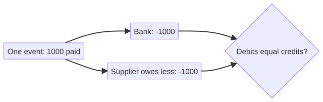

# 3. Le frère qui consigna les règles

Le comptable de Maggie était un homme nommé Gerald Pryce, qui avait un bureau au-dessus d'un magasin de pharmacie et l'habitude de répondre aux questions dans l'ordre où elles l'intéressaient plutôt que dans l'ordre où elles avaient été posées.

Elle alla le voir un jeudi, avec un classeur de tirages et une question dont elle se sentait légèrement honteuse : *pourquoi faut-il tenir les comptes au?* Pas la taxe, dit-elle—elle comprenait la taxe. L'écriture en partie double. Les débits et les crédits, le bilan de vérification, toute l'élaborée symétrie que Doreen effectuait chaque mois à la table de cuisine du bureau avec une calculette et une potée de thé.

Gerald retira ses lunettes, ce qui était un bon signe, et dit : « Parce qu'un marchand à Venise voulait savoir s'il était riche. »

---

L'homme qu'il désignait era Luca Pacioli, et la date qui compte est 1494.

Pacioli était un frère franciscain, un mathématicien, et un enseignant de grande renommée en son temps. Il travailla à Venise, à Florence, à Milan, et un moment dans la maison d'un duc. Il fut l'ami de Leonardo da Vinci—Leonardo dessina les illustrations d'un de ses livres, et Pacioli lui enseigna les mathématiques—et il fut, par tempérament, le genre de personne qui croit que tout ce qui vaut la peine d'être fait vaut la peine d'être consigné correctement.

En 1494, à Venise, il publia un manuel de mathématiques appelé *Summa de arithmetica, geometria, proportioni et proportionalità* : le résumé de l'arithmétique, de la géométrie, des proportions et de la proportionnalité. C'était un livre énorme, écrit en italien plutôt qu'en latin afin que les marchands pussent le lire, et il couvrait tout ce qu'un homme d'affaires pratique pourrait avoir besoin : comment multiplier, comment calculer l'intérêt, comment échanger les monnaies, comment mesurer un tonneau.

Un chapitre de celui-ci décrivait quelque chose que les marchands italiens faisaient depuis au moins deux cents années, et que personne n'avait jamais expliqué imprimé : la méthode de tenue des comptes par écriture en partie double.

L'idée est presque insultamment simple, et c'est la raison pour laquelle tout système de comptabilité dans le monde, y compris celui que Riverton était sur le point d'installer, a la forme qu'il a.

Chaque opération est consignée deux fois, en deux endroits différents, depuis deux points de vue différents. Si la compagnie paie un fournisseur mille livres, alors l'argent dans la banque a baissé d'un mille et le montant dû au fournisseur a baissé d'un mille. Deux faits, un événement. Si la compagnie vend un bureau à l'école, alors le client doit de l'argent et la compagnie a gagné des revenus : deux faits, un événement. Les deux écritures sont appelées un débit et un crédit, et elles doivent toujours être égales et opposées, parce qu'elles décrivent la même chose des deux côtés de la table.

La conséquence est un système auto-vérifiant. Additionnez chaque débit dans les comptes et chaque crédit, et si les deux totaux ne concordent pas, quelque chose est erroné. Pas « quelque chose pourrait être erroné »—erroné. Les comptes vous le disent. C'est la seule partie de l'administration des affaires qui a une garantie mathématique intégrée en elle, et elle a survécu à six siècles de guerres, de monnaies, d'empires et de logiciels à cause de cette garantie.

Gerald le dessina au verso d'une enveloppe, ce par quoi la comptabilité est enseignée depuis 1494.

« Maintenant », dit Gerald en posant la plume, « voici ce que votre père n'a jamais compris, et ce que la plupart des gens ne comprennent jamais. L'écriture en partie double n'est pas une règle inventée pour rendre votre vie difficile. C'est une *description de la réalité*. Il y a deux côtés à chaque opération parce qu'il y a deux parties à chaque opération. Les comptes ne sont pas un formulaire de taxe. Ce sont un modèle de ce qui s'est réellement passé. »

---

Pour comprendre pourquoi la symétrie compte, il aide à observer quelqu'un qui s'en sert.

Une fois par mois, Doreen prenait l'extrait de banque, la liste imprimée de tout ce qui était réellement sorti et entré dans le compte de la compagnie, et la posait à côté des comptes. Les deux ne concordaient jamais. Ils ne concordent jamais dans aucune compagnie; la question n'est que de combien, et pourquoi.

Un mois, la différence était de trois cents douze livres. Doreen ne commença pas à chercher trois cents douze livres. Elle commença au sommet de l'extrait et travailla vers le bas, cochant chaque ligne contre les comptes, et elle trouva que la banque avait facturé des frais de douze livres que Riverton n'avait pas enregistré, et qu'un client avait payé une facture de trois cents livres que les comptes montraient encore comme impayée.

Douze et trois cents. La différence était la somme de deux choses qui s'étaient produites dans le monde réel et qui ne s'étaient pas encore produites dans le modèle. En dix minutes elle écrivit deux écritures—une pour les frais de banque, une pour la réception—et les deux colonnes concordèrent au centime près.

C'est tout l'art, et il vaut la peine de remarquer ce qu'il *n'est* pas. Ce n'est pas de l'arithmétique; une calculette aurait pu trouver la différence. Ce n'est pas de la mémoire; l'extrait est la mémoire. C'est la discipline d'un modèle qui a deux côtés, de sorte que chaque événement réel a un endroit où être consignée deux fois, et un vide qui peut être *localisé*. Sans le second côté, une différence de trois cents douze livres n'est qu'un nombre qui est erroné, et vous le cherchez en lisant tout. Avec le second côté, le nombre vous dit où chercher.

Quand un ERP poste une facture, il accomplit les dix minutes de Doreen automatiquement, au moment où la facture est créée, et il l'accomplit pour chaque opération de la compagnie. Ce n'est pas une commodité. C'est la différence entre une compagnie qui découvre ses erreurs mensuellement, par lot, et une compagnie qui les découvre immédiatement, une à la fois, pendant que la personne qui les a causées est encore dans la pièce.

---

L'histoire vaut un moment de plus, parce qu'elle explique quelque chose au sujet du logiciel moderne qui autrement paraît arbitraire.

La plus ancienne preuve survivante de tenue de comptes complète en partie double est un registre de 1299–1300, tenu par un marchand florentin nommé Amatino Manucci pour la compagnie Farolfi, qui commerçait de Nîmes dans le sud de la France. Il y a des indices de la pratique encore plus tôt, dans les records des changeurs de monnaie florentins à une foire à Bologna en 1211. Le système se répandit le long des routes commerciales : vers les foires de Champagne, vers Venise, vers Lyon, vers Anvers. Au quinzième siècle, un marchand qui voulait faire des affaires aux grandes foires internationales devait tenir ses comptes de cette façon, parce que ses partenaires et ses banquiers le faisaient, et parce que le crédit est impossible sans une façon partagée de compter.

Un marchand ragusain nommé Benedetto Cotrugli écrivit une description de la méthode en 1458, dans un livre appelé *Della mercatura e del mercante perfetto*—sur le commerce et le marchand parfait. Il ne fut imprimé qu'en 1573, quatre-vingts années après le livre de Pacioli, et le imprimeur le raccourcit. Ainsi Pacioli obtint le crédit, et la phrase « père de la comptabilité », qu'il aurait probablement trouvée embarrassante, puisqu'il était tout à fait clair qu'il décrivait ce que d'autres gens faisaient déjà.

Ce que Pacioli fit fut plus important qu'inventer cela : il le rendit *portable*. Un marchand à Naples qui lut la *Summa* pouvait tenir des comptes qu'un banquier à Bruges aurait acceptés. Une méthode qui vit dans la tête d'une famille meurt avec la famille; une méthode qui vit dans un livre imprimé appartient à tous. C'est la même raison pour laquelle nous consignons les recettes.

Six cents années plus tard, quand vous ouvrez une facture dans un système ERP et que vous voyez les mots *Écritures de journal* en dessous, vous regardez le chapitre de Pacioli, traduit en logiciel. Les comptes ont des noms maintenant—Débiteurs, Créditeurs, Ventes, Stock—and les écritures sont faites automatiquement quand vous cliquez sur un bouton marqué *Poster*. Mais la symétrie est inchangée, et la garantie tient encore : si les écritures ne s'équilibrent pas, le système ne vous laissera pas poster le document. C'est le seul endroit dans le logiciel d'affaires où la machine peut vous dire, avec certitude, que vous avez fait une erreur.

Il y a une curiosité agréable attachée à l'homme. En 1496 Pacioli déménqua à Milan, à la cour de Ludovico Sforza, et là il rencontra un peintre et ingénieur qui travaillait alors sur un cheval de bronze qui ne fut jamais coulé. Les deux hommes devinrent amis; Pacioli lui enseigna les mathématiques, et le peintre dessina les illustrations d'un des livres plus tard de Pacioli, sur la proportion divine. Le peintera Leonardo da Vinci. Ainsi les règles qui gouvernent le registre d'un grossiste en papeterie dans une ville de marché furent, littéralement, dessinées par la même main qui dessina la *Cène*—et il vaut la peine de se souvenir, quand la comptabilité semble une corvée, qu'elle se tint une fois dans la même pièce que l'esprit le plus curieux de son âge, et fut considérée comme un sujet digne de celui-ci.

## Pourquoi elle survécut

Il y a une question worth asking au sujet de toute pratique de six cents années : pourquoi celle-ci survécut-elle quand tant d'autres ne survécurent pas?

La réponse n'est pas la tradition. L'écriture en partie double survécut parce qu'elle est *falsifiable*. Un ensemble de comptes peut être vérifié, par quelqu'un qui ne les a pas écrits, avec pas plus que de l'arithmétique. Cette propriété est rare dans l'administration : un contrat, un rapport, un plan—aucun d'eux ne peut être vérifié de la même façon. Le registre le peut.

La seconde raison est qu'elle est *portable*. Les règles de Pacioli ne dépendent pas d'une monnaie, d'un pays ou d'une technologie. Elles survécirent au florin, à la livre, à l'euro; elles survécirent à l'écriture manuscrite, à la machine à écrire, à la feuille de calcul et à la base de données. Un marchand de 1500 pouvait lire un bilan de vérification moderne et le reconnaître, ce qui est plus que ce qui peut être dit d'un lecteur moderne confronté à un registre de 1500.

La troisième est qu'elle *contraint*. Un système qui seulement enregistre ce qui s'est passé est un journal; un système qui refuse d'enregistrer une opération avec un seul côté est un contrôle. Ce refus est pourquoi un ERP semble strict, et pourquoi la strictest est worth la peine.

---

Maggie posa la question qui la préoccupait depuis longtemps. « Si les comptes sont un modèle de la réalité, pourquoi la réalité continue-t-elle à ne pas conc aver avec eux? »

Gerald rit, puis il devint sérieux, parce que c'était une bonne question.

« Parce que le modèle n'est bon que comme ce qui y entre », dit-il. « Les comptes disent que l'entrepôt contient deux cents classeurs. L'entrepôt dit qu'il contient cent quatre-vingt. L'un d'eux est erroné, et les comptes ne vous diront pas lequel, parce que les comptes ne savent seulement ce que quelqu'un a tapé en eux. C'est pourquoi les prises de stock existent. C'est pourquoi les auditeurs existent. Les mathématiques sont parfaites; les données sont humaines. »

C'est la fissure par laquelle la plupart de l'argent dans une petite compagnie disparaît. Pas la fraude—la fraude est rare et généralement évidente. Les pertes ordinaires sont : le stock que le système pense exister et qui n'existe pas, les factures qui n'ont jamais été envoyées, les paiements qui n'ont jamais été appariés à la facture qu'ils payaient, les remises données oralement et enregistrées nulle part, et les petits délais sans fin de demander à une personne un fait qu'une machine aurait pu répondre.

Un ERP est une tentative de fermer la fissure, non pas en rendant les mathématiques meilleures—les mathématiques sont fines depuis 1494—mais en rendant les *données* arriver au modèle automatiquement, au moment où l'événement se produit, depuis la personne qui l'a causé.

C'est pourquoi l'installation d'un tel système n'est pas vraiment un projet informatique. C'est une décision au sujet de où la vérité vit.

---

Il y eut une chose de plus que Gerald dit, quand Maggie mettait son manteau, et elle le consign dans la voiture parce qu'elle ne voulait pas le perdre.

« Votre père menait cette entreprise sur la confiance », dit-il. « Confiance en Doreen, confiance en les chauffeurs, confiance en les clients à payer quand ils dis qu'ils paieraient. Ce n'est pas une mauvaise façon de mener une compagnie. C'est comment chaque compagnie de ce pays fut menée pendant deux cents années, et certaines d'elles furent très réussies. Mais la confiance ne s'échelle pas. Elle fonctionne pendant que tout le monde se connaît tous. Le moment où vous avez six camions, onze mille produits et un client dans un autre pays, la confiance doit être consignée, ou elle devient une histoire que les gens se racontent l'un à l'autre sur ce qu'ils pensent qui se passe. »

Il remit ses lunettes, ce qui signifiait que la conversation était finie.

« Consignez-la », dit-il. « Alors vous pouvez faire confiance à la consignation. »

---

Ce soir-là Maggie ouvrit le programme de comptabilité que Riverton utilisait depuis 2014. C'était un programme parfaitement respectable. Il produisait un compte de profits et de pertes, un bilan, une déclaration de TVA. Il avait, quelque part en lui, le fantôme de Pacioli, parce que tout logiciel de comptabilité le fait.

Mais il ne pouvait pas lui dire combien de classeurs étaient dans l'entrepôt. Il ne pouvait pas lui dire que la facture du district scolaire avait été imprimée et non envoyée. Il ne pouvait pas lui dire lequel des onze mille produits n'avait vendu une seule unité en deux ans, ou quel client avaitQuietement cessé de commander, ou combien les six camions avaient coûté par livraison le mois dernier. Il savait de l'argent. Il ne savait pas de l'entreprise.

La différence entre ces deux choses est le sujet du prochain chapitre, et elle a un nom qui est en usage depuis 1990 : Planification des Ressources d'Entreprise. Un système qui sait de l'entreprise, pas seulement de l'argent. Et comme toute grande idée dans l'histoire de l'administration, elle commença avec une usine qui ne pouvait pas trouver ses propres pièces.
