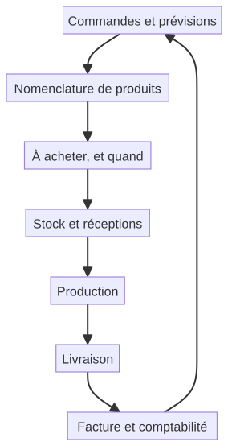

# 4. La machine qui a dévoré l'entrepôt

Arthur Ellery était l'oncle de Maggie, le plus jeune frère de son père, et il avait passé trente-quatre ans comme planificateur de production dans une usine qui fabriquait des pompes industrielles. Il avait soixante-huit ans, il élevait des abeilles, et c'était la seule personne que Maggie connaiss qui pouvait expliquer ce qu'était un ERP sans employer le mot « solution ».

Elle conduisit jusqu'à son cottage un dimanche d'octobre, avec une boîte des bons biscuits, et lui demanda ce que cela avait été avant.

« Avant quoi ? » dit-il.

« Avant tout ça. Avant les ordinateurs. »

Il rit d'elle à la façon dont les vieilles gens rient des jeunes, puis il entra dans la pièce du fond et en revint avec un livre. C'était un classeur à anneaux, maintenu par de la colle, et il faisait quatre pouces d'épaisseur.

« Ça, dit-il, c'est une nomenclature. C'est de quoi est composée une pompe. Chaque pièce, chaque sous-partie, chaque vis. Et sur chaque page, la quantité dont nous avions besoin pour fabriquer une pompe, et le fournisseur, et le délai dont il disposait pour arriver. »

Maggie l'ouvrit. Les pages étaient tapées, avec des annotations manuscrites en trois couleurs différentes, et tout l'ensemble sentait la poussière et la cigarette.

« Qui le tenait à jour ? »

« Moi. Et quand j'étais en vacances, personne. »

---

Le problème que le classeur d'Arthur cherchait à résoudre est l'un des plus anciens de la fabrication, et il est surprenant qu'il soit si difficile à formuler clairement.

Vous avez des commandes de pompes. Pour construire une pompe, vous avez besoin de pièces. Pour avoir des pièces, vous devez les commander, et elles mettent des semaines à arriver. Pour savoir combien en commander, vous devez savoir combien de pompes vous allez construire, ce qui dépend des commandes que vous avez et des commandes que vous attendez. Mais les pièces elles-mêmes sont faites de sous-parties, dont certaines sont fabriquées dans la même usine, et chacune a son propre délai, et certaines partagent une machine qui ne peut faire qu'une seule tâche à la fois. Si vous commandez trop, vous immobilisez de l'argent sur des étagères. Si vous commandez trop peu, l'usine s'arrête, et une usine arrêtée est l'objet le plus coûteux du bâtiment.

À la main, un planificateur compétent pouvait faire cela pour quelques centaines de pièces. Au-delà, l'arithmétique dépassait le humain. Vous ne pouviez pas tenir dans votre tête tout le réseau de dépendances, et donc vous faisiez ce qu'Arthur faisait : vous teniez un classeur, vous le mettiez à jour au crayon, et vous priiez que personne ne vous pose une question sur une pièce que vous n'aviez pas examinée depuis le printemps.

---

Au début des années 1950, deux fabricants de moteurs d'avion, Rolls-Royce et General Electric, commencèrent à confier cette arithmétique aux ordinateurs. Ce n'était pas un produit commercial ; c'était un outil interne pour un problème si coûteux qu'un ordinateur de la taille d'une chambre valait la peine. Les moteurs d'avion comptent des dizaines de milliers de pièces, et une erreur dans le plan ne coûte pas un retard, elle coûte un avion.

L'idée devint un produit en 1964, lorsqu'un homme nommé Joseph Orlicky trouva une méthode pratique pour calculer les besoins, et qu'une compagnie nommée Black & Decker installa le premier système à l'utiliser. Le chef de projet se nommait Dick Alban, ce qui est le genre de détail que l'histoire perd habituellement et qui rend une histoire vraie : ce n'était pas un comité, c'était une personne avec un problème.

Orlicky publia la méthode sous forme de livre en 1975, avec un titre qu'aucun éditeur aujourd'hui n'autoriserait : *Material Requirements Planning: The New Way of Life in Production and Inventory Management.* À cette époque, environ sept cents entreprises utilisaient l'idée. En 1981, huit mille l'étaient.

La méthode s'appelle MRP, et elle fait exactement une chose : elle prend ce que vous intendez construire, descend la nomenclature, soustrait ce que vous avez déjà en stock, et vous dit quoi acheter et quand, en tenant compte des délais. Si cela semble évident, c'est parce qu'il fonctionnait. Il devint la façon dont les usines pensent.

En 1983, un homme nommé Oliver Wight étendit l'idée au-delà des matériaux. Si le système sait déjà ce que l'usine va construire, pourquoi ne pas lui laisser planifier les gens, les machines, l'argent et la prévision des ventes aussi ? Le résultat s'appelait Manufacturing Resource Planning—MRP II—et c'était le premier logiciel d'affaires qui prétendait connaître l'état d'une entreprise entière.

En 1989, le logiciel MRP II représentait environ un tiers des ventes de l'industrie du logiciel vers la fabrication américaine, environ 1,2 milliard de dollars. Quelque chose avait changé : l'usine ne fonctionnait plus sur le classeur du planificateur. Elle fonctionnait sur un modèle, et le modèle était dans un ordinateur.

L'usine d'Arthur acheta l'un de ces systèmes en 1988, et la première tentative échoua.

« Le logiciel était bon, dit-il. Il était mieux que bon. Il pouvait faire en une seconde des choses que j'avais faites avec un crayon pendant vingt ans. Mais il voulait connaître le délai de chaque pièce, et personne n'avait jamais écrit les délais. Ils étaient dans la tête des acheteurs, et les acheteurs nous donnaient les nombres qu'ils pensaient que nous voulions entendre, parce qu'ils ne voulaient pas paraître lents. Donc le système planifiait avec de la fiction, et l'usine fonctionnait sur le plan, et trois mois plus tard nous avions un entrepôt plein des mauvaises pièces et un directeur général demandant qui était responsable. »

« Qui était ? »

« Tout le monde. Personne. Les acheteurs ne mentaient pas ; ils ne savaient véritablement pas, parce que personne n'avait jamais mesuré. Voilà la chose à propos d'un modèle : il n'expose pas seulement les erreurs que vous avez commises. Il expose les choses que vous n'avez jamais su ne pas savoir. »

La deuxième tentative fonctionnait, et la raison pour laquelle elle fonctionnait n'avait rien à voir avec le logiciel. L'usine passa quatre mois à mesurer les délais, à compter le stock et à écrire les règles qu'elle avait toujours suivies par habitude. Au moment où le système fut allumé, le modèle était déjà vrai, et le seul travail de l'ordinateur était de le garder plus vite qu'une personne ne le pouvait.

Arthur en était fier, à la façon dont les hommes de sa génération étaient fiers des choses sans charme. « Nous n'avons pas installé un ordinateur, dit-il. Nous avons écrit comment l'usine fonctionnait. L'ordinateur était la partie facile. »

---

En 1990, une firme d'analystes nommée Gartner eut besoin d'un nom pour l'étape suivante. Les usines avaient le MRP II. Le département des finances avait ses propres systèmes. Le bureau des ventes en avait un autre. Les entrepôts en avaient un autre. Que se passerait-il si un seul système faisait tout cela—pas seulement l'usine, mais l'entreprise entière ?

Ils l'appelèrent Enterprise Resource Planning. ERP.

Le nom n'est pas précis, et chacun dans l'industrie le sait. Il ne planifie pas les ressources d'une façon profonde, et « enterprise » est un mot qui signifie « grand » jusqu'à ce qu'il signifie « coûteux ». Mais les noms collent, et celui-ci colla à une chose réelle : une seule base de données dans laquelle le client, le produit, la commande, le stock, la facture et le grand livre sont tous connectés, de sorte qu'un fait entré une fois est visible partout.

La compagnie qui en fit une norme fut SAP, fondée en 1972 par cinq ingénieurs qui avaient quitté IBM. En 1992 ils publièrent R/3, qui fonctionnait sur l'architecture client-serveur qui devenait abordable, et qui encodait les processus d'une entreprise d'une façon que les auditeurs, les banques et les régulateurs reconnaissaient. Si vous fairiez tourner R/3, vous pouviez être audité de la façon dont une grande entreprise est audité. Pour une entreprise croissante qui voulait vendre à de grands clients, cela valait plus que toute fonctionnalité.

Deux autres choses se produisirent dans les années 1990, et toutes deux comptent pour l'histoire de ce livre.

La première fut l'an 2000. Un grand nombre d'entreprises remplacèrent leurs vieux systèmes à la fin des années 1990 parce que ces systèmes stockaient les années avec deux chiffres et que, craignait-on, ils confondraient 2000 avec 1900. Une partie de la crainte était exagérée. Mais le remplacement se produisit, et il déplaça l'ERP de l'usine vers chaque type d'organisation : hôpitaux, universités, associations, gouvernements.

La seconde fut le cloud. En 1999 une compagnie nommée NetLedger commença à vendre du logiciel de comptabilité qui fonctionnait dans un navigateur, sur l'ordinateur de quelqu'un d'autre, contre des frais mensuels. Il fallut quinze ans pour que l'idée devienne normale. Aujourd'hui c'est le défaut, et la raison n'est pas l'élégance technique. C'est qu'une petite compagnie peut louer un système qu'elle n'aurait jamais pu acheter et faire tourner.

---

Arthur rangea le classeur et prépara le thé, et Maggie posa la question vers laquelle elle menait depuis le début.

« Alors pourquoi tout le monde déteste ces systèmes ? »

Il y réfléchit un moment. « Parce qu'ils vous obligent à faire le travail à leur façon, dit-il. Et parce que les gens qui les vendent mentent sur combien de travail cela prend. »

Voilà la version honnête de l'histoire, et elle vaut la peine d'être dite clairement, parce que le reste de ce livre s'appuie sur elle.

Un ERP est un modèle d'une entreprise, et un modèle a des règles. Vous ne pouvez pas publier une facture sans un client, parce que la facture a besoin d'une adresse et d'un numéro de taxe et d'un compte du grand livre. Vous ne pouvez pas expédier des marchandises qui ne sont pas en stock, sauf si le système permet le stock négatif, que la plupart des entreprises éteignent. Vous ne pouvez pas supprimer une écriture de journal publiée, parce que la garantie de Pacioli dépend de l'intégrité de l'histoire. Chacune de ces règles existe pour une bonne raison, et chacune d'elles est un argument avec quelqu'un qui a un client au téléphone et qui a besoin que la chose arrive *maintenant*.

Multipliez cet argument par chaque processus de l'entreprise, et vous avez la raison pour laquelle les projets ERP sont célèbres pour mal tourner. Le logiciel n'est pas habituellement le problème. Le problème est qu'installer un ERP n'est pas un projet informatique : c'est un accord sur la façon dont l'entreprise fonctionne, extrait des têtes des gens qui y travaillent, écrit, puis imposé par une machine. Les entreprises qui ne peuvent pas avoir cette conversation—parce que le propriétaire ne le veut pas, ou parce que les départements ne s'accordent pas, ou parce que le consultant est payé à l'heure et s'en soucie—finissent par un système coûteux que personne ne fait confiance, et elles retournent aux plateaux.

Cette boucle est le tout d'une entreprise de fabrication, et le tout d'une entreprise de gros aussi, avec « production » remplacé par « préparation de commandes ». Chaque ERP au monde est une machine pour garder cette boucle vraie.

## Ce que le sol de l'usine a appris au bureau

Il est facile de oublier, en lisant l'histoire de l'ERP, que les idées sont venues des usines et ont été appliquées plus tard aux bureaux—pas l'inverse.

La nomenclature, le délai, le point de réapprovisionnement, la concordance en trois points, le plan de capacité : tous ont été inventés pour empêcher une ligne de production, et tous se sont révélés décrire un bureau tout aussi bien. Une offre a un délai. Une facture a une nomenclature, si vous comptez la livraison et la commande comme ses composants. Un mois clos a un plan de capacité.

Le transfert a fonctionné parce qu'une entreprise est une entreprise, qu'elle fabrique des pompes ou qu'elle vend des classeurs. Le vocabulaire a changé et l'arithmétique non. Ce qui a changé, quand les idées atteignirent le bureau, fut le *coût de l'arithmétique* : une usine pouvait justifier un ordinateur en 1964 parce qu'une ligne arrêtée coûtait plus que la machine ; un bureau ne pouvait le justifier qu'une fois que la machine coûtait moins que le salaire d'un clerc.

Voilà le tout de l'histoire des soixante dernières années en une seule phrase, et cela explique pourquoi les mêmes idées continuent à arriver dans les petites entreprises, plus tard, dans des paquets moins chers.

---

Maggie conduisit chez elle dans le noir, à propos du classeur de son oncle.

Ce qui la frappa n'était pas la technologie. C'était la *maintenance*. Quelqu'un devait tenir le classeur à jour, et quand ce quelqu'un était en vacances, la vérité se décomposait. Chaque système qu'elle avait lu au cours du dernier mois avait la même faiblesse à son centre : le modèle n'est bon que dans la mesure où la personne qui le nourrit, et les gens sont occupés, et les gens oublient, et les gens partent.

Le rêve de l'ERP était que le nourrissage se produirait automatiquement, comme un sous-produit de faire le travail. Vendre quelque chose et le stock bouge ; bouger le stock et le grand livre bouge ; envoyer la facture et le solde du client change. En grande partie, ce rêve se réalisa. Ce qui ne se réalisa pas fut la partie où quelqu'un doit *demander* au système des choses.

Cette partie resta manuelle pendant trente ans. Vous vouliez savoir quels clients étaient en retard à payer ? Vous ouvriez un rapport, ou vous demandiez au département des comptes, ou vous exportiez vers un tableur et vous plissiez les yeux pour le regarder. Vous vouliez créer quarante factures de quarante bons de livraison ? Vous cliquiez quarante fois, ou vous payiez quelqu'un pour cliquer quarante fois.

Le modèle existait. La machine qui pourrait *utiliser* le modèle n'existait pas.

Puis, tout à coup, elle existait.

---

Arthur avait une dernière chose à dire, à la porte, les biscuits terminés et les abeilles endormies.

« Savez-vous quelle était la partie la plus dure de mon travail ? dit-il. Pas l'arithmétique. L'arithmétique je pouvais la faire. C'était que personne ne m'a jamais dit quand quelque chose changeait. Un fournisseur change un délai, un client change une commande, un ingénieur change une pièce—et je m'en rends compte trois semaines plus tard, quand l'usine s'arrête. Le classeur était toujours décalé d'un mois, et j'étais toujours le dernier à savoir. »

Il regarda le jardin sombre.

« Si vous pouvez construire une chose qui sait quand quelque chose change, et qui dit à quelqu'un avant que ce soit important, dit-il, alors vous avez construit quelque chose qui vaut la peine d'être possédé. »

Maggie y réfléchit tout le chemin du retour. C'était, elle réalisa plus tard, la meilleure description d'une intelligence artificielle dans les affaires qu'elle eut jamais entendue, et elle était venue d'un homme de soixante-huit ans avec un classeur et une boîte de biscuits.
