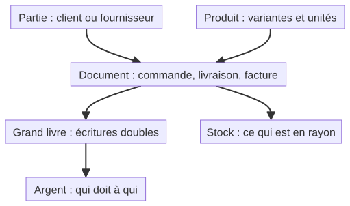

# 5. Ce qu'une entreprise est vraiment

La réunion qui a changé Riverton a eu lieu un mardi matin, dans la petite pièce avec le photocopieur, car la grande salle était pleine de stock.

Maggie avait demandé à trois personnes : Priya Raman, qui gérait les ventes ; Tom Beck, qui gérait l'entrepôt ; et Doreen, qui gérait, à sa manière, tout le reste. Sur le tableau blanc, elle écrivit un seul mot.

**COMMANDE**

« Bien », dit-elle. « Dites-moi ce que ce mot signifie pour vous. »

Priya prit la parole la première, comme elle le faisait toujours. « Une commande, c'est ce que le client souhaite. Un article, une quantité, un prix, une date de livraison. Je la prends au téléphone ou par la boutique en ligne, et je l'ins dans le système. »

Tom dit : « Une commande, c'est ce que j'ai à préparer. Elle me parvient sous forme d'une liste d'articles sur des étagères. Sauf que la moitié du temps, c'est un bon de livraison, et l'autre moitié, c'est un email de Priya avec la photo d'une note manuscrite. »

Doreen dit : « Une commande, c'est ce que je facture. Une fois que les marchandises sont parties, je transforme la commande en facture. Sauf que parfois les marchandises partent en deux lots et que je facture en deux lots, et alors ce n'est plus une seule commande, c'est deux factures et une commande et un avoir pour la partie revenue. »

Il y eut un silence de ce type qui suit une vérité dite à haute voix.

« Donc », dit Maggie, « nous avons trois choses différentes, toutes appelées commande. »

« Quatre », dit Priya. « Il y a aussi le bon de commande que nous envoyons aux fournisseurs. »

Cinq, si l'on compte le numéro de bon de commande du client lui-même, qui apparaissait sur leurs papiers et devait être cité sur la facture, sinon ils ne la paieraient pas. Six, si l'on compte le « ordre permanent » que l'Académie Ashfield passait chaque septembre, qui n'était pas une commande du tout mais un accord pour commander.

C'est le moment où la plupart des petites entreprises découvrent la vraie raison pour laquelle leurs systèmes ne fonctionnent pas. Ils n'ont pas un problème de données. Ils ont un problème de *langue*. Six choses différentes partagent un seul mot, et trois mots différents partagent une seule chose, et le seul dictionnaire est la mémoire des gens dans la pièce.

La liste de prix le prouva, une heure plus tard.

Priya cita une boîte des bons marqueurs pour tableaux blancs à onze livres quarante. Tom dit que c'était neuf livres quatre-vingt-quinze. Tous deux étaient certains. Sur le disque partagé, il s'avéra qu'il existait dix-sept fichiers appelés liste de prix, datés entre 2019 et ce mardi, et quatre d'entre eux avaient été modifiés au cours du dernier mois. La réponse correcte dépendait du client : Ashfield avait un prix contractuel depuis janvier, que Priya avait dans un tableau de données qui était le sien, et Tom avait une feuille imprimée de mars qui n'incluait pas les prix contractuels parce qu'ils étaient « commerciaux ».

Personne ne mentait. Personne n'était même négligent. L'entreprise n'avait pas d'endroit où le prix d'un produit pour un client était une *facteur* ; elle avait une habitude d'accord, renouvelée par téléphone, enregistrée dans dix-sept endroits, dont un seul était correct à un jour donné et personne ne savait lequel.

Doreen, qui n'avait rien dit depuis un moment, dit : « C'est pour ça que je garde les factures. Parce que la facture est le seul morceau de papier où nous nous sommes tous accordés au même moment. »

Elle décrivait, sans connaître le mot pour le faire, exactement ce qu'un ERP stocke : non la liste de prix, mais le prix *qui s'appliquait à ce document*. La distinction est tout le chapitre cinq de n'importe quel standard comptable, et c'est la raison pour laquelle un document dans un vrai système garde sa propre copie des faits plutôt que de pointer vers une liste qui changera demain.

---

Un ERP est, avant toute chose, un dictionnaire avec des règles attachées.

Il dit : il existe une chose appelée Bon de commande. Il a un client, une date, et une liste de lignes ; chaque ligne a un produit, une quantité, un prix et une taxe. Il a un état : brouillé, confirmé, fait, annulé. Ce n'est pas la même chose qu'une Livraison, qui est ce qui sort de l'entrepôt, et ce n'est pas la même chose qu'une Facture, qui est ce qui demande de l'argent. Quand vous avez besoin du numéro de bon de commande du client, c'est un champ sur le Bon de commande, pas une note dans la marge.

Une fois ces définitions existantes, les six significations s'effondrent en une seule, et les arguments s'arrêtent. Pas parce que tout le monde s'accorde, mais parce que l'argument a déménagé de « que veux-tu dire par commande ? » à « lequel de ces choses parlons-nous ? », et le second argument peut être réglé en une minute.

Alors laissez-moi vous donner le dictionnaire. Il est petit. Quatre sortes de choses, et tout le reste dans ce livre est une conséquence d'elles.

---

**La première sorte de chose est une partie.**

Un client est une partie. Un fournisseur est une partie. Votre propre entreprise est une partie. Une banque est une partie. L'administration fiscale est une partie. Elles sont toutes de la même forme : un nom, une adresse, un numéro fiscal, une devise, des conditions de paiement, un contact.

Ce n'est pas une astuce technique ; c'est un morceau de bon sens profond qui a pris à l'industrie du logiciel des années à accepter. Dans un vieux système, les clients vivaient dans un fichier et les fournisseurs dans un autre, et une entreprise qui était les deux — ce qui arrive constamment en gros, parce que le magasin où vous vendez vous vend aussi des choses — apparaissait deux fois, avec deux soldes, et les réconcilier était une misère mensuelle. Dans un ERP moderne, il existe une seule liste de parties, et être un client ou un fournisseur est un *rôle* qu'une partie joue.

La conséquence est immédiatement pratique. Quand l'Académie Ashfield achète à la fois des classeurs de Riverton et vend à Riverton ses vieux meubles, il y a un seul compte, une seule adresse, une seule limite de crédit, et un seul solde net. Les papiers sont plus simples parce que le modèle est plus vrai.

**La seconde sorte de chose est un produit.**

Un produit est une chose que vous achetez ou vendez : une boîte de stylos, une palette de papier, un service, des frais de livraison. Il a un nom, un code de référence, une unité de mesure (chaque, boîte, palette, kilogramme, heure), un prix d'achat, un prix de vente, une taxe, et — si vous gardez du stock — une quantité disponible dans chaque lieu.

Deux subtilités valent la peine d'être connues, parce qu'elles causent la plupart des confusions dans les vraies entreprises.

La première est la *variante*. Une chemise existe en quatre tailles et trois couleurs : c'est un seul produit avec douze variantes, pas douze produits. Si vous le modélisez comme douze produits, alors vos rapports de vente ne peuvent pas vous dire que le bleu se vend deux fois mieux que le vert, parce que le système pense qu'il s'agit d'objets non liés. Si vous le modélisez comme un seul produit avec variantes, le rapport est trivial et le stock est exact.

La seconde est l'*unité de mesure*. Vous achetez le papier par palette et le vendez par rame. Si le système ne sait pas qu'une palette vaut quarante rames, alors chaque comptage de stock est un argument, et quelqu'un doit convertir à la main, et quelqu'un finit par convertir de travers. L'unité de mesure n'est pas une décoration ; c'est l'arithmétique qui garde l'entrepôt honnête.

**La troisième sorte de chose est un document.**

Une commande, une livraison, une facture, un paiement, un ajustement de stock, une demande d'achat : ce sont tous des documents, et ils ont tous la même anatomie. Une date, une partie, une liste de lignes, un total, et un état.

L'état est la partie que les gens sous-estiment. Un document n'est pas un morceau de papier ; c'est une chose qui traverse le temps. Un devis est un brouillé qui pourrait devenir une commande. Une commande confirmée peut être partiellement livrée. Une facture peut être comptabilisée puis partiellement payée. Chacune de ces états est un fait concernant le monde, et le travail du système est de savoir quel état chaque document occupe et de refuser les transitions qui n'ont aucun sens. Vous ne pouvez pas livrer des marchandises qui n'ont jamais été commandées. Vous ne pouvez pas payer une facture qui n'a jamais été comptabilisée. Vous ne pouvez pas annuler une livraison qui est déjà sortie du bâtiment, sauf si vous la ramenez.

C'est pour ça qu'un ERP semble strict. Il est strict à la façon d'un signal ferroviaire. La strictesse est la sécurité.

Il y a une propriété de plus des documents qui est facile à manquer et énormément importante : **un document se souvient de ses propres faits.** Quand vous confirmez une commande de cent classeurs à quatre livres l'un, la commande stocke le prix. Si le prix change demain, la commande dit toujours quatre livres, parce que c'est ce que le client a accepté. Si l'adresse du client change le mois prochain, la facture du mois dernier montre toujours l'adresse ancienne, parce que c'est là qu'elle a été envoyée. Le système garde une histoire de faits, pas seulement une image actuelle. Sans cela, vous ne pourriez jamais prouver quoi que ce soit à qui que ce soit.

**La quatrième sorte de chose est l'argent.**

Chaque document qui a une conséquence financière produit des écritures de journal : les statements à double partie que Pacioli décrivit en 1494. Vendre quelque chose et le système enregistre le revenu et une dette du client. Acheter quelque chose et il enregistre une dépense et une dette envers le fournisseur. Payer un fournisseur et il enregistre l'argent quittant la banque et la dette disparaissant.

Personne à Riverton n'écrirait jamais une écriture de journal à la main, et c'est le point. Les écritures sont un sous-produit des documents. Le travail du comptable cesse d'être « enregistrer ce qui s'est passé » et devient « vérifier que ce qui a été enregistré est correct », ce qui est un usage bien meilleur d'un comptable.

---

Maggie dessina ce diagramme sur le tableau blanc, et Tom — qui avait dit presque rien pendant vingt minutes — le regarda pendant longtemps.

« C'est ça ? » dit-il. « C'est tout ? »

« C'est tout », dit Maggie. « Tout le reste sont des détails. »

Tom tapota la boîte marquée Stock. « Donc si je prends une palette de l'étagère et que je la mets sur un van, le système devrait savoir. »

« Oui. »

« Et si le van revient parce que la porte de l'école était verrouillée, le système devrait savoir ça aussi. »

« Oui. »

« Et si la palette s'endommage sous la pluie pendant qu'elle est assise sur le quai de chargement, et que je dois l'amortir — »

« Alors c'est un document aussi », dit Maggie. « Un ajustement de stock. Avec une raison. »

Tom hocha lentement la tête. « Nous n'avons jamais eu ça », dit-il. « Nous avons eu un carnet. Et quand le carnet désaccorde avec les comptes, les comptes gagnent, parce que les comptes sont ceux que l'administration fiscale voit. Mais les comptes sont faux, parce que je suis celui qui sait ce qui est réellement sur l'étagère. »

C'est la plainte la plus commune concernant le logiciel d'entreprise, et elle vaut la peine d'être nommée précisément, parce que le reste de ce livre est à propos de le corriger. Tom connaissait la vérité et ne pouvait pas l'insérer. Les comptes contenaient une vérité et ne pouvaient pas être corrigés. L'écart entre eux était rempli par un rituel mensuel de comptage de stock, au cours duquel l'entreprise découvrait à quel point elle avait été fausse, amortissait la différence, et recommençait.

L'écart existe parce que l'insération de faits dans un ordinateur a toujours été un travail séparé du fait le travail. Quelqu'un doit s'asseoir et taper. Ce quelqu'un est généralement occupé, et le tapotage est généralement la chose la moins intéressante qu'il fera ce jour-là. Donc le modèle s'éloigne de la réalité, un peu à la fois, puis beaucoup.

La promesse du système que Maggie était sur le point d'installer n'est pas que l'éloignement disparaît. C'est que le tapotage disparaît. Tom ne tapotera pas qu'il a déplacé une palette. Il dira à l'assistant, en anglais, que la palette est montée sur le van, et l'assistant fabriquera le document. Le modèle reste vrai parce que le coût de le garder vrai est tombé à presque zéro.

C'est le changement. Tout le reste — les captures d'écran, les installations, les diagrammes — est au service de cette seule phrase.

---

Doreen avait été silencieuse, ce qui était inhabituel. Quand Maggie lui demanda ce qu'elle pensait, elle dit : « Je pense que j'ai fait le travail d'une base de données pendant trente-et-ans, et personne ne m'a jamais demandé si je le voulais. »

Personne ne rit, parce que ce n'était pas une blague.

« Que feriez-vous », lui demanda Maggie, « si vous n'aviez pas à vous souvenir où tout est ? »

Doreen y réfléchit. Puis elle dit : « Je vérifierais les choses. Je remarquerais quand un prix semble faux, ou quand un client commande quelque chose qu'il n'a jamais commandé auparavant. J'aurais le temps d'être curieuse. »

Dans la langue de la gestion, c'est appelé *gestion des exceptions*, et c'est le travail le plus précieux dans n'importe quel bureau. C'est aussi le travail qui ne se fait jamais, parce que les gens qui pourraient le faire sont occupés à être des bases de données.

Maggie écrivit *être curieuse* sur le tableau blanc, sous les quatre boîtes, et dessina un cercle autour.

« Bien », dit-elle. « Allons acheter un dictionnaire. »
