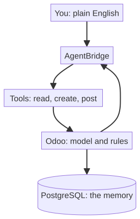

# 6. Trois machines dans une seule pièce

Sam Okafor installait des systèmes d'affaire pour les petites entreprises, et il avait une règle : il ne vendait de système à personne avant d'avoir vu leur entrepôt.

« Il est très insistant au sujet de l'entrepôt », dit Priya lorsqu'elle fit les présentations. « Il m'a fait faire le tour du nôtre pendant vingt minutes, puis m'a dit que nous avions trois cent quarante palettes que le système ne connaissait pas. »

« Trois cent quarante-et-une », dit Sam lorsqu'il arriva au bureau. « L'une d'elles était derrière la porte. »

Il avait la cinquantaine, il portait un sac de toile à la place d'une mallette, et il refusait le café au prétexte qu'il en trop bu. Dans la petite pièce avec le photocopieur, il prit une feuille de papier dans l'imprimante et dessina trois cadres dessus.

« Bien », dit-il. « Tout ce que je vais vous dire rentre sur cette serviette. Le reste, ce sont les détails. »

---

**Le premier cadre est la mémoire.**

Un système d'affaire doit se souvenir des choses. Les clients, les produits, les commandes, les factures, le stock, les prix, les paiements. Pas dans un classeur, et pas dans un tableur, mais dans une base de données : un programme dont le seul travail est de stocker des faits et de les restituer fidèlement, même si l'électricité venait à manquer en plein milieu de l'écriture d'un d'entre eux.

La base de données que Riverton allait utiliser s'appelle PostgreSQL, et c'est une des merveilles silencieuses du monde moderne. Elle est née à l'Université de Californie à Berkeley dans les années 1980, dans un projet de recherche dirigé par un homme nommé Michael Stonebraker, et elle est développée en source ouverte depuis lors : aucune compagnie ne la possède, quiconque peut lire ses instructions, et elle fait tourner une part surprenante de tout—les banques, les gouvernements, les sites web, et, bientôt, un grossiste en papeterie dans une ville de marché.

Ce qui différencie une base de données d'un tableur n'est pas la taille. Ce sont les promesses.

Un tableur vous laissera taper un mot dans une colonne de nombres, et il ne se plaindra pas. Un tableur vous laissera à deux personnes d'ouvrir le même fichier et d'écraser le travail de l'autre. Un tableur vous laissera enregistrer un changement à demi terminé. Une base de données fait trois promesses à la place : qu'un changement arrive soit complètement soit pas du tout ; que les données satisfont toujours les règles que vous avez déclarées ; et que deux personnes changeant des choses en même temps ne peuvent pas détruire silencieusement le travail de l'autre.

Ces promesses ont un nom sans charme—les *transactions*—et c'est la raison pour laquelle une compagnie peut faire confiance à un nombre sur un écran. Lorsque l'assistant crée une facture, soit la facture, ses lignes, ses écritures de grand livre et son lien vers la commande existent tous, soit aucun d'entre eux n'existe. Il n'y a pas d'état dans lequel la facture existe mais le grand livre n'existe pas.

**Le second cadre est le modèle.**

Au-dessus de la mémoire se trouve la chose qui sait ce que les faits *veulent dire* : qu'une facture doit avoir un client, qu'une livraison doit provenir du stock, qu'un taux de taxe s'applique à un produit et non à une page de notes. C'est l'ERP, et pour Riverton c'est un système appelé Odoo.

Odoo a une histoire qui vaut la peine d'être connue, car elle explique pourquoi une petite entreprise peut se le permettre. Elle a commencé en 2005 comme un projet appelé TinyERP, écrit par un Belge nommé Fabien Pinckaers. En 2008 elle a été rebaptisée OpenERP, et en 2014 elle a pris son nom actuel. Elle est en source ouverte—l'édition communautaire est sous une licence qui permet à quiconque de l'utiliser, de l'étudier et de la modifier—et c'est aussi une compagnie, qui vend une édition plus riche et du support. Cette combinaison, source à cœur commercial, est la façon dont une grande partie du logiciel d'affaire moderne est financée.

L'édition communautaire est gratuite, et ce n'est pas une démo. Elle contient les ventes, les achats, l'inventaire, la comptabilité, la facturation, les projets, la fabrication, un site web et une boutique web. Odoo 20, la version utilisée dans ce livre, est arrivée en septembre 2026. La compagnie rapporte des millions d'utilisateurs ; le nombre exact importe moins que le fait que le logiciel est utilisé, en de nombreuses langues, par des compagnies de toutes tailles, et qu'une question à son sujet a généralement été posée et à laquelle on a répondu par quelqu'un avant.

La chose importante au sujet d'Odoo, pour nos fins, est qu'il est *strict avec son modèle*. Il ne vous laissera pas publier une facture sans lignes. Il ne vous laissera pas expédier des marchandises que vous n'avez pas, sauf si vous le lui dites pour autoriser cela. Il conserve l'histoire. Cette rigueur n'est pas un défaut de caractère ; c'est toute la raison pour laquelle le système peut être approuvé par un comptable.

**Le troisième cadre est le jugement.**

Celui-ci est le nouveau, et c'est celui dont ce livre traite vraiment.

Une base de données n'a pas d'avis. Un modèle n'a pas d'initiative. Aucun des deux ne remarquera jamais qu'un client a cessé de commander, ou que les prix d'un fournisseur se sont lentement élevés, ou que la facture du district scolaire a été imprimée et jamais envoyée. Ils répondent à des questions ; ils ne les posent pas.

La troisième machine est un agent : un programme qu'on peut donner une instruction en langue ordinaire, qui détermine quels faits il lui faut, qui les récupère, qui décide quoi faire, qui le fait, et qui rend compte. À Riverton on l'appelle AgentBridge, et il tourne sur le même ordinateur que tout le reste—ce qui importe plus qu'il n'en a l'air, et nous y reviendrons.

Un agent n'est pas un bot de conversation. Un bot de conversation prend une question et produit du texte. Un agent prend une instruction et produit *des effets* : un enregistrement créé, un document publié, un courriel envoyé. Pour faire cela en sécurité il faut deux choses : un ensemble d'outils qu'il est autorisé à utiliser, et un ensemble de limites qu'il ne peut pas franchir.

Les outils, dans le cas de Riverton, sont les opérations de l'ERP lui-même : rechercher des clients, lire un produit, créer une commande, la confirmer, publier une facture, poser une question au grand livre. Chaque outil est une petite action bien définie avec un nom et une description, et l'agent choisit parmi eux de la façon dont un nouvel employé choisit parmi les boutons sur un écran—en lisant ce qu'ils font.

Les limites sont celles d'Odoo. C'est là la partie qui a pris du temps à Maggie pour qu'elle comprenne, et ça vaut la peine d'être énoncé lentement.

L'agent n'a pas de clé maîtresse. Il se connecte à Odoo en tant que *utilisateur*—un compte d'utilisateur réel, avec un mot de passe et un ensemble de permissions, créé pour lui par l'installateur. Lorsqu'il demande à créer une facture, la demande voyage vers Odoo, et Odoo vérifie si cet utilisateur est autorisé à créer des factures, sur cette compagnie, avec ces taxes. Si la réponse est non, la réponse est non. L'agent ne peut pas discuter, car l'agent n'est pas l'autorité. Odoo l'est.

C'est la décision architecturale la plus importante de tout le système, et c'est la raison pour laquelle le livre peut le recommander à une compagnie qui n'a jamais utilisé l'intelligence artificielle auparavant. L'intelligence est nouvelle et légèrement imprévisible ; les règles sont anciennes et complètement imprévisibles. La chose nouvelle n'est autorisée à agir qu'à l'intérieur des règles de la chose ancienne.

## Pourquoi trois et pas une

Une question raisonnable, et Sam avait une réponse qui prit dix secondes et qui est restée avec Maggie depuis lors.

« Parce qu'ils échouent différemment », dit-il. « Si la base de données s'arrête, vous le savez immédiatement : rien ne fonctionne. Si le modèle est faux, vous le découvrez lentement : les nombres semblent étranges. Si l'assistant est faux, vous le découvrez tard : quelqu'un a fait confiance à une réponse. Trois machines signifie trois sortes d'échouement, et trois sortes d'échouement peuvent être distinguées. »

Un seul programme qui ferait les trois serait plus simple à installer et impossible à diagnostiquer. Lorsqu'il se comportait mal, la question *est-ce les données, les règles ou le jugement ?* n'aurait pas de réponse, et le seul remède serait de réinstaller et d'espérer.

La séparation a un second bénéfice qui n'apparaît que plus tard : chaque machine peut être remplacée seule. Une compagnie qui dépasse la base de données passe à une plus grande ; une compagnie qui dépasse le modèle passe à un autre ERP, gardant les données ; une compagnie qui dépasse l'assistant change le modèle avec lequel elle cause. Aucune de ces migrations n'exige les autres, ce qui est pourquoi la pile dans ce livre restera raisonnable dans cinq ans.

---

« Comment ils causent entre eux ? » demanda Maggie.

« Deux façons, et toutes deux sont ennuyeuses, ce qui est bon », dit Sam.

L'agent cause avec Odoo par l'interface externe même d'Odoo—une façon documentée pour un autre programme de demander à Odoo de faire des choses par le réseau. Odoo l'appelle l'API JSON-2, qui est un nom qu'un seul programmeur pourrait aimer. Ce que ça veut dire est : il y a une porte, elle a une serrure, il faut une clé, et derrière la porte sont les mêmes opérations que les écrans web utilisent. Rien que l'agent peut faire n'est une chose qu'une personne ne pourrait pas faire en cliquant ; l'agent est simplement plus rapide et ne se fatigue pas.

Et les outils eux-mêmes sont décrits à l'agent en utilisant une convention appelée le Modèle de Protocle de Contexte, ou MCP. Il fut publié par Anthropic en novembre 2024 comme un standard ouvert, et il fait une seule chose simple : il donne à un programme une façon standard de dire « voici une liste de choses que je peux faire, voici ce que chacune nécessite, et voici ce qu'elle retourne. » Avant lui, chaque assistant avait besoin d'un connecteur sur mesure pour chaque système, et les connecteurs se multipliaient. Avec lui, un outil écrit une fois peut être utilisé par tout assistant qui parle le protocole—et il y a maintenant des milliers de tels outils dans le monde.

L'outil ERP de Riverton est un d'entre eux. Il s'appelle OdooTool, il est en source ouverte, et il fut écrit par les mêmes personnes qui écrirent l'assistant. Son travail est d'être le traducteur : l'agent dit « crée un client appelé Ashfield Academy », l'outil tourne ça en la séquence exacte d'appels qu'Odoo attend, vérifie les réponses, et rend compte en langue ordinaire.

---

Il y avait une chose de plus sur la serviette, dans le coin, dans l'écriture fine de Sam : *la pièce.*

« Toutes ces trois tournent sur votre ordinateur », dit-il. « Pas sur un serveur dans un autre pays. La base de données, l'ERP et l'assistant. Ça veut dire que la seule chose qui sort de ce bâtiment est ce que vous choisissez d'envoyer au modèle de langue, et si vous tournez le modèle localement, rien ne sort du tout. »

Maggie posa la question évidente. « Est-ce mieux ? »

« C'est différent », dit Sam. « C'est mieux pour le contrôle et pour la vie privée, et c'est pire pour la commodité, car il faut s'en occuper. Il n'y a pas de ligne de support à appeler à onze heures du soir. Mais il n'y a aussi personne qui peut vous éteindre, ou augmenter le prix, ou lire votre liste de clients. Pour une compagnie comme la vôtre, je prendrais ce marché. »

Il ajouta une quatrième ligne à la serviette, sous les trois cadres, dans des lettres si petites que Maggie dut se pencher : *les sauvegardes.*

« Deux choses vous arriveront », dit-il. « La première est que la machine cassera, ou que l'électricité s'arrêtera, ou que quelqu'un renversera du thé sur la mauvaise chose. La seconde est qu'une nouvelle version d'une de ces programmes arrivera et voudra être installée. Toutes deux sont ordinaires. Aucune d'elles n'est une catastrophe, pourvu que vous ayez une copie de la base de données d'hier et une note de ce que vous avez changé. Ce qui tourne une ordinaire échouement en catastrophe est de découvrir, au moment de l'échouement, que la seule copie de la mémoire de votre compagnie était sur la machine qui vient de s'arrêter. »

« À quelle fréquence ? » demanda Maggie.

« La nuit pour la base de données. La semaine pour le dossier entier. Et une fois par mois, ouvrez la sauvegarde et vérifiez qu'elle contient ce que tu crois qu'elle contient. Une sauvegarde non vérifiée est un vœu. »

Il posa le stylo. « Une chose de plus, puis je cesserai de vous faire le sermon. Décidez maintenant qui possède ceci. Pas qui l'a payé—qui *possède* le. Quelqu'un doit être autorisé à dire non à un changement, à insister pour la sauvegarde, à lire le journal quand quelque chose semble étrange. Dans une petite compagnie cette personne est d'habitude le propriétaire, et le mode d'échouement est que le propriétaire est trop occupé, et que le système devient silencieusement à personne. »

Maggie regarda la serviette. Trois cadres pour les machines, un mot pour la personne qui doit s'occuper d'elles.

Il plia la serviette et la lui remit.

« Gardez-la », dit-il. « Quelque chose partira mal—et quelque chose partira mal—revenez à la serviette. Demandez-vous lequel des trois cadres est mécontent. Neuf fois sur dix, la réponse vous dit quoi faire. »

---

Ce soir-là, Maggie épingla la serviette au tableau dans la pièce des factures, à côté d'un horaire de livraison de 2019 que quiconque n'avait jamais descendu.

Doreen le regarda un moment.

« Laquelle est moi ? » demanda-t-elle.

Maggie y pensa. « Tu es la partie qui remarque », dit-elle. « La serviette n'a pas encore de cadre pour ça. »

« Alors elle n'est pas finie », dit Doreen, et retourna à son bureau.

Elle avait raison, bien sûr. La serviette avait trois cadres pour la machinerie et aucun cadre pour la personne qui décide qu'un nombre semble faux. Tout système que Maggie avait lu au cours du dernier mois avait fait la même omission, et chacun d'entre eux avait échoué pour la même raison : ils traitaient les gens comme des appareils d'entrée.

Le système qu'elle était sur le point d'installer ne ferait pas cette erreur, pour une raison qui était presque un accident de conception. Parce que l'assistant prend des instructions en langue ordinaire, la personne reste dans la conversation. Doreen ne serait pas remplacée par une base de données. Elle serait celle qui dit à la base de données quoi remarquer.
