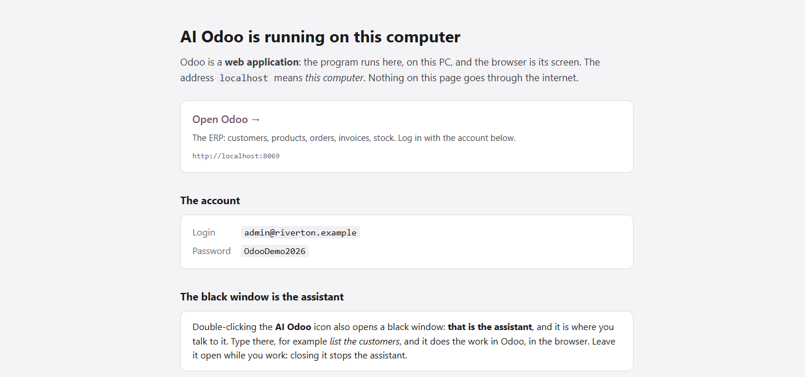

# 7. Un fichier et un double-clic

Le bureau de secours à Riverton faisait face à une fenêtre donnant sur la cour où l'on chargeait les camions.
Maggie l'avait préparé elle-même, ce qui signifie qu'elle avait déposé quatre cartons de catalogues sur le
sol et essuyé le bureau avec un chiffon qui n'était pas tout à fait propre. Elle y posa un ordinateur portable,
une tasse, et une feuille de papier sur laquelle trois lignes avaient été écrites.

Sam Okafor regarda la feuille de papier.

« C'est tout ? »

« C'est tout. »

Les trois lignes étaient : *nom de la société, e-mail administrateur, mot de passe administrateur*. Tout le reste,
elle avait décidé, la machine pourrait le calculer elle-même.

---

Avant le double-clic, il y a quatre choses qu'une société doit vérifier, et aucune d'elles n'est technique.

**Un ordinateur qui ne fait rien d'autre.** La pile exécute trois programmes à la fois—la base de données, l'ERP et
l'assistant—and sur un ordinateur portable occupé, ils entreront en concurrence avec tout le reste qui est ouvert.
Riverton utilisait une machine qui avait été achetée pour la boutique en ligne et jamais utilisée à cet effet.
Octo gigabytes de mémoire suffisent ; seize sont à l'aise ; le disque souhaite environ douze gigabytes libres avant
que l'installateur ne démarre, et il vérifie.

**Une connexion Internet, une fois.** L'installateur télécharge les composants dont il a besoin. Après cela, le
système fonctionne sans connexion, sauf le modèle de langage, qui est un service dans un autre bâtiment (ou sur une
autre machine vous appartenant, si vous préférez).

**L'autorisation d'installer.** Sur Windows, le moteur de base de données installe un service, et cela nécessite des
droits administrateur. Si le compte que vous utilisez ne les possède pas, l'installateur le dit à la fin plutôt que
de échouer silencieusement, et une deuxième exécution avec le bon compte termine le travail.

**Un nom de société.** Pas nécessairement le nom légal—le nom que vous voulez voir en haut de vos factures. Riverton
utilisait « Riverton Office Supply », ce que ses clients appellent.

Telle est la liste entière. Il n'y a pas de mot de passe à inventer pour la base de données, pas de port à choisir,
pas de fichier de configuration à modifier. L'installateur attribue lui-même le mot de passe du superutilisateur de la
base de données, l'imprime à la fin, et choisit un port libre si le port standard est pris. Le fournisseur d'IA est
demandé plus tard, par l'assistant, à son premier démarrage—où une clé peut effectivement être testée contre le
service qui l'a émise.

---

Le fichier s'appelle `install.bat`, et c'est un des rares vraiment bonnes idées dans l'histoire de la distribution
du logiciel d'entreprise : un seul fichier texte, assez petit pour être envoyé par e-mail, qui sait comment récupérer
tout le reste.

Maggie fit un double-clic dessus. Une fenêtre noire s'ouvrit, avec une barre de titre qui indiquait *OdooTool
installateur*, et la première chose qu'il fit fut de poser une question.

Pas une question technique. Il imprima quatre titres—*Questions*, *Espace libre*, *Vérification de PostgreSQL,
Python et Git*—et sous *Questions* il listait ce qu'il allait demander. Sur une exécution non surveillée, il n'y avait
rien à taper, car les trois réponses se trouvaient dans l'environnement ; sur une exution ordinaire, il aurait demandé
le nom de la société et rien d'autre.

Il y a une décision de design cachée dans cet ordre, et elle vaut la peine d'être remarquée car elle fait la différence
entre un installateur en qui les personnes ont confiance et un qu'elles abandonnent. Les titres viennent *avant* le
travail : l'installateur vous dit ce qu'il va demander, puis ce qu'il a trouvé, puis ce qu'il va faire. Rien n'est
découvert à mi-chemin, quand il est trop tard pour changer d'avis. Une personne qui lit le premier écran connaît la
forme des quarante prochaines minutes.

La fenêtre elle-même est délibérément simple—texte blanc sur noir, pas de barres de progression, pas de logo, pas
d'animation. Ce n'est pas de la paresse. Une fenêtre de console qui imprime une ligne par événement réel est une
fenêtre dont la sortie peut être *lue*, copiée dans un e-mail, et comparée à l'exécution de quelqu'un d'autre. Les
installateurs qui cachent leur sortie derrière un cercle qui tourne sont ceux qui ne peuvent pas être diagnostiqués
quand ils s'arrêtent.

Le deuxième titre concernait le disque : *Espace libre sur C: 79,53 GB*. L'installateur refuse de démarrer en dessous
de douze gigabytes, ce qui est une décision prise par quelqu'un qui a vu une installation échouer à quatre-vingt-dix
pour cent et a dû expliquer pourquoi.

Le troisième titre produisit deux lignes qui valent la peine d'être comprises, car ce sont le genre de choses qui font
penser aux personnes qu'un ordinateur est cassé.

```
! Le port TCP 5432 est déjà utilisé sur cet ordinateur ; le nouveau PostgreSQL écoutera sur le 5433 à la place.
PostgreSQL n'est pas installé. Il est installé maintenant avec le mot de passe du superutilisateur 'postgres' réglé sur 'odoo'.
```

La première ligne n'est pas une erreur. C'est le rapport d'une chose ordinaire : un autre programme sur la machine—dans
ce cas une base de données à l'intérieur du Sous-système Windows pour Linux, transmise vers le côté Windows par un petit
assistant appelé `wslrelay`—utilisait déjà le port standard pour PostgreSQL. Les ports sont des numéros de porte, et
un seul programme peut écouter derrière chaque porte. L'installateur chercha la première porte libre après le 5432,
trouva le 5433, et décida de l'utiliser pour tout : la base de données, l'ERP et le lanceur. Personne n'a à se souvenir
du numéro ; l'installateur l'écrit où il doit être écrit.

La deuxième ligne est l'installateur disant ce qu'il s'apprête à faire, et—c'est la partie qui compte pour une petite
société—qu'il va choisir le mot de passe de la base de données lui-même. Le mot de passe est `odoo`, c'est un compte
local sur cet ordinateur, et il n'a rien à voir avec aucun compte sur Internet. L'installateur l'imprime à la fin afin
que le propriétaire de la machine puisse le trouver plus tard.

---

Puis l'attente commença, et c'est dans l'attente que ce chapitre gagne sa place dans le livre, car la première tentative
échoua.

L'installateur tenta d'abord le gestionnaire de paquets Windows, qui est la façon polie d'installer un logiciel sur
Windows. Le gestionnaire de paquets ne put atteindre sa source—un réseau d'entreprise, un réseau d'hôtel ou un produit
antivirus feront cela—et retourna une erreur. L'installateur le dit, en une seule ligne, et recula vers le téléchargement
de l'installateur officiel de la base de données directement. C'est le comportement correct, et c'est pourquoi la chose
suivante sur l'écran fut un téléchargement.

Le téléchargement fut lent. Pas « un peu lent » : soixante kilobytes par seconde, sur une ligne qui avait été mesurée à
quatre-vingt-quatre cents. L'installateur de la base de données fait trois cent quatre-vingt-six megaoctets, ce qui à
cette vitesse est une heure et trois quarts, et la connexion tomba trois fois avant que le fichier ne soit complet.
Chaque chute recommençait le transfert depuis zéro, car c'est ce que le code faisait à l'époque, et après la troisième
tentative, l'installateur renonça et imprima la phrase qui pousse les personnes vers un forum d'assistance :

> PostgreSQL n'a pas pu être téléchargé (winget et le téléchargement direct ont tous deux échoué). Installez-le vous-même
> depuis enterprisedb.com et relancez cet installateur.

Ceci est la première vraie faute de ce livre, et il vaut la peine d'être précis sur ce qui clochait, car ce n'était pas
le réseau.

L'installateur utilisait déjà `curl`, qui peut reprendre un transfert partiel. Mais il supprimait le fichier partiel avant
chaque tentative, donc le reprise n'avait rien à reprendre. Sur une connexion rapide, personne n'aurait jamais remarqué.
Sur une lente, elle transforma un téléchargement de trente minutes en trois demi-heures d'échecs.

La correction tient en trois lignes de réflexion et une douzaine de lignes de code : garder le fichier partiel, le nommer
d'après la version à laquelle il appartient afin qu'il ne puisse jamais être confondue avec une autre, et demander à
`curl` de continuer là où il s'était arrêté (`-C -`). Un fichier qui est déjà de la bonne taille est réutilisé sans
transfert du tout, et un fichier qui est *plus gros* que la taille déclarée est jeté, car il ne peut pas être un préfixe
du vrai.

Avec ce changement, la deuxième exécution de l'installateur imprima une seule ligne et passa à la suite :

```
==> réutilisation du téléchargement vérifié de 16.16-1
```

Cette ligne est toute la différence entre un produit et un prototype. La première version demandait à l'utilisateur de
résoudre un problème de réseau. La deuxième version le résolut et le dit en sept mots.

Pendant que la base de données s'installait—trois cent quatre-vingt megaoctets à décompresser, ce qui prend quelques
minutes sur un disque ordinaire—l'installateur n'imprima rien, car il n'y avait rien à imprimer. Il attendait que
l'installateur de la base de données termine, et l'installateur de la base de données est silencieux par design. Une
barre de progression aurait été plus agréable. Le silence, au moins, était honnête.

---

La base de données fut terminée. L'installateur vérifia qu'il pouvait y accéder, avec le mot de passe qu'il avait
attribué, et imprima une ligne pour le dire. Puis il se tourna vers Python.

Python est la langue dans laquelle Odoo est écrit, et l'approche de l'installateur à son égard est celle d'un bon
collègue : si une version utilisable est déjà là, l'utiliser ; si non, en installer une. Sur Windows, c'est plus délica
qu'il n'y paraît, car la commande `python` sur une machine moderne est souvent pas du tout Python mais une publicité du
Microsoft Store—un petit intermédiaire qui ouvre le Store quand vous tapez `python`. Un installateur qui fait confiance à
la commande n'installera rien puis échouera mystérieusement plus tard. Celui-ci l'exécute et vérifie la réponse, ce qui
est le seul test fiable.

Puis il récupéra Odoo lui-même—une copie de la source de la version en cours d'installation—et les paquets Python dont
il a besoin, et créa la base de données, et chargea les modules de base. Chacune de ces étapes imprime une ligne, et
chaque ligne est un petit morceau de réassurance : *cela continue encore, et cela avance dans la bonne direction.*

La dernière étape fut l'assistant : télécharger la publication publique, décompresser, installer le connecteur qui lui
permet de parler à l'ERP, écrire l'adresse de l'ERP et une clé fraîchement générée dans la configuration du connecteur,
et démarrer l'ERP.

Puis la fenêtre imprima un résumé. Il vaut la peine de le citer, car c'est la seule partie de l'installation qu'un
utilisateur doit conserver.

```
==> Terminé.
  COMMENT DÉMARRER :
    Double-cliquez sur l'icône « AI Odoo » du bureau (ou du menu Démarrer).
    Une page s'ouvre dans le navigateur : elle dit ce qui tourne ici, avec le compte et le lien.
      « Ouvrir Odoo »  l'ERP, où sont les données. Connectez-vous avec le compte ci-dessous.
    Une fenêtre noire s'ouvre aussi : c'est l'assistant. Tapez-y, par exemple
    « liste les clients », et laissez-la ouverte pendant que vous travaillez.

  Odoo (l'ERP, dans le navigateur) :  http://localhost:8069
  Identifiant : admin@riverton.example
  Mot de passe : OdooDemo2026
  Assistant (parlez-lui ici) :  http://localhost:5290/OfficeManager
```

Trois de ces lignes sont celles que Maggie avait écrites sur la feuille de papier et mises dans le tiroir avec le
serviette : l'adresse, l'utilisateur, le mot de passe. La quatrième est l'adresse du chat, qu'elle n'avait pas besoin de connaître,
et la cinquième est l'icône qu'elle ferait un double-clic chaque matin pour l'année suivante.

## Ce que l'installateur ne fera pas

Il vaut la peine de dire clairement ce que le script laisse de côté, car une société qui s'attend à ce que l'installateur
produise une entreprise fonctionnelle sera déçue en une heure.

Il ne fera pas **choisir votre plan comptable**, au-delà de l'installation de celui que votre pays utilise. Les comptes
dont votre société a réellement besoin—transport facturé, transport payé, les deux ou trois dépenses qui comptent—sont
une conversation avec votre comptable.

Il ne fera pas **saisir vos produits, clients ou stock**. Ce sont les faits de votre entreprise, et personne d'autre ne
les a.

Il ne fera pas **décider qui peut faire quoi**. Il crée l'administrateur et l'utilisateur de l'assistant ; le reste est un
jugement sur vos gens.

Il ne fera pas **configurer le fournisseur d'IA pour vous** au-delà de l'écriture de l'adresse et de la clé que vous lui
avez données à l'avance ; sur une exécution ordinaire, l'assistant demande à son premier démarrage.

Et il ne fera pas **sauvegarder vos données**, car au moment où il s'exécute il n'y a pas de données à sauvegarder.
C'est la première chose à mettre en place ensuite, et le chapitre huit explique comment.

Le travail de l'installateur est étroit et il le fait bien : il met les trois machines dans la pièce, les câble ensemble,
et imprime les trois faits dont vous avez besoin pour vous connecter. Tout le reste est le travail dont ce livre parle.

---

Il y a une petite pièce de théâtre à la fin qui est facile à manquer et qui vous dit quelque chose sur les personnes qui ont
écrit l'installateur. Ayant terminé, il ouvre dans le navigateur une page que l'installateur a écrite lui-même : un fichier
sur cet ordinateur, pas un site web, avec un seul grand bouton et le compte qu'il vient de créer.



Ce n'est pas l'assistant, et ce n'est pas une page marketing. C'est la seule chose dont une personne a besoin à ce
moment-là : une déclaration claire de ce qui tourne maintenant sur cette machine, une porte pour entrer dans l'ERP, et le
compte qui l'ouvre. L'assistant n'est pas sur cette page et n'a pas besoin d'y être : c'est la fenêtre noire que la même
icône ouvre, et c'est là qu'on tape une demande.

Une version précédente de cet installateur finissait en ouvrant le site de documentation du fournisseur, et un lecteur de
l'édition précédente a raconté la suite : il a vu une page sur Odoo, dans la langue de son navigateur, l'a fermée parce
qu'elle n'avait rien à voir avec son installation, a double-cliqué sur l'icône, est tombé sur une page web avec un logo
factice, et a conclu que tout avait échoué. Chaque mot de cette page de documentation était vrai, et aucun ne parlait de
*son* ordinateur. Celle de la figure, si.

Le message est : vous n'êtes pas terminés, vous venez d'arriver. L'heure suivante est la configuration, et c'est l'heure
qui décide si le système devient la vérité ou devient un autre programme abandonné. L'installateur ne peut pas faire cette
partie pour vous, et il ne prétend pas le faire.

Maggie lut la page deux fois, nota l'identifiant et le mot de passe sur la feuille de papier, et cliqua sur *Ouvrir Odoo*.
Puis elle appela Doreen, car le plan comptable allait être une dispute, et il valait mieux avoir la dispute avec la personne
qui tenait les livres depuis trente-et-une années qu'avec un consultant.

Cette conversation est le chapitre suivant.
