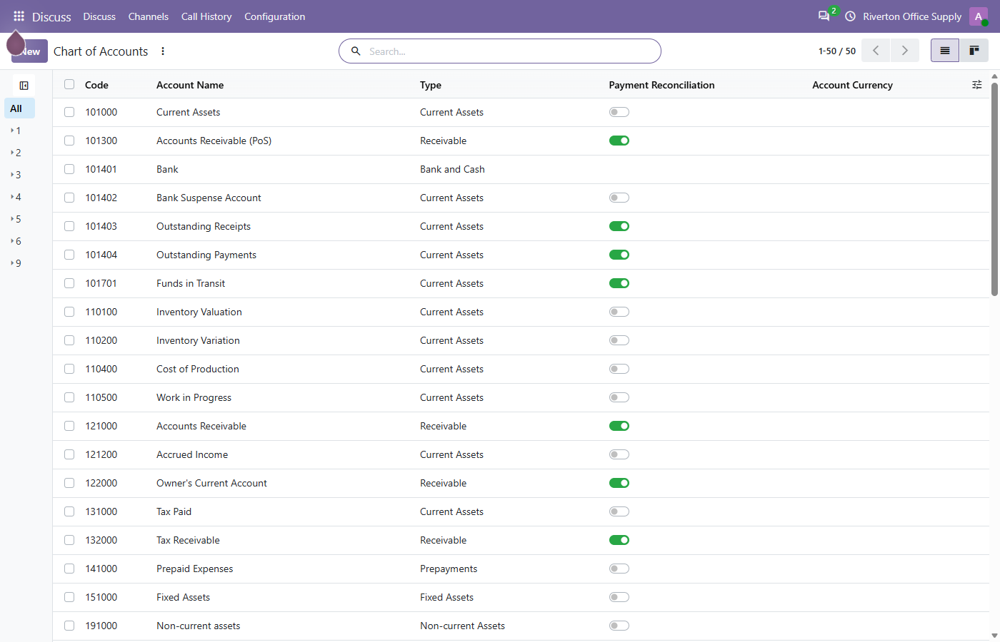

# 10. Apprendre au système la forme de l'entreprise

L'argument sur le plan comptable a duré deux jours et s'est, au bout du compte, joué sur la question de savoir si Riverton était un magasin de papeterie ou une entreprise.

Un plan comptable est la liste des bacs dans lesquels une entreprise trie son argent. Chaque livre qui bouge est versé dans l'un d'eux : vente de marchandises, vente de services, fret facturé, fret payé, salaires, loyer, électricité, frais bancaires, stock, débiteurs, créanciers, TVA. Une petite entreprise a une quarantaine de bacs ; une grande en a quatre cents ; la différence n'est pas la sophistication, c'est le nombre de questions que les comptes doivent répondre.

Doreen en voulait quarante. Maggie en voulait une douzaine.

« Ce n'est pas une question de volonté », dit Doreen, le deuxième matin, avec la patience de quelqu'un qui explique quelque chose pour la troisième fois. « Si je ne peux pas séparer le fret que nous facturons du fret que nous payons, je ne peux pas vous dire si les livraisons rapportent de l'argent. »

« Vous ne pouvez pas regarder les factures ? »

« Pas sans en lire quatre cents. »

Cela, Maggie l'accorda, était un point juste, et c'est la règle qui tranche toute argumentation sur un plan comptable : **un bac gagne son place si quelqu'un se propose de poser une question que seul ce bac peut répondre.** Le fret facturé et le fret payé gagnent le leur. « Frais divers » ne le gagne pas ; c'est un bac qui existe pour que personne n'ait à décider, et il devient l'endroit où l'argent de l'entreprise va être oublié.

---

## Ce que le système apporte avec lui

Odoo ne vous demande pas d'inventer un plan comptable. Il vous demande dans quel pays vous vous trouvez, puis installe le plan que les comptables de ce pays attendent — même numérotation, mêmes noms, mêmes codes fiscaux — afin que votre auditeur reconnaisse le lieu, et afin que la déclaration fiscale ait quelque part d'où venir.

Pour Riverton, cela signifiait l'installation de la localisation comptable du Royaume-Uni. C'est un des cent paquets de ce genre ; l'installateur avait déjà téléchargé le code, et son activation prit une minute dans l'écran *Applications*.

Lorsqu'il eut terminé, le module comptable avait un plan comptable, un ensemble de taxes, quatre journaux et une année fiscale. Rien de tout cela n'était encore celui de Riverton, et tout cela était un point de départ raisonnable — ce qui est exactement ce qu'un plan comptable devrait être.

Les comptes sont numérotés, et la numérotation n'est pas arbitraire. Le premier chiffre est la classe : 1 pour les actifs, 2 pour les passifs, 3 pour les capitaux propres, 4 pour les produits, 5 pour les charges, 6 pour le coût des marchandises. Un comptable lisant un bilan de vérification peut voir d'un coup d'œil quel genre de nombre il examine, dans n'importe quelle entreprise du pays, sans connaître l'entreprise.

Doreen parcourit la liste au crayon, et fit trois choses.

**Elle ne supprima rien.** Un compte sans activité ne coûte rien, et en supprimer un qu'un auditeur s'attend à trouver est une conversation que personne ne souhaite.

**Elle rebella quatre comptes** pour correspondre aux mots que Riverton utilise réellement. Le système en appelait un « Marchandises » ; Riverton l'appelle « Stock — acheté ». Le nom à l'écran doit être le nom dans la conversation, ou les gens ne l'utiliseront pas.

**Elle ajouta deux comptes** : un pour le fret facturé aux clients, un pour le fret payé aux transporteurs. C'étaient les deux questions qu'elle voulait répondre, et maintenant elle le pouvait.

## Les trois questions qui décident du plan comptable

Doreen et Maggie tranchèrent leur argument par trois questions, et elles valent la peine d'être notées car elles fonctionnent pour n'importe quelle entreprise.

**Que demanderez-vous chaque mois ?** Les réponses devinrent des comptes : vente de marchandises, vente de fret, achat de marchandises, achat de fret, salaires, loyer. Tout ce que personne ne se serait demandé n'obtint pas de compte.

**Que l'administration fiscale doit-elle voir distinctement ?** Les réponses furent peu nombreuses — ventes au taux normal, ventes au taux zéro, exonérées — et elles ne sont pas optionnelles. Un plan qui ne peut produire les cases de la déclaration est un plan qui sera reconstruit dans la panique.

**Qu'un auditeur demanderait-il en premier ?** Les réponses furent la banque, les débiteurs, les créanciers et le stock. Ces quatre-là doivent être propres, réconciliés et compréhensibles d'un coup d'œil, car c'est là que se trouve l'argent.

Seize comptes sortirent de ces trois questions, plus les comptes fiscaux que la localisation avait déjà créés. C'est un plan plus petit que n'en dessinerait un comptable et plus grand que n'en aurait besoin un comptable avec un tableur, ce qui est à peu près juste.

## Les paramètres faciles à manquer, et qui coûtent le plus

Cinq paramètres sur le formulaire entreprise sont faciles à ignorer et coûteux à découvrir plus tard, car ils apparaissent sur chaque document qui sort du bâtiment.

**Le logo.** Petit, et la première chose qu'un client remarque. Une entreprise qui envoie des factures avec le logo Odoo par défaut a dit au client quelque chose sur l'attention qu'elle porte.

**Les coordonnées bancaires.** Elles vont dans le pied de page de chaque facture. Une entreprise qui les ajoute à la main à chaque document finira par ajouter le mauvais compte à l'un d'eux, et c'est une conversation avec un client qui a payé la mauvaise entreprise.

**Les conditions de paiement par défaut.** Trente jours, ou fin de mois suivant, ou quatorze jours. Les fixer sur l'entreprise fait que chaque nouveau client les hérite, et les exceptions sont les exceptions plutôt que la règle.

**Les taxes par défaut.** La tax appliquée à un nouveau produit si personne n'en choisit une. Si c'est faux, chaque nouveau produit est faux, et l'erreur est invisible jusqu'à la première déclaration.

**La fin d'année fiscale.** La plupart des entreprises utilisent l'année civile, et certaines ne le font pas. Le paramètre décide quand l'année se ferme, et le changer plus tard est une opération véritablelement douloureuse.

Aucun de ceux-là n'est difficile, et tous sont le genre de chose qu'on ignore un après-midi occupé et qu'on découvre en mars. La règle qui sauve l'après-midi : **remplissez le formulaire entreprise comme si un client le verrait, car un client le verra.**

## Les taxes

Une taxe dans un ERP n'est pas un pourcentage. C'est une petite machine avec une entrée et une sortie : elle prend une ligne d'une facture, calcule la taxe, décide de quel compte la taxe va, et se souvient de la période à laquelle elle appartient afin que la déclaration puisse être produite.

La localisation installa les taux standards : vingt pour cent sur la plupart des marchandises, cinq pour cent sur certaines (comme les sièges auto pour enfants et certains matériaux économiseurs d'énergie), zéro sur les livres et sur la plupart des aliments. Riverton vend de la papeterie, qui est au taux normal, et du papier, qui est au taux normal, et un service occasionnel, qui est aussi au taux normal. Le taux de cinq pour cent est là et sera presque jamais utilisé, ce qui est correct ; l'important est qu'il existe, afin que personne n'invente un quatrième taux au comptoir.

Il y a un piège worth naming, car il fait tomber des entreprises chaque année : **la taxe est configurée par produit, non par facture.** Si un produit est réglé sur la mauvaise taxe, chaque facture qui le contient sera fausse, et l'erreur sera trouvée par l'administration fiscale plutôt que par le client. Le formulaire produit a un champ pour cela, et remplir ce champ correctement une seule fois vaut plus que toute somme de vérifications plus tard.

## Les journaux

L'argent arrive et part par un petit nombre de portes, et Odoo les appelle journaux : *Factures clients*, *Factures fournisseurs*, *Banque*, *Caisse*, *Opérations diverses*. Chaque journal a un code — INV, BILL, BNK, CSH, MISC — et chaque document posté par son intermédiaire obtient un numéro en séquence.

La séquence importe plus qu'il n'y paraît. Un numéro de facture doit être unique et doit suivre le précédent, car c'est ce qui rend le grand-livre vérifiable : si la facture 2026/0042 manque, un auditeur demandera où elle est passée. Odoo impose cela en refusant de poster un document qui briserait la séquence, ce qui est une des petites strictetés qui font que le système vaut la peine d'être possédé.

## Ce qui n'a pas été configuré, et pourquoi

Il existe une longue liste de choses qu'une entreprise *peut* configurer le premier jour, et presque toutes doivent attendre.

**La devise multiple.** Riverton achète à un fournisseur de la zone euro, donc finalement oui. Le premier jour, non : les taux de change, les gains et les pertes, et le traitement des factures en devise étrangère sont un sujet qui leur est propre, et les faire avant que la facturation de base fonctionne est la façon dont une entreprise finit par avoir un grand-livre que personne ne comprend.

**La comptabilité analytique.** La capacité de tagger chaque ligne d'un projet, d'un département ou d'un centre de coûts. Utile pour une entreprise avec des projets ; une taxe sur une entreprise sans eux.

**Les entreprises multiples.** Odoo peut contenir plusieurs entreprises dans une seule base de données, avec des transactions inter-entreprises. Riverton est une entreprise. En ajouter une seconde le premier jour est la façon dont une entreprise découvre, en mars, que la moitié de ses factures appartiennent à la mauvaise entité légale.

**Les budgets, les immobilisations, les revenus différés, les coûts de revient.** Tous réels, tous utiles, tous plus tard.

Le principe est celui que Sam avait écrit sur le mouchoir en papier et que Maggie avait épinglée au tableau : installez ce que vous utiliserez ce mois-ci. Un paramètre que personne n'utilise n'est pas une capacité ; c'est un endroit où quelqu'un finira par faire une erreur.

---

## La banque, et le solversement d'ouverture

Il reste une pièce de configuration qu'une entreprise découvre tard et regrette de n'avoir pas faite plus tôt : la banque.

Odoo installe un journal bancaire sans banque derrière lui. Le connecter au compte réel signifie entrer les détails du compte, puis — c'est la partie que personne n'attend — décider comment l'argent *existant* de l'entreprise entre dans le système.

Une entreprise qui commerce depuis trente ans ne commence pas à zéro dans la banque. Elle commence par ce que l'extrait dit le jour où le système passe en production, et par une histoire qui vit dans l'ancien programme de comptabilité. Il y a deux façons honnêtes de gérer cela, et une dishonnête.

La façon honnête, pour une petite entreprise, est une **écriture d'ouverture** : une seule écriture de journal, datée du jour avant le passage en production, qui énonce ce que l'entreprise possède et doit — solde bancaire, valeur du stock, ce que les clients doivent, ce qui est dû aux fournisseurs — et qui s'équilibre vers le compte des capitaux propres. C'est un instantané, c'est vérifiable, et ça prend un après-midi avec le bilan de l'année précédente.

L'autre façon honnête est de **faire entrer l'histoire** : importer les anciennes factures et les anciennes factures fournisseurs afin que les débiteurs et créanciers âgés soient de vrais documents plutôt qu'une seule masse. Plus de travail, plus utile, et ça vaut le coup si les clients paient régulièrement en retard — car le moment où l'assistant peut lister les factures en retard, il a des factures à lister.

La façon dishonnête est de taper le solde bancaire dans un champ qui a l'air d'accepter ça. Ça acceptera. Et puis le grand-livre ne s'équilibrera pas, et quelqu'un passera un week-end à découvrir pourquoi.

Doreen choisit l'écriture d'ouverture, avec les débiteurs âgés importés comme documents, et l'après-midi qu'elle prit fut la première fois qu'elle utilisa le système pour quelque chose qui lui tenait réellement à cœur. Elle ne configurait plus un logiciel. Elle déplaçait les chiffres de son entreprise d'un jeu de livres à un autre, et vérifiait, ligne par ligne, que rien n'avait été perdu en chemin.

---

## La première écriture

Le troisième après-midi, Doreen posta le premier document.

Ce n'était pas une facture, et ce n'était pas une vente. C'était un paiement bancaire : deux cents livres du compte de l'entreprise vers le compte d'un fournisseur, pour du papier livré en octobre. Elle créa le fournisseur, créa la facture, enregistra le paiement, et regarda les trois documents se lier les uns aux autres — facture au fournisseur, paiement à la facture, les deux à la banque.

Puis elle ouvrit le grand-livre et regarda ce que le système avait écrit.

Deux écritures. Deux cents livres sorties de la banque ; deux cents livres en moins sur ce que l'entreprise doit au fournisseur. Égales et opposées, dans deux comptes différents, datées du jour du paiement. La règle de Pacioli, accomplie par une machine en une fraction de seconde, dans une base de données dans un dossier dans un profil utilisateur.

Elle se cala en arrière et dit quelque chose que Maggie nota, car c'était le moment où le système cessa d'être un logiciel pour devenir la mémoire de l'entreprise.

« C'est le même que mon livre », dit-elle. « C'est exactement le même que mon livre. Seulement, je peux lui poser des questions. »

Voilà tout de la première semaine. Pas une transformation : une reconnaissance. Les règles que le système suit sont les règles qu'elle avait suivies à la main pendant trente-et-ans, écrites par quelqu'un d'autre, il y a six siècles, et maintenant imposées par une machine qui ne se fatigue jamais et qui ne manque jamais d'écrire la seconde ligne.

Le reste du livre est ce qui arrive quand vous pouvez lui poser des questions — et quand quelque chose d'autre peut les lui poser.
