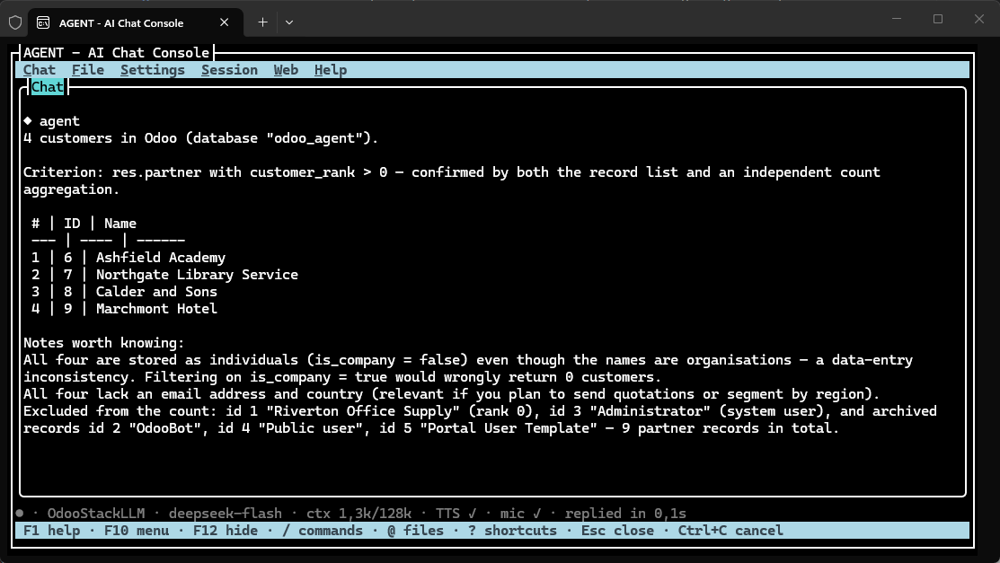

# 13. La première conversation

La première fois que l'assistant a été démarré, il a demandé une clé.

Pas la clé de l'ERP—celle-ci avait été créée lors de l'installation et insérée dans la configuration du connecteur. C'était l'autre : la clé qui permet à l'assistant de parler à un modèle de langage, ce qui veut dire, la clé qui lui permet de penser.

La fenêtre était celle de l'assistant lui-même, ouverte par l'icône AI Odoo, et elle ressemblait à un terminal des années 1995 : une barre de menu en haut, une grande zone vide, et une ligne en bas avec un curseur. Avant cela, au premier démarrage, il y avait une courte série de questions.

*Choisissez un fournisseur.*

La liste était la coutumière : les grands services cloud, quelques agrégateurs, et l'option d'un modèle tournant sur la machine elle-même. Maggie a choisi DeepSeek, car c'était celui que Sam avait recommandé pour son coût, et parce que l'entreprise avait déjà un compte pour celui-ci.

*Collez la clé.*

Elle l'a collée. La fenêtre a fait une pause pendant une seconde puis a imprimé une liste de noms de modèles—ce qui est le moment worth remarquer, car c'est le moment où l'assistant *prouve* que la clé fonctionne. Elle n'avait pas simplement accepté ce qu'elle tapait ; elle l'avait utilisée pour demander au fournisseur ce qu'il pouvait faire, et le fournisseur avait répondu. Une clé erronée produit une erreur à ce moment-là, pas trois jours plus tard au milieu d'une facture.

Elle a choisi le modèle, et la fenêtre s'est effacée.

---

## La première question

Elle a tapé : *Que pouvez-vous faire ?*

La réponse était une liste, et elle était plus longue qu'elle ne le supposait. Elle pouvait rechercher des clients, des produits, des commandes, des factures et des stocks ; elle pouvait lire et créer des fiches ; elle pouvait appeler les actions qui font passer un document du brouillon à la confirmation ; elle pouvait grouper, totaliser et compter. Elle ne pouvait pas modifier les paramètres de l'entreprise, gérer les utilisateurs, ou supprimer quoi que ce soit.

Elle l'a lue deux fois. Puis elle a tapé la question qu'elle portait depuis novembre.

*Combien de clients avons-nous ?*

La réponse est revenue en environ une seconde : *Zéro. La base de données n'a encore aucun enregistrement client.*

Un modèle qui devinerait aurait dit quelque chose comme « vous avez environ 40 clients » ou aurait produit une liste de noms plausibles, car c'est ce qu'un modèle de langage fait quand il n'a pas de faits : il produit le texte le plus probable. Celui-ci avait été construit pour *regarder*, et regarder une table vide produit la seule réponse honnête qui soit.

Le chiffre ci-dessus provient de la même installation, quelques jours plus tard, quand les quatre clients de démonstration existaient. Deux choses en valent la peine d'être lues deux fois : la réponse nomme le critère (*res.partner avec customer_rank > 0*) et dit qu'il a été confirmé par un second comptage indépendant ; et elle propose trois observations que personne n'a demandées—que les quatre clients sont stockés comme des particuliers plutôt que comme des entreprises, qu'aucun d'eux n'a d'adresse électronique, et quelles fiches ont été exclues du comptage et pourquoi. Ce n'est pas un rapport. C'est ce qu'un collèmeticieux dit quand il vous remet un nombre.

---

## Ce qui se passe entre la question et la réponse

Il vaut la peine de ralentir la seconde, car la vitesse cache quelque chose qui vaut la peine d'être compris.

Quand Maggie a tapé *combien de clients avons-nous ?*, quatre choses se sont produites.

**L'assistant a lu l'instruction** et a décidé de quelle sorte de chose il s'agissait : une question sur le nombre de fiches d'un type, pas une action. Cette décision est faite par le modèle de langage, et c'est la partie qui est véritablement nouvelle : personne n'a écrit de règle qui dise « si la phrase commence par combien de, comptez quelque chose ».

**Il a choisi un outil.** Le connecteur propose une douzaine d'opérations, chacune avec un nom et une description. L'assistant a choisi *recherche*, sur le modèle *clients*, avec un filtre vide et un comptage.

**L'outil a tourné, dans Odoo, en tant qu'utilisateur Agent.** Odoo a vérifié la clé, vérifié les permissions, a exécuté la requête contre la base de données, et a retourné un nombre.

**L'assistant a écrit la phrase.** Il aurait pu écrire un paragraphe sur la gestion des clients ; à la place, il a écrit une seule ligne, car l'instruction demandait un nombre et le nombre était zéro.

L'ensemble de la séquence a pris environ une seconde, dont la majeure partie était le modèle de langage qui pensait. La requête contre la base de données a pris des microsecondes.

## La boucle, et pourquoi ce n'est pas un chatbot

Un chatbot prend une question et produit du texte. Cette-çi prend une instruction et produit *du travail*, et la différence est une boucle.

La boucle est : penser, choisir un outil, l'exécuter, lire le résultat, penser à nouveau, et soit s'arrêter soit choisir un autre outil. Une question simple est un tour de la boucle. Une instruction compliquée—*créer un devis, le confirmer, le livrer et le facturer*—est huit ou neuf tours, chacun décidé par le modèle en fonction de ce que le précédent a retourné.

C'est cette boucle qui fait que l'assistant peut faire des choses que personne n'a programmées pour lui, et c'est aussi pourquoi il peut se tromper de façons qu'un programme ne peut pas. Un programme fait ce pour quoi il a été écrit, à chaque fois. Une boucle décide de ce qu'il faut faire à chaque fois, et une décision peut être fausse.

La défense est celle que ce livre a décrite depuis le début : les outils sont étroits, les permissions sont celles de l'ERP, et le résultat est visible. L'assistant ne peut rien faire qu'un utilisateur ne pourrait pas faire, et tout ce qu'il fait est consigné.

---

## La première action

La première chose que l'assistant *a faite*—plutôt que répondue—a été de créer un client, et Maggie l'a faite elle-même, au terminal, avec l'ouverture manuelle.

*Créer un client appelé Ashfield Academy, à Mill Lane, Ashfield, avec des conditions de paiement de trente jours, et faire du contact Carol Whitfield le contact facturation.*

L'assistant a pensé un moment—deux secondes, ce qui est plus long qu'une requête—puis :

*Client « Ashfield Academy » créé (ID 7), adresse Mill Lane, Ashfield, conditions de paiement 30 jours. Contact Carol Whitfield ajouté comme contact facturation. Voulez-vous que je recherche des doublons avant que vous n'ajoutiez le reste ?*

La dernière phrase n'est dans aucun manuel. C'est le modèle qui décide, de lui-même, que la prochaine chose qu'une personne méticuleuse ferait est de rechercher des doublons—car l'instruction disait *créer*, et créer sans vérifier est la façon dont les entreprises finissent par avoir quatre versions de la même école.

Maggie a tapé *oui*, et l'assistant a recherché quoi que ce soit de similaire. Il n'y avait rien, car la base de données était vide. Mais l'habitude avait été établie le premier jour : la machine propose une vérification, la personne l'accepte, et après une semaine la personne commence à la proposer elle aussi.

## La première erreur

Trois jours plus tard, l'assistant a fait sa première erreur, et elle vaut la peine d'être consignée car elle n'était pas du genre que quiconque attendait.

Maggie a demandé : *Quels produits n'avons-nous jamais vendus ?*

L'assistant a répondu par une liste de quatre produits, et Maggie, qui connaissait le catalogue, a remarqué que l'un d'eux—le papier A4—avait vendu quatre cents ramettes la semaine précédente.

La cause était une définition. L'assistant avait interprété *jamais vendus* comme « aucune ligne de commande de vente confirmée », et le papier avait été vendu par une livraison créée directement, sans commande, car Tom avait rempli une demande urgente d'un client qui avait téléphoné.

Les deux faits étaient vrais. La question était ambiguë, et l'assistant avait choisi une lecture.

Le verdict de Doreen, quand elle en a entendu parler, a été la phrase qui a façonné toute l'approche de l'entreprise vis-à-vis de la technologie.

*Elle a répondu à la question que j'ai posée. J'ai posé la mauvaise question.*

Ce n'est pas une défense de la machine ; c'est une description du travail. Le savoir-faire de l'utilisation d'un assistant est, dans une large mesure, le savoir-faire de poser précisément—and le savoir-faire de vérifier, quand la réponse compte, en posant une seconde question qui aurait dû s'accorder.

*Quels produits n'ont ni ligne de commande de vente ni livraison directe au cours de l'année dernière ?*

Cette version a produit la bonne liste, et elle a pris quatre secondes.

---

## La première question de Doreen

Doreen avait observé la première semaine à distance, de la façon dont quelqu'un avec trente-et-uns ans d'expérience observe un nouveau collègue : poliment, et avec une liste de choses qui pourraient probablement mal tourner.

Le vendredi, elle s'est assise et a tapé une seule chose.

*Quelles factures du mois dernier n'ont pas été payées ?*

La réponse était une liste de quatre, avec des montants et des jours de retard, et un total. Elle l'a regardée un moment, puis a ouvert l'ancien programme de comptabilité, a exécuté le même rapport à la main, et a comparé.

Ils correspondaient.

*C'est bien,* a-t-elle dit. *C'est le même rapport. Ça m'a pris vingt minutes et ça a pris à cette chose une seconde, et c'est le même rapport.*

Puis elle a demandé la question qui comptait.

*Pourquoi Marchmont Hotel est-il en retard ?*

L'assistant ne le savait pas, et l'a dit : il n'avait aucun enregistrement d'un appel téléphonique, aucune note d'une requête, aucune raison. Ce qu'il avait, c'était la facture, la date d'échéance, et le fait que Marchmont avait payé chaque facture précédente dans les dix jours.

*Ils ont payé à temps chaque mois pendant deux ans,* a-t-il ajouté. *C'est la première facture en retard.*

Cette phrase n'est pas dans la base de données. C'est une conclusion tirée de la base de données—une remarque, observée et énoncée—and c'est la chose qui a fait que Doreen a cessé d'être suspicive. Elle a téléphoné à Marchmont, et a trouvé que la facture était partie à une adresse comptable qui avait été fermée quand l'hôtel a changé de propriétaires en octobre, et que personne n'avait informé Riverton.

*La machine ne savait pas pourquoi,* a-t-elle dit par la suite. *Mais elle savait que c'était étrange. C'est la partie que je n'attendais pas. Elle savait que c'était étrange.*

## La règle de la première semaine

À la fin de la première semaine, le bureau avait une seule règle, et elle était écrite sur le tableau blanc dans des lettres assez grandes pour être lues depuis la porte.

*Demandez-lui quelque chose dont vous connaissez déjà la réponse.*

La règle semble être un gaspillage de temps et c'est le contraire. Une question dont vous connaissez la réponse est un test de la machine : si elle s'accorde, vous avez appris que la connexion, la clé, les définitions et le modèle fonctionnent tous, et chaque réponse ultérieure peut être un peu plus fiable. Si elle ne s'accorde pas, vous avez trouvé un problème pendant que les enjeux sont nuls.

Doreen l'a utilisée pendant une quinzaine de jours. Elle a demandé le comptage des clients, le total des factures d'une semaine, le solde du compte bancaire—toutes des choses qu'elle pouvait vérifier dans l'ancien système en dix minutes. Deux fois les réponses différaient, et à chaque fois la différence était une définition : une fois un client compté comme deux parce qu'il avait deux contacts, une fois une facture exclue parce qu'elle était une note de crédit.

Ces deux corrections valaient plus que toute session de formation, car elles ont appris au bureau comment la machine *pense*—et elles ont appris à la machine, d'une petite manière, ce que le bureau signifie. Les définitions ont été fixées dans les instructions et dans les données, et elles n'ont plus été fausses depuis.

## Ce qu'attendre de la première semaine

Trois choses surprennent les gens dans la première semaine, et les trois valent la peine d'être connues à l'avance.

**Elle est plus lente que vous ne le souhaitez, et plus rapide que vous ne le supposez.** Une question prend de deux à huit secondes, selon le modèle et le nombre d'étapes. Cela semble lent à côté d'une boîte de recherche et instantané à côté de l'ouverture de quatre écrans. La tentation est de poser plusieurs questions à la fois, ce qui rend tout plus lent et produit des réponses entrelacées—la façon la plus commune de faire sentir à un bon système qu'il est mauvais.

**Elle est littérale d'une façon qui ressemble à de la pedanterie.** *Montrez-moi les commandes* produira une question sur quelles commandes. Ce n'est pas un échec ; c'est le même comportement qu'un nouvel employé méticuleux a, et c'est le comportement qui rend le système sûr. Le remède est une meilleure instruction, pas un système plus indulgent.

**Elle est meilleure pour les balayages que pour les conversations.** Demandez-lui chaque facture de plus de trente jours et elle vous donnera une liste complète et précise. Demandez-lui ce que vous devriez faire à leur sujet et elle vous donnera un paragraphe méticuleux et générique, car la réponse dépend de choses qu'elle ne connaît pas. La première vaut le coût ; la seconde ne le vaut pas.

## Les quatre questions que l'assistant se pose

Quand une instruction arrive, l'assistant passe en revue quatre questions, et les comprendre est le moyen le plus rapide d'écrire de meilleures instructions.

**De quelle sorte de chose s'agit-il ?** Une question, une action, ou une conversation. Ceci est décidé par le modèle, à partir de la forme de la phrase, et c'est pourquoi *combien de clients avons-nous* et *créer un client* produisent un comportement si différent.

**Quels outils pourraient le faire ?** Le connecteur décrit chaque opération dans une phrase, et l'assistant choisit celles qui correspondent. Une demande qui ne correspond à aucun outil produira un refus poli, ce qui est mieux qu'un devinements.

**Quels sont les arguments ?** Le nom du client, le produit, la date. C'est là que l'ambiguïté mord : *les classeurs bleus* ne correspondent pas à un produit, et l'assistant demandera plutôt qu'inventer.

**Le résultat est-il ce qui a été demandé ?** Après que l'outil a retourné, l'assistant lit le résultat et décide si l'instruction a été satisfaite ou si une autre étape est nécessaire. Cette boucle est ce qui rend une chaîne d'opérations possible, et c'est aussi ce qui rend une erreur possible—la boucle peut se satisfaire de quelque chose qui n'est pas ce que vous vouliez dire.

## Ce que la première semaine a ressenti

La note de Maggie, écrite le vendredi de la première semaine, est le meilleur résumé de ce chapitre qui existe, et elle est longue de quatre lignes.

*Jour 1 : il m'a dit que nous n'avions pas de clients. Correct, et légèrement impoli.*
*Jour 2 : il a créé un client et a demandé si je voulais vérifier des doublons. Je l'ai fait.*
*Jour 3 : il a répondu à une question que j'ai posée mal, et Doreen avait raison à propos du pourquoi.*
*Jour 4 : j'ai cessé d'être impressionnée et commence à être agacée quand il est lent, ce qui, je pense, signifie qu'il fonctionne.*

Cette dernière ligne est celle à conserver. La mesure d'un outil qui est devenu partie d'une entreprise n'est pas l'admiration ; c'est l'impatience. Personne n'est impressionné par le téléphone. Les gens sont agacés quand il ne fonctionne pas.

À la fin de la première semaine, l'assistant avait cessé d'être une démonstration et era devenu un collègue avec une habitude irritante d'être literal—which, comme quiconqui a géré un junior très consciencieux le sait, est un problème avec lequel on peut travailler.
