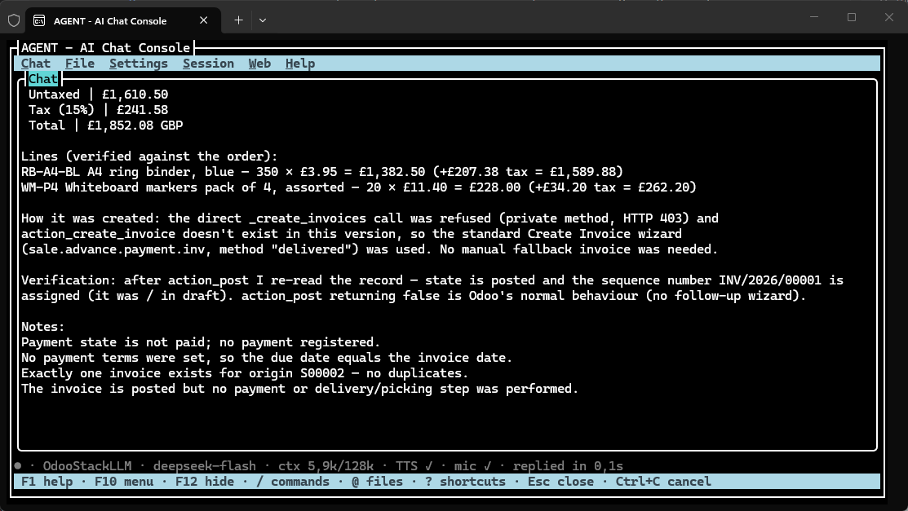

# 15. De la commande à la facture

Les classeurs étaient partis un matin de vendredi, sous la pluie, ce qui est traditionnel.

Tom les avait chargés lui-même parce que le chauffeur était en retard, et il era revenu au bureau avec des manches mouillées et un bout de papier : le bon de livraison, signé par le concierge d'Ashfield, avec un stylo Biro qui était presque vide. Sur l'ancien système, ce bout de papier serait entré dans un plateau et aurait attendu que Doreen revienne de déjeuner, et la facture aurait été tapée le lundi.

Sur le nouveau système, Doreen a demandé l'assistant pendant que Tom se déshabillait encore de son manteau.

> *Quelles commandes livrées de cette semaine ne sont pas encore facturées ?*

> *Une : commande de vente S00012, Ashfield Academy, livrée ce matin. 350 × Classeur A4 (bleu),
> 20 × Marqueurs de tableau blanc. Prête à être facturée. Dois-je créer la facture ?*

Elle a dit oui. Voilà tout le transaction, et il vaut la peine de comprendre ce qui s'est passé en dessous, car « créer la facture » accomplit une grande partie du travail dans une seule phrase.

---

## Ce qu'est une facture

Une facture est un document qui dit trois choses à la fois, et c'est la raison pour laquelle la comptabilité est plus compliquée que l'arithmétique.

**C'est une demande de paiement.** C'est la partie que tout le monde connaît : le client doit le montant sur la page, à la date sur la page.

**C'est l'enregistrement d'un événement imposable.** Dans la plupart des pays, le tax devient dû lorsque la facture est émise, et non lorsque l'argent arrive. C'est pourquoi une facture a un point de tax, et pourquoi une facture annulée de la mauvaise façon peut laisser une compagnie devoir du tax sur de l'argent qu'elle n'a jamais reçu.

**C'est une créance légale.** Si le client ne paie pas, la facture est la preuve. Elle doit montrer le nom enregistré de la compagnie et le numéro de tax, les détails du client, un numéro séquentiel unique, la date, une description de ce qui a été fourni, le montant avant tax, le taux et le montant du tax, et le total. Manquer l'un de ceux-là rend la créance plus faible ; manquer le numéro et la créance peut être sans valeur.

Un ERP fait tout cela à la fois, et la raison pour laquelle il insiste sur une *commande confirmée* avant de vouloir créer une facture est que les deuxième et troisième fonctions dépendent de la première étant vraie. Vous ne pouvez pas facturer des marchandises que vous n'avez pas convenu de fournir, car le point de tax et la créance se rapportent tous deux à une fourniture.

## Ce que l'assistant a réellement fait

L'instruction était de quatre mots, et le travail de l'assistant était une chaîne de huit ou neuf étapes, chacune desquelles une personne aurait faite à la main.

Il a cherché les commandes livrées qui n'avaient pas de facture. Il en a trouvé une. Il a lu les lignes de la commande, les prix et les taxes. Il a créé un document de facture lié à la commande—lié, non copié, de sorte que la facture puisse toujours être ramenée à ce qui avait été commandé. Il a calculé le tax par ligne. Il a fixé la date de la facture à aujourd'hui et la date d'échéance selon les conditions de paiement du client. Il a laissé la facture en *brouillon*, qui est l'état dans lequel rien ne s'est encore passé.

Puis Doreen l'a regardée et a pressé le bouton qui compte : *Passer*.

## Le moment du passage

Le passage est le verbe le plus important de tout le système, et il vaut une section à lui seul.

Avant le passage, une facture est un brouillon : un bout de papier avec des nombres dessus. On peut la modifier, l'effacer, l'ignorer. Rien dans le grand livre n'a changé.

Après le passage, quatre choses sont vraies qui ne l'étaient pas avant :

1. La facture a un **numéro**, pris dans une séquence, sans trous.
2. La facture a des **écritures de journal** : deux pour la vente et la dette, et davantage pour le tax.
3. Le **solde** du client a changé.
4. La facture ne peut plus être modifiée. Si elle est fausse, elle est *annulée* et un avis de crédit est émis—parce que l'histoire du grand livre ne doit pas être réécrite.

Ce dernier point est celui qui surprend les gens, et c'est celui qui rend le système vérifiable. Une compagnie qui peut modifier une facture passée est une compagnie dont le grand livre est un brouillon. Une compagnie qui ne le peut pas est une compagnie qui peut prouver, à un inspecteur des taxes, à une banque ou à un tribunal, ce qu'elle a dit à ses clients et quand.

Doreen l'a passée, et l'assistant a rapporté le numéro.

> *Facture INV/2026/0007 passée pour Ashfield Academy : net 1 524,00 £, VAT 304,80 £, total 1 828,80 £.
> Échéance le 14 juillet (30 jours).*

Le numéro est la partie qui compte. INV/2026/0007 est la septième facture de l'année, et il n'y a pas de sixième manquante ni de huitième déjà utilisée, parce que la séquence ne le permet pas. Six cents ans après Pacioli, le numérotage des pages est toujours la façon dont un grand livre prouve qu'il est complet.

La figure ci-dessus est l'exécution réelle, et elle contient le passage le plus instructif de ce livre. L'assistant a tenté la route directe d'abord—la méthode privée qui crée une facture à partir d'une commande—et l'ERP l'a refusée, parce que les méthodes privées ne peuvent pas être appelées de l'extérieur. Il n'a pas cherché un moyen de contourner le refus. Il a utilisé la route *documentée* à la place, l'assistant standard « Créer une facture » qu'une personne aurait atteint en cliquant, et il l'a dit dans la réponse : *l'appel direct a été refusé (méthode privée, HTTP 403), donc l'assistant standard a été utilisé.*

C'est le comportement qu'une compagnie veut d'un collègue avec un nouveau système : quand la porte est verrouillée, trouver la porte qui est censée être utilisée, et dire laquelle vous avez utilisée. Une machine qui à la place chasserait pour trouver un moyen de passer à travers le mur serait une machine que l'on ne pourrait pas laisser seule avec votre grand livre.

Les deux figures appartiennent ensemble. À gauche, le récit de l'assistant de ce qu'il a fait ; à droite, l'enregistrement propre de l'ERP du résultat—le même numéro, le même total, l'état *Passée*, et la piste d'audit qui dit qui l'a créée et quand. L'installation de démonstration applique un tax de quinze pour cent sur ces produits parce que c'est ce que sa localisation a configuré ; la narration utilise le taux standard de vingt pour cent, et la différence est exactement le genre de chose qu'une compagnie découvre quand elle lit sa propre configuration au lieu de la présumer.

---

## L'impression

La facture a été imprimée, parce que le service comptable d'Ashfield demande un PDF et parce qu'un document qui a été imprimé est un document que quelqu'un a regardé.

La mise en page est celle standard d'Odoo, et elle est délibérément simple : le nom et l'adresse de la compagnie en haut, les détails du client, le numéro et les dates, les lignes, les totaux, le détail du tax, et les conditions de paiement en bas. Chaque champ qui s'y trouve vient de la base de données. Rien n'est tapé deux fois.

C'est le moment à lequel la promesse des premiers chapitres est enfin visible sur papier : l'adresse sur la facture est l'adresse sur l'enregistrement du client, le prix est le prix sur la commande, le tax est le tax sur le produit, et le total est la somme des lignes. Il n'y a pas de deuxième copie de aucun fait, et donc pas de deuxième chance de le mal taper.

---

## Les avis de crédit, et la discipline de ne pas effacer

Trois semaines plus tard, un des classeurs est revenu. Pas endommagé—mauvaise couleur, parce que le département artistique avait demandé du bleu et que le concierge avait commandé du vert en son propre nom, et qu'il y avait eu une conversation dans un couloir dont personne chez Riverton ne faisait partie.

L'ancienne façon aurait été de barrer la ligne sur la facture et d'en écrire une nouvelle. La nouvelle façon est un avis de crédit : un document qui inverse une partie de la facture, avec son propre numéro, ses propres écritures de grand livre, et une raison.

> *Créer un avis de crédit pour Ashfield Academy pour 20 classeurs, raison : couleur erronnée retournée, et
> le passer.*

> *Avis de crédit RINV/2026/0003 passé pour Ashfield Academy : 20 × Classeur A4 (bleu) à 3,40 £, net
> 68,00 £, VAT 13,60 £, total 81,60 £. La facture INV/2026/0007 reste passée ; son solde
> non payé est maintenant 1 747,20 £.*

Remarquez la dernière sentence. La facture originale n'a pas été touchée. Elle existe toujours, avec son total original, parce que c'est ce qui a été envoyé. L'avis de crédit est à côté d'elle, et le *net* est ce que le client doit. Deux documents, deux numéros, une seule vérité—et une histoire complète de ce qui s'est passé, y compris l'erreur.

C'est ce que « le grand livre n'oublie pas » signifie en pratique, et c'est une discipline que les compagnies adoptent soit ou combattent. Celles qui la combattent passent leurs soirées à réconcilier ; celles qui l'adoptent découvrent que l'histoire n'est pas un fardeau mais un atout, parce qu'elle répond à des questions que personne n'a pensé à demander au moment voulu.

---

## L'exécution des factures

Une seule facture est une démonstration. quatre cent factures, c'est un mardi.

L'exécution est le moment à lequel un système soit gagne son maintien soit devienne un autre écran sur lequel cliquer, et il vaut la peine de la décrire parce que la forme du travail est différente d'une seule facture.

L'instruction de Doreen, une fois par semaine, est une seule sentence.

*Créer des factures à partir de toutes les commandes livrées qui ne sont pas encore facturées, les laisser en brouillon, et me donner la liste avec les totaux.*

L'assistant produit une liste—généralement entre quarante et soixante commandes—crée les factures, et rapporte. Il ne les passe pas. Doreen lit la liste, vérifie la première contre le bon de livraison, vérifie les deux plus grandes, puis passe le lot.

Cette dernière étape est une seule action dans Odoo—tout sélectionner, passer—et elle prend environ quatre secondes pour cinquante factures. Sur l'ancien système, c'était cinquante opérations séparées, chacune avec une boîte de dialogue d'impression.

Trois choses rendent l'exécution sûre, et les trois valent la peine d'être copiées.

**Elle les laisse en brouillon.** Une facture en brouillon peut être corrigée ; une passée ne le peut pas. Le lot est une proposition jusqu'à ce qu'une personne le regarde.

**Elle rapporte la liste avant le passage.** Pas après. La liste est la chose qui est approuvée, non un enregistrement de ce qui s'est passé.

**Elle ne touche jamais une commande qui est partiellement livrée.** Celles-là ont besoin d'une décision—facturer ce qui est parti, ou attendre le reste—and le système les laisse hors du lot et le dit.

Le dernier point est la différence entre un assistant et un script. Un script facturerait ce qu'il trouverait ; l'assistant sait qu'une livraison partielle est une question, et il la pose.

## Les quatre nombres sur une facture qui ne doivent jamais être faux

Une facture a une douzaine de champs et quatre d'entre eux comptent plus que le reste, parce qu'une erreur dans l'un quelconque d'entre eux produit un document que le service comptable du client rejettera—et un rejet coûte un cycle d'un mois.

**Le nom légal et l'adresse du client.** Pas le nom commercial, pas l'adresse du site. Le service comptable met la facture en correspondance avec son maître de fournisseur, et une non-correspondance l'envoie dans une file d'attente.

**Leur numéro de commande d'achat**, quand ils en exigent un. Beaucoup d'organisations plus grandes ne paieront pas une facture sans lui, et le numéro doit être exactement comme ils l'ont écrit.

**Le numéro de tax.** Le leur, pour les cas de tax inversion, et le vôtre, qui est sur chaque facture par la loi.

**Le total, en mots et en chiffres.** Dans la plupart des juridictions les chiffres suffisent ; dans quelques-uns, les mots sont requis. D'une façon ou de l'autre, un total qui ne concorde pas avec ses propres lignes est la route la plus rapide possible vers une requête.

L'assistant peut vérifier trois de ces quatre contre l'enregistrement du client avant que la facture soit passée—le nom, la référence de commande d'achat, le numéro de tax—and il vaut la peine de le lui demander. *Cette facture correspond-elle à l'enregistrement du client dans chaque champ que le client vérifiera ?* est une question qu'une machine répond bien et qu'une personne occupée répond mal.

## Quand le client conteste

La facture est partie, le client dit qu'elle est fausse, et la conversation qui suit est là où le papier-dorerie d'une compagnie est soit un atout soit une responsabilité.

Il y a quatre sortes de contestation, et chacune a une réponse différente.

**La quantité est fausse.** Le client dit qu'ils ont reçu trente caisses, pas quarante. La réponse est le bon de livraison, signé à la porte, et le mouvement de stock derrière lui. Si le note dit quarante et que la signature est lisible, la conversation est courte. Si le note dit quarante et que la signature est une égratignure, la conversation porte sur la prochaine livraison.

**Le prix est fausse.** Le client dit que le prix convenu était plus bas. La réponse est la quotation qu'ils ont acceptée, qui est stockée, avec la date, et la liste de prix derrière elle. C'est la contestation qui était autrefois invincible, parce que la quotation vivait dans un email et que l'email vivait dans le dossier de quelqu'un.

**Les marchandises n'ont jamais été reçues.** La réponse est le bon de livraison et le mouvement de stock, et si le propre service de réception du client a perdu la palette—which arrive plus souvent que quiconque n'admet—la preuve est ce qui tourne un argument en enquête interne à la fin du client.

**La facture n'a jamais été reçue.** La réponse est la date d'envoi et l'adresse à laquelle elle est partie, et la cause la plus commune est un changement de service comptable que personne n'a signalé au fournisseur.

Dans les quatre, la contribution du système est la même : il détient les documents, il détient les dates, et il peut les produire en une seconde. L'ancien système les tenait aussi, dans un classeur, et la différence était les quatre minutes qu'il fallait pour les trouver—which est exactement assez long pour que la conversation devienne un argument.

---

## Une courte histoire de la facture

La facture est plus ancienne que la presse à imprimer. Les tablettes d'argile babyloniennes d'autour de 3000 avant J-C enregistrant des quantités livrées et des amounts dus ; les marchands romains utilisaient les reçus *apocha* ; les banquiers italiens médiévaux qui ont inventé la comptabilité en partie double ont aussi inventé la lettre de change, qui est une facture avec une promesse attachée et qui a financé le commerce de la laine des Flandres.

Ce qui a changé au dix-neuvième siècle n'était pas le document mais le *numérotage*. À mesure que les compagnies grandissaient, et à mesure que les autorités fiscales ont commencé à s'y intéresser, la facture séquentielle et pré-imprimée est devenue la norme—d'abord en Prusse, puis dans toute l'Europe—parce qu'une séquence est la preuve la plus simple possible que rien n'a été retiré. C'est une technologie si simple qu'elle est invisible, et c'est encore la raison pour laquelle le numéro de votre facture a une année en elle.

La facture électronique est le chapitre le plus récent, et le moins intéressant : c'est le même document, envoyé par une route différente, avec les mêmes numéros et les mêmes règles. Ce qui a changé n'est pas la facture mais le *coût de la produire*, qui est tombé de l'après-midi d'une dactylo à une fraction de seconde—and c'est le sujet du prochain chapitre, qui est à propos de l'entrepôt.

---

Doreen a imprimé l'avis de crédit, l'a mis dans une enveloppe, puis a fait quelque chose qu'elle n'avait pas fait en trente-et-uns ans : elle a jeté l'enveloppe.

"Il n'y a pas de sens à le passer," elle a dit. "Carol le reçoit par email avant que j'aie léché le timbre."

Elle avait raison, et c'était la première fois dans tout le projet qu'elle changeait un habitude sans qu'on le lui demande. Le système ne lui avait pas dit d'arrêter de passer les lettres. Il avait simplement rendu la lettre sans but, et elle avait remarqué.

Ça, plus que n'importe quelle fonction, est ce qu'un bon système fait : il n'interdit pas l'ancienne façon, il rend la nouvelle façon évidemment meilleure, puis il attend que les gens remarquent.
