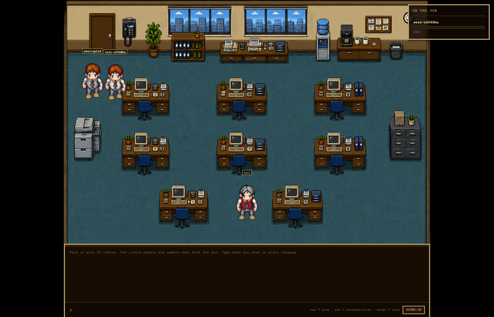

# 23. Le bureau au bout du couloir

L'assistant dispose de deux portes d'entrée, et la plupart des entreprises en utilisent une pendant un mois avant de découvrir l'autre.

La première est la fenêtre de terminal : fond noir, une invite, et la réponse en dessous. C'est la porte que ce livre a utilisée, car c'est celle qui montre le travail—les appels aux outils, les étapes intermédiaires, le journal. C'est un atelier.

La seconde est une page web, à `http://localhost:5290/OfficeManager`, et ce n'est pas un atelier. C'est un bureau.

---

## Ce que la page montre

La page dessine une petite pièce. Il y a des bureaux, une porte, une plante, et plusieurs petites figures qui marchent, s'assissent, se lèvent, et de temps en temps se rassemblent autour de la machine à café. L'une d'elles est votre agent. Sous la pièce se trouve une boîte de discussion.

Quand une instruction arrive, une figure apparaît à la porte et prend un bureau, le panneau à droite montre ce qu'elle fait—*obtenir le contexte*, *rechercher*, *créer*—et le journal de discussion enregistre l'échange.

Si cela semble fantaisiste, c'est le cas—et c'est aussi l'interface la plus efficace pour ce genre de travail que Riverton a essayée. La raison vaut la peine d'être comprise, car il ne s'agit pas de mignonnité.

Une fenêtre de terminal montre *une seule conversation à la fois*, et elle montre tout : chaque appel à un outil, chaque résultat intermédiaire, chaque ligne de raisonnement. C'est exactement ce que vous voulez quand vous construisez ou débuguez un travail. C'est exactement ce que vous ne voulez pas quand vous êtes un gestionnaire de bureau avec un client au téléphone.

La page de bureau montre *une seule chose* : l'agent, et s'il est occupé. Les figures marchent quand l'agent réfléchit et s'assissent quand il est inactif. Vous pouvez voir, depuis le bout de la pièce, si l'assistant travaille—ce qui semble trivial et qui est en fait le seul renseignement le plus utile de tout le système.

« On peut savoir s'il est occupé sans rien lire », a dit Priya. « Dans le terminal, je dois regarder la dernière ligne. Ici, je regarde simplement. »

## Quand utiliser l'un ou l'autre

Après un mois, les habitudes de Riverton se sont fixées en une simple division.

**Le terminal pour tout ce qui touche à l'argent ou modifie un document.** Créer une facture, publier une facture, confirmer une commande. La raison n'est pas que la page web ne le peut pas—elle le peut—mais que le terminal montre les *étapes*, et qu'une personne qui peut voir les étapes peut les interrompre. Sur le terminal, vous regardez l'assistant chercher le client, lire le produit, créer le document, et vous pouvez voir le moment où ça se trompe. Sur la page web, vous voyez une bulle disant « terminé », et vous devez lui faire confiance.

**La page web pour les questions et les dépouillements.** *Combien de factures en retard avons-nous ? Quels produits sont bas ? Qu'avons-nous vendu la semaine dernière ?* Rien n'est modifié, la réponse est courte, et la métaphore du bureau fait sentir que tout cela ressemble à demander à un collègue plutôt qu'à actionner une machine.

**La page web pour quiconque n'est pas Maggie.** Tom l'utilise, Priya l'utilise, et Doreen—après quelques résistances—l'utilise. Le terminal est intimidant d'une manière qui n'a rien à voir avec le travail : ça ressemble à l'intérieur d'une machine, et la plupart du personnel de bureau a été formé, pendant trente ans, au fait que l'intérieur d'une machine ne leur est pas destiné. La page de bureau ressemble à un endroit où quelqu'un travaille.

Ce dernier point n'est pas de la décoration. C'est la différence entre un outil que quatre personnes utilisent et un outil qu'une seule personne utilise pour le compte de quatre.

## Les petites gens

Les figures dans le bureau ne sont pas des avatars du personnel. Ce sont des *agents* : l'installation peut en faire tourner plusieurs, chacun avec son propre travail, et la page les montre tous. Riverton en fait tourner un, car la machine a un modèle et une seule carte graphique, et les agents parallèles sur une seule machine n'ajoutent pas de vitesse—ils prennent tour à tour, et ils peuvent épuiser la mémoire.

La page est honnête à ce sujet si vous regardez : les figures partagent la pièce, et la pièce a un seul téléphone. Deux agents essayant d'y répondre à la fois n'est pas une fonctionnalité.

Il y a une tentation, quand on voit le bureau, à le peupler—donner à chaque département sa petite figure avec ses propres instructions. C'est une mauvaise idée pour une petite entreprise, et la raison est la même qui traverse tout ce livre : un agent n'est bon que comme le modèle qui le soutient, et un seul modèle répondant à quatre conversations fait quatre conversations lentes. Le bureau est une fenêtre sur un seul travailleur, pas un personnel.

## La troisième porte, qui n'est pas une porte du tout

Il y a une troisième façon d'entrer, et ce n'est pas un écran : l'assistant répond aux requêtes HTTP.

Sur la même machine, à `http://localhost:5290/v1/chat/completions`, il parle le même protocole que les gros services cloud. Tout ce qui peut parler à un point d'accord compatible OpenAI peut lui parler—un script, une macro de tableur, un autre programme, un système téléphonique, le formulaire de contact d'un site web.

Riverton ne s'en est pas servi, et ça vaut la peine d'expliquer pourquoi, car la tentation est forte et le risque est subtil.

La tentation est évidente : un client adresse un courriel de demande, le site web le transmet à l'assistant, l'assistant crée un record client et un projet de devis, et Priya trouve le travail fait quand elle ouvre son écran. C'est un vrai flux de travail, et c'est exactement le genre de chose pour lequel cette technologie est bonne.

Le risque est que chaque porte dans le système est une porte, et que la porte à `localhost:5290` est ouverte à tout ce qui tourne sur la machine—including un onglet de navigateur qui a été induit en erreur pour faire une requête. L'API n'a pas d'authentification par défaut, car elle a été conçue pour être atteinte depuis la même machine par des programmes que le propriétaire contrôle. C'est un design raisonnable pour un atelier. Ce n'est pas un design raisonnable pour une entreprise qui un jour la connectera à internet.

La règle que Riverton a adoptée, et celle que ce livre recommande : **l'API reste sur la machine tant qu'il n'y a pas de besoin spécifique et de plan spécifique.** Quand ce jour viendra, le plan fera trois lignes—le mettre derrière un proxy qui exige un jeton, le limiter à un seul point d'accès, et journaliser chaque requête. Jusque-là, deux portes d'entrée suffisent, et chacune d'elles a une personne à son poste.

## L'après-midi de Tom

Le jour où la page de bureau a gagné sa place dans l'entreprise était un jeudi de février, et l'histoire est petite.

Tom était dans l'entrepôt avec un classeur, faisant le comptage trimestriel, et il devait savoir si une palette de papier avait été reçue contre une commande ou était encore « en transit » dans le système. Sur le terminal, cette question signifie aller au bureau, s'asseoir à la machine qui fait tourner l'assistant, et taper. Sur la page de bureau, cela signifie ouvrir un onglet de navigateur sur l'ordinateur portable de l'entrepôt—which est une machine bon marché qui existe pour chercher des codes produit—and taper la question là-bas.

*La palette de papier A4 de Pennine sur la commande P00008 a-t-elle été reçue ?*

*Reçue : 40 rameurs le 12 novembre, validé par Tom Beck, mouvement de stock WH/IN/00031. La commande est entièrement reçue ; la facture n'a pas encore été créée.*

Il eut sa réponse en neuf secondes, debout à côté de la palette. L'ancienne version de cette réponse était une marche jusqu'au bureau, une conversation, et une note sur un classeur.

C'est le bénéfice le moins dramatique de tout le livre et peut-être le plus important : la distance entre une question et sa réponse, mesurée en pas. Un entrepôt qui peut demander quelque chose au système sans quitter l'entrepôt est un entrepôt qui vérifie les choses.

## Ce que le bureau ne peut pas faire

Trois limites valent la peine d'être connues avant qu'une entreprise forme une habiture autour de la page.

**Il ne peut pas faire tourner deux conversations à la fois, utilement.** Le bureau dessine plusieurs figures, et la tentation est d'en embaucher une par département. Sur une machine avec un seul modèle, ce sont quatre conversations qui prennent tour à tour, et les figures s'assiendront à leurs bureaux en l'air occupées pendant que rien ne se termine. La page est honnête à ce sujet si vous la regardez : le panneau à droite liste les sessions, et une seule d'entre elles est *en travail* à tout moment.

**Il ne peut pas vous montrer le raisonnement.** Le terminal montre les appels aux outils comme ils surviennent ; le bureau montre une étiquette (*rechercher*, *créer*, *obtenir le contexte*) puis une réponse. C'est le bon niveau de détail pour un gestionnaire de bureau et le mauvais niveau pour quelqu'un qui débugue un travail. Les deux entrées ne sont pas interchangeables, et une entreprise qui n'utilise que la page web finira par avoir besoin du terminal—souvent le jour où quelque chose se trompe.

**Il ne peut pas être laissé ouvert sur un écran dans une pièce publique.** La discussion montre les données de l'entreprise : noms, montants, factures. Un ordinateur portable sur un bureau dans une boutique est une fenêtre sur le grand-livre. La page n'a pas de connexion propre, car elle est servie par l'assistant sur `localhost` et suppose que la machine est la vôtre. Cette supposition est correcte à un bureau et fausse dans une salle d'accueil.

## Le son, et le interrupteur qui l'éteint

La page joue de petits bruits : un clavier quand l'agent tape, une cloche quand un travail est fait. C'est charmant pendant une semaine et exaspérant pendant un mois, et l'interrupteur est dans le coin inférieur droit de la page, étiqueté *SON : ON*.

Le fait que cela vaille un paragraphe est en lui-même une leçon sur le logiciel de bureau. Les fonctionnalités qui décident si un outil survit sont rarement celles du dépliant. Ce sont celles qui touchent les nerfs du bureau : s'il fait du bruit, s'il peut être laissé ouvert, si la chose qu'il montre est vraie.

## Une courte histoire de la métaphore du bureau

Mettre des gens dans une image pour représenter le travail est une vieille idée en informatique, et elle a un bon bilan.

En 1984, le Macintosh d'Apple a introduit la métaphore du bureau—des fichiers, des dossiers, une poubelle—and ça a fonctionné parce qu'elle laissait aux gens utiliser les connaissances qu'ils avaient déjà. En 1987, le projet Information Visualizer au Xerox PARC est allé plus loin et a dessiné des bureaux, avec des pièces et des documents, comme moyen de naviguer dans de grands espaces d'information. En 1993, le jeu *Doom* a appris à une génération qu'une vue à première personne d'un espace est plus lisible qu'un diagramme de celui-ci.

Ce que les trois ont découvert est la même chose : **une métaphore spatiale porte l'état.** Vous n'avez pas à lire une ligne d'état pour savoir qu'une pièce est occupée ; vous pouvez le voir. La page de bureau à Riverton est une descendante directe de cette idée, et elle existe pour la même raison—pas pour être charmante, mais pour répondre à la question *qu'est-ce qui se passe ?* sans exiger que l'utilisateur lise.

## La discussion, et la même discipline

La boîte de discussion en bas de la page prend les mêmes instructions que le terminal, et produit le même travail. Tout dans le chapitre vingt-cinq sur les prompts s'applique inchangé.

Deux choses sont différentes, et toutes deux sont des conséquences de l'interface.

**Les réponses sont plus courtes.** La page web montre une conversation, pas un journal, donc l'assistant résume. C'est bon pour la lecture et mauvais pour la vérification : le numéro de facture peut être dans le résumé, mais la liste des étapes qui l'ont produite ne l'est pas. Quand un résultat compte, demandez un complément—*montre-moi les documents derrière ce numéro*—et la réponse sera une liste.

**La tentation de multitâcher est plus forte.** Une fenêtre de discussion invite à une deuxième question pendant que la première est encore en cours, et une deuxième question pendant que la première est en cours est la chose qui fait sentir à une installation à modèle unique qu'elle est cassée. La page ne l'empêche pas. L'habiture le fait.

---

L'usage propre de Maggie se est fixé en quelque chose qu'elle n'attendait pas : elle utilise la page web le matin et le terminal l'après-midi.

« Le matin, je veux savoir des choses », dit-elle. « Je veux la liste de ce qui est en retard, de ce qui est bas, de ce qui est arrivé la nuit. C'est une conversation, et le bureau est où je l'ai. L'après-midi, je veux *faire* des choses—publier les factures, courir après les trois comptes, corriger la chose que Tom a trouvée—and pour ça je veux voir les roues tourner. »

Elle y a pensé un moment.

« C'est comme la différence entre demander à quelqu'un une question dans le couloir et s'asseoir avec lui à un bureau. Même personne. Pièce différente. »

C'est une aussi bonne description des deux interfaces que ce livre peut offrir, et ça suggère le principe qui les soutient : l'interface doit correspondre au *genre d'attention* que le travail requiert, pas au genre de technologie qui est derrière lui. Une question nécessite une conversation. Une publication nécessite un témoin.
