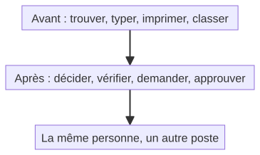

# 27. Ce qui change au bureau

Six mois après l'installation, Doreen Pratt a fait quelque chose qu'elle n'avait jamais fait en trente-et-ans : elle a pris des congés au milieu du mois.

Pas parce que le système le permettait—bien qu'il le permettait—mais parce que rien ne s'est cassé. Les factures sont parties. Les relevés sont partis. La réconciliation de fin de mois attendait, patiemment, de la façon dont le logiciel attend, et quand elle est revenue, cela lui a pris un après-midi au lieu d'une semaine.

Elle en a parlé à Maggie le premier matin de son retour, debout dans l'encadrement de la porte de la salle des factures, puis elle a dit quelque chose que Maggie a noté.

« La chose étrange, c'est que je suis plus occupée que avant. Mais c'est une occupation différente. Je ne cherche plus rien. Je regarde *les choses »

Ce chapitre porte sur cette différence, car c'est la part de l'automatisation que personne n'annonce et que tout le monde expérimente. Les brochures promettent que la machine fera le travail. La vérité est plus intéressante : la machine fait l'*administration* du travail, et la personne se retrouve avec le travail lui-même—ce qui s'avêtre la part qui avait toujours besoin d'une personne.

---

Soyons précis sur ce qui a changé à Riverton, car l'imprécision est l'ennemi d'un argument utile.

**Ce qui a cessé.** Quelqu'un tapait autrefois la commande du client dans le programme de comptabilité. Cela a cessé. Quelqu'un imprimait autrefois les factures une par une, vérifiait chacune contre le bon de livraison, et les mettait dans des enveloppes. Cela a cessé, en grande partie. Quelqu'un compilait autrement le rapport de ventes mensuel en exportant trois tableurs et en les réconciliant à la main. Cela a cessé. Quelqu'un marchait vers l'entrepôt pour demander à Tom si un produit était en stock. Cela a cessé, car la réponse était une question qu'on pouvait poser en une phrase et obtenir en une seconde.

**Ce qui a commencé.** Doreen a commencé à vérifier les prix contre le grand livre des achats tous les vendredis, car elle avait du temps et car elle avait toujours soupçonné que le fournisseur s'infiltrait. Priya a commencé à envoyer une courte liste de clients qui avaient cessé de commander, avec une raison suggérée pour chacun, à l'équipe de vente tous les lundis. Tom a commencé à examiner les ajustements de stock hebdomadairement au lieu d'annuellement, ce qui est ainsi que l'entreprise a découvert qu'un produit avait été saisi dans la mauvaise unité de mesure depuis 2022 et que la « perte » que tous avaient imputée au service de nuit était une erreur d'arithmétique.

Aucun de ces éléments n'est spectaculaire. Ensemble, ils sont la différence entre une entreprise qui réagit et une entreprise qui remarque.

**Ce qui n'a pas changé du tout.** La relation avec l'Académie d'Ashfield, qui a dix-neuf ans et qui repose sur le fait que Carol fait confiance à Maggie pour répondre du téléphone. Le jugement sur quel client accorder du crédit. La décision de cesser de stocker une gamme de produits. La conversation avec un fournisseur qui a augmenté les prix pour la troisième fois. L'excuse quand quelque chose se passe mal.

Voilà la forme honnête du changement, et il vaut la peine de l'énoncer comme une règle, car la règle tient dans chaque entreprise où elle a été essayée : **l'automatisation retire l'administration d'un travail et laisse le travail.**

---

Il existe un parallèle historique plus réconquant que toute statistique.

En 1979, deux hommes à Harvard—Dan Bricklin et Bob Frankston—ont publié un programme appelé VisiCalc. C'était le premier tableur : une grille sur un écran d'ordinateur où un changement dans une cellule recalculait tout ce qui en dépendait. Avant VisiCalc, un modèle financier était une feuille de papier, un crayon et une calculatrice, et changer une hypothèse signifiait recalculer à la main, ce qui signifiait que la plupart des modèles étaient calculés une fois puis défendus.

VisiCalc, et les tableurs qui ont suivi, ont fait à l'arithmétique du comptable ce que la machine à laver a fait pour le linge. Et la prédiction à l'époque était que les comptables disparaîtraient.

Ils n'ont pas disparu. Il y en a, si quelque chose, davantage. Ce qui a disparu fut le travail de la personne qui additionnait des colonnes de chiffres avec un crayon, et ce qui apparut fut le travail de la personne qui décide quels chiffres additionner, vérifie si le modèle a du sens, et explique au conseil pourquoi les nombres sont ce qu'ils sont. L'outil n'a pas remplacé le jugement. Il a changé le *prix* du jugement, en retirant l'arithmétique qui se tenait devant lui.

La même chose arrive maintenant, et elle arrive plus vite, et elle arrive à une couche différente du travail. Le tableur a retiré l'arithmétique. L'agent retire la *récupération*—la part du travail qui consiste à découvrir ce qui est vrai.

Demandez à Doreen ce qu'elle faisait en 2019 et elle aurait dit : je garde les papiers. Demandez-lui ce qu'elle fait maintenant et elle dit : je vérifie les choses. La seconde réponse vaut plus pour l'entreprise, et c'est aussi la réponse de quelqu'un qui fait un travail plutôt que de servir un système.

---

Tout ceci ne se produit pas tout seul, et c'est là que la plupart des entreprises se trompent.

Le mode de défaillance est bien connu de quiconque a observé un bureau adopter un nouvel outil. L'outil est installé. Un formateur vient pour une journée. Les gens enthousiastes l'utilisent ; les autres gardent leur tableur, car le tableur est plus rapide *aujourd'hui*, et l'outil n'est plus rapide *une fois que vous avez mis vos données dedans*. Six mois plus tard, l'entreprise a deux systèmes, dont l'un est la vérité et dont l'est l'habitude, et l'argument sur lequel est lequel consomme plus de temps que l'un ou l'autre n'en a économisé.

Il y a trois choses qui empêchent ceci, et ce ne sont pas des choses techniques.

**La première est que le travail doit arriver par la nouvelle porte.** Si une commande peut encore être prise par téléphone et écrite sur un bloc-notes, elle le sera. Si la facture peut encore être produite dans l'ancien programme, elle le sera. Le nouveau système devient la vérité le jour où il devient la *seule* voie, et pas un jour avant. C'est pourquoi l'installation dans ce livre se termine par la suppression des raccourcis anciens, et non par une session de formation.

**La seconde est que quelqu'un doit être autorisé à être curieux.** Le nouveau travail de Doreen—vérifier, remarquer, demander pourquoi—n'existe que si l'entreprise le traite comme un travail. Dans trop d'entreprises, le moment où l'administration est automatisée, la personne reçoit plus d'administration, car l'administration est mesurable et le remarque ne l'est pas. Les entreprises qui obtiennent le bénéfice sont celles qui écrivent « remarquer » dans la semaine de quelqu'un.

**La troisième est que la machine doit recevoir un nom et une limite.** Pas une personnalité—un nom au sens d'une responsabilité. Quelqu'un doit être responsable de ce que l'assistant fait, doit lire son journal, doit être autorisé à l'éteindre. Un assistant que personne ne possède est un assistant que personne ne vérifie, et un assistant que personne ne vérifie est un bruit de clavier.

## La nouvelle description de travail

Il vaut la peine de noter ce que le travail de Doreen est devenu, car les descriptions de travail sont là où ce genre de changement est soit rendu réel soit discrètement abandonné.

Avant, dans le langage du bureau : garder les livres, élever les factures, courir après l'argent, classer les papiers, répondre du téléphone quand il s'agit d'argent.

Après, dans le même langage : **garder le modèle vrai, décider ce qui est une exception, et répondre aux questions que les nombres soulèvent.**

Trois devoirs, et chacun d'eux est nouveau d'une manière spécifique.

**Garder le modèle vrai** signifie les petites disciplines qui rendent le système digne de confiance : un produit avec la bonne unité de mesure, un client avec les bonnes conditions de paiement, une livraison validée le jour où elle s'est produite, un ajustement de stock avec une raison. Dans l'ancien monde, ceux-ci étaient aussi son travail, mais ils étaient invisibles—personne ne pouvait voir le coût de l'obtenir mal jusqu'à la fin d'année. Maintenant, ils sont la différence entre une réponse et un pari, et ils ont une conséquence quotidienne visible, ce qui les rend plus faciles à défendre et plus difficiles à sauter.

**Décider ce qui est une exception** signifie lire les listes. Les factures en retard, le stock sous le minimum, les produits sans prix, la livraison sans facture. Le système produit la liste ; la personne décide quels articles sont du bruit et quels sont un problème. C'est une véritable compétence, et c'est celle qui s'améliore avec la pratique—après trois mois, Doreen pouvait regarder une liste de douze factures en retard et vous dire lesquelles quatre étaient réelles.

**Répondre aux questions que les nombres soulèvent** est la part que personne n'a prévue. Un système qui peut répondre à des questions produit *davantage de questions* : pourquoi le fret est-il à la hausse, pourquoi ce client est devenu muet, pourquoi la marge de ce produit est différente de celle du mois dernier. Quelqu'un doit courir après celles-ci, et la personne qui court après elles est celle qui a maintenant le temps.

## Ce qui n'a pas changé, et pourquoi cela importe

Trois choses n'ont pas changé du tout, et il vaut la peine de le dire car la littérature sur l'automatisation est surtout change.

**Le téléphone est encore répondu par une personne.** Carol à Ashfield appelle car elle veut parler à Maggie, et non car elle veut une transaction. La relation est l'affaire, et aucun système n'a jamais amélioré.

**Le jugement sur les gens est encore fait par des gens.** À qui accorder du crédit, à qui courir après fort, à qui laisser partir. Le système fournit les faits—historique de paiement, modèle de commande, montants en retard—et les faits rendent le jugement mieux informé, mais ils ne le font pas.

**L'excuse est encore à une personne.** Quand quelque chose se passe mal, un client veut entendre un être humain dire pardon. Une excuse automatisée est pire qu'aucune, car elle confirme que personne n'était attentif.

Ces trois-là sont le cœur de l'affaire, et c'est la raison pour laquelle ce livre continue d'insister sur le fait que la machine prend la *patience* et que la personne garde le *jugement*. Une entreprise qui automatise le téléphone, la décision de crédit ou l'excuse a automatisé la mauvaise chose, et elle le découvrira de la façon dont les entreprises découvissent toujours : lentement, puis soudainement.

## L'heure dans le calendrier

Le changement le plus important à Riverton n'était pas une fonctionnalité du logiciel. C'était une heure dans le calendrier de Doreen, tous les vendredis, intitulée *systèmes et exceptions*, ce que personne n'était autorisé à réserver par-dessus.

Cette heure est là où le remarque se produit : la vérification de prix, la lecture du journal, la liste des choses qui semblent étranges. Sans elle, le temps économisé par l'automatisation aurait été rempli de plus d'administration—ce qui arrive dans la plupart des entreprises, et pourquoi la plupart des entreprises rapportent que l'automatisation « n'a pas vraiment économisé quoi que ce soit ».

Une heure par semaine fait cinquante heures par an, ce qui est une fraction de ce que le système économise. C'est aussi la différence entre un système qui s'améliore et un qui se dégrade. La ligne de Sam—*le logiciel ne se dégrade pas, les habitudes le sont*—est tout l'argument, et l'heure dans le calendrier est comment une habitude est protégée.

---

On a demandé à Maggie, lors d'un dîner de chambre de commerce au printemps, si elle avait « remplacé du personnel par de l'intelligence artificielle ».

Elle avait pensé à la question à l'avance, car elle savait qu'elle venait, et elle avait décidé de y répondre honnêtement plutôt que diplomatiquement.

« Non », a-t-elle dit. « Nous avons remplacé un système de classement. Le personnel est toujours là, et il fait le travail que le système de classement l'empêchait de faire. »

La femme qui avait demandé regardait avec scepticisme. « Mais vous devez avoir besoin de moins de gens. »

« Nous avons besoin du même nombre de gens et de davantage de leur attention », a dit Maggie. « Ce qui, si vous gérez une entreprise, revient au même que d'avoir besoin de plus de gens. »

Voilà la vérité à ce sujet, et il vaut la peine de le mettre en termes aussi clairs que possible, car la conversation publique sur l'intelligence artificielle est dominée par deux histoires qui sont toutes deux fausses : que la machine fera tout, et que la machine prendra tout. Ce qui se produit réellement, dans une petite entreprise bien gérée, est que la machine prend la part du travail que personne ne voulait, et que les gens découvrent qu'ils ont fait cette part si longtemps qu'ils ont oublié ce que le reste du travail était.

Doreen, le premier matin de son retour de ce congé, avait trouvé une facture de fournisseur avec un prix qui était monté de quatre pour cent sans avis. Elle l'avait devant elle en une minute après s'être assise, car l'assistant l'avait signalé pendant qu'elle était partie. En 2019, cela aurait été classé, payé, et découvert à la fin d'année, si découvert à tout.

Elle n'a pas dit « la machine a trouvé ceci ». Elle a dit : « Regardez ceci. Quatre pour cent, en mars, et personne ne nous a informés. »

C'est la phrase que ce livre a travaillé à atteindre. La machine a fait le finding. La personne a fait le remarque. L'entreprise a obtenu le bénéfice.
