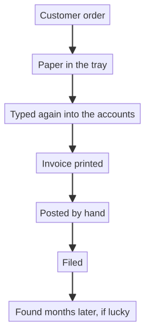

# 1. La stanza dove vive la fattura

La stanza non aveva nome sulla porta. Chi lavorava a Riverton Office Supply la chiamava la stanza delle fatture, sebbene le fatture fossero solo una frazione di ciò che conteneva: ordini di acquisto, note di consegna, quietanze, note di credito, i fogli rosa sottili che i fornitori mandavano quando volevano essere pagati prima, e quelli crema più spessi che i clienti mandavano quando volevano pagare dopo.

Maggie Ellery aveva ereditato la stanza, insieme alla compagnia, da suo padre. Guidava Riverton da undici anni e continuava ancora a iniziare ogni lunedì in quella stanza, in piedi nel vano della porta con una tazza di caffè che si raffreddava in mano, a guardare i tre armadi grigi come se fossero animali di cui era responsabile nel dar da mangiare.

Gli armadi si chiamavano, nel linguaggio dell'ufficio, gli Anni Vecchi, gli Anni di Mezzo e l'Anno Corrente. Gli Anni Vecchi avevano una serratura per cui nessuno aveva la chiave. Gli Anni di Mezzo avevano un cassetto che si apriva solo quando lo sollevavi leggermente, nel modo in cui si solleva una valigia la cui chiusura ha fatto capitolare. L'Anno Corrente era quello che contava, ed era anche quello che non poteva chiudersi, perché i fascicoli al suo interno erano ingrossati di carta arrivata più in fretta di quanto chiunque la archivasse.

Doreen Pratt archivava quegli armadi da trentuno anni. Aveva sessantatre anni, portava un cardigan in ogni stagione, e possedeva quel tipo di memoria che fa sentire una compagnia più al sicuro di quanto non sia. Se avessi chiesto a Doreen la nota di consegna della spedizione di marzo verso il distretto scolastico di Ashfield, non avrebbe guardato gli armadi. Avrebbe guardato il soffitto, avrebbe mosso leggermente le labbra, e avrebbe detto: "Fu la settimana in cui il furgone di Trevor ebbe l'alternatore. Terzo fascicolo dalla parte posteriore, secondo cassetto, dietro le quietanze rosa." Aveva ragione abbastanza spesso che nessuno aveva mai pensato di annotare come facesse.

Questa è la prima cosa da capire di una compagnia come Riverton, ed è la cosa che quasi nessuno scrive nei libri sulla gestione. La compagnia non funzionava grazie al suo software. Funzionava grazie a Doreen.

---

Alle otto e venti di quel lunedì, il telefono sulla scrivania di Maggie suonò con la particolare vivacità di un cliente che sta per essere deluso.

Era l'Accademia di Ashfield, il distretto scolastico che acquistava da Riverton da diciannove anni: penne a migliaia, quaderni a pallet, i buoni pennelli per lavagna che si cancellano davvero. Il suo responsabile commerciale era una donna paziente di nome Carol che, quella mattina, aveva ricevuto una consegna di quattrocento raccoglitori con cartoni e nessuna fattura.

"Margaret," disse Carol, e Maggie comprese dall'uso del suo nome completo che era seria, "non possiamo pagare una fattura che non abbiamo ricevuto, e non possiamo chiudere il nostro trimestre senza di essa. E il tuo conducente ha lasciato i raccoglitori nel parcheggio, non al caricatore."

Maggie disse le cose che si dicono. L'avrebbe esaminato personalmente. Si scusava. Avrebbe ricontattato nell'ora.

Rimise giù il telefono e fece ciò che aveva fatto diecimille volte: camminò verso la stanza delle fatture e chiese a Doreen dove fosse la documentazione.

Doreen guardò il soffitto. Mosse le labbra. Poi disse: "I raccoglitori sono usciti giovedì. La fattura sarebbe dovuta uscire con la nota. A meno che"—e qui si interruppe, perché era arrivata al limite della sua memoria e sentiva il vuoto oltre—"a meno che non sia finita nel vassoio e Trevor l'abbia presa con i resi."

Nella stanza delle fatture c'erano quattro vasi. Erano etichettati *In*, *Out*, *Later* e, con una mano che apparteneva a nessuno che lavorasse ancora a Riverton, *Trevor*. Non c'era più un Trevor. Non c'era un Trevor da sei anni. Il vassoio restava, e la carta ci entrava ancora, perché un vassoio con un nome sopra è una sorta di istruzione.

Maggie trovò la fattura nel vassoio di Trevor, sotto un catalogo di semi e un promemoria sugli estintori. Era stata stampata giovedì, firmata giovedì, e mai spedita. Era, nel senso stretto, un documento completo e corretto. Semplicemente non era riuscita a viaggiare.

La portò a Ashfield da sola, perché il conducente era già tornato a casa e perché voleva che i venti minuti in auto servissero a infuriarsi in privato. Sulla strada del ritorno si fermò al rotatorio presso il parco commerciale e restò lì più a lungo di quanto il traffico richiedesse, a guardare i tergicristalli svolgere il loro lavoro, e pensò: *non siamo bravi male in questo. Non siamo pigri. Non siamo stupidi. Allora perché sembra che la compagnia sia tenuta insieme da uno spago?*

---

Ecco un fatto che sorprese Maggie quando lo lesse quella sera, e che probabilmente sorprenderà anche te.

Nel giugno del 1975, una rivista di nome *Business Week* pubblicò un lungo articolo intitolato "L'ufficio del futuro." Descriveva, con grande sicurezza, un mondo in cui la documentazione routinaria delle imprese—la tenuta dei registri, la contabilità, l'archiviazione—sarebbe stata gestita dalle macchine, e la carta sarebbe diventata una curiosità, nel modo in cui il cavallo divenne una curiosità dopo l'automobile. La previsione fu ripetuta così spesso nei decenni successivi da acquisire un nome suo stesso: l'ufficio senza carta.

Tra il 1980 e il 2000, l'uso mondiale di carta d'ufficio più che raddoppiò.

Non è una piccola ironia; è una grande, ed ha una causa che conta per tutto il resto di questo libro. La carta non sopravvisse perché gli uffici erano arretrati. La carta sopravvisse perché era estremamente brava in un solo lavoro: era l'unica cosa nell'edificio che tutti potevano leggere. Il contabile poteva leggere un ordine di acquisto. Il magazzino poteva leggere una nota di consegna. Il commerciale poteva leggere una lista dei prezzi. L'ispettore fiscale poteva leggere tutte e tre. Un computer nel 1985 non poteva parlare con un computer nella stanza accanto, tanto meno con il dipartimento conti del distretto scolastico, quindi il computer stampava la carta e la carta parlava.

Non fallimmo nel diventare senza carta. Automatizzammo la *produzione* della carta. Rendemmo più economico stampare un documento che camminare verso un adibito, e poi stampammo tutto, e poi comprammo più adibiti.

---

Il lunedì di Riverton non era insolito, ed è esattamente per questo che vale la pena raccontarlo. La stessa scena si ripete in mille variazioni in ogni paese: un fornitore di idraulica, un stampatore di etichette, una impresa familiare che installa cucine commerciali. I dettagli cambiano; la forma no.

Un cliente fa una domanda che richiede tre fatti da tre posti. Qualcuno promette una risposta. La risposta richiede un quarto fatto che vive nella testa di una persona che è in vacanza. Quando il quarto fatto viene trovato, il cliente ha richiamato, e la promessa è diventata un piccolo pezzo di danno. Il danno viene riparato con una scusa e uno sconto, e lo sconto viene registrato ovunque, perché gli sconti dati per riparare un danno non sono il tipo di cosa che qualcuno vuole annotare.

Moltiplica questo per cinquantadue settimane e per ogni dipartimento, e arriverai al vero costo del modo in cui lavorano la maggior parte delle piccole imprese. Non furto. Non spreco, nel senso che un revisore intende. Una tassa sul ricordare: il continuo, invisibile pedaggio del mantenere fatti nelle teste umane e nei vasi di carta, e del spostare quei fatti da una testa all'altra per telefono.

C'è un diagramma che rende questo visibile, ed vale la pena guardarlo per un momento, perché è la mappa del problema di cui tratta questo libro.

Sei passi, e ad ogni freccia un fatto viene copiato da una persona da un mezzo a un altro. Ogni copia è una possibilità di introdurre un errore, e ogni errore costa più da trovare di quanto costi produrlo. La fattura che non viaggiò non era un'anomalia. Era il comportamento normale di un sistema la cui memoria è distribuita tra vasi, teste e cassetti, senza un unico luogo dove la verità viene tenuta.

Vale la pena dare un numero a questo, perché il numero è ciò che cambia il pensiero delle persone.

La fattura di Ashfield prese a Maggie quaranta minuti: venti al telefono, venti in auto. Aggiungi i dieci minuti di ricerca di Doreen, e i cinque del conducente, e i quindici del contabile la settimana successiva quando il pagamento non arrivò e dovette essere rincorso. Un'ora e mezza del tempo di quattro persone, per consegnare un pezzo di carta che era già stato prodotto correttamente. La fattura valeva ottocentoquaranta sterline. La compagnia aveva speso forse sessanta sterline di salari per consegnarla, e nessuno avrebbe mai visto quelle sessanta sterline in alcun report, perché non è una spesa. È semplicemente una giornata leggermente più corta di quanto dovrebbe essere.

Moltiplica sessanta sterline per il numero di documenti che produce un grossista in un anno—ordini, note, fatture, crediti, estrconti, quietanze—e la tassa invisibile diventa il singolo costo più grande dell'impresa, più grande dell'affitto, più grande dei furgoni, più grande dei salari di cui si paga. È invisibile perché non è una riga nei conti. È l'assenza di una riga.

---

Il padre di Maggie aveva una frase per l'impresa. Usava dire, in piedi nel magazzino con le mani dietro la schiena, "Vendiamo cancelleria, Margaret. Non vendiamo confusione." Lo intendeva come un vanto sulla qualità del servizio, ed era vero: il servizio di Riverton era buono. Era buono nel modo in cui è buono un ristorante con uno chef brillante e senza libro delle prenotazioni. Funzionava mentre lo chef era in cucina.

Ciò che Maggie iniziò a sospettare, quel lunedì sera, con il caffè freddo e la fattura consegnata in sicurezza, era che la compagnia avesse raggiunto il limite di ciò che le persone brave possono tenere nelle loro teste. Riverton era cresciuta da quattrocento linee di prodotto a undicimila. Era passata da un furgone a sei. Aveva clienti che ordinavano tramite uno shop web che nessuno si fidava davvero, e fornitori in tre paesi che mandavano fatture in due valute. La memoria di Doreen, straordinaria com'era, era diventata un punto singolo di fallimento con un cardigan.

Non voleva comprare software. Aveva comprato software. C'era un programma di contabilità che produceva report bellissimi che nessuno leggeva, e un sistema di magazzino installato da un uomo che da allora era emigrato, e una cartella condivisa sulla rete d'ufficio contenente diciassette versioni della lista dei prezzi, delle quali quattordici erano sbagliate.

Ciò che voleva, sebbene non avesse ancora le parole per esprimerlo, era una impresa che si ricordasse. Un unico luogo dove un cliente, un prodotto, un ordine, una fattura e un pagamento fossero lo stesso fatto visto da lati diversi. Un unico luogo che potesse rispondere alla domanda "che cosa è vero in questo momento?" senza una telefonata.

Il resto di questo libro tratta di come una compagnia ottiene quel luogo, e di ciò che accade quando si permette a un'intelligenza artificiale di lavorare al suo interno.

---

Una nota su ciò che stai per leggere.

Questo non è un libro per programmatori. Non c'è codice al suo interno, nessun comando da digitare in una finestra nera, nessuna query al database. Se sai usare un browser web e rispondere a una email, hai ogni abilità che questo libro richiede. Le parti tecniche sono descritte nel modo in cui le descriveresti a un collega a pranzo: che cosa fa la cosa, perché la fa in quel modo, e cosa ti aspettassi di vedere sullo schermo.

Né è un libro di teoria. Ogni scena che segue—ogni schermo di installazione, ogni conversazione con l'assistente, ogni fattura che crea, ogni rifiuto che riceve dal sistema—fu eseguita su un vero computer, in una vera installazione, e fotografata mentre accadeva. Quando qualcosa andava sbagliato, e le cose andavano sbagliate, il fallimento è anche nel libro, perché una guida che mostra solo il percorso riuscito non è una guida; è un annuncio pubblicitario.

La compagnia in queste pagine si chiama Riverton Office Supply. È una vera installazione con un nome fittizio, allestita per la scrittura di questo libro: un grossista di cancelleria con clienti, prodotti, un magazzino, un conto bancario e un ufficio fiscale da soddisfare. Puoi seguire gli stessi passi con il nome della tua compagnia, e alla fine avrai la stessa cosa che Maggie voleva in quel lunedì sera—una impresa che sa ciò che è vero, e un'assistente che può agire su di esso.

Maggie, per quanto la riguarda, non conosceva ancora nulla di tutto ciò. Conosceva solo che aveva guidato quaranta minuti per consegnare un pezzo di carta che una macchina avrebbe dovuto spedire, e che la sensazione nel suo petto non era più rabbia. Era l'inizio di una decisione.

Tornò in ufficio, accese la luce nella stanza delle fatture, e guardò i tre adibiti per un lungo momento.

"Bene," disse, a nessuno in particolare. "Scopriamo come si suppone che questo funzioni."
