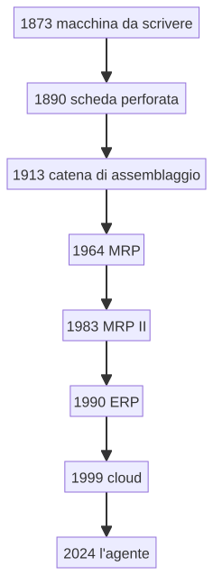

# 2. Breve storia del fare le cose due volte

L'archivio a cassettieri è stato inventato perché un uomo si è stancato di cercare una lettera.

Non è una battuta, e non è una semplificazione eccessiva. Prima del file verticale, gli uffici
conservavano i propri documenti nei gabbieri, in fasci legati con nastro, in etichette di scatola
con il nome di un cliente e l'anno. Per trovare qualcosa che si doveva ricordare dove era stato
messo, il che significava che l'ufficio, come Riverton, funzionava sulle memorie dei propri
impiegati. L'archivio a cassettieri verticale, che apparve negli ultimi anni del XIX secolo e si
diffuse negli uffici con velocità sorprendente, cambiò i termini del problema: rendeva un documento
ricercabile per *categoria* anziché per *ricordo*. Un impiegato che non aveva mai conosciuto il
cliente poteva aprire il cassettiero segnato A–B e trovare il fascicolo.

Era, al suo tempo, un'intelligenza artificiale. Conservava informazioni fuori della testa umana,
rispondevalle domande a richiesta, e non si assentai mai. Noi dimentichiamo questo perché la
tecnologia è fatta d'acciaio e sa di polvere, ma l'ambizione era esattamente l'ambizione della
macchina che sarà discussa in questo libro: togliere i fatti dalla persona, metterli in un luogo
dove si possano trovare, e lasciare alla persona il lavoro che richiede una persona.

Maggie passò la settimana dopo la fattura di Ashfield a leggere di questo, nel modo in cui le
persone che gestiscono piccole aziende leggono di cose—di notte, con un laptop sul tavolo della
cucina e un quaderno accanto, seguendo un riferimento all'altro finché il marito le chiese se
stava venendo a letto.

Quello che trovò non era una storia di progresso costante. Era una storia della stessa idea che
veniva scoperta di nuovo e di nuovo, da persone diverse, in materiali diversi.

---

**1873.** La macchina da scrivere arriva in ufficio. Non è una macchina da calcolo e non
conserva nulla, ma fa qualcosa che si rivela più importante: rende la scrittura uniforme. Un
ordine manoscritto è un documento con una personalità; un ordine digitato è un documento con un
formato. I formati si possono confrontare, contare e archiviare. In una generazione, la digitatrice
è diventata la custode dell'ufficio, e l'ufficio è diventato un luogo dove l'informazione è
*prodotta* su programma anziché quando qualcuno ha il tempo di farla.

**1890.** Il censimento degli Stati Uniti è contato con schede perforate e una macchina
tabulatrice elettromeccanica, costruita da Herman Hollerith. Il censimento del 1880 aveva
richiesto otto anni per essere elaborato. Il censimento del 1890, con una popolazione più grande e
più domande, ne richiese circa uno. La macchina che lo fece divenne, attraverso una fusione nel
1911 e un cambio di nome nel 1924, la compagnia che conosciamo come IBM. Le schede perforate
sarebano rimaste il modo standard di parlare a un computer per i successivi settant'anni, e la
ragione è istruttiva: una scheda è un registro che puoi tenere, ordinare, far cadere, e
rieseguire. È carta che una macchina può leggere.

**1913.** La linea di montaggio mobile di Henry Ford a Highland Park trasforma la fabbricazione
di una automobile in una sequenza di fasi cronometrate. La lezione che il mondo delle imprese trae
da essa non è davvero sulle automobili. È che un processo può essere *progettato*—scritto,
misurato, e poi migliorato—invece di essere lasciato alle abitudini delle persone che lo eseguono.
Frederick Winslow Taylor stava sostenendo la stessa cosa dagli anni '80 con il suo cronometro e la
sua "gestione scientifica", e la combinazione del cronometro di Taylor e della linea di Ford
produsse una convinzione che avrebbe dominato il secolo: se puoi descrivere un'impresa come una
sequenza di fasi, puoi meccanizzare le fasi.

**1951.** Un computer è usato per calcolare lo stipendio di una compagnia. La macchina è
enorme, il programma è scritto in istruzioni di macchina, e il calcolo richiede meno tempo della
preparazione delle schede perforate che legge. Ma il principio è stabilito: l'aritmetica noiosa,
ripetitiva, soggetta a errori dell'ufficio è esattamente ciò di cui un computer è bravo.

**1964.** Un uomo chiamato Joseph Orlicky, lavorando con l'industria manifatturiera, sviluppa un
modo di calcolare cosa una fabbrica deve comprare e quando, in base a ciò che intende costruire.
Si chiama Material Requirements Planning, e nello stesso anno una compagnia chiamata Black & Decker
installa il primo sistema che la usa, con un capo progetto chiamato Dick Alban. Orlicky pubblica
il libro nel 1975—*Material Requirements Planning: The New Way of Life in Production and Inventory
Management*—e per allora circa settecento compagnie gestivano qualche versione dell'idea. Nel
1981 ce ne erano circa otto mila.

**1983.** Oliver Wight estende l'idea dai materiali a tutta la fabbrica: programmi, capacità,
previsioni di vendita, finanza. Il risultato si chiama Manufacturing Resource Planning, o MRP II,
ed è il primo software d'impresa che pretende di conoscere lo stato di un'intera compagnia.

**1990.** Una compagnia di analisi chiamata Gartner ha bisogno di un nome per la cosa successiva—
software che non solo progetta la fabbrica ma gestisce l'intera impresa: vendite, acquisti,
scorte, conti, persone. Lo chiamano Enterprise Resource Planning. ERP. Il nome è un incidente di
marketing che è rimasto, ed è stato allungato da allora per coprire quasi qualsiasi cosa una
compagnia fa con un database.

**1992.** SAP, una compagnia tedesca fondata nel 1972 da cinque ingegneri che avevano lasciato la
IBM, rilascia R/3, un sistema che gira sull'architettura client-server che stava diventando
accessibile. Diventa lo standard contro cui ogni ERP successivo è misurato, e la ragione non è la
eleganza. È che R/3 codifica i processi di una compagnia in un modo che revisori, banche e autorità
di regolamentazione riconoscono.

**1999.** Una compagnia chiamata NetLedger inizia a vendere software contabile che gira in un
browser, sul computer di qualcun altro, per una fee mensile. Comincia l'era del cloud nel software
d'impresa. Ci vorranno altri quindici anni perché l'idea diventi normale, e altri cinque perché
diventi il valore predefinito.

**2013.** Gartner conia "ERP postmoderno": invece di un unico sistema enorme, una compagnia
goverà un insieme di sistemi più piccoli che parlano tra loro. La previsione è giusta nello spirito
e sbagliata nei dettagli—quello che realmente è successo è che i sistemi piccoli si sono
moltiplicati, e il parlare è diventato la parte difficile.

Maggie copiò le date nel suo quaderno, tracciò una linea sotto di esse, e scrisse una frase che
avrebbe fatto ridere il padre: *Ognuna di queste era un tentativo di smettere di fare le cose due
volte.*

## Il modello che si ripete

Guardate di nuovo le date e appare un ritmo: circa ogni venti anni, una nuova tecnologia promette
di eliminare la copia, e ogni volta la promessa è mantenuta in parte e rotta in parte.

La macchina da scrivere eliminò la copia manoscritta e creò il pool di digitazione. La fotocopiatrice
eliminò la carta carbone e creò la crisi dell'archiviazione. Il computer personale eliminò il libro
mastro e creò la diffusione del foglio di calcolo. Ognuna rimuoveva un costo specifico e aggiungeva
un costo generale: il costo di *sapire quale copia è vera.*

L'ERP fu la prima tecnologia della serie che attaccò il costo generale direttamente, insistendo che
ci fosse una sola copia. Richiese trenta anni, e funzionò—dentro le quattro pareti di una
compagnia. Ciò che non risolse mai fu il confine: il sistema del cliente, il sistema del
fornitore, il sistema dell'ufficio tasse, ognuno con la propria copia degli stessi fatti.

L'agente è la prima tecnologia della serie che può lavorare attraverso quel confine, perché può
leggere ciò che un uomo ha scritto e scrivere ciò che un sistema comprende. Se mantiene la
promessa è l'argomento del resto di questo libro.

---

C'era una fotografia sul muro dell'ufficio che aveva guardato mille volte senza vederla.
Mostrava quattro donne a quattro scrivanie nel 1978, nella stanza che era ora la stanza delle
fatture, ognuna con una macchina da scrivere e un mucchio di carta sottile. La madre era la seconda
da sinistra.

"Carta carbone," disse Doreen, quando Maggie le chiese. "Digitavi la fattura e la copia veniva
fuori sotto, sul foglio rosa sottile. Tre copie se eri fortunata e il tuo nastro era nuovo. Poi le
separavi e mandavi una copia al cliente, una al fascicolo, e una al libro dei conti."

"E se facevi un errore?"

"Lo digitavate di nuovo. Tutto. E poi avevi due copie dell'errore, una delle quali era nel
fascicolo, quindi dovevi andare a trovarla."

Riverton aveva comprato una fotocopiatrice nel 1983, e per un po' la compagnia credette di aver
risolto il problema delle copie. Aveva risolto il problema del *fare* copie. Ciò che non aveva
risolto—ciò che nessuno aveva risolto—era il problema di sapere quale copia fosse quella vera. Nel
1991 c'erano fotocopie di fatture in tre luoghi dell'edificio, e la persona che sa quale fosse
quella che il cliente aveva realmente ricevuto era Doreen, che c'era dal 1987.

Questo è il modello che si ripete per tutta la storia dell'ufficio, ed è utile nominarlo prima di
andare oltre. Ogni tecnologia che rende più facile produrre un documento rende anche più facile
produrre *un altro* documento, e il costo del secondo scende più velocemente del costo del decidere
quale conti. La fotocopiatrice ha moltiplicato la carta. La posta elettronica ha moltiplicato di
nuovo i documenti. La cartella condivisa ha moltiplicato le versioni. Ogni invenzione mantenne la
sua promessa—più economico, più veloce, più—e ognuna lasciò lo stesso conto da pagare: il lavoro
di decidere ciò che è vero.

Un ERP è la prima tecnologia di quella serie la cui promessa non è "più documenti" ma "un unico
fatto." È per questo che si sente diverso nelle mani, e per cui installarlo è più simile a un
accordo legale che a comprare una macchina.

C'è un piccolo test che ti dice se una compagnia ha fatto il cambiamento, ed è gratis applicarlo.
Chiedi a due persone, in dipartimenti diversi, la stessa domanda sullo stesso cliente: quanto ci
devono? Se le risposte differiscono, la compagnia ha ancora delle copie. Se le risposte
concordano, e entrambe le persone possono dirti da quali documenti la risposta è costruita, la
compagnia ha un modello. Qualunque altra cosa—il software, i server, l'intelligenza artificiale—è
impalcatura attorno a quell'unico risultato.

---

Perché questo è il filo. Dall'archivio a cassettieri al cloud, ogni invenzione nella storia
dell'ufficio è stata mirata allo stesso spreco: la seconda volta che un fatto viene scritto.

Il cliente dà il proprio indirizzo. È scritto sull'ordine. È scritto di nuovo sulla nota di
spedizione, di nuovo sulla fattura, di nuovo nei conti, di nuovo sull'etichetta, e di nuovo dal
dipartimento dei conti del cliente quando la fattura arriva. Cinque copie di un fatto che è stato
detto una volta sola. Ogni copia è una possibilità di sbagliare il codice postale, e il codice
postale è come il pacco trova la scuola.

Un ERP è, nel cuore, una promessa: che l'indirizzo sarà scritto una volta sola, in un luogo solo,
e che ogni documento che lo necessita *lo cercherà* invece di ricevere una copia fresca. Quella
promessa suona modesta. Non lo è. Per mantenerla, il sistema deve sapere ciò che è un cliente, ciò
che è un ordine, ciò che è un prodotto, e come si relazionano; deve decidere chi è autorizzato a
cambiare l'indirizzo e chi non lo è; deve ricordare ciò che l'indirizzo era il mese scorso, perché
la fattura che è stata spedita a marzo deve ancora mostrare l'indirizzo a cui è stata spedita. La
promessa trasforma un mucchio di carta in un modello della compagnia.

E un modello, una volta esistente, può essere *agito* da qualcosa d'altro che un uomo.

---

C'era una cosa in più nel quaderno di Maggie, scritta nell'ultima pagina di quella settimana, in
una scrittura che si inclinava più del solito perché era tardi.

*Perché tutto questo ha funzionato?*

Aveva letto di compagnie che avevano speso milioni in sistemi ERP e erano finite peggio; le
storie non erano difficili da trovare, e l'avevano resa cauta. Un sistema che modella una compagnia
è utile solo se il modello è *vero*, e un modello è vero solo se le persone che conoscono i fatti
li mettono. Questo è il paradosso al centro di tutta l'industria: il software esiste per sollevare
le persone dall'amministrazione, e funziona solo se le persone fanno l'amministrazione del
nutrirlo.

La generazione di sistemi che venne dopo il 1990 risolse questo con la forza. Resero il software
l'unico modo di fare il lavoro: non puoi spedire il pacco senza la nota di spedizione, non puoi
stampare la fattura senza l'ordine, non puoi chiudere il mese senza la riconciliazione bancaria. Il
modello resta vero perché non c'è un'altra strada per aggirarlo. È per questo che gli ERP sembrano
prigioni alle persone che li usano, e per cui funzionano comunque.

Maggie comprese il compromesso. Ciò che non aveva ancora compreso—quasi nessuno comprese fino a
poco tempo fa—era che il compromesso stava per cambiare, perché una macchina aveva imparato a
leggere.

La macchina da leggere non è un archivio a cassettieri e non è un ERP. È la cosa che, negli ultimi
pochi anni, ha iniziato a apparire negli uffici sotto il nome vago di intelligenza artificiale: un
programma che può ricevere una frase in lingua ordinaria e può rispondere, o agire, senza che
alcuno abbia scritto una regola per quella particolare frase.

Se un tale programma potesse ricevere il modello della compagnia—i clienti, i prodotti, gli ordini,
il mastro—allora il peso del nutrire il sistema cadrebbe, non sulle persone, ma sulla macchina che
legge ciò che le persone dicono.

Questa è l'intera idea di questo libro, e ci ha messo il resto dell'anno per renderla reale.
