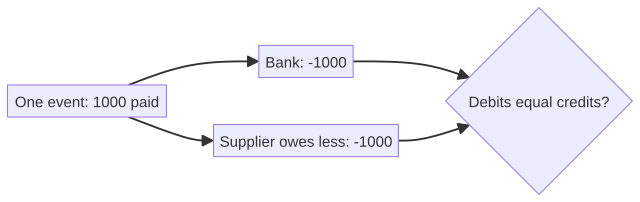

# 3. Il frate che scrisse le regole

Il ragioniere di Maggie era un uomo di nome Gerald Pryce, che aveva uno studio sopra un negozio di prodotti per la salute e l'abitudine di rispondere alle domande nell'ordine in cui lo interessavano, piuttosto che nell'ordine in cui erano state poste.

Lei andò a trovarlo un giovedì, con una cartella di stampe e una domanda di cui era leggermente imbarazzata: *perché dobbiamo per forza tenere i conti?* Non la tassa, disse—lei la tassa la capiva. La partita doppia. I addebiti e i crediti, il provvisionale, l'intera elaborata simmetria che Doreen eseguiva ogni mese al tavolo della cucina dello studio con una calcolatrice e una teiera di tè.

Gerald si tolse gli occhiali, che era un buon segno, e disse: "Perché un mercante a Venezia voleva sapere se era ricco."

---

L'uomo a cui si riferiva era Luca Pacioli, e la data che conta è il 1494.

Pacioli era un frate francescano, un matematico e un insegnante di celebre fama al suo tempo. Lavorò a Venezia, a Firenze, a Milano e per un periodo nella casa di un duca. Era amico di Leonardo da Vinci—Leonardo disegnò le illustrazioni per uno dei suoi libri, e Pacioli gli insegnò la matematica—ed era, per indole, quel tipo di persona che crede che tutto ciò che vale la pena di essere fatto valga la pena di essere scritto correttamente.

Nel 1494, a Venezia, pubblicò un manuale di matematica intitolato *Summa de arithmetica, geometria, proportioni et proportionalità*: il sommario di aritmetica, geometria, proporzioni e proporzionalità. Era un libro enorme, scritto in italiano anziché in latino affinché i mercanti potessero leggerlo, e trattava di tutto ciò che un uomo d'affari pratico poteva necessitare: come moltiplicare, come calcolare gli interessi, come cambiare valute, come misurare una botte.

Un capitolo descriveva qualcosa che i mercanti italiani praticavano da almeno duecento anni, e che nessuno aveva mai spiegato a stampa: il metodo di tenere le scritture con la partita doppia.

L'idea è quasi insultantemente semplice, ed è la ragione per cui ogni sistema di contabilità nel mondo, compreso quello che Riverton stava per installare, ha la forma che ha.

Ogni operazione viene registrata due volte, in due luoghi diversi, da due punti di vista diversi. Se la compagnia paga un fornitore mille sterline, allora i soldi in banca sono diminuiti di mille e l'importo dovuto al fornitore è diminuito di mille. Due fatti, un evento. Se la compagnia vende una scrivania alla scuola, allora il cliente deve dei soldi e la compagnia ha guadagnato un ricavo: due fatti, un evento. Le due scritture si chiamano addebito e credito, e devono essere sempre uguali e opposte, perché descrivono la stessa cosa da entrambi i lati del tavolo.

La conseguenza è un sistema che si autoverifica. Si sommano tutti gli addebiti nei libri e tutti i crediti, e se i due totali non coincidono, c'qualche cosa che non va. Non "potrebbe esserci qualche cosa che non va"—non va. I libri te lo dicono. È l'unica parte dell'amministrazione aziendale che ha una garanzia matematica integrata in sé, ed è sopravvissuta a sei secoli di guerre, valute, imperi e software proprio a causa di quella garanzia.

Gerald lo disegnò sul retro di una busta, che è così che la contabilità viene insegnata dal 1494.

"Ora," disse Gerald, posando la penna, "ecco cosa tuo padre non ha mai capito, e cosa la maggior parte delle persone non capisce mai. La partita doppia non è una regola inventata per renderti la vita difficile. È una *descrizione della realtà*. Ci sono due lati in ogni operazione perché ci sono due parti in ogni operazione. I libri non sono un modulo fiscale. Sono un modello di ciò che è realmente accaduto."

---

Per capire perché la simmetria conta, aiuta osservare qualcuno che la usa.

Una volta al mese, Doreen prendeva l'estrazione di conto, la lista stampata di tutto ciò che era realmente uscito e entrato nell'account della compagnia, e la posava accanto alle scritture. Le due non coincidevano mai. Non coincidono mai in nessuna compagnia; la domanda è solo di quanto, e perché.

Un mese, la differenza era di trecento dodici sterline. Doreen non iniziò a cercare trecento dodici sterline. Iniziò dall'alto dell'estrazione e scese, verificando ogni riga contro le scritture, e trovò che la banca aveva addebitato una commissione di dodici sterline che Riverton non aveva registrato, e che un cliente aveva pagato una fattura di trecento sterline che le scritture mostravano ancora come non pagata.

Dodici e trecento. La differenza era la somma di due cose che erano accadute nel mondo reale e non avevano ancora avuto luogo nel modello. Dentro dieci minuti aveva scritto due scritture—una per la commissione della banca, una per la ricevuta—e le due colonne coincidevano al centesimo.

Quello è tutto l'arte, ed vale la pena notare ciò che *non* è. Non è aritmetica; una calcolatrice avrebbe potuto trovare la differenza. Non è memoria; l'estrazione è la memoria. È la disciplina di un modello che ha due lati, in modo che ogni evento reale abbia un luogo dove essere registrato due volte, e una lacuna che può essere *localizzata*. Senza il secondo lato, una differenza di trecento dodici sterline è solo un numero che non va, e tu la cerchi leggendo tutto. Con il secondo lato, il numero te dice dove guardare.

Quando un ERP registra una fattura, esegue i dieci minuti di Doreen automaticamente, nel momento in cui la fattura viene creata, e la esegue per ogni operazione della compagnia. Questo non è una comodità. È la differenza tra una compagnia che scopre i suoi errori mensilmente, in un lotto, e una compagnia che li scopre immediatamente, uno alla volta, mentre la persona che li ha causati è ancora nella stanza.

---

La storia vale un altro momento, perché spiega qualcosa sul software moderno che altrimenti sembra arbitrario.

La più antica testimonianza superstite della partita doppia completa è un libro mastro del 1299-1300, tenuto da un mercante fiorentino di nome Amatino Manucci per la compagnia Farolfi, che commerciava da Nîmes nel sud della Francia. Ci sono indizi della pratica ancora più antichi, nei registri dei cambiatori di soldi fiorentini a una fiera a Bologna nel 1211. Il sistema si diffuse lungo le vie del commercio: alle fiere di Champagne, a Venezia, a Lione, ad Anversa. Verso il XV secolo, un mercante che voleva fare affari alle grandi fiere internazionali doveva tenere i conti in questo modo, perché lo facevano i suoi soci e i suoi banchieri, e perché il credito è impossibile senza un modo condiviso di contare.

Un mercante raguseo di nome Benedetto Cotrugli scrisse una descrizione del metodo nel 1458, in un libro intitolato *Della mercatura e del mercante perfetto*—sul commercio e il mercante perfetto. Non fu stampato fino al 1573, ottant'anni dopo il libro di Pacioli, e il tipografo lo accorciò. Cosí Pacioli si guadagnò il credito, e la frase "padre della contabilità", che probabilmente avrebbe trovato imbarazzante, poiché era del tutto chiaro che descriveva ciò che altre persone facevano già.

Ciò che Pacioli fece fu più importante che inventarlo: lo rese *portabile*. Un mercante a Napoli che lesse la *Summa* poteva tenere libri che un banchiere a Bruges avrebbe accettato. Un metodo che vive nella testa di una famiglia muore con la famiglia; un metodo che vive in un libro stampato appartiene a tutti. È la stessa ragione per cui scriviamo le ricette.

Seicento anni dopo, quando apri una fattura in un sistema ERP e vedi le parole *Scritture di registro* sotto di essa, stai guardando il capitolo di Pacioli, tradotto in software. Le scritture hanno dei nomi ora—Debitori, Creditori, Vendite, Merci—and le scritture vengono fatte automaticamente quando clicchi un pulsante marcato *Registra*. Ma la simmetria è invariata, e la garanzia vale ancora: se le scritture non bilanciano, il sistema non ti permetterà di registrare il documento. È l'unico posto nel software aziendale dove la macchina può te dire, con certezza, che hai fatto un errore.

C'è una piacevole curiosità legata all'uomo. Nel 1496 Pacioli si trasferì a Milano, alla corte di Ludovico Sforza, e lì incontrò un pittore e ingegnere che stava allora lavorando a un cavallo di bronzo che non fu mai fuso. I due uomini diventarono amici; Pacioli gli insegnò la matematica, e il pittore disegnò le illustrazioni per uno dei libri più tardi di Pacioli, sulla proporzione divina. Il pittore era Leonardo da Vinci. Cosí le regole che governano il libro mastro di un grossista di cancelleria in un paese di mercato furono, letteralmente, disegnate dalla stessa mano che disegnò l'*Ultima Cena*—ed vale la pena ricordare, quando la contabilità sembra un compito gravoso, che un tempo stava nella stessa stanza della mente più curiosa della sua epoca, e fu considerata un soggetto degno per essa.

## Perché è sopravvissuta

C'è una domanda vale la pena porsi su qualsiasi pratica seicentennale: perché questa è sopravvissuta quando così tanto altro non lo è stato?

La risposta non è la tradizione. La partita doppia è sopravvissuta perché è *falsificabile*. Un insieme di libri può essere verificato, da qualcuno che non li ha scritti, con non più dell'aritmetica. Quella proprietà è rara nell'amministrazione: un contratto, un rapporto, un piano—nessuno di loro può essere verificato nello stesso modo. Il libro mastro sì.

Il secondo motivo è che è *portabile*. Le regole di Pacioli non dipendono da una valuta, da un paese o da una tecnologia. Sono sopravvissute al fiorino, alla sterlina, all'euro; sono sopravvissute alla scrittura a mano, alla macchina da scrivere, al foglio di calcolo e al database. Un mercante del 1500 poteva leggere un provvisionale moderno e riconoscerlo, che è più di quanto si possa dire di un lettore moderno davanti a un libro mastro del 1500.

Il terzo è che *vincola*. Un sistema che registra solo ciò che è accaduto è un diario; un sistema che rifiuta di registrare una operazione con un solo lato è un controllo. Quel rifiuto è perché un ERP sembra severo, e perché la severità vale la pena della fatica.

---

Maggie fece la domanda che la stava preoccupando. "Se i libri sono un modello della realtà, perché la realtà continua a non coincidere con loro?"

Gerald rise, e poi divenne serio, perché era una buona domanda.

"Perché il modello è buono solo quanto ciò che vi entra," disse. "I libri dicono che il magazzino contiene duecento raccoglitori. Il magazzino dice che contiene centottanta. Uno di loro è sbagliato, e i libri non te lo diranno quale, perché i libri conoscono solo ciò che qualcuno ha digitato in loro. È per questo che esistono i conteggi di magazzino. È per questo che esistono i revisori. La matematica è perfetta; i dati sono umani."

Questa è la crepa attraverso cui la maggior parte dei soldi in una piccola compagnia scompare. Non frode—la frode è rara e di solito evidente. Le perdite ordinarie sono: merci che il sistema crede esistano e non esistano, fatture che non sono mai state inviate, pagamenti che non sono mai stati abbinati alla fattura che pagavano, sconti dati a voce e registrati da nessuna parte, e le piccole interminabili ritardi nel chiedere a una persona un dato che una macchina avrebbe potuto rispondere.

Un ERP è un tentativo di chiudere la crepa, non rendendo la matematica migliore—la matematica è da fine dal 1494—ma rendendo i *dati* arrivare al modello automaticamente, nel momento in cui l'evento accade, dalla persona che lo ha causato.

È per questo che l'installazione di un tale sistema non è davvero un progetto IT. È una decisione su dove vive la verità.

---

C'era una cosa ancora che Gerald disse, mentre Maggie si metteva il cappotto, e la scrisse in auto perché non voleva perderla.

"Tuo padre gestiva questo business sulla fiducia," disse. "Fiducia in Doreen, fiducia in gli autisti, fiducia in i clienti di pagare quando dicevano che avrebbero pagato. Questo non è un modo cattivo di gestire una compagnia. È così che ogni compagnia in questo paese fu gestita per duecento anni, e alcune di loro furono molto di successo. Ma la fiducia non scala. Funziona mentre tutti conoscono tutti. Nel momento in cui hai sei furgoni, undicimila prodotti e un cliente in un altro paese, la fiducia deve essere scritta, o diventa una storia che le persone si raccontano su ciò che credono stia accadendo."

Mise di nuovo gli occhiali, che significava che la conversazione era finita.

"Scrivilo," disse. "Poi puoi fidarti della scrittura."

---

Quella sera Maggie aprì il programma di contabilità che Riverton usava dal 2014. Era un programma perfettamente rispettabile. Produceva un conto economico, uno stato patrimoniale, una dichiarazione IVA. Aveva, da qualche parte al suo interno, il fantasma di Pacioli, perché tutto il software di contabilità lo ha.

Ma non poteva dirle quanti raccoglitori erano nel magazzino. Non poteva dirle che la fattura del distretto scolastico era stata stampata e non inviata. Non poteva dirle quale delle undicimila prodotti non aveva venduto una singola unità in due anni, o quale cliente aveva smesso silenziosamente di ordinare, o quanto avevano fatto i sei furgoni per consegna il mese scorso. Sapeva dei soldi. Non sapeva del business.

La differenza tra quelle due cose è il soggetto del prossimo capitolo, e ha un nome che è in uso dal 1990: Pianificazione delle Risorse Aziendali. Un sistema che sa del business, non solo dei soldi. E come ogni grande idea nella storia dell'amministrazione, iniziò con una fabbrica che non riusciva a trovare le proprie parti.
