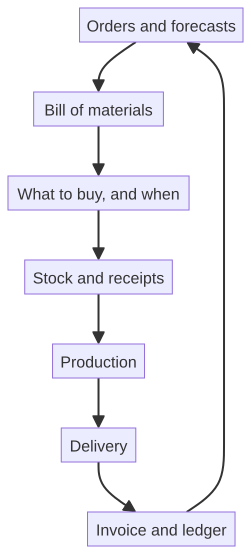

# 4. La macchina che si è mangiato il magazzino

Arthur Ellery era lo zio di Maggie, il fratello minore di suo padre, ed era rimasto trentaquattro anni come pianificatore della produzione in una fabbrica che produceva pompe industriali. Aveva settantotto anni, allevava api, ed era l'unica persona che Maggie conosceva in grado di spiegare cosa fosse un ERP senza usare la parola "soluzione."

Andò da lui in cottage una domenica di ottobre, con una scatola dei biscotti buoni, e gli chiese com'era stato prima.

"Prima di cosa?" disse.

"Prima di tutto. Prima dei computer."

Rise di lei nel modo in cui i vecchi ridono dei giovani, poi entrò nella stanza sul retro e tornò fuori con un libro. Era un raccoglitore con anelli, tenuto insieme con del nastro adesivo, ed era spesso quattro pollici.

"Quello," disse, "è un elenco dei materiali. Quello di cui è fatta una pompa. Ogni parte, ogni sotto-parte, ogni vite. E su ogni pagina, la quantità che serviva per farne una pompa, e il fornitore, e quanto tempo ci metteva ad arrivare."

Maggie lo aprì. Le pagine erano digitate, con annotazioni manoscritte in tre colori diversi, e tutto l'insieme puzzava di polvere e di sigarette.

"Chi lo teneva aggiornato?"

"Io. E quando ero in vacanza, nessuno."

---

Il problema che il raccoglitore di Arthur cercava di risolvere è uno dei più antichi nella produzione, ed è sorprendentemente difficile da enunciare chiaramente.

Hai ordini per pompe. Per costruire una pompa ti servono parti. Per avere parti devi ordinarle, e ci mettono settimane ad arrivare. Per sapere quanti ordinarne, devi sapere quante pompe stai per costruire, che dipende dagli ordini che hai e dagli ordini che ti aspetti. Ma le parti stesse sono fatte di sotto-parti, alcune delle quali sono fatte nella stessa fabbrica, e ciascuna ha il proprio tempo di consegna, e alcune di esse condividono una macchina che può fare un solo lavoro alla volta. Se ordini troppo, immobilizzi soldi sugli scaffali. Se ordini troppo poco, la fabbrica si ferma, e una fabbrica ferma è l'oggetto più costoso dell'edificio.

A mano, un pianificatore competente poteva farlo per poche centinaia di parti. Oltre quello, l'aritmetica superava il umano. Non potevi tenere in testa l'intera rete di dipendenze, e quindi facevi quello che faceva Arthur: tenevate un raccoglitore, lo aggiornavate a matita, e pregavate che nessuno vi facesse una domanda su una parte di cui non vi eravate occupati dalla primavera.

---

All'inizio degli anni Cinquanta, due produttori di motori per aerei, Rolls-Royce e General Electric, cominciarono a mettere questa aritmetica sui computer. Non era un prodotto commerciale; era uno strumento interno per un problema così costoso che anche un computer grande quanto una stanza valeva la pena. I motori per aerei hanno decine di migliaia di parti, e un errore nel piano non costa un ritardo, costa un aereo.

L'idea divenne un prodotto nel 1964, quando un uomo di nome Joseph Orlicky elaborò un metodo pratico per calcolare i fabbisogni e una chiamata Black & Decker installò il primo sistema per usarlo. Il capo progetto si chiamava Dick Alban, che è il genere di dettaglio che la storia di solito perde e che rende vera una storia: non era una commissione, era una persona con un problema.

Orlicky pubblicò il metodo come libro nel 1975, con un titolo che nessun editore oggi permetterebbe: *Material Requirements Planning: The New Way of Life in Production and Inventory Management.* A quel momento circa settecento aziende usavano l'idea. Al 1981, otto mila lo facevano.

Il metodo si chiama MRP, e fa esattamente una cosa: prende quello che intendete costruire, scende lungo l'elenco dei materiali, sottrae quello che avete già in magazzino, e vi dice cosa comprare e quando, tenendo conto dei tempi di consegna. Se questo sembra ovvio, lo è perché funzionava. Diventò il modo in cui le fabbriche pensano.

Nel 1983, un uomo di nome Oliver Wight estese l'idea oltre i materiali. Se il sistema sa già cosa la fabbrica sta per costruire, perché non lasciarle pianificare anche le persone, le macchine, i soldi e la previsione di vendita? Il risultato si chiamava Manufacturing Resource Planning—MRP II—ed era il primo software aziendale che pretendeva di conoscere lo stato di un'intera azienda.

Al 1989, il software MRP II era circa un terzo delle vendite del settore software verso la produzione americana, circa 1,2 miliardi di dollari. Qualcosa era cambiato: la fabbrica non girava più sul raccoglitore del pianificatore. Girava su un modello, e il modello era in un computer.

La fabbrica di Arthur comprò uno di quei sistemi nel 1988, e il primo tentativo fallì.

"Il software era a posto," disse. "Era meglio che a posto. Poteva fare cose che facevo con una matita da vent'anni, in un secondo. Ma voleva conoscere il tempo di consegna per ogni parte, e nessuno aveva mai scritto i tempi di consegna. Erano nelle teste degli acquirenti, e gli acquirenti ci davano i numeri che credevamo volessero sentire, perché non volevano sembrare lenti. Quindi il sistema pianificava con la finzione, e la fabbrica girava sul piano, e tre mesi dopo avevamo un magazzino pieno delle parti sbagliate e un direttore generale che chied chi era responsabile."

"Chi era?"

"Tutti. Nessuno. Gli acquirenti non mentivano; genuinamente non sapevano, perché nessuno aveva mai misurato. Quella è la cosa di un modello: non espone solo gli errori che hai fatto. Espone le cose di cui non sapevi di non sapere."

Il secondo tentativo funzionò, e il motivo per cui funzionava non aveva nulla a che fare con il software. La fabbrica impiegò quattro mesi a misurare i tempi di consegna, a contare il magazzino e a scrivere le regole che aveva sempre seguito per abitudine. Al momento in cui il sistema fu acceso, il modello era già vero, e l'unico lavoro del computer era mantenerlo vero più velocemente di quanto un potesse fare.

Arthur era fiero di questo, nel modo in cui gli uomini della sua generazione erano fieri di cose non glamour. "Non installammo un computer," disse. "Scrivemmo come funzionava la fabbrica. Il computer era la parte facile."

---

Nel 1990, una ditta di analisti di nome Gartner ebbe bisogno di un nome per il passo successivo. Le fabbriche avevano MRP II. Il reparto finanza aveva i suoi sistemi. L'ufficio vendite ne aveva un altro. I magazzini ne avevano un altro. Che succedere se un unico sistema facesse tutto—non solo la fabbrica, ma l'intera impresa?

La chiamarono Enterprise Resource Planning. ERP.

Il nome non è accurato, e tutti nel settore lo sanno. Non pianifica risorse in alcun senso profondo, e "impresa" è una parola che significa "grande" finché significa "costosa." Ma i nomi sono appiccicosi, e questo si è attaccato a una cosa reale: un unico database in cui il cliente, il prodotto, l'ordine, il magazzino, la fattura e la contabilità sono tutti collegati, in modo che un fatto inserito una volta sia visibile everywhere.

L'azienda che la rese uno standard fu SAP, fondata nel 1972 da cinque ingegneri che avevano lasciato l'IBM. Nel 1992 rilasciarono R/3, che girava sull'architettura client-server che stava diventando accessibile, e che codificava i processi di un'azienda in un modo che revisori, banche e autorità di riconoscimento riconoscevano. Se giravi R/3, potevi essere revisiti nel modo in cui si revisisce una grande azienda. Per un'azienda in crescita che voleva vendere a grandi clienti, questo valeva più di qualsiasi funzione.

Accaddero altre due cose negli anni Novanta, e entrambe contano per la storia di questo libro.

La prima fu l'anno 2000. Un gran numero di aziende sostituirono i loro vecchi sistemi alla fine degli anni Novanta perché quei sistemi memorizzavano gli anni con due cifre e sarebbero, si temeva, confusi il 2000 con il 1900. Parte della paura era esagerata. Ma la sostituzione accadde, e spostò l'ERP dalla fabbrica in ogni genere di organizzazione: ospedali, università, organizzazioni di beneficenza, governi.

La seconda fu la nuvola. Nel 1999 una chiamata NetLedger cominciò a vendere software contabile che girava in un browser, sul computer di qualcun altro, per una fee mensile. Ci vollero quindici anni perché l'idea diventasse normale. Ora è il valore predefinito, e il motivo non è l'eleganza tecnica. È che una piccola azienda può affittare un sistema che non avrebbe mai potuto permettersi di comprare e far girare.

---

Arthur ripose il raccoglitore e preparò il tè, e Maggie fece la domanda a cui stava conducendo da tempo.

"Quindi perché tutti odiano questi sistemi?"

Pensò per un po'. "Perché ti fanno fare il lavoro al loro modo," disse. "E perché chi li vende mente su quanto lavoro sia."

Questa è la versione onesta della storia, ed vale la pena dirlo chiaramente, perché il resto di questo libro dipende da essa.

Un ERP è un modello di un'azienda, e un modello ha regole. Non puoi pubblicare una fattura senza un cliente, perché la fattura ha bisogno di un indirizzo e di un numero di tassa e di un conto di contabilità. Non puoi spedire merci che non sono in magazzino, a meno che il sistema permetta il magazzino negativo, che la maggior parte delle aziende disattiva. Non puoi cancellare una scrittura contabile pubblicata, perché la garanzia di Pacioli dipende dal fatto che la storia sia intatta. Ognuna di quelle regole esiste per un buon motivo, e ognuna di esse è una discussione con qualcuno che ha un cliente al telefono e ha bisogno che la cosa succeda *adesso*.

Moltiplica quella discussione per ogni processo nell'azienda, e hai il motivo per cui i progetti ERP sono famosi per andare sbagliati. Il software di solito non è il problema. Il problema è che installare un ERP non è un progetto IT: è un accordo su come funziona l'azienda, estratto dalle teste delle persone che lavorano lì, scritto, e poi fatto rispettare da una macchina. Le aziende che non possono avere quella conversazione—perché il proprietario non vuole, o i reparti non concordano, o il consulente è pagato a ore e non gli importa—finiscono con un sistema costoso che nessuno si fida, e tornano ai vassoi.

Quello giro è tutto di un'azienda manifatturiera, e tutto di un'azienda grossista pure, con "produzione" sostituita da "prelievo". Ogni ERP nel mondo è una macchina per mantenere vero quel giro.

## Cosa insegnò il pavimento della fabbrica all'ufficio

È facile dimenticare, leggendo la storia dell'ERP, che le idee venivano dalle fabbriche e furono poi applicate agli uffici—non il contrario.

L'elenco dei materiali, il tempo di consegna, il punto di riordino, la corrispondenza a tre vie, il piano di capacità: tutti quanti furono inventati per fermare una linea di produzione, e tutti quanti si rivelarono descrivere un ufficio altrettanto bene. Una quotazione ha un tempo di consegna. Una fattura ha un elenco dei materiali, se conti la consegna e l'ordine come suoi componenti. Un fine mese ha un piano di capacità.

Il trasferimento funzionò perché un'azienda è un'azienda, che faccia pompe o venda raccoglitori. Il vocabolario cambiò e l'aritmetica no. Cosa cambiò, quando le idee raggiunsero l'ufficio, fu il *costo dell'aritmetica*: una fabbrica poteva giustificare un computer nel 1964 perché una linea ferma costava più della macchina; un ufficio poteva giustificarne uno solo quando la macchina costava meno dello stipendio di un impiegato.

Quello è tutto della storia degli ultimi sessant'anni in una frase, e spiega perché le stesse idee continuano ad arrivare nelle piccole aziende, più tardi, in pacchetti più economici.

---

Maggie tornò a casa nel buio, pensando al raccoglitore dello zio.

Ciò che la colpì non era la tecnologia. Era la *manutenzione*. Qualcuno doveva tenere il raccoglitore aggiornato, e quando quello qualcuno era in vacanza, la verità si degradava. Ogni sistema di cui aveva letto nell'ultimo mese aveva la stessa debolezza al suo centro: il modello è buono quanto la persona che lo alimenta, e le persone sono occupate, e le persone dimenticano, e le persone se ne vanno.

Il sogno dell'ERP era che l'alimentazione sarebbe accaduta automaticamente, come sottoprodotto del fare il lavoro. Vendi qualcosa e il magazzino si muove; muovi il magazzino e la contabilità si muove; invii la fattura e il bilancio del cliente cambia. Per la maggior parte, quel sogno divenne vero. Ciò che non divenne vero era la parte in cui qualcuno deve *chiedere* al sistema le cose.

Quella parte restò manuale per trenta anni. Volevi sapere quali clienti erano in ritardo nel pagare? Aprievi un report, o chiedevi al reparto contabilità, o esportavi in un foglio di calcolo e squintivati a guardarlo. Volevi creare quarante fatture da quarante note di consegna? Cliccavi quarante volte, o pagavi qualcuno a cliccare quarante volte.

Il modello esisteva. La macchina che poteva *usare* il modello non esisteva.

Poi, del tutto improvvisamente, esisteva.

---

Arthur aveva un'ultima cosa da dire, alla porta, con i biscotti finiti e le api addormentate.

"Sapete qual era la parte più difficile del mio lavoro?" disse. "Non l'aritmetica. L'aritmetica la potevo fare. Era che nessuno mai mi diceva quando qualcosa cambiava. Un fornitore cambia un tempo di consegna, un cliente cambia un ordine, un ingegnere cambia una parte—e io lo scopro tre settimane dopo, quando la fabbrica si ferma. Il raccoglitore era sempre un mese fuori data, e io ero sempre l'ultimo a saperlo."

Guardò il giardino scuro.

"Se riuscite a costruire una cosa che sa quando qualcosa cambia, e avvisa qualcuno prima che diventi importante," disse, "allora avete costruito qualcosa che vale la pena avere."

Maggie pensò a tutto per tutta la strada di casa. Era, si rese conto più tardi, la migliore descrizione di un'intelligenza artificiale nel business che avesse mai sentito, ed era venuta da un uomo di settantotto anni con un raccoglitore e una scatola di biscotti.
