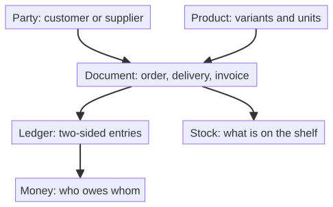

# 5. Cosa è davvero una azienda

L'incontro che cambiò Riverton ebbe luogo il martedì mattina nella piccola stanza con la fotocopiatrice, perché la stanza grande era piena di merce.

Maggie aveva invitato tre persone: Priya Raman, che gestiva le vendite; Tom Beck, che gestiva il magazzino; e Doreen, che gestiva, al modo suo, tutto il resto. Sulla lavagna scrisse una sola parola.

**ORDINE**

"Bene," disse. "Dimmi cosa significa per te questa parola."

Priya parlò per prima, perché lo faceva sempre. "Un ordine è ciò che vuole il cliente. Articolo, quantità, prezzo, data di consegna. Io lo raccolgo al telefono o attraverso lo shop online, e lo inserisco nel sistema."

Tom disse: "Un ordine è ciò che devo prelevare. Mi arriva come una lista di cose sugli scaffali. Tranne che metà delle volte è una bolla di consegna, e metà delle volte è una email di Priya con l'immagine di un appunto scritto a mano."

Doreen disse: "Un ordine è ciò che fatturo. Quando la merce è partita, io trasformo l'ordine in fattura. Tranne che a volte la partita di merce parte in due momenti e io fatturo in due momenti, e allora non è più un ordine, sono due fatture e un ordine e una nota di credito per la parte che è tornata."

Ci fu un silenzio di quel tipo che segue una verità detta ad alta voce.

"Quindi," disse Maggie, "abbiamo tre cose diverse, tutte chiamate ordine."

"Quattro," disse Priya. "C'è anche l'ordine d'acquisto che inviamo ai fornitori."

Cinque, se si conta il numero d'ordine d'acquisto del cliente stesso, che appariva sui loro documenti e doveva essere citato sulla fattura o non l'avrebbero pagato. Sei, se si conta la "distinta permanente" che l'Ashfield Academy rilasciava ogni settembre, che non era un ordine a tutti gli effetti ma un accordo per ordinare.

Questo è il momento in cui la maggior parte delle piccole aziende scopre la vera ragione per cui i loro sistemi non funzionano. Non hanno un problema di dati. Hanno un problema di *linguaggio*. Sei cose diverse condividono una sola parola, e tre parole diverse condividono una sola cosa, e l'unico dizionario è la memoria delle persone nella stanza.

La lista dei prezzi lo dimostrò, un'ora dopo.

Priya citò una scatola dei buoni pennarelli per lavagna a undici sterline e quaranta. Tom disse che era nove sterline e novantacinque. Entrambi erano convinti. Sulla rete condivisa c'erano, si scoprì, diciassette file chiamati lista dei prezzi, datati tra il 2019 e quel martedì, e quattro di essi erano stati modificati nell'ultimo mese. La risposta corretta dipendeva dal cliente: Ashfield aveva un prezzo contrattuale da gennaio, che Priya aveva in un proprio foglio di calcolo, e Tom aveva un foglio stampato di marzo che non includeva i prezzi contrattuali perché erano "commerciali."

Nessuno mentiva. Nessuno era anche solo imprudente. L'azienda non aveva un luogo dove il prezzo di un prodotto per un cliente fosse un *fatto*; aveva un'abitudine d'accordo, rinnovata al telefono, registrata in diciassette luoghi, di cui uno era corretto in un dato giorno e nessuno sapeva quale.

Doreen, che non aveva parlato per un po', disse: "È per questo che tengo io le fatture. Perché la fattura è l'unico pezzo di carta su cui ci siamo accordati tutti nello stesso momento."

Stava descrivendo, senza conoscere la parola per esso, esattamente ciò che un ERP memorizza: non la lista dei prezzi, ma il prezzo *che si applicava a quel documento*. La distinzione è tutta la quintessenza del quinto capitolo di qualsiasi standard contabile, ed è la ragione per cui un documento in un sistema reale conserva la propria copia dei fatti invece di puntare a una lista che cambierà domani.

---

Un ERP è, prima di tutto il resto, un dizionario con delle regole attaccate.

Dice: c'è una cosa chiamata Ordine di vendita. Ha un cliente, una data, e una lista di righe; ogni riga ha un prodotto, una quantità, un prezzo e una tassa. Ha uno stato: bozza, confermato, concluso, annullato. Non è la stessa cosa di una Consegna, che è ciò che esce dal magazzino, e non è la stessa cosa di una Factura, che è ciò che chiede soldi. Quando hai bisogno del numero d'ordine d'acquisto del cliente, è un campo sull'Ordine di vendita, non un appunto al margine.

Una volta che queste definizioni esistono, i sei significati collassano in uno, e le discussioni si fermano. Non perché tutti sono d'accordo, ma perché la discussione si sposta da "cosa intendi per ordine?" a "quale di queste cose stiamo discutendo?", e la seconda discussione può essere risolta in un minuto.

Lasciami quindi darti il dizionario. È piccolo. Quattro tipi di cosa, e tutto il resto in questo libro è una conseguenza di esse.

---

**Il primo tipo di cosa è una controparte.**

Un cliente è una controparte. Un fornitore è una controparte. La tua stessa azienda è una controparte. Una banca è una controparte. L'ufficio tasse è una controparte. Sono tutte della stessa forma: un nome, un indirizzo, un numero di tassa, una valuta, condizioni di pagamento, un contatto.

Questo non è un trucco tecnico; è un pezzo di buon senso profondo che l'industria del software ha impiegato anni ad accettare. In un vecchio sistema, i clienti vivevano in un file e i fornitori in un altro, e una azienda che era entrambe le cose—which succede costantemente nel commercio all'ingrosso, perché il negozio a cui vendi vende anche a te delle cose—appariva due volte, con due saldi, e conciliarli era una miseria mensile. In un ERP moderno c'è una sola lista di controparti, ed essere un cliente o un fornitore è un *ruolo* che una controparte interpreta.

La conseguenza è immediatamente pratica. Quando l'Ashfield Academy compra dei raccoglenti da Riverton e vende a Riverton i suoi vecchi mobili, c'è un solo conto, un solo indirizzo, un solo limite di credito, e un solo saldo netto. La documentazione è più semplice perché il modello è più vero.

**Il secondo tipo di cosa è un prodotto.**

Un prodotto è una cosa che acquisti o vendi: una scatola di penne, una palletta di carta, un servizio, una spesa di consegna. Ha un nome, un codice di riferimento, una unità di misura (ognuno, scatola, palletta, chilogrammo, ora), un prezzo d'acquisto, un prezzo di vendita, una tassa, e—se tieni scorta—una quantità disponibile in ogni posizione.

Due sottigliezze valgono la pena di essere conosciute, perché causano la maggior parte della confusione nelle aziende reali.

La prima è la *variante*. Una camicia viene in quattro taglie e tre colori: quella è un solo prodotto con dodici varianti, non dodici prodotti. Se lo modelli come dodici prodotti, allora i tuoi report di vendita non possono dirti che il blu vende il doppio del verde, perché il sistema li considera oggetti non correlati. Se lo modelli come un solo prodotto con varianti, il report è banale e la scorta è esatta.

La seconda è l'*unità di misura*. Acquisti la carta per palletta e la vendi per rimata. Se il sistema non sa che una palletta è quaranta rimate, allora ogni conteggio di scorta è una discussione, e qualcuno deve convertire a mano, e alla fine qualcuno converte sbagliato. L'unità di misura non è una decorazione; è l'aritmetica che mantiene il magazzino onesto.

**Il terzo tipo di cosa è un documento.**

Un ordine, una consegna, una fattura, un pagamento, una rettifica di scorta, una richiesta d'acquisto: questi sono tutti documenti, e hanno tutti la stessa anatomia. Una data, una controparte, una lista di righe, un totale, e uno stato.

Lo stato è la parte che le persone sottovalutano. Un documento non è un pezzo di carta; è una cosa che si sposta nel tempo. Una quotazione è una bozza che potrebbe diventare un ordine. Un ordine confermato può essere consegnato in parte. Una fattura può essere registrata e poi pagata in parte. Ognuno di quegli stati è un fatto sul mondo, e il lavoro del sistema è sapere in quale stato si trova ogni documento e rifiutare le transizioni che non hanno senso. Non puoi consegnare merce che non è mai stata ordinata. Non puoi pagare una fattura che non è mai stata registrata. Non puoi annullare una consegna che è già uscita dall'edificio, a meno che non la riporti indietro.

Questo è perché un ERP sembra severo. È severo al modo in cui è severo un segnale ferroviario. La severità è la sicurezza.

C'è una proprietà in più dei documenti che è facile trascurare e enormemente importante: **un documento ricorda i propri fatti.** Quando confermi un ordine per cento raccoglenti a quattro sterline ciascuno, l'ordine memorizza il prezzo. Se il prezzo cambia domani, l'ordine dice ancora quattro sterline, perché è quello che il cliente ha concordato. Se l'indirizzo del cliente cambia il mese prossimo, la fattura del mese scorso mostra ancora l'indirizzo vecchio, perché è lì dove è stata spedita. Il sistema conserva una storia di fatti, non solo una immagine corrente. Senza quello, non potresti mai dimostrare nulla a nessuno.

**Il quarto tipo di cosa è il denaro.**

Ogni documento che ha una conseguenza finanziaria produce scritture di registro: le dichiarazioni a doppio passaggio che Pacioli descrisse nel 1494. Vendi qualcosa e il sistema registra un ricavo e un credito del cliente. Acquisti qualcosa e registra una spesa e un debito verso il fornitore. Paghi un fornitore e registra il denaro che esce dalla banca e il debito che scompare.

Nessuno a Riverton digiterebbe mai una scrittura di registro a mano, e questo è il punto. Le scritture sono un sottoprodotto dei documenti. Il lavoro del contabile cessa di essere "registrare ciò che è successo" e diventa "verificare che ciò che è stato registrato sia giusto," che è un uso molto migliore di un contabile.

---

Maggie disegnò quel diagramma sulla lavagna, e Tom—che aveva parlato quasi per niente per venti minuti—lo guardò per molto tempo.

"È questo?" disse. "È tutta la cosa?"

"È tutta la cosa," disse Maggie. "Tutto il resto sono dettagli."

Tom picchiettò sulla casella segnata Scorta. "Quindi se prendo una palletta dall'scaffale e la metto su un furgone, il sistema dovrebbe saperlo."

"Sì."

"E se il furgone torna indietro perché il cancello della scuola era chiuso, il sistema dovrebbe saperlo anche questo."

"Sì."

"E se la palletta si danneggia nella pioggia mentre è seduta nel piazzale di carico, e io devo scriverla via—"

"Allora questo è un documento pure," disse Maggie. "Una rettifica di scorta. Con una ragione."

Tom annuiì lentamente. "Non abbiamo mai avuto quello," disse. "Abbiamo avuto un quaderno. E quando il quaderno non è d'accordo con i conti, i conti vincono, perché i conti sono quelli che l'ufficio tasse vede. Ma i conti sono sbagliati, perché sono io quello che sa cosa c'è davvero sull'scaffale."

Questa è la lamentela più comune sul software aziendale, ed vale la pena nominarla precisamente, perché il resto di questo libro è sulla sua correzione. Tom conosceva la verità e non poteva inserirla. I conti contenevano una verità e non potevano essere corretti. Il gap tra loro era riempito da un rituale mensile di conteggio della scorta, durante il quale l'azienda scopre quanto era sbagliata, scrive via la differenza, e ricomincia.

Il gap esiste perché inserire fatti in un computer è sempre stato un lavoro separato dal fare il lavoro. Qualcuno deve sedersi e digitare. Quel qualcuno è di solito occupato, e la digitazione è di solito la cosa meno interessante che faranno quel giorno. Quindi il modello si allontana dalla realtà, un po' alla volta, e poi molto.

La promessa del sistema che Maggie stava per installare non è che l'allontanamento scompare. È che la digitazione scompare. Tom non digiterà che ha spostato una palletta. Dirà all'assistente, in inglese, che la palletta è andata sul furgone, e l'assistente creerà il documento. Il modello resta vero perché il costo del mantenerlo vero è sceso quasi a zero.

Questo è il cambiamento. Tutto il resto—le schermate, le installazioni, i diagrammi—è al servizio di quella sola frase.

---

Doreen era stata silenziosa, il che era insolito. Quando Maggie le chiese cosa pensasse, disse: "Penso di aver fatto il lavoro di un database per trentuno anni, e nessuno mai mi ha chiesto se lo volevo."

Nessuno rise, perché non era una battuta.

"Cosa faresti," le chiese Maggie, "se non avessi più bisogno di ricordare dove è tutto?"

Doreen ci pensò. Poi disse: "Verificherei le cose. Noterei quando un prezzo sembra sbagliato, o quando un cliente ordina qualcosa che non ha mai ordinato prima. Avrei tempo di essere curiosa."

Nel linguaggio della gestione, questo si chiama *gestione delle eccezioni*, ed è il lavoro più prezioso in ogni ufficio. È anche il lavoro che non viene mai fatto, perché le persone che potrebbero le farlo sono occupate a essere database.

Maggie scrisse *essere curiosa* sulla lavagna, sotto le quattro caselle, e disegnò un cerchio intorno.

"Bene," disse. "Andiamo a comprare un dizionario."
